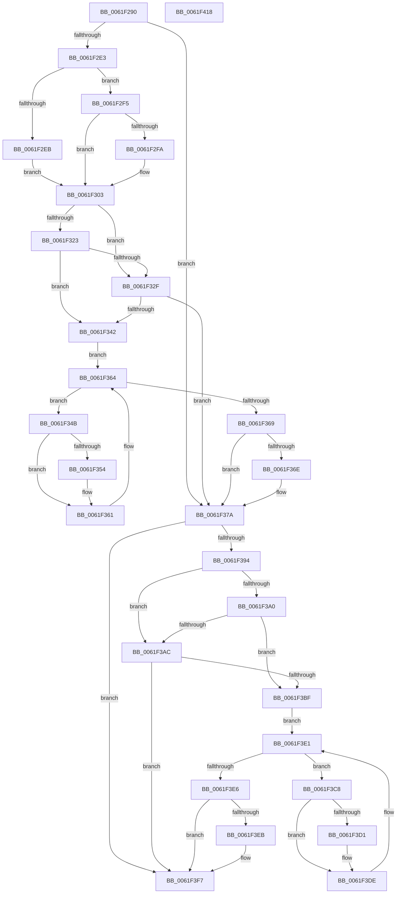

# DifExCreateCallbackWrapper

- RVA: `0x0061F290`–`0x0061F419` (길이 `393` bytes)
- VA: `0x000000014061F290`
- 실행 섹션: `.text`
- PDB 이름 있음: `예`; PDB Function 태그: `아니요`
- unwind 정보 RVA: `0x000D2B7C`
- 디코드: `113`개 명령, `393/393` bytes 표시
- 미해석 바이트: `0` (있으면 어셈블리에 `.byte`로 보존)

> 이 문서는 커널 이미지의 기계어와 PDB 기호를 분석해 생성했습니다. 4번과 5번은 함수 원형과 자료형을 바이너리 사용 방식에서 추정한 C 해석이며 원본 소스 복구 결과는 아닙니다.

## 1. Dependencies

- 직접 호출 지점: **9**; 고유 호출 대상: **6**
- 직접 호출자로 확인된 함수: **0**
- RIP 상대 이미지 참조: **3**

### Outgoing calls
- `0x0061F2D2` → [DifGetAPIThunkContextById](../49/DifGetAPIThunkContextById_function_00495A34.md) (function, `0x00495A34`)
- `0x0061F2FA` → [DifGetReturnAddressForWrappers](../4D/DifGetReturnAddressForWrappers_function_004D3C08.md) (function, `0x004D3C08`)
- `0x0061F336` → [ExAcquireRundownProtection](../21/ExAcquireRundownProtection_function_00216620.md) (function, `0x00216620`)
- `0x0061F35C` → [guard_dispatch_icall](../6B/guard_dispatch_icall_function_006BAAD0.md) (function, `0x006BAAD0`)
- `0x0061F375` → [ExReleaseRundownProtection](../34/ExReleaseRundownProtection_function_00349E80.md) (function, `0x00349E80`)
- `0x0061F387` → [ExCreateCallback](../../page/A7/ExCreateCallback_function_00A7B9D0.md) (function, `0x00A7B9D0`)
- `0x0061F3B3` → [ExAcquireRundownProtection](../21/ExAcquireRundownProtection_function_00216620.md) (function, `0x00216620`)
- `0x0061F3D9` → [guard_dispatch_icall](../6B/guard_dispatch_icall_function_006BAAD0.md) (function, `0x006BAAD0`)
- `0x0061F3F2` → [ExReleaseRundownProtection](../34/ExReleaseRundownProtection_function_00349E80.md) (function, `0x00349E80`)

### Direct callers
- 이 함수 시작 RVA로 연결되는 직접 call은 확인되지 않았습니다. 간접 호출은 완전히 역산할 수 없습니다.

### Static image references
- `0x0061F30A` → RVA `0x00F048B8` (`.data`; read)
- `0x0061F323` → RVA `0x00F04980` (`.data`; read)
- `0x0061F32F` → RVA `0x00F03E80` (`.data`; read)

## 2. Other-region calls and transfers

- 다른 실행 섹션으로 향하는 call: **1**
  - `0x0061F387` → [ExCreateCallback](../../page/A7/ExCreateCallback_function_00A7B9D0.md) (`.text` → `PAGE`)
- 별도 외부 분기/꼬리 이동을 확인하지 못했습니다.

## 3. Assembly (complete function range)

```asm
0061F290  48 8B C4                        mov rax, rsp
0061F293  48 89 58 10                     mov qword ptr [rax + 0x10], rbx
0061F297  48 89 70 18                     mov qword ptr [rax + 0x18], rsi
0061F29B  48 89 78 20                     mov qword ptr [rax + 0x20], rdi
0061F29F  48 89 48 08                     mov qword ptr [rax + 8], rcx
0061F2A3  55                              push rbp
0061F2A4  41 54                           push r12
0061F2A6  41 55                           push r13
0061F2A8  41 56                           push r14
0061F2AA  41 57                           push r15
0061F2AC  48 8B EC                        mov rbp, rsp
0061F2AF  48 83 EC 50                     sub rsp, 0x50
0061F2B3  0F 57 C0                        xorps xmm0, xmm0
0061F2B6  33 C0                           xor eax, eax
0061F2B8  B9 9B 01 00 00                  mov ecx, 0x19b
0061F2BD  48 89 45 F0                     mov qword ptr [rbp - 0x10], rax
0061F2C1  0F 11 45 D0                     movups xmmword ptr [rbp - 0x30], xmm0
0061F2C5  45 8A F9                        mov r15b, r9b
0061F2C8  45 8A E0                        mov r12b, r8b
0061F2CB  0F 11 45 E0                     movups xmmword ptr [rbp - 0x20], xmm0
0061F2CF  4C 8B EA                        mov r13, rdx
0061F2D2  E8 5D 67 E7 FF                  call 0x140495a34
0061F2D7  4C 8B F0                        mov r14, rax
0061F2DA  48 85 C0                        test rax, rax
0061F2DD  0F 84 97 00 00 00               je 0x14061f37a
0061F2E3  8B 48 0C                        mov ecx, dword ptr [rax + 0xc]
0061F2E6  F6 C1 18                        test cl, 0x18
0061F2E9  74 0A                           je 0x14061f2f5
0061F2EB  48 8B 4D 28                     mov rcx, qword ptr [rbp + 0x28]
0061F2EF  48 89 4D D0                     mov qword ptr [rbp - 0x30], rcx
0061F2F3  EB 0E                           jmp 0x14061f303
0061F2F5  F6 C1 04                        test cl, 4
0061F2F8  74 09                           je 0x14061f303
0061F2FA  E8 09 49 EB FF                  call 0x1404d3c08
0061F2FF  48 89 45 D0                     mov qword ptr [rbp - 0x30], rax
0061F303  48 8B 45 30                     mov rax, qword ptr [rbp + 0x30]
0061F307  40 32 F6                        xor sil, sil
0061F30A  40 38 35 A7 55 8E 00            cmp byte ptr [rip + 0x8e55a7], sil
0061F311  48 89 45 E8                     mov qword ptr [rbp - 0x18], rax
0061F315  4C 89 6D E0                     mov qword ptr [rbp - 0x20], r13
0061F319  44 88 65 D9                     mov byte ptr [rbp - 0x27], r12b
0061F31D  44 88 7D D8                     mov byte ptr [rbp - 0x28], r15b
0061F321  75 0C                           jne 0x14061f32f
0061F323  F7 05 53 56 8E 00 00 08 00 00   test dword ptr [rip + 0x8e5653], 0x800
0061F32D  74 13                           je 0x14061f342
0061F32F  48 8D 0D 4A 4B 8E 00            lea rcx, [rip + 0x8e4b4a]
0061F336  E8 E5 72 BF FF                  call 0x140216620
0061F33B  40 8A F0                        mov sil, al
0061F33E  84 C0                           test al, al
0061F340  74 38                           je 0x14061f37a
0061F342  49 8D 7E 20                     lea rdi, [r14 + 0x20]
0061F346  48 8B 1F                        mov rbx, qword ptr [rdi]
0061F349  EB 19                           jmp 0x14061f364
0061F34B  48 8D 43 F0                     lea rax, [rbx - 0x10]
0061F34F  48 85 C0                        test rax, rax
0061F352  74 0D                           je 0x14061f361
0061F354  48 8B 40 08                     mov rax, qword ptr [rax + 8]
0061F358  48 8D 4D D0                     lea rcx, [rbp - 0x30]
0061F35C  E8 6F B7 09 00                  call 0x1406baad0
0061F361  48 8B 1B                        mov rbx, qword ptr [rbx]
0061F364  48 3B DF                        cmp rbx, rdi
0061F367  75 E2                           jne 0x14061f34b
0061F369  40 84 F6                        test sil, sil
0061F36C  74 0C                           je 0x14061f37a
0061F36E  48 8D 0D 0B 4B 8E 00            lea rcx, [rip + 0x8e4b0b]
0061F375  E8 06 AB D2 FF                  call 0x140349e80
0061F37A  48 8B 4D 30                     mov rcx, qword ptr [rbp + 0x30]
0061F37E  45 8A CF                        mov r9b, r15b
0061F381  45 8A C4                        mov r8b, r12b
0061F384  49 8B D5                        mov rdx, r13
0061F387  E8 44 C6 45 00                  call 0x140a7b9d0
0061F38C  89 45 F0                        mov dword ptr [rbp - 0x10], eax
0061F38F  4D 85 F6                        test r14, r14
0061F392  74 63                           je 0x14061f3f7
0061F394  40 32 FF                        xor dil, dil
0061F397  40 38 3D 1A 55 8E 00            cmp byte ptr [rip + 0x8e551a], dil
0061F39E  75 0C                           jne 0x14061f3ac
0061F3A0  F7 05 D6 55 8E 00 00 08 00 00   test dword ptr [rip + 0x8e55d6], 0x800
0061F3AA  74 13                           je 0x14061f3bf
0061F3AC  48 8D 0D CD 4A 8E 00            lea rcx, [rip + 0x8e4acd]
0061F3B3  E8 68 72 BF FF                  call 0x140216620
0061F3B8  40 8A F8                        mov dil, al
0061F3BB  84 C0                           test al, al
0061F3BD  74 38                           je 0x14061f3f7
0061F3BF  49 8D 76 30                     lea rsi, [r14 + 0x30]
0061F3C3  48 8B 1E                        mov rbx, qword ptr [rsi]
0061F3C6  EB 19                           jmp 0x14061f3e1
0061F3C8  48 8D 43 F0                     lea rax, [rbx - 0x10]
0061F3CC  48 85 C0                        test rax, rax
0061F3CF  74 0D                           je 0x14061f3de
0061F3D1  48 8B 40 08                     mov rax, qword ptr [rax + 8]
0061F3D5  48 8D 4D D0                     lea rcx, [rbp - 0x30]
0061F3D9  E8 F2 B6 09 00                  call 0x1406baad0
0061F3DE  48 8B 1B                        mov rbx, qword ptr [rbx]
0061F3E1  48 3B DE                        cmp rbx, rsi
0061F3E4  75 E2                           jne 0x14061f3c8
0061F3E6  40 84 FF                        test dil, dil
0061F3E9  74 0C                           je 0x14061f3f7
0061F3EB  48 8D 0D 8E 4A 8E 00            lea rcx, [rip + 0x8e4a8e]
0061F3F2  E8 89 AA D2 FF                  call 0x140349e80
0061F3F7  8B 45 F0                        mov eax, dword ptr [rbp - 0x10]
0061F3FA  4C 8D 5C 24 50                  lea r11, [rsp + 0x50]
0061F3FF  49 8B 5B 38                     mov rbx, qword ptr [r11 + 0x38]
0061F403  49 8B 73 40                     mov rsi, qword ptr [r11 + 0x40]
0061F407  49 8B 7B 48                     mov rdi, qword ptr [r11 + 0x48]
0061F40B  49 8B E3                        mov rsp, r11
0061F40E  41 5F                           pop r15
0061F410  41 5E                           pop r14
0061F412  41 5D                           pop r13
0061F414  41 5C                           pop r12
0061F416  5D                              pop rbp
0061F417  C3                              ret
0061F418  CC                              int3
```

## 4. C-style interpretation (structured pseudocode)

```c
__int64 __fastcall DifExCreateCallbackWrapper(__int64 a1, __int64 a2, unsigned __int8 a3, unsigned __int8 a4)
{
    __int64 result;
    __int64 v_rdi;
    __int64 v_rsi;
    __int64 v_rsp;
    unsigned __int64 v_stack_m28;
    unsigned __int64 v_stack_m38;
    unsigned __int64 v_stack_m40;
    unsigned __int64 v_stack_m48;
    unsigned __int8 v_stack_m4F;
    unsigned __int8 v_stack_m50;
    unsigned __int64 v_stack_m58;
    unsigned __int64 v_stack_p0;
    unsigned __int64 v_stack_p8;

    *(unsigned __int64 *)(v_rsp + 16) = v_rbx;
    *(unsigned __int64 *)(v_rsp + 24) = v_rsi;
    *(unsigned __int64 *)(v_rsp + 32) = v_rdi;
    *(unsigned __int64 *)(v_rsp + 8) = a1;
    v_rsp = (v_rsp) - (80);
    result = 0;
    v_stack_m38 = 0;
    v_stack_m58 = v_xmm0;
    v_stack_m48 = v_xmm0;
    result = DifGetAPIThunkContextById(411, a2, a3, a4);
    if (result == 0) goto loc_0061F37A;
    if ((((unsigned __int8)((unsigned int)(*(unsigned int *)(result + 12)))) & (24)) == 0) goto loc_0061F2F5;
    v_stack_m58 = v_stack_p0;
    goto loc_0061F303;
loc_0061F2F5:
    if ((((unsigned __int8)(v_stack_p0)) & (4)) != 0) {
        result = DifGetReturnAddressForWrappers(v_stack_p0, a2, a3, a4);
        v_stack_m58 = result;
    }
    v_rsi = 0;
    v_stack_m40 = v_stack_p8;
    v_stack_m48 = a2;
    v_stack_m4F = a3;
    v_stack_m50 = a4;
    if ((*(unsigned __int8 *)(v_rip + 9328039)) != 0) goto loc_0061F32F;
    if (((*(unsigned int *)(v_rip + 9328211)) & (0x800ULL)) == 0) goto loc_0061F342;
loc_0061F32F:
    result = ExAcquireRundownProtection(v_rip + 9325386, a2, a3, a4);
    if ((unsigned __int8)(result) == 0) goto loc_0061F37A;
loc_0061F342:
    goto loc_0061F364;
loc_0061F34B:
    result = *(unsigned __int64 *)(result + 32) - 16;
    if (*(unsigned __int64 *)(result + 32) - 16 != 0) {
        result = *(unsigned __int64 *)(*(unsigned __int64 *)(result + 32) - 16 + 8);
        a1 = v_stack_m58;
        result = guard_dispatch_icall(a1, a2, a3, a4);
    }
loc_0061F364:
    if ((*(unsigned __int64 *)(*(unsigned __int64 *)(result + 32))) != (result + 32)) goto loc_0061F34B;
    if ((unsigned __int8)((unsigned __int8)(result)) != 0) {
        a1 = v_rip + 9325323;
        result = ExReleaseRundownProtection(a1, a2, a3, a4);
    }
    result = ExCreateCallback(v_stack_p8, a2, a3, a4);
    v_stack_m38 = (unsigned int)(result);
    if (result == 0) goto loc_0061F3F7;
    v_rdi = 0;
    if ((*(unsigned __int8 *)(v_rip + 9327898)) != 0) goto loc_0061F3AC;
    if (((*(unsigned int *)(v_rip + 9328086)) & (0x800ULL)) == 0) goto loc_0061F3BF;
loc_0061F3AC:
    result = ExAcquireRundownProtection(v_rip + 9325261, a2, a3, a4);
    if ((unsigned __int8)(result) == 0) goto loc_0061F3F7;
loc_0061F3BF:
    goto loc_0061F3E1;
loc_0061F3C8:
    result = *(unsigned __int64 *)(result + 48) - 16;
    if (*(unsigned __int64 *)(result + 48) - 16 != 0) {
        result = *(unsigned __int64 *)(*(unsigned __int64 *)(result + 48) - 16 + 8);
        a1 = v_stack_m58;
        result = guard_dispatch_icall(a1, a2, a3, a4);
    }
loc_0061F3E1:
    if ((*(unsigned __int64 *)(*(unsigned __int64 *)(result + 48))) != (result + 48)) goto loc_0061F3C8;
    if ((unsigned __int8)((unsigned __int8)(result)) != 0) {
        a1 = v_rip + 9325198;
        result = ExReleaseRundownProtection(a1, a2, a3, a4);
    }
    return (unsigned int)(v_stack_m38);
}
```

## 5. (Beta) C Style

```c
int64_t DifExCreateCallbackWrapper(int64_t Arg1, int64_t Arg2, uint8_t Arg3, uint8_t Arg4)
{
    int64_t result;
    int64_t local_rdi;
    int64_t local_rsi;
    int64_t local_rsp;
    uint64_t v_stack_m28;
    uint64_t v_stack_m38;
    uint64_t v_stack_m40;
    uint64_t v_stack_m48;
    uint8_t v_stack_m4F;
    uint8_t v_stack_m50;
    uint64_t v_stack_m58;
    uint64_t v_stack_p0;
    uint64_t v_stack_p8;

    *(uint64_t *)(local_rsp + 0x10) = local_rbx;
    *(uint64_t *)(local_rsp + 0x18) = local_rsi;
    *(uint64_t *)(local_rsp + 0x20) = local_rdi;
    *(uint64_t *)(local_rsp + 0x8) = Arg1;
    local_rsp = (local_rsp) - (80);
    result = 0;
    v_stack_m38 = 0;
    v_stack_m58 = v_xmm0;
    v_stack_m48 = v_xmm0;
    result = DifGetAPIThunkContextById(411, Arg2, Arg3, Arg4);
    if (result == 0) goto loc_0061F37A;
    if ((((uint8_t)((uint32_t)(*(uint32_t *)(result + 0xC)))) & (24)) == 0) goto loc_0061F2F5;
    v_stack_m58 = v_stack_p0;
    goto loc_0061F303;
loc_0061F2F5:
    if ((((uint8_t)(v_stack_p0)) & (4)) != 0) {
        result = DifGetReturnAddressForWrappers(v_stack_p0, Arg2, Arg3, Arg4);
        v_stack_m58 = result;
    }
    local_rsi = 0;
    v_stack_m40 = v_stack_p8;
    v_stack_m48 = Arg2;
    v_stack_m4F = Arg3;
    v_stack_m50 = Arg4;
    if ((*(uint8_t *)(v_rip + 0x8E55A7)) != 0) goto loc_0061F32F;
    if (((*(uint32_t *)(v_rip + 0x8E5653)) & (0x800ULL)) == 0) goto loc_0061F342;
loc_0061F32F:
    result = ExAcquireRundownProtection(v_rip + 9325386, Arg2, Arg3, Arg4);
    if ((uint8_t)(result) == 0) goto loc_0061F37A;
loc_0061F342:
    goto loc_0061F364;
loc_0061F34B:
    result = *(uint64_t *)(result + 0x20) - 16;
    if (*(uint64_t *)(result + 0x20) - 16 != 0) {
        result = *(uint64_t *)(*(uint64_t *)(result + 0x20) - 0x10 + 0x8);
        Arg1 = v_stack_m58;
        result = guard_dispatch_icall(Arg1, Arg2, Arg3, Arg4);
    }
loc_0061F364:
    if ((*(uint64_t *)(*(uint64_t *)(result + 0x20))) != (result + 32)) goto loc_0061F34B;
    if ((uint8_t)((uint8_t)(result)) != 0) {
        Arg1 = v_rip + 9325323;
        result = ExReleaseRundownProtection(Arg1, Arg2, Arg3, Arg4);
    }
    result = ExCreateCallback(v_stack_p8, Arg2, Arg3, Arg4);
    v_stack_m38 = (uint32_t)(result);
    if (result == 0) goto loc_0061F3F7;
    local_rdi = 0;
    if ((*(uint8_t *)(v_rip + 0x8E551A)) != 0) goto loc_0061F3AC;
    if (((*(uint32_t *)(v_rip + 0x8E55D6)) & (0x800ULL)) == 0) goto loc_0061F3BF;
loc_0061F3AC:
    result = ExAcquireRundownProtection(v_rip + 9325261, Arg2, Arg3, Arg4);
    if ((uint8_t)(result) == 0) goto loc_0061F3F7;
loc_0061F3BF:
    goto loc_0061F3E1;
loc_0061F3C8:
    result = *(uint64_t *)(result + 0x30) - 16;
    if (*(uint64_t *)(result + 0x30) - 16 != 0) {
        result = *(uint64_t *)(*(uint64_t *)(result + 0x30) - 0x10 + 0x8);
        Arg1 = v_stack_m58;
        result = guard_dispatch_icall(Arg1, Arg2, Arg3, Arg4);
    }
loc_0061F3E1:
    if ((*(uint64_t *)(*(uint64_t *)(result + 0x30))) != (result + 48)) goto loc_0061F3C8;
    if ((uint8_t)((uint8_t)(result)) != 0) {
        Arg1 = v_rip + 9325198;
        result = ExReleaseRundownProtection(Arg1, Arg2, Arg3, Arg4);
    }
    return (uint32_t)(v_stack_m38);
}
```

## 6. Execution-region graph

[열기: 2D/3D 그래프와 함수 탐색 컨트롤 패널](../../../control-panel.html?section=text&rva=0x0061F290&view=graph)

- 2D 그래프는 위에서 아래로 흐르고, 3D 그래프는 빈 공간을 드래그해 회전합니다. Shift+드래그는 이동, 휠은 확대·축소, 함수 노드 선택은 대상 보고서 이동입니다.

### Static fallback


