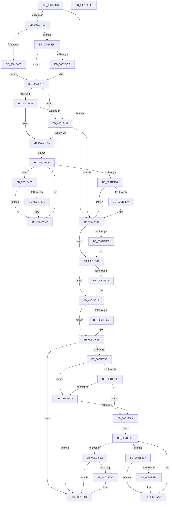

# DifExDeleteFastResourceWrapper

- RVA: `0x0061F420`–`0x0061F5DF` (길이 `447` bytes)
- VA: `0x000000014061F420`
- 실행 섹션: `.text`
- PDB 이름 있음: `예`; PDB Function 태그: `아니요`
- unwind 정보 RVA: `0x00060130`
- 디코드: `120`개 명령, `447/447` bytes 표시
- 미해석 바이트: `0` (있으면 어셈블리에 `.byte`로 보존)

> 이 문서는 커널 이미지의 기계어와 PDB 기호를 분석해 생성했습니다. 4번과 5번은 함수 원형과 자료형을 바이너리 사용 방식에서 추정한 C 해석이며 원본 소스 복구 결과는 아닙니다.

## 1. Dependencies

- 직접 호출 지점: **12**; 고유 호출 대상: **7**
- 직접 호출자로 확인된 함수: **0**
- RIP 상대 이미지 참조: **3**

### Outgoing calls
- `0x0061F448` → [DifGetAPIThunkContextById](../49/DifGetAPIThunkContextById_function_00495A34.md) (function, `0x00495A34`)
- `0x0061F470` → [DifGetReturnAddressForWrappers](../4D/DifGetReturnAddressForWrappers_function_004D3C08.md) (function, `0x004D3C08`)
- `0x0061F49E` → [ExAcquireRundownProtection](../21/ExAcquireRundownProtection_function_00216620.md) (function, `0x00216620`)
- `0x0061F4C5` → [guard_dispatch_icall](../6B/guard_dispatch_icall_function_006BAAD0.md) (function, `0x006BAAD0`)
- `0x0061F4DE` → [ExReleaseRundownProtection](../34/ExReleaseRundownProtection_function_00349E80.md) (function, `0x00349E80`)
- `0x0061F504` → [KeBugCheckEx](../4F/KeBugCheckEx_function_004FD660.md) (function, `0x004FD660`)
- `0x0061F524` → [KeBugCheckEx](../4F/KeBugCheckEx_function_004FD660.md) (function, `0x004FD660`)
- `0x0061F52D` → [ExpIsFastResourceOwned](../3C/ExpIsFastResourceOwned_function_003CF550.md) (function, `0x003CF550`)
- `0x0061F54B` → [KeBugCheckEx](../4F/KeBugCheckEx_function_004FD660.md) (function, `0x004FD660`)
- `0x0061F57E` → [ExAcquireRundownProtection](../21/ExAcquireRundownProtection_function_00216620.md) (function, `0x00216620`)
- `0x0061F5A5` → [guard_dispatch_icall](../6B/guard_dispatch_icall_function_006BAAD0.md) (function, `0x006BAAD0`)
- `0x0061F5BE` → [ExReleaseRundownProtection](../34/ExReleaseRundownProtection_function_00349E80.md) (function, `0x00349E80`)

### Direct callers
- 이 함수 시작 RVA로 연결되는 직접 call은 확인되지 않았습니다. 간접 호출은 완전히 역산할 수 없습니다.

### Static image references
- `0x0061F482` → RVA `0x00F048B8` (`.data`; read)
- `0x0061F48B` → RVA `0x00F04980` (`.data`; read)
- `0x0061F497` → RVA `0x00F03E80` (`.data`; read)

## 2. Other-region calls and transfers

- 다른 실행 섹션으로 향하는 call: **0**
- 별도 외부 분기/꼬리 이동을 확인하지 못했습니다.

## 3. Assembly (complete function range)

```asm
0061F420  48 8B C4                        mov rax, rsp
0061F423  48 89 58 08                     mov qword ptr [rax + 8], rbx
0061F427  48 89 68 10                     mov qword ptr [rax + 0x10], rbp
0061F42B  48 89 70 18                     mov qword ptr [rax + 0x18], rsi
0061F42F  48 89 78 20                     mov qword ptr [rax + 0x20], rdi
0061F433  41 56                           push r14
0061F435  48 83 EC 40                     sub rsp, 0x40
0061F439  48 8B D9                        mov rbx, rcx
0061F43C  0F 57 C0                        xorps xmm0, xmm0
0061F43F  B9 C1 01 00 00                  mov ecx, 0x1c1
0061F444  0F 11 40 E8                     movups xmmword ptr [rax - 0x18], xmm0
0061F448  E8 E7 65 E7 FF                  call 0x140495a34
0061F44D  48 8B F0                        mov rsi, rax
0061F450  48 85 C0                        test rax, rax
0061F453  0F 84 8A 00 00 00               je 0x14061f4e3
0061F459  8B 40 0C                        mov eax, dword ptr [rax + 0xc]
0061F45C  A8 18                           test al, 0x18
0061F45E  74 0C                           je 0x14061f46c
0061F460  48 8B 4C 24 48                  mov rcx, qword ptr [rsp + 0x48]
0061F465  48 89 4C 24 30                  mov qword ptr [rsp + 0x30], rcx
0061F46A  EB 0E                           jmp 0x14061f47a
0061F46C  A8 04                           test al, 4
0061F46E  74 0A                           je 0x14061f47a
0061F470  E8 93 47 EB FF                  call 0x1404d3c08
0061F475  48 89 44 24 30                  mov qword ptr [rsp + 0x30], rax
0061F47A  40 32 ED                        xor bpl, bpl
0061F47D  48 89 5C 24 38                  mov qword ptr [rsp + 0x38], rbx
0061F482  40 38 2D 2F 54 8E 00            cmp byte ptr [rip + 0x8e542f], bpl
0061F489  75 0C                           jne 0x14061f497
0061F48B  F7 05 EB 54 8E 00 00 08 00 00   test dword ptr [rip + 0x8e54eb], 0x800
0061F495  74 13                           je 0x14061f4aa
0061F497  48 8D 0D E2 49 8E 00            lea rcx, [rip + 0x8e49e2]
0061F49E  E8 7D 71 BF FF                  call 0x140216620
0061F4A3  40 8A E8                        mov bpl, al
0061F4A6  84 C0                           test al, al
0061F4A8  74 39                           je 0x14061f4e3
0061F4AA  4C 8D 76 20                     lea r14, [rsi + 0x20]
0061F4AE  49 8B 3E                        mov rdi, qword ptr [r14]
0061F4B1  EB 1A                           jmp 0x14061f4cd
0061F4B3  48 8D 47 F0                     lea rax, [rdi - 0x10]
0061F4B7  48 85 C0                        test rax, rax
0061F4BA  74 0E                           je 0x14061f4ca
0061F4BC  48 8B 40 08                     mov rax, qword ptr [rax + 8]
0061F4C0  48 8D 4C 24 30                  lea rcx, [rsp + 0x30]
0061F4C5  E8 06 B6 09 00                  call 0x1406baad0
0061F4CA  48 8B 3F                        mov rdi, qword ptr [rdi]
0061F4CD  49 3B FE                        cmp rdi, r14
0061F4D0  75 E1                           jne 0x14061f4b3
0061F4D2  40 84 ED                        test bpl, bpl
0061F4D5  74 0C                           je 0x14061f4e3
0061F4D7  48 8D 0D A2 49 8E 00            lea rcx, [rip + 0x8e49a2]
0061F4DE  E8 9D A9 D2 FF                  call 0x140349e80
0061F4E3  41 B9 01 00 00 00               mov r9d, 1
0061F4E9  44 84 4B 1A                     test byte ptr [rbx + 0x1a], r9b
0061F4ED  75 1B                           jne 0x14061f50a
0061F4EF  48 83 64 24 20 00               and qword ptr [rsp + 0x20], 0
0061F4F5  45 33 C9                        xor r9d, r9d
0061F4F8  4C 8B C3                        mov r8, rbx
0061F4FB  B9 C6 01 00 00                  mov ecx, 0x1c6
0061F500  41 8D 51 03                     lea edx, [r9 + 3]
0061F504  E8 57 E1 ED FF                  call 0x1404fd660
0061F509  CC                              int3
0061F50A  44 0F 20 C0                     mov rax, cr8
0061F50E  41 3A C1                        cmp al, r9b
0061F511  76 17                           jbe 0x14061f52a
0061F513  48 83 64 24 20 00               and qword ptr [rsp + 0x20], 0
0061F519  33 D2                           xor edx, edx
0061F51B  44 0F B6 C0                     movzx r8d, al
0061F51F  B9 C6 01 00 00                  mov ecx, 0x1c6
0061F524  E8 37 E1 ED FF                  call 0x1404fd660
0061F529  CC                              int3
0061F52A  48 8B CB                        mov rcx, rbx
0061F52D  E8 1E 00 DB FF                  call 0x1403cf550
0061F532  84 C0                           test al, al
0061F534  74 1B                           je 0x14061f551
0061F536  48 83 64 24 20 00               and qword ptr [rsp + 0x20], 0
0061F53C  45 33 C9                        xor r9d, r9d
0061F53F  4C 8B C3                        mov r8, rbx
0061F542  B9 C6 01 00 00                  mov ecx, 0x1c6
0061F547  41 8D 51 04                     lea edx, [r9 + 4]
0061F54B  E8 10 E1 ED FF                  call 0x1404fd660
0061F550  CC                              int3
0061F551  B8 BE FF 00 00                  mov eax, 0xffbe
0061F556  66 21 43 1A                     and word ptr [rbx + 0x1a], ax
0061F55A  48 85 F6                        test rsi, rsi
0061F55D  74 64                           je 0x14061f5c3
0061F55F  40 32 FF                        xor dil, dil
0061F562  40 38 3D 4F 53 8E 00            cmp byte ptr [rip + 0x8e534f], dil
0061F569  75 0C                           jne 0x14061f577
0061F56B  F7 05 0B 54 8E 00 00 08 00 00   test dword ptr [rip + 0x8e540b], 0x800
0061F575  74 13                           je 0x14061f58a
0061F577  48 8D 0D 02 49 8E 00            lea rcx, [rip + 0x8e4902]
0061F57E  E8 9D 70 BF FF                  call 0x140216620
0061F583  40 8A F8                        mov dil, al
0061F586  84 C0                           test al, al
0061F588  74 39                           je 0x14061f5c3
0061F58A  48 83 C6 30                     add rsi, 0x30
0061F58E  48 8B 1E                        mov rbx, qword ptr [rsi]
0061F591  EB 1A                           jmp 0x14061f5ad
0061F593  48 8D 43 F0                     lea rax, [rbx - 0x10]
0061F597  48 85 C0                        test rax, rax
0061F59A  74 0E                           je 0x14061f5aa
0061F59C  48 8B 40 08                     mov rax, qword ptr [rax + 8]
0061F5A0  48 8D 4C 24 30                  lea rcx, [rsp + 0x30]
0061F5A5  E8 26 B5 09 00                  call 0x1406baad0
0061F5AA  48 8B 1B                        mov rbx, qword ptr [rbx]
0061F5AD  48 3B DE                        cmp rbx, rsi
0061F5B0  75 E1                           jne 0x14061f593
0061F5B2  40 84 FF                        test dil, dil
0061F5B5  74 0C                           je 0x14061f5c3
0061F5B7  48 8D 0D C2 48 8E 00            lea rcx, [rip + 0x8e48c2]
0061F5BE  E8 BD A8 D2 FF                  call 0x140349e80
0061F5C3  48 8B 5C 24 50                  mov rbx, qword ptr [rsp + 0x50]
0061F5C8  48 8B 6C 24 58                  mov rbp, qword ptr [rsp + 0x58]
0061F5CD  48 8B 74 24 60                  mov rsi, qword ptr [rsp + 0x60]
0061F5D2  48 8B 7C 24 68                  mov rdi, qword ptr [rsp + 0x68]
0061F5D7  48 83 C4 40                     add rsp, 0x40
0061F5DB  41 5E                           pop r14
0061F5DD  C3                              ret
0061F5DE  CC                              int3
```

## 4. C-style interpretation (structured pseudocode)

```c
__int64 __fastcall DifExDeleteFastResourceWrapper(__int64 a1)
{
    __int64 result;
    __int64 v_rbp;
    __int64 v_rdi;
    __int64 v_rsi;
    __int64 v_rsp;
    unsigned __int64 v_stack_m10;
    unsigned __int64 v_stack_m18;
    unsigned __int64 v_stack_m28;
    unsigned __int64 v_stack_p0;
    unsigned __int64 v_stack_p10;
    unsigned __int64 v_stack_p18;
    unsigned __int64 v_stack_p20;
    unsigned __int64 v_stack_p8;

    *(unsigned __int64 *)(v_rsp + 8) = v_rbx;
    *(unsigned __int64 *)(v_rsp + 16) = v_rbp;
    *(unsigned __int64 *)(v_rsp + 24) = v_rsi;
    *(unsigned __int64 *)(v_rsp + 32) = v_rdi;
    v_rsp = (v_rsp) - (64);
    *(unsigned __int64 *)(v_rsp - 24) = v_xmm0;
    result = DifGetAPIThunkContextById(449, a2, a3, a4);
    if (result == 0) goto loc_0061F4E3;
    if ((((unsigned __int8)((unsigned int)(*(unsigned int *)(result + 12)))) & (24)) == 0) goto loc_0061F46C;
    v_stack_m18 = v_stack_p0;
    goto loc_0061F47A;
loc_0061F46C:
    result = (unsigned int)(*(unsigned int *)(result + 12));
    if ((((unsigned __int8)((unsigned int)(*(unsigned int *)(result + 12)))) & (4)) != 0) {
        result = DifGetReturnAddressForWrappers(v_stack_p0, a2, a3, a4);
        v_stack_m18 = result;
    }
    v_rbp = 0;
    v_stack_m10 = a1;
    if ((*(unsigned __int8 *)(v_rip + 9327663)) != 0) goto loc_0061F497;
    if (((*(unsigned int *)(v_rip + 9327851)) & (0x800ULL)) == 0) goto loc_0061F4AA;
loc_0061F497:
    result = ExAcquireRundownProtection(v_rip + 9325026, a2, a3, a4);
    if ((unsigned __int8)(result) == 0) goto loc_0061F4E3;
loc_0061F4AA:
    goto loc_0061F4CD;
loc_0061F4B3:
    result = *(unsigned __int64 *)(result + 32) - 16;
    if (*(unsigned __int64 *)(result + 32) - 16 != 0) {
        result = *(unsigned __int64 *)(*(unsigned __int64 *)(result + 32) - 16 + 8);
        a1 = v_stack_m18;
        result = guard_dispatch_icall(a1, a2, a3, a4);
    }
loc_0061F4CD:
    if ((*(unsigned __int64 *)(*(unsigned __int64 *)(result + 32))) != (result + 32)) goto loc_0061F4B3;
    if ((unsigned __int8)((unsigned __int8)(result)) != 0) {
        a1 = v_rip + 9324962;
        result = ExReleaseRundownProtection(a1, a2, a3, a4);
    }
    if (((*(unsigned __int8 *)(a1 + 26)) & (1)) == 0) {
        a4 = 0;
        a3 = a1;
        a1 = 454;
        a2 = a4 + 3;
        result = KeBugCheckEx(a1, a2, a3, a4);
    }
    result = v_cr8;
    if (((unsigned __int8)(v_cr8)) >= = 0) {
        a2 = 0;
        a3 = (unsigned __int8)(v_cr8);
        a1 = 454;
        result = KeBugCheckEx(a1, a2, a3, a4);
    }
    result = ExpIsFastResourceOwned(a1, a2, a3, a4);
    if ((unsigned __int8)(result) != 0) {
        a4 = 0;
        a3 = a1;
        a1 = 454;
        a2 = a4 + 4;
        result = KeBugCheckEx(a1, a2, a3, a4);
    }
    if (result == 0) goto loc_0061F5C3;
    v_rdi = 0;
    if ((*(unsigned __int8 *)(v_rip + 9327439)) != 0) goto loc_0061F577;
    if (((*(unsigned int *)(v_rip + 9327627)) & (0x800ULL)) == 0) goto loc_0061F58A;
loc_0061F577:
    result = ExAcquireRundownProtection(v_rip + 9324802, a2, a3, a4);
    if ((unsigned __int8)(result) == 0) goto loc_0061F5C3;
loc_0061F58A:
    v_rsi = (result) + (48);
    goto loc_0061F5AD;
loc_0061F593:
    result = *(unsigned __int64 *)(v_rsi) - 16;
    if (*(unsigned __int64 *)(v_rsi) - 16 != 0) {
        result = *(unsigned __int64 *)(*(unsigned __int64 *)(v_rsi) - 16 + 8);
        a1 = v_stack_m18;
        result = guard_dispatch_icall(a1, a2, a3, a4);
    }
loc_0061F5AD:
    if ((*(unsigned __int64 *)(*(unsigned __int64 *)(v_rsi))) != v_rsi) goto loc_0061F593;
    if ((unsigned __int8)((unsigned __int8)(result)) != 0) {
        a1 = v_rip + 9324738;
        result = ExReleaseRundownProtection(a1, a2, a3, a4);
    }
    v_rsp = (v_rsp) + (64);
    return result;
}
```

## 5. (Beta) C Style

```c
int64_t DifExDeleteFastResourceWrapper(void *Arg1)
{
    uint8_t *arg1 = (uint8_t *)Arg1;

    int64_t result;
    int64_t local_rbp;
    int64_t local_rdi;
    int64_t local_rsi;
    int64_t local_rsp;
    uint64_t v_stack_m10;
    uint64_t v_stack_m18;
    uint64_t v_stack_m28;
    uint64_t v_stack_p0;
    uint64_t v_stack_p10;
    uint64_t v_stack_p18;
    uint64_t v_stack_p20;
    uint64_t v_stack_p8;

    *(uint64_t *)(local_rsp + 0x8) = local_rbx;
    *(uint64_t *)(local_rsp + 0x10) = local_rbp;
    *(uint64_t *)(local_rsp + 0x18) = local_rsi;
    *(uint64_t *)(local_rsp + 0x20) = local_rdi;
    local_rsp = (local_rsp) - (64);
    *(uint64_t *)(local_rsp - 0x18) = v_xmm0;
    result = DifGetAPIThunkContextById(449, a2, a3, a4);
    if (result == 0) goto loc_0061F4E3;
    if ((((uint8_t)((uint32_t)(*(uint32_t *)(result + 0xC)))) & (24)) == 0) goto loc_0061F46C;
    v_stack_m18 = v_stack_p0;
    goto loc_0061F47A;
loc_0061F46C:
    result = (uint32_t)(*(uint32_t *)(result + 0xC));
    if ((((uint8_t)((uint32_t)(*(uint32_t *)(result + 0xC)))) & (4)) != 0) {
        result = DifGetReturnAddressForWrappers(v_stack_p0, a2, a3, a4);
        v_stack_m18 = result;
    }
    local_rbp = 0;
    v_stack_m10 = Arg1;
    if ((*(uint8_t *)(v_rip + 0x8E542F)) != 0) goto loc_0061F497;
    if (((*(uint32_t *)(v_rip + 0x8E54EB)) & (0x800ULL)) == 0) goto loc_0061F4AA;
loc_0061F497:
    result = ExAcquireRundownProtection(v_rip + 9325026, a2, a3, a4);
    if ((uint8_t)(result) == 0) goto loc_0061F4E3;
loc_0061F4AA:
    goto loc_0061F4CD;
loc_0061F4B3:
    result = *(uint64_t *)(result + 0x20) - 16;
    if (*(uint64_t *)(result + 0x20) - 16 != 0) {
        result = *(uint64_t *)(*(uint64_t *)(result + 0x20) - 0x10 + 0x8);
        Arg1 = v_stack_m18;
        result = guard_dispatch_icall(Arg1, a2, a3, a4);
    }
loc_0061F4CD:
    if ((*(uint64_t *)(*(uint64_t *)(result + 0x20))) != (result + 32)) goto loc_0061F4B3;
    if ((uint8_t)((uint8_t)(result)) != 0) {
        Arg1 = v_rip + 9324962;
        result = ExReleaseRundownProtection(Arg1, a2, a3, a4);
    }
    if (((*(uint8_t *)(arg1 + 0x1A)) & (1)) == 0) {
        a4 = 0;
        a3 = Arg1;
        Arg1 = 454;
        a2 = a4 + 3;
        result = KeBugCheckEx(Arg1, a2, a3, a4);
    }
    result = v_cr8;
    if (((uint8_t)(v_cr8)) >= = 0) {
        a2 = 0;
        a3 = (uint8_t)(v_cr8);
        Arg1 = 454;
        result = KeBugCheckEx(Arg1, a2, a3, a4);
    }
    result = ExpIsFastResourceOwned(Arg1, a2, a3, a4);
    if ((uint8_t)(result) != 0) {
        a4 = 0;
        a3 = Arg1;
        Arg1 = 454;
        a2 = a4 + 4;
        result = KeBugCheckEx(Arg1, a2, a3, a4);
    }
    if (result == 0) goto loc_0061F5C3;
    local_rdi = 0;
    if ((*(uint8_t *)(v_rip + 0x8E534F)) != 0) goto loc_0061F577;
    if (((*(uint32_t *)(v_rip + 0x8E540B)) & (0x800ULL)) == 0) goto loc_0061F58A;
loc_0061F577:
    result = ExAcquireRundownProtection(v_rip + 9324802, a2, a3, a4);
    if ((uint8_t)(result) == 0) goto loc_0061F5C3;
loc_0061F58A:
    local_rsi = (result) + (48);
    goto loc_0061F5AD;
loc_0061F593:
    result = *(uint64_t *)(local_rsi) - 16;
    if (*(uint64_t *)(local_rsi) - 16 != 0) {
        result = *(uint64_t *)(*(uint64_t *)(local_rsi) - 0x10 + 0x8);
        Arg1 = v_stack_m18;
        result = guard_dispatch_icall(Arg1, a2, a3, a4);
    }
loc_0061F5AD:
    if ((*(uint64_t *)(*(uint64_t *)(local_rsi))) != local_rsi) goto loc_0061F593;
    if ((uint8_t)((uint8_t)(result)) != 0) {
        Arg1 = v_rip + 9324738;
        result = ExReleaseRundownProtection(Arg1, a2, a3, a4);
    }
    local_rsp = (local_rsp) + (64);
    return result;
}
```

### 관측된 메모리 오프셋

구조체 형식이 확인되지 않은 접근은 인자 기준의 오프셋으로만 기록했습니다.

| 기준 인자 | 오프셋 표현 | 폭 (bit) | 접근 |
|---|---:|---:|---|
| `Arg1` | `+ 0x1A` | `8` | `R` |
| `Arg1` | `+ 0x1A` | `16` | `R/W` |

## 6. Execution-region graph

[열기: 2D/3D 그래프와 함수 탐색 컨트롤 패널](../../../control-panel.html?section=text&rva=0x0061F420&view=graph)

- 2D 그래프는 위에서 아래로 흐르고, 3D 그래프는 빈 공간을 드래그해 회전합니다. Shift+드래그는 이동, 휠은 확대·축소, 함수 노드 선택은 대상 보고서 이동입니다.

### Static fallback


