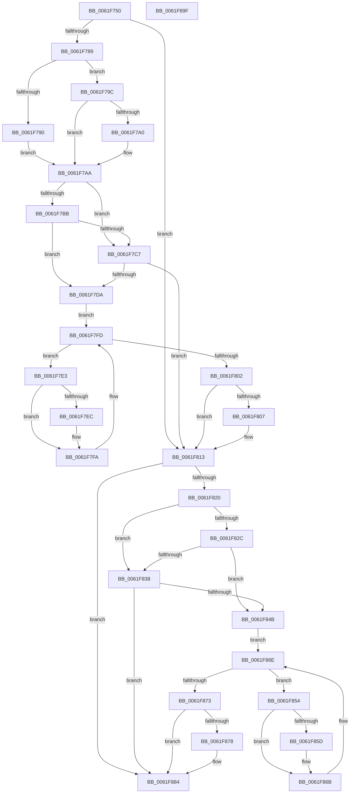

# DifExDeleteNPagedLookasideListWrapper

- RVA: `0x0061F750`–`0x0061F8A0` (길이 `336` bytes)
- VA: `0x000000014061F750`
- 실행 섹션: `.text`
- PDB 이름 있음: `예`; PDB Function 태그: `아니요`
- unwind 정보 RVA: `0x0005D7BC`
- 디코드: `90`개 명령, `336/336` bytes 표시
- 미해석 바이트: `0` (있으면 어셈블리에 `.byte`로 보존)

> 이 문서는 커널 이미지의 기계어와 PDB 기호를 분석해 생성했습니다. 4번과 5번은 함수 원형과 자료형을 바이너리 사용 방식에서 추정한 C 해석이며 원본 소스 복구 결과는 아닙니다.

## 1. Dependencies

- 직접 호출 지점: **9**; 고유 호출 대상: **6**
- 직접 호출자로 확인된 함수: **0**
- RIP 상대 이미지 참조: **3**

### Outgoing calls
- `0x0061F778` → [DifGetAPIThunkContextById](../49/DifGetAPIThunkContextById_function_00495A34.md) (function, `0x00495A34`)
- `0x0061F7A0` → [DifGetReturnAddressForWrappers](../4D/DifGetReturnAddressForWrappers_function_004D3C08.md) (function, `0x004D3C08`)
- `0x0061F7CE` → [ExAcquireRundownProtection](../21/ExAcquireRundownProtection_function_00216620.md) (function, `0x00216620`)
- `0x0061F7F5` → [guard_dispatch_icall](../6B/guard_dispatch_icall_function_006BAAD0.md) (function, `0x006BAAD0`)
- `0x0061F80E` → [ExReleaseRundownProtection](../34/ExReleaseRundownProtection_function_00349E80.md) (function, `0x00349E80`)
- `0x0061F816` → [ExDeleteNPagedLookasideList](../48/ExDeleteNPagedLookasideList_function_00481D50.md) (function, `0x00481D50`)
- `0x0061F83F` → [ExAcquireRundownProtection](../21/ExAcquireRundownProtection_function_00216620.md) (function, `0x00216620`)
- `0x0061F866` → [guard_dispatch_icall](../6B/guard_dispatch_icall_function_006BAAD0.md) (function, `0x006BAAD0`)
- `0x0061F87F` → [ExReleaseRundownProtection](../34/ExReleaseRundownProtection_function_00349E80.md) (function, `0x00349E80`)

### Direct callers
- 이 함수 시작 RVA로 연결되는 직접 call은 확인되지 않았습니다. 간접 호출은 완전히 역산할 수 없습니다.

### Static image references
- `0x0061F7B2` → RVA `0x00F048B8` (`.data`; read)
- `0x0061F7BB` → RVA `0x00F04980` (`.data`; read)
- `0x0061F7C7` → RVA `0x00F03E80` (`.data`; read)

## 2. Other-region calls and transfers

- 다른 실행 섹션으로 향하는 call: **0**
- 별도 외부 분기/꼬리 이동을 확인하지 못했습니다.

## 3. Assembly (complete function range)

```asm
0061F750  48 8B C4                        mov rax, rsp
0061F753  48 89 58 08                     mov qword ptr [rax + 8], rbx
0061F757  48 89 68 10                     mov qword ptr [rax + 0x10], rbp
0061F75B  48 89 70 18                     mov qword ptr [rax + 0x18], rsi
0061F75F  48 89 78 20                     mov qword ptr [rax + 0x20], rdi
0061F763  41 56                           push r14
0061F765  48 83 EC 30                     sub rsp, 0x30
0061F769  48 8B E9                        mov rbp, rcx
0061F76C  0F 57 C0                        xorps xmm0, xmm0
0061F76F  B9 99 01 00 00                  mov ecx, 0x199
0061F774  0F 11 40 E8                     movups xmmword ptr [rax - 0x18], xmm0
0061F778  E8 B7 62 E7 FF                  call 0x140495a34
0061F77D  48 8B F8                        mov rdi, rax
0061F780  48 85 C0                        test rax, rax
0061F783  0F 84 8A 00 00 00               je 0x14061f813
0061F789  8B 40 0C                        mov eax, dword ptr [rax + 0xc]
0061F78C  A8 18                           test al, 0x18
0061F78E  74 0C                           je 0x14061f79c
0061F790  48 8B 4C 24 38                  mov rcx, qword ptr [rsp + 0x38]
0061F795  48 89 4C 24 20                  mov qword ptr [rsp + 0x20], rcx
0061F79A  EB 0E                           jmp 0x14061f7aa
0061F79C  A8 04                           test al, 4
0061F79E  74 0A                           je 0x14061f7aa
0061F7A0  E8 63 44 EB FF                  call 0x1404d3c08
0061F7A5  48 89 44 24 20                  mov qword ptr [rsp + 0x20], rax
0061F7AA  40 32 F6                        xor sil, sil
0061F7AD  48 89 6C 24 28                  mov qword ptr [rsp + 0x28], rbp
0061F7B2  40 38 35 FF 50 8E 00            cmp byte ptr [rip + 0x8e50ff], sil
0061F7B9  75 0C                           jne 0x14061f7c7
0061F7BB  F7 05 BB 51 8E 00 00 08 00 00   test dword ptr [rip + 0x8e51bb], 0x800
0061F7C5  74 13                           je 0x14061f7da
0061F7C7  48 8D 0D B2 46 8E 00            lea rcx, [rip + 0x8e46b2]
0061F7CE  E8 4D 6E BF FF                  call 0x140216620
0061F7D3  40 8A F0                        mov sil, al
0061F7D6  84 C0                           test al, al
0061F7D8  74 39                           je 0x14061f813
0061F7DA  4C 8D 77 20                     lea r14, [rdi + 0x20]
0061F7DE  49 8B 1E                        mov rbx, qword ptr [r14]
0061F7E1  EB 1A                           jmp 0x14061f7fd
0061F7E3  48 8D 43 F0                     lea rax, [rbx - 0x10]
0061F7E7  48 85 C0                        test rax, rax
0061F7EA  74 0E                           je 0x14061f7fa
0061F7EC  48 8B 40 08                     mov rax, qword ptr [rax + 8]
0061F7F0  48 8D 4C 24 20                  lea rcx, [rsp + 0x20]
0061F7F5  E8 D6 B2 09 00                  call 0x1406baad0
0061F7FA  48 8B 1B                        mov rbx, qword ptr [rbx]
0061F7FD  49 3B DE                        cmp rbx, r14
0061F800  75 E1                           jne 0x14061f7e3
0061F802  40 84 F6                        test sil, sil
0061F805  74 0C                           je 0x14061f813
0061F807  48 8D 0D 72 46 8E 00            lea rcx, [rip + 0x8e4672]
0061F80E  E8 6D A6 D2 FF                  call 0x140349e80
0061F813  48 8B CD                        mov rcx, rbp
0061F816  E8 35 25 E6 FF                  call 0x140481d50
0061F81B  48 85 FF                        test rdi, rdi
0061F81E  74 64                           je 0x14061f884
0061F820  40 32 F6                        xor sil, sil
0061F823  40 38 35 8E 50 8E 00            cmp byte ptr [rip + 0x8e508e], sil
0061F82A  75 0C                           jne 0x14061f838
0061F82C  F7 05 4A 51 8E 00 00 08 00 00   test dword ptr [rip + 0x8e514a], 0x800
0061F836  74 13                           je 0x14061f84b
0061F838  48 8D 0D 41 46 8E 00            lea rcx, [rip + 0x8e4641]
0061F83F  E8 DC 6D BF FF                  call 0x140216620
0061F844  40 8A F0                        mov sil, al
0061F847  84 C0                           test al, al
0061F849  74 39                           je 0x14061f884
0061F84B  48 83 C7 30                     add rdi, 0x30
0061F84F  48 8B 1F                        mov rbx, qword ptr [rdi]
0061F852  EB 1A                           jmp 0x14061f86e
0061F854  48 8D 43 F0                     lea rax, [rbx - 0x10]
0061F858  48 85 C0                        test rax, rax
0061F85B  74 0E                           je 0x14061f86b
0061F85D  48 8B 40 08                     mov rax, qword ptr [rax + 8]
0061F861  48 8D 4C 24 20                  lea rcx, [rsp + 0x20]
0061F866  E8 65 B2 09 00                  call 0x1406baad0
0061F86B  48 8B 1B                        mov rbx, qword ptr [rbx]
0061F86E  48 3B DF                        cmp rbx, rdi
0061F871  75 E1                           jne 0x14061f854
0061F873  40 84 F6                        test sil, sil
0061F876  74 0C                           je 0x14061f884
0061F878  48 8D 0D 01 46 8E 00            lea rcx, [rip + 0x8e4601]
0061F87F  E8 FC A5 D2 FF                  call 0x140349e80
0061F884  48 8B 5C 24 40                  mov rbx, qword ptr [rsp + 0x40]
0061F889  48 8B 6C 24 48                  mov rbp, qword ptr [rsp + 0x48]
0061F88E  48 8B 74 24 50                  mov rsi, qword ptr [rsp + 0x50]
0061F893  48 8B 7C 24 58                  mov rdi, qword ptr [rsp + 0x58]
0061F898  48 83 C4 30                     add rsp, 0x30
0061F89C  41 5E                           pop r14
0061F89E  C3                              ret
0061F89F  CC                              int3
```

## 4. C-style interpretation (structured pseudocode)

```c
__int64 __fastcall DifExDeleteNPagedLookasideListWrapper(__int64 a1)
{
    __int64 result;
    __int64 v_rdi;
    __int64 v_rsi;
    __int64 v_rsp;
    unsigned __int64 v_stack_m10;
    unsigned __int64 v_stack_m18;
    unsigned __int64 v_stack_p0;
    unsigned __int64 v_stack_p10;
    unsigned __int64 v_stack_p18;
    unsigned __int64 v_stack_p20;
    unsigned __int64 v_stack_p8;

    *(unsigned __int64 *)(v_rsp + 8) = v_rbx;
    *(unsigned __int64 *)(v_rsp + 16) = v_rbp;
    *(unsigned __int64 *)(v_rsp + 24) = v_rsi;
    *(unsigned __int64 *)(v_rsp + 32) = v_rdi;
    v_rsp = (v_rsp) - (48);
    *(unsigned __int64 *)(v_rsp - 24) = v_xmm0;
    result = DifGetAPIThunkContextById(409, a2, a3, a4);
    if (result == 0) goto loc_0061F813;
    if ((((unsigned __int8)((unsigned int)(*(unsigned int *)(result + 12)))) & (24)) == 0) goto loc_0061F79C;
    v_stack_m18 = v_stack_p0;
    goto loc_0061F7AA;
loc_0061F79C:
    result = (unsigned int)(*(unsigned int *)(result + 12));
    if ((((unsigned __int8)((unsigned int)(*(unsigned int *)(result + 12)))) & (4)) != 0) {
        result = DifGetReturnAddressForWrappers(v_stack_p0, a2, a3, a4);
        v_stack_m18 = result;
    }
    v_rsi = 0;
    v_stack_m10 = a1;
    if ((*(unsigned __int8 *)(v_rip + 9326847)) != 0) goto loc_0061F7C7;
    if (((*(unsigned int *)(v_rip + 9327035)) & (0x800ULL)) == 0) goto loc_0061F7DA;
loc_0061F7C7:
    result = ExAcquireRundownProtection(v_rip + 9324210, a2, a3, a4);
    if ((unsigned __int8)(result) == 0) goto loc_0061F813;
loc_0061F7DA:
    goto loc_0061F7FD;
loc_0061F7E3:
    result = *(unsigned __int64 *)(result + 32) - 16;
    if (*(unsigned __int64 *)(result + 32) - 16 != 0) {
        result = *(unsigned __int64 *)(*(unsigned __int64 *)(result + 32) - 16 + 8);
        a1 = v_stack_m18;
        result = guard_dispatch_icall(a1, a2, a3, a4);
    }
loc_0061F7FD:
    if ((*(unsigned __int64 *)(*(unsigned __int64 *)(result + 32))) != (result + 32)) goto loc_0061F7E3;
    if ((unsigned __int8)((unsigned __int8)(result)) != 0) {
        a1 = v_rip + 9324146;
        result = ExReleaseRundownProtection(a1, a2, a3, a4);
    }
    result = ExDeleteNPagedLookasideList(a1, a2, a3, a4);
    if (result == 0) goto loc_0061F884;
    v_rsi = 0;
    if ((*(unsigned __int8 *)(v_rip + 9326734)) != 0) goto loc_0061F838;
    if (((*(unsigned int *)(v_rip + 9326922)) & (0x800ULL)) == 0) goto loc_0061F84B;
loc_0061F838:
    result = ExAcquireRundownProtection(v_rip + 9324097, a2, a3, a4);
    if ((unsigned __int8)(result) == 0) goto loc_0061F884;
loc_0061F84B:
    v_rdi = (result) + (48);
    goto loc_0061F86E;
loc_0061F854:
    result = *(unsigned __int64 *)(v_rdi) - 16;
    if (*(unsigned __int64 *)(v_rdi) - 16 != 0) {
        result = *(unsigned __int64 *)(*(unsigned __int64 *)(v_rdi) - 16 + 8);
        a1 = v_stack_m18;
        result = guard_dispatch_icall(a1, a2, a3, a4);
    }
loc_0061F86E:
    if ((*(unsigned __int64 *)(*(unsigned __int64 *)(v_rdi))) != v_rdi) goto loc_0061F854;
    if ((unsigned __int8)((unsigned __int8)(result)) != 0) {
        a1 = v_rip + 9324033;
        result = ExReleaseRundownProtection(a1, a2, a3, a4);
    }
    v_rsp = (v_rsp) + (48);
    return result;
}
```

## 5. (Beta) C Style

```c
int64_t DifExDeleteNPagedLookasideListWrapper(int64_t Arg1)
{
    int64_t result;
    int64_t local_rdi;
    int64_t local_rsi;
    int64_t local_rsp;
    uint64_t v_stack_m10;
    uint64_t v_stack_m18;
    uint64_t v_stack_p0;
    uint64_t v_stack_p10;
    uint64_t v_stack_p18;
    uint64_t v_stack_p20;
    uint64_t v_stack_p8;

    *(uint64_t *)(local_rsp + 0x8) = local_rbx;
    *(uint64_t *)(local_rsp + 0x10) = local_rbp;
    *(uint64_t *)(local_rsp + 0x18) = local_rsi;
    *(uint64_t *)(local_rsp + 0x20) = local_rdi;
    local_rsp = (local_rsp) - (48);
    *(uint64_t *)(local_rsp - 0x18) = v_xmm0;
    result = DifGetAPIThunkContextById(409, a2, a3, a4);
    if (result == 0) goto loc_0061F813;
    if ((((uint8_t)((uint32_t)(*(uint32_t *)(result + 0xC)))) & (24)) == 0) goto loc_0061F79C;
    v_stack_m18 = v_stack_p0;
    goto loc_0061F7AA;
loc_0061F79C:
    result = (uint32_t)(*(uint32_t *)(result + 0xC));
    if ((((uint8_t)((uint32_t)(*(uint32_t *)(result + 0xC)))) & (4)) != 0) {
        result = DifGetReturnAddressForWrappers(v_stack_p0, a2, a3, a4);
        v_stack_m18 = result;
    }
    local_rsi = 0;
    v_stack_m10 = Arg1;
    if ((*(uint8_t *)(v_rip + 0x8E50FF)) != 0) goto loc_0061F7C7;
    if (((*(uint32_t *)(v_rip + 0x8E51BB)) & (0x800ULL)) == 0) goto loc_0061F7DA;
loc_0061F7C7:
    result = ExAcquireRundownProtection(v_rip + 9324210, a2, a3, a4);
    if ((uint8_t)(result) == 0) goto loc_0061F813;
loc_0061F7DA:
    goto loc_0061F7FD;
loc_0061F7E3:
    result = *(uint64_t *)(result + 0x20) - 16;
    if (*(uint64_t *)(result + 0x20) - 16 != 0) {
        result = *(uint64_t *)(*(uint64_t *)(result + 0x20) - 0x10 + 0x8);
        Arg1 = v_stack_m18;
        result = guard_dispatch_icall(Arg1, a2, a3, a4);
    }
loc_0061F7FD:
    if ((*(uint64_t *)(*(uint64_t *)(result + 0x20))) != (result + 32)) goto loc_0061F7E3;
    if ((uint8_t)((uint8_t)(result)) != 0) {
        Arg1 = v_rip + 9324146;
        result = ExReleaseRundownProtection(Arg1, a2, a3, a4);
    }
    result = ExDeleteNPagedLookasideList(Arg1, a2, a3, a4);
    if (result == 0) goto loc_0061F884;
    local_rsi = 0;
    if ((*(uint8_t *)(v_rip + 0x8E508E)) != 0) goto loc_0061F838;
    if (((*(uint32_t *)(v_rip + 0x8E514A)) & (0x800ULL)) == 0) goto loc_0061F84B;
loc_0061F838:
    result = ExAcquireRundownProtection(v_rip + 9324097, a2, a3, a4);
    if ((uint8_t)(result) == 0) goto loc_0061F884;
loc_0061F84B:
    local_rdi = (result) + (48);
    goto loc_0061F86E;
loc_0061F854:
    result = *(uint64_t *)(local_rdi) - 16;
    if (*(uint64_t *)(local_rdi) - 16 != 0) {
        result = *(uint64_t *)(*(uint64_t *)(local_rdi) - 0x10 + 0x8);
        Arg1 = v_stack_m18;
        result = guard_dispatch_icall(Arg1, a2, a3, a4);
    }
loc_0061F86E:
    if ((*(uint64_t *)(*(uint64_t *)(local_rdi))) != local_rdi) goto loc_0061F854;
    if ((uint8_t)((uint8_t)(result)) != 0) {
        Arg1 = v_rip + 9324033;
        result = ExReleaseRundownProtection(Arg1, a2, a3, a4);
    }
    local_rsp = (local_rsp) + (48);
    return result;
}
```

## 6. Execution-region graph

[열기: 2D/3D 그래프와 함수 탐색 컨트롤 패널](../../../control-panel.html?section=text&rva=0x0061F750&view=graph)

- 2D 그래프는 위에서 아래로 흐르고, 3D 그래프는 빈 공간을 드래그해 회전합니다. Shift+드래그는 이동, 휠은 확대·축소, 함수 노드 선택은 대상 보고서 이동입니다.

### Static fallback


