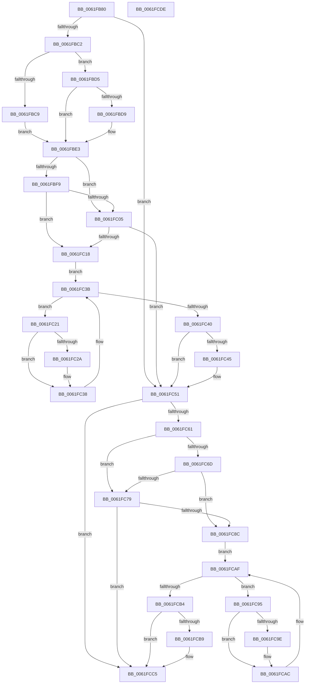

# DifExDisownFastResourceWrapper

- RVA: `0x0061FB80`–`0x0061FCDF` (길이 `351` bytes)
- VA: `0x000000014061FB80`
- 실행 섹션: `.text`
- PDB 이름 있음: `예`; PDB Function 태그: `아니요`
- unwind 정보 RVA: `0x00093E28`
- 디코드: `97`개 명령, `351/351` bytes 표시
- 미해석 바이트: `0` (있으면 어셈블리에 `.byte`로 보존)

> 이 문서는 커널 이미지의 기계어와 PDB 기호를 분석해 생성했습니다. 4번과 5번은 함수 원형과 자료형을 바이너리 사용 방식에서 추정한 C 해석이며 원본 소스 복구 결과는 아닙니다.

## 1. Dependencies

- 직접 호출 지점: **9**; 고유 호출 대상: **6**
- 직접 호출자로 확인된 함수: **0**
- RIP 상대 이미지 참조: **3**

### Outgoing calls
- `0x0061FBB1` → [DifGetAPIThunkContextById](../49/DifGetAPIThunkContextById_function_00495A34.md) (function, `0x00495A34`)
- `0x0061FBD9` → [DifGetReturnAddressForWrappers](../4D/DifGetReturnAddressForWrappers_function_004D3C08.md) (function, `0x004D3C08`)
- `0x0061FC0C` → [ExAcquireRundownProtection](../21/ExAcquireRundownProtection_function_00216620.md) (function, `0x00216620`)
- `0x0061FC33` → [guard_dispatch_icall](../6B/guard_dispatch_icall_function_006BAAD0.md) (function, `0x006BAAD0`)
- `0x0061FC4C` → [ExReleaseRundownProtection](../34/ExReleaseRundownProtection_function_00349E80.md) (function, `0x00349E80`)
- `0x0061FC57` → [ExDisownFastResource](../4A/ExDisownFastResource_function_004A2C10.md) (function, `0x004A2C10`)
- `0x0061FC80` → [ExAcquireRundownProtection](../21/ExAcquireRundownProtection_function_00216620.md) (function, `0x00216620`)
- `0x0061FCA7` → [guard_dispatch_icall](../6B/guard_dispatch_icall_function_006BAAD0.md) (function, `0x006BAAD0`)
- `0x0061FCC0` → [ExReleaseRundownProtection](../34/ExReleaseRundownProtection_function_00349E80.md) (function, `0x00349E80`)

### Direct callers
- 이 함수 시작 RVA로 연결되는 직접 call은 확인되지 않았습니다. 간접 호출은 완전히 역산할 수 없습니다.

### Static image references
- `0x0061FBEB` → RVA `0x00F048B8` (`.data`; read)
- `0x0061FBF9` → RVA `0x00F04980` (`.data`; read)
- `0x0061FC05` → RVA `0x00F03E80` (`.data`; read)

## 2. Other-region calls and transfers

- 다른 실행 섹션으로 향하는 call: **0**
- 별도 외부 분기/꼬리 이동을 확인하지 못했습니다.

## 3. Assembly (complete function range)

```asm
0061FB80  4C 8B DC                        mov r11, rsp
0061FB83  49 89 5B 08                     mov qword ptr [r11 + 8], rbx
0061FB87  49 89 6B 10                     mov qword ptr [r11 + 0x10], rbp
0061FB8B  49 89 73 18                     mov qword ptr [r11 + 0x18], rsi
0061FB8F  57                              push rdi
0061FB90  41 56                           push r14
0061FB92  41 57                           push r15
0061FB94  48 83 EC 40                     sub rsp, 0x40
0061FB98  33 C0                           xor eax, eax
0061FB9A  0F 57 C0                        xorps xmm0, xmm0
0061FB9D  0F 11 44 24 20                  movups xmmword ptr [rsp + 0x20], xmm0
0061FBA2  4C 8B F9                        mov r15, rcx
0061FBA5  49 89 43 D8                     mov qword ptr [r11 - 0x28], rax
0061FBA9  B9 C5 01 00 00                  mov ecx, 0x1c5
0061FBAE  4C 8B F2                        mov r14, rdx
0061FBB1  E8 7E 5E E7 FF                  call 0x140495a34
0061FBB6  48 8B F0                        mov rsi, rax
0061FBB9  48 85 C0                        test rax, rax
0061FBBC  0F 84 8F 00 00 00               je 0x14061fc51
0061FBC2  8B 40 0C                        mov eax, dword ptr [rax + 0xc]
0061FBC5  A8 18                           test al, 0x18
0061FBC7  74 0C                           je 0x14061fbd5
0061FBC9  48 8B 4C 24 58                  mov rcx, qword ptr [rsp + 0x58]
0061FBCE  48 89 4C 24 20                  mov qword ptr [rsp + 0x20], rcx
0061FBD3  EB 0E                           jmp 0x14061fbe3
0061FBD5  A8 04                           test al, 4
0061FBD7  74 0A                           je 0x14061fbe3
0061FBD9  E8 2A 40 EB FF                  call 0x1404d3c08
0061FBDE  48 89 44 24 20                  mov qword ptr [rsp + 0x20], rax
0061FBE3  40 32 ED                        xor bpl, bpl
0061FBE6  4C 89 7C 24 30                  mov qword ptr [rsp + 0x30], r15
0061FBEB  40 38 2D C6 4C 8E 00            cmp byte ptr [rip + 0x8e4cc6], bpl
0061FBF2  4C 89 74 24 28                  mov qword ptr [rsp + 0x28], r14
0061FBF7  75 0C                           jne 0x14061fc05
0061FBF9  F7 05 7D 4D 8E 00 00 08 00 00   test dword ptr [rip + 0x8e4d7d], 0x800
0061FC03  74 13                           je 0x14061fc18
0061FC05  48 8D 0D 74 42 8E 00            lea rcx, [rip + 0x8e4274]
0061FC0C  E8 0F 6A BF FF                  call 0x140216620
0061FC11  40 8A E8                        mov bpl, al
0061FC14  84 C0                           test al, al
0061FC16  74 39                           je 0x14061fc51
0061FC18  48 8D 7E 20                     lea rdi, [rsi + 0x20]
0061FC1C  48 8B 1F                        mov rbx, qword ptr [rdi]
0061FC1F  EB 1A                           jmp 0x14061fc3b
0061FC21  48 8D 43 F0                     lea rax, [rbx - 0x10]
0061FC25  48 85 C0                        test rax, rax
0061FC28  74 0E                           je 0x14061fc38
0061FC2A  48 8B 40 08                     mov rax, qword ptr [rax + 8]
0061FC2E  48 8D 4C 24 20                  lea rcx, [rsp + 0x20]
0061FC33  E8 98 AE 09 00                  call 0x1406baad0
0061FC38  48 8B 1B                        mov rbx, qword ptr [rbx]
0061FC3B  48 3B DF                        cmp rbx, rdi
0061FC3E  75 E1                           jne 0x14061fc21
0061FC40  40 84 ED                        test bpl, bpl
0061FC43  74 0C                           je 0x14061fc51
0061FC45  48 8D 0D 34 42 8E 00            lea rcx, [rip + 0x8e4234]
0061FC4C  E8 2F A2 D2 FF                  call 0x140349e80
0061FC51  49 8B D6                        mov rdx, r14
0061FC54  49 8B CF                        mov rcx, r15
0061FC57  E8 B4 2F E8 FF                  call 0x1404a2c10
0061FC5C  48 85 F6                        test rsi, rsi
0061FC5F  74 64                           je 0x14061fcc5
0061FC61  40 32 FF                        xor dil, dil
0061FC64  40 38 3D 4D 4C 8E 00            cmp byte ptr [rip + 0x8e4c4d], dil
0061FC6B  75 0C                           jne 0x14061fc79
0061FC6D  F7 05 09 4D 8E 00 00 08 00 00   test dword ptr [rip + 0x8e4d09], 0x800
0061FC77  74 13                           je 0x14061fc8c
0061FC79  48 8D 0D 00 42 8E 00            lea rcx, [rip + 0x8e4200]
0061FC80  E8 9B 69 BF FF                  call 0x140216620
0061FC85  40 8A F8                        mov dil, al
0061FC88  84 C0                           test al, al
0061FC8A  74 39                           je 0x14061fcc5
0061FC8C  48 83 C6 30                     add rsi, 0x30
0061FC90  48 8B 1E                        mov rbx, qword ptr [rsi]
0061FC93  EB 1A                           jmp 0x14061fcaf
0061FC95  48 8D 43 F0                     lea rax, [rbx - 0x10]
0061FC99  48 85 C0                        test rax, rax
0061FC9C  74 0E                           je 0x14061fcac
0061FC9E  48 8B 40 08                     mov rax, qword ptr [rax + 8]
0061FCA2  48 8D 4C 24 20                  lea rcx, [rsp + 0x20]
0061FCA7  E8 24 AE 09 00                  call 0x1406baad0
0061FCAC  48 8B 1B                        mov rbx, qword ptr [rbx]
0061FCAF  48 3B DE                        cmp rbx, rsi
0061FCB2  75 E1                           jne 0x14061fc95
0061FCB4  40 84 FF                        test dil, dil
0061FCB7  74 0C                           je 0x14061fcc5
0061FCB9  48 8D 0D C0 41 8E 00            lea rcx, [rip + 0x8e41c0]
0061FCC0  E8 BB A1 D2 FF                  call 0x140349e80
0061FCC5  48 8B 5C 24 60                  mov rbx, qword ptr [rsp + 0x60]
0061FCCA  48 8B 6C 24 68                  mov rbp, qword ptr [rsp + 0x68]
0061FCCF  48 8B 74 24 70                  mov rsi, qword ptr [rsp + 0x70]
0061FCD4  48 83 C4 40                     add rsp, 0x40
0061FCD8  41 5F                           pop r15
0061FCDA  41 5E                           pop r14
0061FCDC  5F                              pop rdi
0061FCDD  C3                              ret
0061FCDE  CC                              int3
```

## 4. C-style interpretation (structured pseudocode)

```c
__int64 __fastcall DifExDisownFastResourceWrapper(__int64 a1, __int64 a2)
{
    __int64 result;
    __int64 v_rbp;
    __int64 v_rdi;
    __int64 v_rsi;
    __int64 v_rsp;
    unsigned __int64 v_stack_m28;
    unsigned __int64 v_stack_m30;
    unsigned __int64 v_stack_m38;
    unsigned __int64 v_stack_p0;
    unsigned __int64 v_stack_p10;
    unsigned __int64 v_stack_p18;
    unsigned __int64 v_stack_p8;

    *(unsigned __int64 *)(v_rsp + 8) = v_rbx;
    *(unsigned __int64 *)(v_rsp + 16) = v_rbp;
    *(unsigned __int64 *)(v_rsp + 24) = v_rsi;
    v_rsp = (v_rsp) - (64);
    result = 0;
    v_stack_m38 = v_xmm0;
    *(unsigned __int64 *)(v_rsp - 40) = 0;
    result = DifGetAPIThunkContextById(453, a2, a3, a4);
    if (result == 0) goto loc_0061FC51;
    if ((((unsigned __int8)((unsigned int)(*(unsigned int *)(result + 12)))) & (24)) == 0) goto loc_0061FBD5;
    v_stack_m38 = v_stack_p0;
    goto loc_0061FBE3;
loc_0061FBD5:
    result = (unsigned int)(*(unsigned int *)(result + 12));
    if ((((unsigned __int8)((unsigned int)(*(unsigned int *)(result + 12)))) & (4)) != 0) {
        result = DifGetReturnAddressForWrappers(v_stack_p0, a2, a3, a4);
        v_stack_m38 = result;
    }
    v_rbp = 0;
    v_stack_m28 = a1;
    v_stack_m30 = a2;
    if ((*(unsigned __int8 *)(v_rip + 9325766)) != 0) goto loc_0061FC05;
    if (((*(unsigned int *)(v_rip + 9325949)) & (0x800ULL)) == 0) goto loc_0061FC18;
loc_0061FC05:
    result = ExAcquireRundownProtection(v_rip + 9323124, a2, a3, a4);
    if ((unsigned __int8)(result) == 0) goto loc_0061FC51;
loc_0061FC18:
    goto loc_0061FC3B;
loc_0061FC21:
    result = *(unsigned __int64 *)(result + 32) - 16;
    if (*(unsigned __int64 *)(result + 32) - 16 != 0) {
        result = *(unsigned __int64 *)(*(unsigned __int64 *)(result + 32) - 16 + 8);
        a1 = v_stack_m38;
        result = guard_dispatch_icall(a1, a2, a3, a4);
    }
loc_0061FC3B:
    if ((*(unsigned __int64 *)(*(unsigned __int64 *)(result + 32))) != (result + 32)) goto loc_0061FC21;
    if ((unsigned __int8)((unsigned __int8)(result)) != 0) {
        a1 = v_rip + 9323060;
        result = ExReleaseRundownProtection(a1, a2, a3, a4);
    }
    result = ExDisownFastResource(a1, a2, a3, a4);
    if (result == 0) goto loc_0061FCC5;
    v_rdi = 0;
    if ((*(unsigned __int8 *)(v_rip + 9325645)) != 0) goto loc_0061FC79;
    if (((*(unsigned int *)(v_rip + 9325833)) & (0x800ULL)) == 0) goto loc_0061FC8C;
loc_0061FC79:
    result = ExAcquireRundownProtection(v_rip + 9323008, a2, a3, a4);
    if ((unsigned __int8)(result) == 0) goto loc_0061FCC5;
loc_0061FC8C:
    v_rsi = (result) + (48);
    goto loc_0061FCAF;
loc_0061FC95:
    result = *(unsigned __int64 *)(v_rsi) - 16;
    if (*(unsigned __int64 *)(v_rsi) - 16 != 0) {
        result = *(unsigned __int64 *)(*(unsigned __int64 *)(v_rsi) - 16 + 8);
        a1 = v_stack_m38;
        result = guard_dispatch_icall(a1, a2, a3, a4);
    }
loc_0061FCAF:
    if ((*(unsigned __int64 *)(*(unsigned __int64 *)(v_rsi))) != v_rsi) goto loc_0061FC95;
    if ((unsigned __int8)((unsigned __int8)(result)) != 0) {
        a1 = v_rip + 9322944;
        result = ExReleaseRundownProtection(a1, a2, a3, a4);
    }
    v_rsp = (v_rsp) + (64);
    return result;
}
```

## 5. (Beta) C Style

```c
int64_t DifExDisownFastResourceWrapper(int64_t Arg1, int64_t Arg2)
{
    int64_t result;
    int64_t local_rbp;
    int64_t local_rdi;
    int64_t local_rsi;
    int64_t local_rsp;
    uint64_t v_stack_m28;
    uint64_t v_stack_m30;
    uint64_t v_stack_m38;
    uint64_t v_stack_p0;
    uint64_t v_stack_p10;
    uint64_t v_stack_p18;
    uint64_t v_stack_p8;

    *(uint64_t *)(local_rsp + 0x8) = local_rbx;
    *(uint64_t *)(local_rsp + 0x10) = local_rbp;
    *(uint64_t *)(local_rsp + 0x18) = local_rsi;
    local_rsp = (local_rsp) - (64);
    result = 0;
    v_stack_m38 = v_xmm0;
    *(uint64_t *)(local_rsp - 0x28) = 0;
    result = DifGetAPIThunkContextById(453, Arg2, a3, a4);
    if (result == 0) goto loc_0061FC51;
    if ((((uint8_t)((uint32_t)(*(uint32_t *)(result + 0xC)))) & (24)) == 0) goto loc_0061FBD5;
    v_stack_m38 = v_stack_p0;
    goto loc_0061FBE3;
loc_0061FBD5:
    result = (uint32_t)(*(uint32_t *)(result + 0xC));
    if ((((uint8_t)((uint32_t)(*(uint32_t *)(result + 0xC)))) & (4)) != 0) {
        result = DifGetReturnAddressForWrappers(v_stack_p0, Arg2, a3, a4);
        v_stack_m38 = result;
    }
    local_rbp = 0;
    v_stack_m28 = Arg1;
    v_stack_m30 = Arg2;
    if ((*(uint8_t *)(v_rip + 0x8E4CC6)) != 0) goto loc_0061FC05;
    if (((*(uint32_t *)(v_rip + 0x8E4D7D)) & (0x800ULL)) == 0) goto loc_0061FC18;
loc_0061FC05:
    result = ExAcquireRundownProtection(v_rip + 9323124, Arg2, a3, a4);
    if ((uint8_t)(result) == 0) goto loc_0061FC51;
loc_0061FC18:
    goto loc_0061FC3B;
loc_0061FC21:
    result = *(uint64_t *)(result + 0x20) - 16;
    if (*(uint64_t *)(result + 0x20) - 16 != 0) {
        result = *(uint64_t *)(*(uint64_t *)(result + 0x20) - 0x10 + 0x8);
        Arg1 = v_stack_m38;
        result = guard_dispatch_icall(Arg1, Arg2, a3, a4);
    }
loc_0061FC3B:
    if ((*(uint64_t *)(*(uint64_t *)(result + 0x20))) != (result + 32)) goto loc_0061FC21;
    if ((uint8_t)((uint8_t)(result)) != 0) {
        Arg1 = v_rip + 9323060;
        result = ExReleaseRundownProtection(Arg1, Arg2, a3, a4);
    }
    result = ExDisownFastResource(Arg1, Arg2, a3, a4);
    if (result == 0) goto loc_0061FCC5;
    local_rdi = 0;
    if ((*(uint8_t *)(v_rip + 0x8E4C4D)) != 0) goto loc_0061FC79;
    if (((*(uint32_t *)(v_rip + 0x8E4D09)) & (0x800ULL)) == 0) goto loc_0061FC8C;
loc_0061FC79:
    result = ExAcquireRundownProtection(v_rip + 9323008, Arg2, a3, a4);
    if ((uint8_t)(result) == 0) goto loc_0061FCC5;
loc_0061FC8C:
    local_rsi = (result) + (48);
    goto loc_0061FCAF;
loc_0061FC95:
    result = *(uint64_t *)(local_rsi) - 16;
    if (*(uint64_t *)(local_rsi) - 16 != 0) {
        result = *(uint64_t *)(*(uint64_t *)(local_rsi) - 0x10 + 0x8);
        Arg1 = v_stack_m38;
        result = guard_dispatch_icall(Arg1, Arg2, a3, a4);
    }
loc_0061FCAF:
    if ((*(uint64_t *)(*(uint64_t *)(local_rsi))) != local_rsi) goto loc_0061FC95;
    if ((uint8_t)((uint8_t)(result)) != 0) {
        Arg1 = v_rip + 9322944;
        result = ExReleaseRundownProtection(Arg1, Arg2, a3, a4);
    }
    local_rsp = (local_rsp) + (64);
    return result;
}
```

## 6. Execution-region graph

[열기: 2D/3D 그래프와 함수 탐색 컨트롤 패널](../../../control-panel.html?section=text&rva=0x0061FB80&view=graph)

- 2D 그래프는 위에서 아래로 흐르고, 3D 그래프는 빈 공간을 드래그해 회전합니다. Shift+드래그는 이동, 휠은 확대·축소, 함수 노드 선택은 대상 보고서 이동입니다.

### Static fallback


