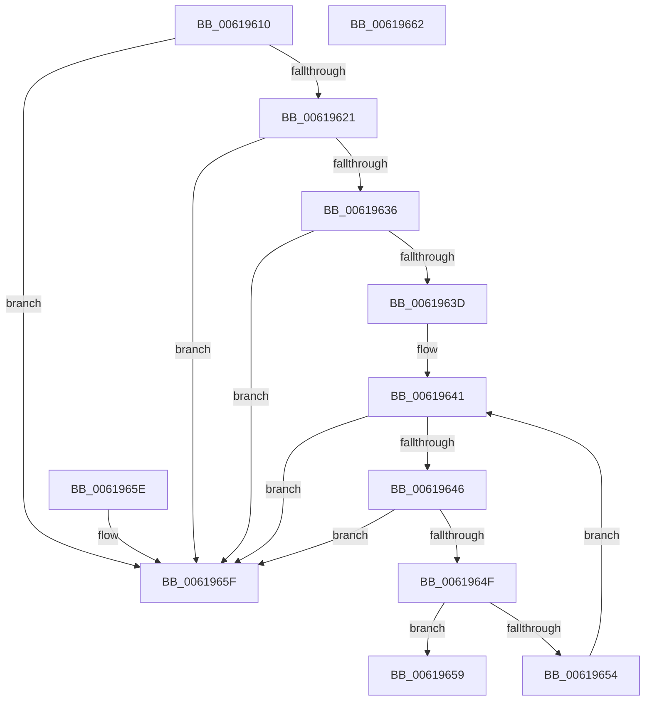

# DifFindThreadContextData

- RVA: `0x00619610`–`0x00619663` (길이 `83` bytes)
- VA: `0x0000000140619610`
- 실행 섹션: `.text`
- PDB 이름 있음: `예`; PDB Function 태그: `아니요`
- unwind 정보 RVA: `0x000DB714`
- 디코드: `27`개 명령, `83/83` bytes 표시
- 미해석 바이트: `0` (있으면 어셈블리에 `.byte`로 보존)

> 이 문서는 커널 이미지의 기계어와 PDB 기호를 분석해 생성했습니다. 4번과 5번은 함수 원형과 자료형을 바이너리 사용 방식에서 추정한 C 해석이며 원본 소스 복구 결과는 아닙니다.

## 1. Dependencies

- 직접 호출 지점: **0**; 고유 호출 대상: **0**
- 직접 호출자로 확인된 함수: **0**
- RIP 상대 이미지 참조: **1**

### Outgoing calls
- 직접 디코드된 call 명령이 없습니다.

### Direct callers
- 이 함수 시작 RVA로 연결되는 직접 call은 확인되지 않았습니다. 간접 호출은 완전히 역산할 수 없습니다.

### Static image references
- `0x00619613` → RVA `0x00E68200` (`.data`; read)

## 2. Other-region calls and transfers

- 다른 실행 섹션으로 향하는 call: **0**
- 별도 외부 분기/꼬리 이동을 확인하지 못했습니다.

## 3. Assembly (complete function range)

```asm
00619610  44 8B C1                        mov r8d, ecx
00619613  48 8D 0D E6 EB 84 00            lea rcx, [rip + 0x84ebe6]
0061961A  41 80 3C 08 00                  cmp byte ptr [r8 + rcx], 0
0061961F  74 3E                           je 0x14061965f
00619621  65 48 8B 04 25 88 01 00 00      mov rax, qword ptr gs:[0x188]
0061962A  48 8B 90 40 06 00 00            mov rdx, qword ptr [rax + 0x640]
00619631  48 85 D2                        test rdx, rdx
00619634  74 29                           je 0x14061965f
00619636  8B 02                           mov eax, dword ptr [rdx]
00619638  83 F8 01                        cmp eax, 1
0061963B  7C 22                           jl 0x14061965f
0061963D  48 8B 42 08                     mov rax, qword ptr [rdx + 8]
00619641  48 85 C0                        test rax, rax
00619644  74 19                           je 0x14061965f
00619646  48 8D 48 F0                     lea rcx, [rax - 0x10]
0061964A  48 85 C9                        test rcx, rcx
0061964D  74 10                           je 0x14061965f
0061964F  44 3B 01                        cmp r8d, dword ptr [rcx]
00619652  74 05                           je 0x140619659
00619654  48 8B 00                        mov rax, qword ptr [rax]
00619657  EB E8                           jmp 0x140619641
00619659  48 8B 41 08                     mov rax, qword ptr [rcx + 8]
0061965D  C3                              ret
0061965E  CC                              int3
0061965F  33 C0                           xor eax, eax
00619661  C3                              ret
00619662  CC                              int3
```

## 4. C-style interpretation (structured pseudocode)

```c
__int64 __fastcall DifFindThreadContextData(int a1)
{
    __int64 result;

    if ((*(unsigned __int8 *)((unsigned int)(a1) + v_rip + 8711142 * 1)) == 0) goto loc_0061965F;
    if (*(unsigned __int64 *)(*(unsigned __int64 *)(gs_base + (0 + 392)) + 1600) == 0) goto loc_0061965F;
    if (((unsigned int)((unsigned int)(*(unsigned int *)(*(unsigned __int64 *)(*(unsigned __int64 *)(gs_base + (0 + 392)) + 1600))))) < 1) goto loc_0061965F;
loc_00619641:
    if (*(unsigned __int64 *)(*(unsigned __int64 *)(*(unsigned __int64 *)(gs_base + (0 + 392)) + 1600) + 8) == 0) goto loc_0061965F;
    if (*(unsigned __int64 *)(*(unsigned __int64 *)(*(unsigned __int64 *)(gs_base + (0 + 392)) + 1600) + 8) - 16 == 0) goto loc_0061965F;
    if (((unsigned int)((unsigned int)(a1))) == (*(unsigned int *)(*(unsigned __int64 *)(*(unsigned __int64 *)(*(unsigned __int64 *)(gs_base + (0 + 392)) + 1600) + 8) - 16))) goto loc_00619659;
    goto loc_00619641;
loc_00619659:
    return *(unsigned __int64 *)(*(unsigned __int64 *)(*(unsigned __int64 *)(*(unsigned __int64 *)(gs_base + (0 + 392)) + 1600) + 8) - 16 + 8);
loc_0061965F:
    result = 0;
    return result;
}
```

## 5. (Beta) C Style

```c
int64_t DifFindThreadContextData(void *Arg1)
{
    uint8_t *arg1 = (uint8_t *)Arg1;

    int64_t result;

    if ((*(uint8_t *)((uint32_t)(arg1) + v_rip + 0x84EBE6 * 1)) == 0) goto loc_0061965F;
    if (*(uint64_t *)(*(uint64_t *)(gs_base + (0 + 0x188)) + 0x640) == 0) goto loc_0061965F;
    if (((uint32_t)((uint32_t)(*(uint32_t *)(*(uint64_t *)(*(uint64_t *)(gs_base + (0 + 0x188)) + 0x640))))) < 1) goto loc_0061965F;
loc_00619641:
    if (*(uint64_t *)(*(uint64_t *)(*(uint64_t *)(gs_base + (0 + 0x188)) + 0x640) + 0x8) == 0) goto loc_0061965F;
    if (*(uint64_t *)(*(uint64_t *)(*(uint64_t *)(gs_base + (0 + 0x188)) + 0x640) + 0x8) - 16 == 0) goto loc_0061965F;
    if (((uint32_t)((uint32_t)(Arg1))) == (*(uint32_t *)(*(uint64_t *)(*(uint64_t *)(*(uint64_t *)(gs_base + (0 + 0x188)) + 0x640) + 0x8) - 0x10))) goto loc_00619659;
    goto loc_00619641;
loc_00619659:
    return *(uint64_t *)(*(uint64_t *)(*(uint64_t *)(*(uint64_t *)(gs_base + (0 + 0x188)) + 0x640) + 0x8) - 0x10 + 0x8);
loc_0061965F:
    result = 0;
    return result;
}
```

### 관측된 메모리 오프셋

구조체 형식이 확인되지 않은 접근은 인자 기준의 오프셋으로만 기록했습니다.

| 기준 인자 | 오프셋 표현 | 폭 (bit) | 접근 |
|---|---:|---:|---|
| `Arg1` | `+ 0x0 + rcx*1` | `8` | `R` |

## 6. Execution-region graph

[열기: 2D/3D 그래프와 함수 탐색 컨트롤 패널](../../../control-panel.html?section=text&rva=0x00619610&view=graph)

- 2D 그래프는 위에서 아래로 흐르고, 3D 그래프는 빈 공간을 드래그해 회전합니다. Shift+드래그는 이동, 휠은 확대·축소, 함수 노드 선택은 대상 보고서 이동입니다.

### Static fallback


