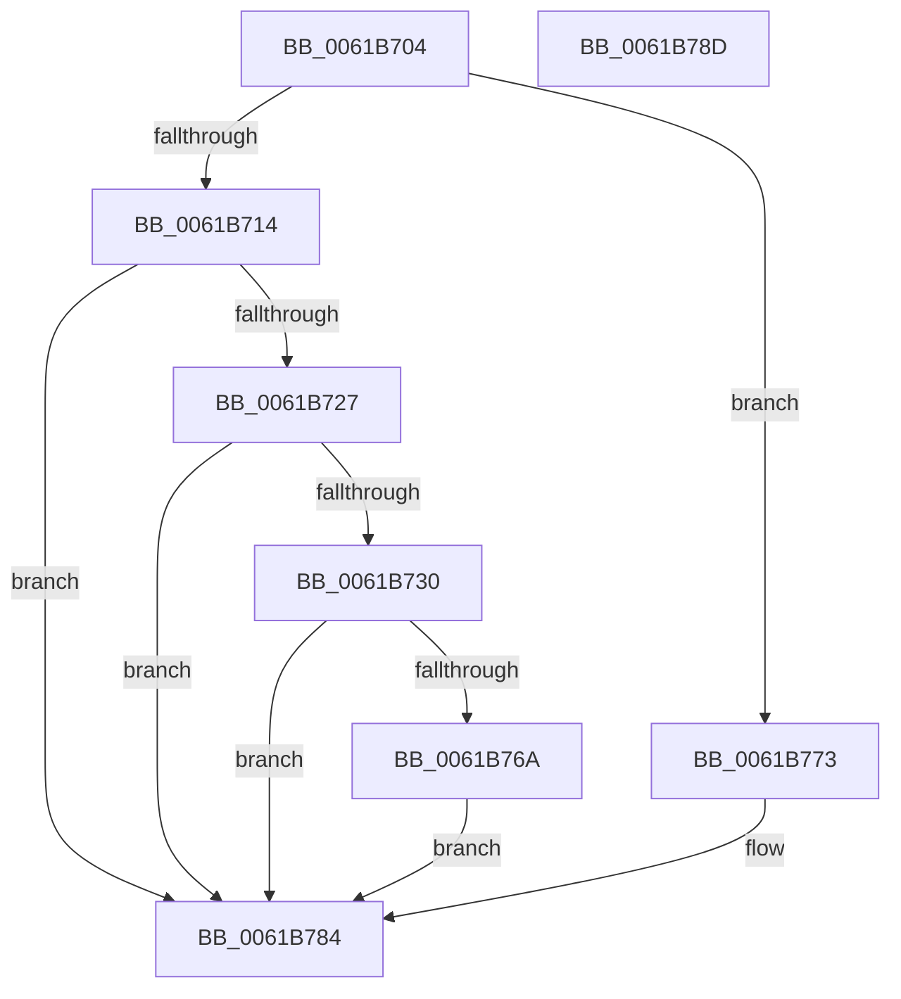

# DifGetAvailableSystemPages

- RVA: `0x0061B704`–`0x0061B78E` (길이 `138` bytes)
- VA: `0x000000014061B704`
- 실행 섹션: `.text`
- PDB 이름 있음: `예`; PDB Function 태그: `아니요`
- unwind 정보 RVA: `0x0005CF00`
- 디코드: `34`개 명령, `138/138` bytes 표시
- 미해석 바이트: `0` (있으면 어셈블리에 `.byte`로 보존)

> 이 문서는 커널 이미지의 기계어와 PDB 기호를 분석해 생성했습니다. 4번과 5번은 함수 원형과 자료형을 바이너리 사용 방식에서 추정한 C 해석이며 원본 소스 복구 결과는 아닙니다.

## 1. Dependencies

- 직접 호출 지점: **3**; 고유 호출 대상: **3**
- 직접 호출자로 확인된 함수: **2**
- RIP 상대 이미지 참조: **7**

### Outgoing calls
- `0x0061B71E` → [MmCreatePartition](../../page/80/MmCreatePartition_function_0080DC3C.md) (function, `0x0080DC3C`)
- `0x0061B73F` → [memset](../6C/memset_function_006C6C40.md) (function, `0x006C6C40`)
- `0x0061B761` → [MmManagePartitionMemoryInformation](../../page/90/MmManagePartitionMemoryInformation_function_0090343C.md) (function, `0x0090343C`)

### Direct callers
- [DifRegisterObjectTracking](DifRegisterObjectTracking_function_0061A360.md) at `0x0061A3C5`
- [VfLwSPEntry](../64/VfLwSPEntry_function_0064C0E0.md) at `0x0064C0FC`

### Static image references
- `0x0061B70C` → RVA `0x00F03E78` (`.data`; read)
- `0x0061B717` → RVA `0x00F03DE0` (`.data`; read)
- `0x0061B732` → RVA `0x00E28B00` (`.data`; read)
- `0x0061B755` → RVA `0x00E28B04` (`.data`; write)
- `0x0061B75B` → RVA `0x00E28B08` (`.data`; write)
- `0x0061B76A` → RVA `0x00E28B38` (`.data`; read)
- `0x0061B773` → RVA `0x00E30088` (`.data`; read)

## 2. Other-region calls and transfers

- 다른 실행 섹션으로 향하는 call: **2**
  - `0x0061B71E` → [MmCreatePartition](../../page/80/MmCreatePartition_function_0080DC3C.md) (`.text` → `PAGE`)
  - `0x0061B761` → [MmManagePartitionMemoryInformation](../../page/90/MmManagePartitionMemoryInformation_function_0090343C.md) (`.text` → `PAGE`)
- 별도 외부 분기/꼬리 이동을 확인하지 못했습니다.

## 3. Assembly (complete function range)

```asm
0061B704  40 53                           push rbx
0061B706  48 83 EC 20                     sub rsp, 0x20
0061B70A  33 DB                           xor ebx, ebx
0061B70C  38 1D 66 87 8E 00               cmp byte ptr [rip + 0x8e8766], bl
0061B712  75 5F                           jne 0x14061b773
0061B714  8D 53 01                        lea edx, [rbx + 1]
0061B717  48 8D 0D C2 86 8E 00            lea rcx, [rip + 0x8e86c2]
0061B71E  E8 19 25 1F 00                  call 0x14080dc3c
0061B723  85 C0                           test eax, eax
0061B725  78 5D                           js 0x14061b784
0061B727  48 39 1D B2 86 8E 00            cmp qword ptr [rip + 0x8e86b2], rbx
0061B72E  74 54                           je 0x14061b784
0061B730  33 D2                           xor edx, edx
0061B732  48 8D 0D C7 D3 80 00            lea rcx, [rip + 0x80d3c7]
0061B739  41 B8 F0 00 00 00               mov r8d, 0xf0
0061B73F  E8 FC B4 0A 00                  call 0x1406c6c40
0061B744  83 C8 FF                        or eax, 0xffffffff
0061B747  48 8D 15 B2 D3 80 00            lea rdx, [rip + 0x80d3b2]
0061B74E  48 8D 0D 8B 86 8E 00            lea rcx, [rip + 0x8e868b]
0061B755  89 05 A9 D3 80 00               mov dword ptr [rip + 0x80d3a9], eax
0061B75B  89 05 A7 D3 80 00               mov dword ptr [rip + 0x80d3a7], eax
0061B761  E8 D6 7C 2E 00                  call 0x14090343c
0061B766  85 C0                           test eax, eax
0061B768  78 1A                           js 0x14061b784
0061B76A  48 8B 1D C7 D3 80 00            mov rbx, qword ptr [rip + 0x80d3c7]
0061B771  EB 11                           jmp 0x14061b784
0061B773  48 8B 05 0E 49 81 00            mov rax, qword ptr [rip + 0x81490e]
0061B77A  48 8B 08                        mov rcx, qword ptr [rax]
0061B77D  48 8B 99 00 49 00 00            mov rbx, qword ptr [rcx + 0x4900]
0061B784  48 8B C3                        mov rax, rbx
0061B787  48 83 C4 20                     add rsp, 0x20
0061B78B  5B                              pop rbx
0061B78C  C3                              ret
0061B78D  CC                              int3
```

## 4. C-style interpretation (structured pseudocode)

```c
__int64 __fastcall DifGetAvailableSystemPages(void)
{
    __int64 result;
    __int64 v_rbx;
    __int64 v_rsp;

    v_rsp = (v_rsp) - (32);
    v_rbx = 0;
    if ((*(unsigned __int8 *)(v_rip + 9340774)) != 0) goto loc_0061B773;
    result = MmCreatePartition(v_rip + 9340610, v_rbx + 1, a3, a4);
    if (sign_flag) goto loc_0061B784;
    if ((*(unsigned __int64 *)(v_rip + 9340594)) == 0) goto loc_0061B784;
    a2 = 0;
    result = memset(v_rip + 8442823, a2, 240, a4);
    result = (unsigned int)((result) | (0xFFFFFFFFULL));
    *(unsigned int *)(v_rip + 8442793) = (unsigned int)(result);
    *(unsigned int *)(v_rip + 8442791) = (unsigned int)(result);
    result = MmManagePartitionMemoryInformation(v_rip + 9340555, v_rip + 8442802, 240, a4);
    if (sign_flag) goto loc_0061B784;
    goto loc_0061B784;
loc_0061B773:
loc_0061B784:
    v_rsp = (v_rsp) + (32);
    return *(unsigned __int64 *)(*(unsigned __int64 *)(*(unsigned __int64 *)(v_rip + 8472846)) + 18688);
}
```

## 5. (Beta) C Style

```c
void DifGetAvailableSystemPages(void)
{
    int64_t result;
    int64_t local_rbx;
    int64_t local_rsp;

    local_rsp = (local_rsp) - (32);
    local_rbx = 0;
    if ((*(uint8_t *)(v_rip + 0x8E8766)) != 0) goto loc_0061B773;
    result = MmCreatePartition(v_rip + 9340610, local_rbx + 1, a3, a4);
    if (sign_flag) goto loc_0061B784;
    if ((*(uint64_t *)(v_rip + 0x8E86B2)) == 0) goto loc_0061B784;
    a2 = 0;
    result = memset(v_rip + 8442823, a2, 240, a4);
    result = (uint32_t)((result) | (0xFFFFFFFFULL));
    *(uint32_t *)(v_rip + 0x80D3A9) = (uint32_t)(result);
    *(uint32_t *)(v_rip + 0x80D3A7) = (uint32_t)(result);
    result = MmManagePartitionMemoryInformation(v_rip + 9340555, v_rip + 8442802, 240, a4);
    if (sign_flag) goto loc_0061B784;
    goto loc_0061B784;
loc_0061B773:
loc_0061B784:
    local_rsp = (local_rsp) + (32);
    return *(uint64_t *)(*(uint64_t *)(*(uint64_t *)(v_rip + 0x81490E)) + 0x4900);
}
```

## 6. Execution-region graph

[열기: 2D/3D 그래프와 함수 탐색 컨트롤 패널](../../../control-panel.html?section=text&rva=0x0061B704&view=graph)

- 2D 그래프는 위에서 아래로 흐르고, 3D 그래프는 빈 공간을 드래그해 회전합니다. Shift+드래그는 이동, 휠은 확대·축소, 함수 노드 선택은 대상 보고서 이동입니다.

### Static fallback


