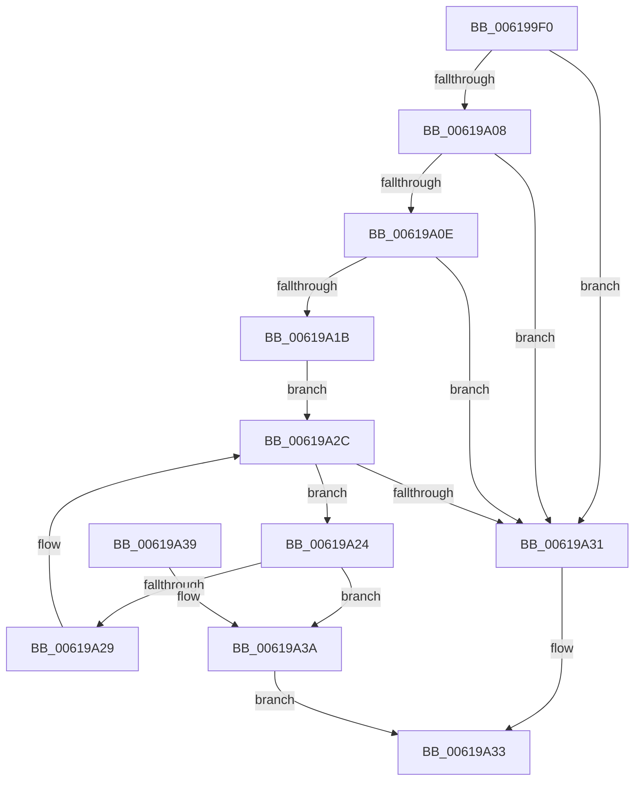

# DifGetPluginPerDriverData

- RVA: `0x006199F0`–`0x00619A40` (길이 `80` bytes)
- VA: `0x00000001406199F0`
- 실행 섹션: `.text`
- PDB 이름 있음: `예`; PDB Function 태그: `아니요`
- unwind 정보 RVA: `0x0006CC84`
- 디코드: `28`개 명령, `80/80` bytes 표시
- 미해석 바이트: `0` (있으면 어셈블리에 `.byte`로 보존)

> 이 문서는 커널 이미지의 기계어와 PDB 기호를 분석해 생성했습니다. 4번과 5번은 함수 원형과 자료형을 바이너리 사용 방식에서 추정한 C 해석이며 원본 소스 복구 결과는 아닙니다.

## 1. Dependencies

- 직접 호출 지점: **1**; 고유 호출 대상: **1**
- 직접 호출자로 확인된 함수: **0**
- RIP 상대 이미지 참조: **1**

### Outgoing calls
- `0x00619A11` → [VfTargetDriversGetVerifierData](../../pagevrfy/BB/VfTargetDriversGetVerifierData_function_00BB7E6C.md) (function, `0x00BB7E6C`)

### Direct callers
- 이 함수 시작 RVA로 연결되는 직접 call은 확인되지 않았습니다. 간접 호출은 완전히 역산할 수 없습니다.

### Static image references
- `0x006199F8` → RVA `0x00E68240` (`.data`; read)

## 2. Other-region calls and transfers

- 다른 실행 섹션으로 향하는 call: **1**
  - `0x00619A11` → [VfTargetDriversGetVerifierData](../../pagevrfy/BB/VfTargetDriversGetVerifierData_function_00BB7E6C.md) (`.text` → `PAGEVRFY`)
- 별도 외부 분기/꼬리 이동을 확인하지 못했습니다.

## 3. Assembly (complete function range)

```asm
006199F0  40 53                           push rbx
006199F2  48 83 EC 20                     sub rsp, 0x20
006199F6  8B D9                           mov ebx, ecx
006199F8  4C 8D 05 41 E8 84 00            lea r8, [rip + 0x84e841]
006199FF  4D 8B 04 D8                     mov r8, qword ptr [r8 + rbx*8]
00619A03  4D 85 C0                        test r8, r8
00619A06  74 29                           je 0x140619a31
00619A08  41 83 38 00                     cmp dword ptr [r8], 0
00619A0C  74 23                           je 0x140619a31
00619A0E  48 8B CA                        mov rcx, rdx
00619A11  E8 56 E4 59 00                  call 0x140bb7e6c
00619A16  48 85 C0                        test rax, rax
00619A19  74 16                           je 0x140619a31
00619A1B  48 8D 48 60                     lea rcx, [rax + 0x60]
00619A1F  48 8B 01                        mov rax, qword ptr [rcx]
00619A22  EB 08                           jmp 0x140619a2c
00619A24  39 58 F0                        cmp dword ptr [rax - 0x10], ebx
00619A27  74 11                           je 0x140619a3a
00619A29  48 8B 00                        mov rax, qword ptr [rax]
00619A2C  48 3B C1                        cmp rax, rcx
00619A2F  75 F3                           jne 0x140619a24
00619A31  33 C0                           xor eax, eax
00619A33  48 83 C4 20                     add rsp, 0x20
00619A37  5B                              pop rbx
00619A38  C3                              ret
00619A39  CC                              int3
00619A3A  48 8B 40 F8                     mov rax, qword ptr [rax - 8]
00619A3E  EB F3                           jmp 0x140619a33
```

## 4. C-style interpretation (structured pseudocode)

```c
__int64 __fastcall DifGetPluginPerDriverData(int a1, __int64 a2)
{
    __int64 result;
    __int64 v_rsp;

    v_rsp = (v_rsp) - (32);
    if (*(unsigned __int64 *)(v_rip + 8710209 + (unsigned int)(a1) * 8) == 0) goto loc_00619A31;
    if ((*(unsigned int *)(*(unsigned __int64 *)(v_rip + 8710209 + (unsigned int)(a1) * 8))) == 0) goto loc_00619A31;
    result = VfTargetDriversGetVerifierData(a2, a2, *(unsigned __int64 *)(v_rip + 8710209 + (unsigned int)(a1) * 8), a4);
    if (result == 0) goto loc_00619A31;
    goto loc_00619A2C;
loc_00619A24:
    if ((*(unsigned int *)(*(unsigned __int64 *)(result + 96) - 16)) == ((unsigned int)((unsigned int)(a1)))) goto loc_00619A3A;
loc_00619A2C:
    if ((*(unsigned __int64 *)(*(unsigned __int64 *)(result + 96))) != (result + 96)) goto loc_00619A24;
loc_00619A31:
    result = 0;
loc_00619A33:
    v_rsp = (v_rsp) + (32);
    return result;
loc_00619A3A:
    goto loc_00619A33;
}
```

## 5. (Beta) C Style

```c
int64_t DifGetPluginPerDriverData(int32_t Arg1, int64_t Arg2)
{
    int64_t result;
    int64_t local_rsp;

    local_rsp = (local_rsp) - (32);
    if (*(uint64_t *)(v_rip + 0x84E841 + (uint32_t)(Arg1) * 8) == 0) goto loc_00619A31;
    if ((*(uint32_t *)(*(uint64_t *)(v_rip + 0x84E841 + (uint32_t)(Arg1) * 8))) == 0) goto loc_00619A31;
    result = VfTargetDriversGetVerifierData(Arg2, Arg2, *(uint64_t *)(v_rip + 0x84E841 + (uint32_t)(Arg1) * 8), a4);
    if (result == 0) goto loc_00619A31;
    goto loc_00619A2C;
loc_00619A24:
    if ((*(uint32_t *)(*(uint64_t *)(result + 0x60) - 0x10)) == ((uint32_t)((uint32_t)(Arg1)))) goto loc_00619A3A;
loc_00619A2C:
    if ((*(uint64_t *)(*(uint64_t *)(result + 0x60))) != (result + 96)) goto loc_00619A24;
loc_00619A31:
    result = 0;
loc_00619A33:
    local_rsp = (local_rsp) + (32);
    return result;
loc_00619A3A:
    goto loc_00619A33;
}
```

## 6. Execution-region graph

[열기: 2D/3D 그래프와 함수 탐색 컨트롤 패널](../../../control-panel.html?section=text&rva=0x006199F0&view=graph)

- 2D 그래프는 위에서 아래로 흐르고, 3D 그래프는 빈 공간을 드래그해 회전합니다. Shift+드래그는 이동, 휠은 확대·축소, 함수 노드 선택은 대상 보고서 이동입니다.

### Static fallback


