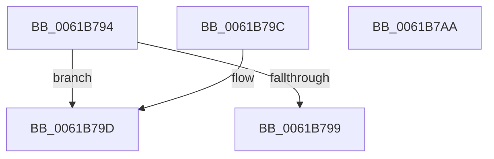

# DifIsPluginEnabled

- RVA: `0x0061B794`–`0x0061B7AB` (길이 `23` bytes)
- VA: `0x000000014061B794`
- 실행 섹션: `.text`
- PDB 이름 있음: `예`; PDB Function 태그: `아니요`
- unwind 정보 RVA: `0x000DB714`
- 디코드: `10`개 명령, `23/23` bytes 표시
- 미해석 바이트: `0` (있으면 어셈블리에 `.byte`로 보존)

> 이 문서는 커널 이미지의 기계어와 PDB 기호를 분석해 생성했습니다. 4번과 5번은 함수 원형과 자료형을 바이너리 사용 방식에서 추정한 C 해석이며 원본 소스 복구 결과는 아닙니다.

## 1. Dependencies

- 직접 호출 지점: **0**; 고유 호출 대상: **0**
- 직접 호출자로 확인된 함수: **1**
- RIP 상대 이미지 참조: **1**

### Outgoing calls
- 직접 디코드된 call 명령이 없습니다.

### Direct callers
- [DifIsValidTrackingObject](DifIsValidTrackingObject_function_00619BCC.md) at `0x00619BE5`

### Static image references
- `0x0061B79F` → RVA `0x00E68200` (`.data`; read)

## 2. Other-region calls and transfers

- 다른 실행 섹션으로 향하는 call: **0**
- 별도 외부 분기/꼬리 이동을 확인하지 못했습니다.

## 3. Assembly (complete function range)

```asm
0061B794  83 F9 40                        cmp ecx, 0x40
0061B797  72 04                           jb 0x14061b79d
0061B799  32 C0                           xor al, al
0061B79B  C3                              ret
0061B79C  CC                              int3
0061B79D  8B C1                           mov eax, ecx
0061B79F  48 8D 0D 5A CA 84 00            lea rcx, [rip + 0x84ca5a]
0061B7A6  8A 04 08                        mov al, byte ptr [rax + rcx]
0061B7A9  C3                              ret
0061B7AA  CC                              int3
```

## 4. C-style interpretation (structured pseudocode)

```c
__int64 __fastcall DifIsPluginEnabled(int a1)
{
    __int64 result;

    if (a1 < 64) goto loc_0061B79D;
    result = 0;
    return result;
loc_0061B79D:
    return *(unsigned __int8 *)((unsigned int)(a1) + v_rip + 8702554 * 1);
}
```

## 5. (Beta) C Style

```c
int64_t DifIsPluginEnabled(int32_t Arg1)
{
    int64_t result;

    if (Arg1 < 64) goto loc_0061B79D;
    result = 0;
    return result;
loc_0061B79D:
    return *(uint8_t *)((uint32_t)(Arg1) + v_rip + 0x84CA5A * 1);
}
```

## 6. Execution-region graph

[열기: 2D/3D 그래프와 함수 탐색 컨트롤 패널](../../../control-panel.html?section=text&rva=0x0061B794&view=graph)

- 2D 그래프는 위에서 아래로 흐르고, 3D 그래프는 빈 공간을 드래그해 회전합니다. Shift+드래그는 이동, 휠은 확대·축소, 함수 노드 선택은 대상 보고서 이동입니다.

### Static fallback


