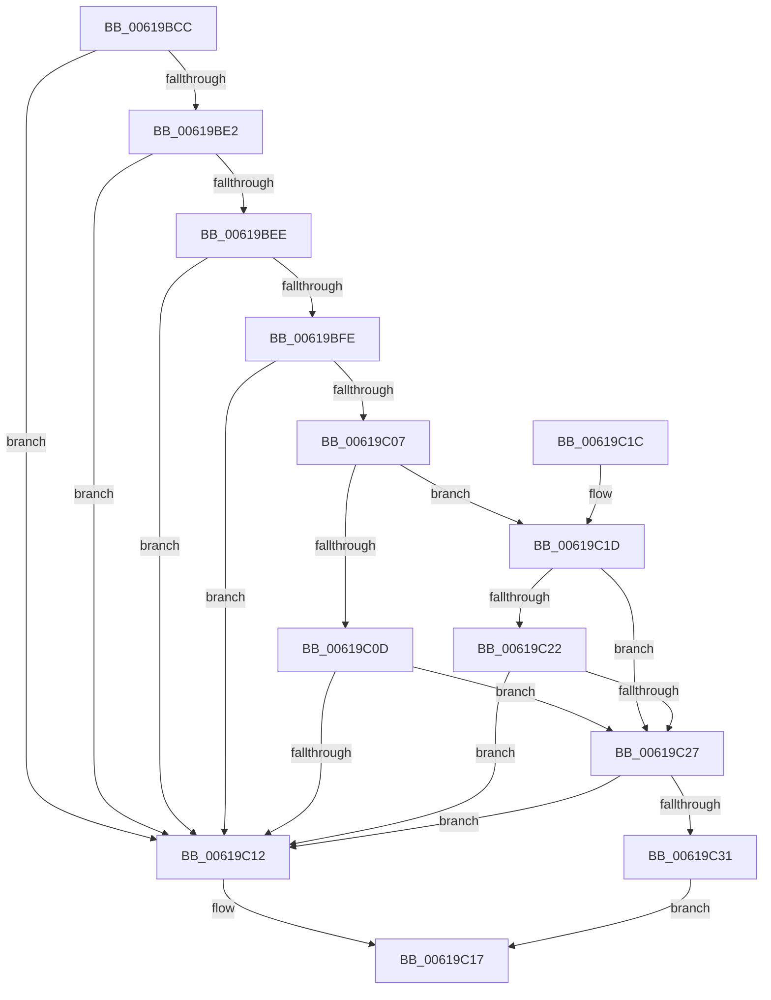

# DifIsValidTrackingObject

- RVA: `0x00619BCC`–`0x00619C44` (길이 `120` bytes)
- VA: `0x0000000140619BCC`
- 실행 섹션: `.text`
- PDB 이름 있음: `예`; PDB Function 태그: `아니요`
- unwind 정보 RVA: `0x00098820`
- 디코드: `37`개 명령, `120/120` bytes 표시
- 미해석 바이트: `0` (있으면 어셈블리에 `.byte`로 보존)

> 이 문서는 커널 이미지의 기계어와 PDB 기호를 분석해 생성했습니다. 4번과 5번은 함수 원형과 자료형을 바이너리 사용 방식에서 추정한 C 해석이며 원본 소스 복구 결과는 아닙니다.

## 1. Dependencies

- 직접 호출 지점: **1**; 고유 호출 대상: **1**
- 직접 호출자로 확인된 함수: **2**
- RIP 상대 이미지 참조: **3**

### Outgoing calls
- `0x00619BE5` → [DifIsPluginEnabled](DifIsPluginEnabled_function_0061B794.md) (function, `0x0061B794`)

### Direct callers
- [DifObjTrkInsertItem](DifObjTrkInsertItem_function_00619D00.md) at `0x00619D43`
- [DifObjTrkRemoveItem](DifObjTrkRemoveItem_function_0061A1D0.md) at `0x0061A213`

### Static image references
- `0x00619BEE` → RVA `0x00E68240` (`.data`; read)
- `0x00619C27` → RVA `0x00F03EB8` (`.data`; read)
- `0x00619C31` → RVA `0x00F03EB4` (`.data`; read)

## 2. Other-region calls and transfers

- 다른 실행 섹션으로 향하는 call: **0**
- 별도 외부 분기/꼬리 이동을 확인하지 못했습니다.

## 3. Assembly (complete function range)

```asm
00619BCC  48 83 EC 28                     sub rsp, 0x28
00619BD0  48 B8 00 00 00 00 00 80 FF FF   movabs rax, 0xffff800000000000
00619BDA  44 8B C9                        mov r9d, ecx
00619BDD  48 3B D0                        cmp rdx, rax
00619BE0  72 30                           jb 0x140619c12
00619BE2  41 8B C9                        mov ecx, r9d
00619BE5  E8 AA 1B 00 00                  call 0x14061b794
00619BEA  84 C0                           test al, al
00619BEC  74 24                           je 0x140619c12
00619BEE  48 8D 0D 4B E6 84 00            lea rcx, [rip + 0x84e64b]
00619BF5  4A 8B 04 C9                     mov rax, qword ptr [rcx + r9*8]
00619BF9  48 85 C0                        test rax, rax
00619BFC  74 14                           je 0x140619c12
00619BFE  48 8B 40 18                     mov rax, qword ptr [rax + 0x18]
00619C02  48 85 C0                        test rax, rax
00619C05  74 0B                           je 0x140619c12
00619C07  8B 00                           mov eax, dword ptr [rax]
00619C09  85 C0                           test eax, eax
00619C0B  75 10                           jne 0x140619c1d
00619C0D  45 85 C0                        test r8d, r8d
00619C10  75 15                           jne 0x140619c27
00619C12  B8 BB 00 00 C0                  mov eax, 0xc00000bb
00619C17  48 83 C4 28                     add rsp, 0x28
00619C1B  C3                              ret
00619C1C  CC                              int3
00619C1D  45 85 C0                        test r8d, r8d
00619C20  74 05                           je 0x140619c27
00619C22  41 3B C0                        cmp eax, r8d
00619C25  75 EB                           jne 0x140619c12
00619C27  48 83 3D 89 A2 8E 00 00         cmp qword ptr [rip + 0x8ea289], 0
00619C2F  74 E1                           je 0x140619c12
00619C31  8B 05 7D A2 8E 00               mov eax, dword ptr [rip + 0x8ea27d]
00619C37  F7 D8                           neg eax
00619C39  1B C0                           sbb eax, eax
00619C3B  F7 D0                           not eax
00619C3D  25 BB 00 00 C0                  and eax, 0xc00000bb
00619C42  EB D3                           jmp 0x140619c17
```

## 4. C-style interpretation (structured pseudocode)

```c
__int64 __fastcall DifIsValidTrackingObject(int a1, __int64 a2, int a3)
{
    __int64 result;
    __int64 v_rsp;

    v_rsp = (v_rsp) - (40);
    if (a2 < result) goto loc_00619C12;
    result = DifIsPluginEnabled((unsigned int)((unsigned int)((unsigned int)(a1))), a2, a3, (unsigned int)(a1));
    if ((unsigned __int8)(result) == 0) goto loc_00619C12;
    if (*(unsigned __int64 *)(v_rip + 8709707 + (unsigned int)(a1) * 8) == 0) goto loc_00619C12;
    if (*(unsigned __int64 *)(*(unsigned __int64 *)(v_rip + 8709707 + (unsigned int)(a1) * 8) + 24) == 0) goto loc_00619C12;
    if ((unsigned int)((unsigned int)(*(unsigned int *)(*(unsigned __int64 *)(*(unsigned __int64 *)(v_rip + 8709707 + (unsigned int)(a1) * 8) + 24)))) != 0) goto loc_00619C1D;
    if (a3 != 0) goto loc_00619C27;
loc_00619C12:
loc_00619C17:
    v_rsp = (v_rsp) + (40);
    return (unsigned int)(0xC00000BBULL);
loc_00619C1D:
    if (a3 == 0) goto loc_00619C27;
    if (((unsigned int)((unsigned int)(0xC00000BBULL))) != a3) goto loc_00619C12;
loc_00619C27:
    if ((*(unsigned __int64 *)(v_rip + 9347721)) == 0) goto loc_00619C12;
    result = (unsigned int)(-((unsigned int)(*(unsigned int *)(v_rip + 9347709))));
    result = (unsigned int)(~(result));
    result = (unsigned int)((result) & (0xC00000BBULL));
    goto loc_00619C17;
}
```

## 5. (Beta) C Style

```c
int64_t DifIsValidTrackingObject(int32_t Arg1, int64_t Arg2, int32_t Arg3)
{
    int64_t result;
    int64_t local_rsp;

    local_rsp = (local_rsp) - (40);
    if (Arg2 < result) goto loc_00619C12;
    result = DifIsPluginEnabled((uint32_t)((uint32_t)((uint32_t)(Arg1))), Arg2, Arg3, (uint32_t)(Arg1));
    if ((uint8_t)(result) == 0) goto loc_00619C12;
    if (*(uint64_t *)(v_rip + 0x84E64B + (uint32_t)(Arg1) * 8) == 0) goto loc_00619C12;
    if (*(uint64_t *)(*(uint64_t *)(v_rip + 0x84E64B + (uint32_t)(Arg1) * 8) + 0x18) == 0) goto loc_00619C12;
    if ((uint32_t)((uint32_t)(*(uint32_t *)(*(uint64_t *)(*(uint64_t *)(v_rip + 0x84E64B + (uint32_t)(Arg1) * 8) + 0x18)))) != 0) goto loc_00619C1D;
    if (Arg3 != 0) goto loc_00619C27;
loc_00619C12:
loc_00619C17:
    local_rsp = (local_rsp) + (40);
    return (uint32_t)(0xC00000BBULL);
loc_00619C1D:
    if (Arg3 == 0) goto loc_00619C27;
    if (((uint32_t)((uint32_t)(0xC00000BBULL))) != Arg3) goto loc_00619C12;
loc_00619C27:
    if ((*(uint64_t *)(v_rip + 0x8EA289)) == 0) goto loc_00619C12;
    result = (uint32_t)(-((uint32_t)(*(uint32_t *)(v_rip + 0x8EA27D))));
    result = (uint32_t)(~(result));
    result = (uint32_t)((result) & (0xC00000BBULL));
    goto loc_00619C17;
}
```

## 6. Execution-region graph

[열기: 2D/3D 그래프와 함수 탐색 컨트롤 패널](../../../control-panel.html?section=text&rva=0x00619BCC&view=graph)

- 2D 그래프는 위에서 아래로 흐르고, 3D 그래프는 빈 공간을 드래그해 회전합니다. Shift+드래그는 이동, 휠은 확대·축소, 함수 노드 선택은 대상 보고서 이동입니다.

### Static fallback


