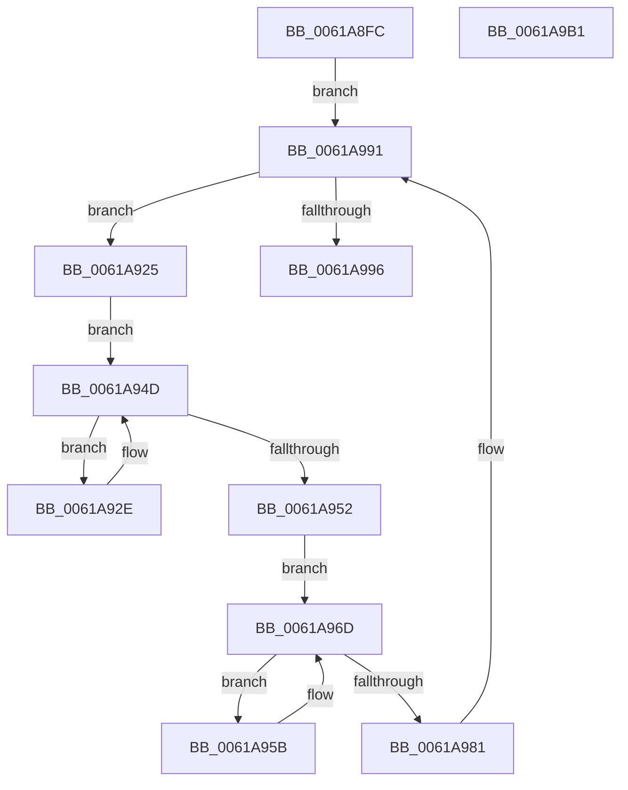

# DifMarkHiberPhase

- RVA: `0x0061A8FC`–`0x0061A9B2` (길이 `182` bytes)
- VA: `0x000000014061A8FC`
- 실행 섹션: `.text`
- PDB 이름 있음: `예`; PDB Function 태그: `아니요`
- unwind 정보 RVA: `0x0005D7BC`
- 디코드: `48`개 명령, `182/182` bytes 표시
- 미해석 바이트: `0` (있으면 어셈블리에 `.byte`로 보존)

> 이 문서는 커널 이미지의 기계어와 PDB 기호를 분석해 생성했습니다. 4번과 5번은 함수 원형과 자료형을 바이너리 사용 방식에서 추정한 C 해석이며 원본 소스 복구 결과는 아닙니다.

## 1. Dependencies

- 직접 호출 지점: **3**; 고유 호출 대상: **1**
- 직접 호출자로 확인된 함수: **1**
- RIP 상대 이미지 참조: **1**

### Outgoing calls
- `0x0061A945` → [PoSetHiberRange](../47/PoSetHiberRange_function_0047C580.md) (function, `0x0047C580`)
- `0x0061A965` → [PoSetHiberRange](../47/PoSetHiberRange_function_0047C580.md) (function, `0x0047C580`)
- `0x0061A989` → [PoSetHiberRange](../47/PoSetHiberRange_function_0047C580.md) (function, `0x0047C580`)

### Direct callers
- [PopMarkComponentsBootPhase](../../pagelk/B6/PopMarkComponentsBootPhase_function_00B6E0E4.md) at `0x00B6E26B`

### Static image references
- `0x0061A915` → RVA `0x00F03E90` (`.data`; read)

## 2. Other-region calls and transfers

- 다른 실행 섹션으로 향하는 call: **0**
- 별도 외부 분기/꼬리 이동을 확인하지 못했습니다.

## 3. Assembly (complete function range)

```asm
0061A8FC  48 8B C4                        mov rax, rsp
0061A8FF  48 89 58 08                     mov qword ptr [rax + 8], rbx
0061A903  48 89 68 10                     mov qword ptr [rax + 0x10], rbp
0061A907  48 89 70 18                     mov qword ptr [rax + 0x18], rsi
0061A90B  48 89 78 20                     mov qword ptr [rax + 0x20], rdi
0061A90F  41 56                           push r14
0061A911  48 83 EC 30                     sub rsp, 0x30
0061A915  48 8B 1D 74 95 8E 00            mov rbx, qword ptr [rip + 0x8e9574]
0061A91C  4C 8D 35 6D 95 8E 00            lea r14, [rip + 0x8e956d]
0061A923  EB 6C                           jmp 0x14061a991
0061A925  48 8D 73 10                     lea rsi, [rbx + 0x10]
0061A929  48 8B 3E                        mov rdi, qword ptr [rsi]
0061A92C  EB 1F                           jmp 0x14061a94d
0061A92E  33 C9                           xor ecx, ecx
0061A930  C7 44 24 20 44 69 66 4E         mov dword ptr [rsp + 0x20], 0x4e666944
0061A938  4C 8D 47 F0                     lea r8, [rdi - 0x10]
0061A93C  BA 00 00 01 00                  mov edx, 0x10000
0061A941  44 8D 49 20                     lea r9d, [rcx + 0x20]
0061A945  E8 36 1C E6 FF                  call 0x14047c580
0061A94A  48 8B 3F                        mov rdi, qword ptr [rdi]
0061A94D  48 3B FE                        cmp rdi, rsi
0061A950  75 DC                           jne 0x14061a92e
0061A952  48 8D 73 20                     lea rsi, [rbx + 0x20]
0061A956  48 8B 3E                        mov rdi, qword ptr [rsi]
0061A959  EB 12                           jmp 0x14061a96d
0061A95B  4C 8D 47 F0                     lea r8, [rdi - 0x10]
0061A95F  41 B9 20 00 00 00               mov r9d, 0x20
0061A965  E8 16 1C E6 FF                  call 0x14047c580
0061A96A  48 8B 3F                        mov rdi, qword ptr [rdi]
0061A96D  33 C9                           xor ecx, ecx
0061A96F  C7 44 24 20 44 69 66 4E         mov dword ptr [rsp + 0x20], 0x4e666944
0061A977  BA 00 00 01 00                  mov edx, 0x10000
0061A97C  48 3B FE                        cmp rdi, rsi
0061A97F  75 DA                           jne 0x14061a95b
0061A981  44 8D 49 40                     lea r9d, [rcx + 0x40]
0061A985  4C 8D 43 F0                     lea r8, [rbx - 0x10]
0061A989  E8 F2 1B E6 FF                  call 0x14047c580
0061A98E  48 8B 1B                        mov rbx, qword ptr [rbx]
0061A991  49 3B DE                        cmp rbx, r14
0061A994  75 8F                           jne 0x14061a925
0061A996  48 8B 5C 24 40                  mov rbx, qword ptr [rsp + 0x40]
0061A99B  48 8B 6C 24 48                  mov rbp, qword ptr [rsp + 0x48]
0061A9A0  48 8B 74 24 50                  mov rsi, qword ptr [rsp + 0x50]
0061A9A5  48 8B 7C 24 58                  mov rdi, qword ptr [rsp + 0x58]
0061A9AA  48 83 C4 30                     add rsp, 0x30
0061A9AE  41 5E                           pop r14
0061A9B0  C3                              ret
0061A9B1  CC                              int3
```

## 4. C-style interpretation (structured pseudocode)

```c
__int64 __fastcall DifMarkHiberPhase(int a1)
{
    __int64 result;
    __int64 v_rsp;
    unsigned int v_stack_m18;
    unsigned __int64 v_stack_p10;
    unsigned __int64 v_stack_p18;
    unsigned __int64 v_stack_p20;
    unsigned __int64 v_stack_p8;

    *(unsigned __int64 *)(v_rsp + 8) = v_rbx;
    *(unsigned __int64 *)(v_rsp + 16) = v_rbp;
    *(unsigned __int64 *)(v_rsp + 24) = v_rsi;
    *(unsigned __int64 *)(v_rsp + 32) = v_rdi;
    v_rsp = (v_rsp) - (48);
    goto loc_0061A991;
loc_0061A925:
    goto loc_0061A94D;
loc_0061A92E:
    a1 = 0;
    v_stack_m18 = 0x4E666944ULL;
    result = PoSetHiberRange(a1, (unsigned int)(0x10000ULL), *(unsigned __int64 *)(*(unsigned __int64 *)(v_rip + 9344372) + 16) - 16, a1 + 32);
loc_0061A94D:
    if ((*(unsigned __int64 *)(*(unsigned __int64 *)(*(unsigned __int64 *)(v_rip + 9344372) + 16))) != (*(unsigned __int64 *)(v_rip + 9344372) + 16)) goto loc_0061A92E;
    goto loc_0061A96D;
loc_0061A95B:
    result = PoSetHiberRange(a1, (unsigned int)(0x10000ULL), *(unsigned __int64 *)(*(unsigned __int64 *)(v_rip + 9344372) + 32) - 16, 32);
loc_0061A96D:
    a1 = 0;
    v_stack_m18 = 0x4E666944ULL;
    if ((*(unsigned __int64 *)(*(unsigned __int64 *)(*(unsigned __int64 *)(v_rip + 9344372) + 32))) != (*(unsigned __int64 *)(v_rip + 9344372) + 32)) goto loc_0061A95B;
    result = PoSetHiberRange(a1, (unsigned int)(0x10000ULL), *(unsigned __int64 *)(v_rip + 9344372) - 16, a1 + 64);
loc_0061A991:
    if ((*(unsigned __int64 *)(*(unsigned __int64 *)(v_rip + 9344372))) != (v_rip + 9344365)) goto loc_0061A925;
    v_rsp = (v_rsp) + (48);
    return result;
}
```

## 5. (Beta) C Style

```c
int64_t DifMarkHiberPhase(int32_t Arg1)
{
    int64_t result;
    int64_t local_rsp;
    uint32_t v_stack_m18;
    uint64_t v_stack_p10;
    uint64_t v_stack_p18;
    uint64_t v_stack_p20;
    uint64_t v_stack_p8;

    *(uint64_t *)(local_rsp + 0x8) = local_rbx;
    *(uint64_t *)(local_rsp + 0x10) = local_rbp;
    *(uint64_t *)(local_rsp + 0x18) = local_rsi;
    *(uint64_t *)(local_rsp + 0x20) = local_rdi;
    local_rsp = (local_rsp) - (48);
    goto loc_0061A991;
loc_0061A925:
    goto loc_0061A94D;
loc_0061A92E:
    Arg1 = 0;
    v_stack_m18 = 0x4E666944ULL;
    result = PoSetHiberRange(Arg1, (uint32_t)(0x10000ULL), *(uint64_t *)(*(uint64_t *)(v_rip + 0x8E9574) + 0x10) - 16, Arg1 + 32);
loc_0061A94D:
    if ((*(uint64_t *)(*(uint64_t *)(*(uint64_t *)(v_rip + 0x8E9574) + 0x10))) != (*(uint64_t *)(v_rip + 0x8E9574) + 16)) goto loc_0061A92E;
    goto loc_0061A96D;
loc_0061A95B:
    result = PoSetHiberRange(Arg1, (uint32_t)(0x10000ULL), *(uint64_t *)(*(uint64_t *)(v_rip + 0x8E9574) + 0x20) - 16, 32);
loc_0061A96D:
    Arg1 = 0;
    v_stack_m18 = 0x4E666944ULL;
    if ((*(uint64_t *)(*(uint64_t *)(*(uint64_t *)(v_rip + 0x8E9574) + 0x20))) != (*(uint64_t *)(v_rip + 0x8E9574) + 32)) goto loc_0061A95B;
    result = PoSetHiberRange(Arg1, (uint32_t)(0x10000ULL), *(uint64_t *)(v_rip + 0x8E9574) - 16, Arg1 + 64);
loc_0061A991:
    if ((*(uint64_t *)(*(uint64_t *)(v_rip + 0x8E9574))) != (v_rip + 9344365)) goto loc_0061A925;
    local_rsp = (local_rsp) + (48);
    return result;
}
```

## 6. Execution-region graph

[열기: 2D/3D 그래프와 함수 탐색 컨트롤 패널](../../../control-panel.html?section=text&rva=0x0061A8FC&view=graph)

- 2D 그래프는 위에서 아래로 흐르고, 3D 그래프는 빈 공간을 드래그해 회전합니다. Shift+드래그는 이동, 휠은 확대·축소, 함수 노드 선택은 대상 보고서 이동입니다.

### Static fallback


