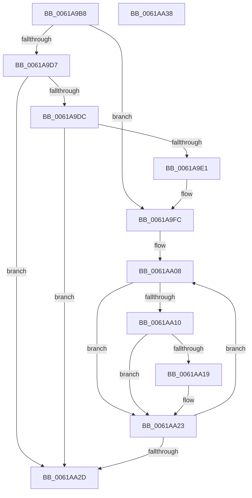

# DifNotifyPluginSystemEvent

- RVA: `0x0061A9B8`–`0x0061AA39` (길이 `129` bytes)
- VA: `0x000000014061A9B8`
- 실행 섹션: `.text`
- PDB 이름 있음: `예`; PDB Function 태그: `아니요`
- unwind 정보 RVA: `0x00089EA4`
- 디코드: `39`개 명령, `129/129` bytes 표시
- 미해석 바이트: `0` (있으면 어셈블리에 `.byte`로 보존)

> 이 문서는 커널 이미지의 기계어와 PDB 기호를 분석해 생성했습니다. 4번과 5번은 함수 원형과 자료형을 바이너리 사용 방식에서 추정한 C 해석이며 원본 소스 복구 결과는 아닙니다.

## 1. Dependencies

- 직접 호출 지점: **1**; 고유 호출 대상: **1**
- 직접 호출자로 확인된 함수: **2**
- RIP 상대 이미지 참조: **1**

### Outgoing calls
- `0x0061AA1E` → [guard_dispatch_icall](../6B/guard_dispatch_icall_function_006BAAD0.md) (function, `0x006BAAD0`)

### Direct callers
- [VfNotifyVerifierOfEvent](../../pagevrfy/B9/VfNotifyVerifierOfEvent_function_00B92E90.md) at `0x00B92F13`
- [VfPtFreePoolNotification](../../pagevrfy/BB/VfPtFreePoolNotification_function_00BB96DC.md) at `0x00BB9720`

### Static image references
- `0x0061A9FC` → RVA `0x00E68240` (`.data`; read)

## 2. Other-region calls and transfers

- 다른 실행 섹션으로 향하는 call: **0**
- 별도 외부 분기/꼬리 이동을 확인하지 못했습니다.

## 3. Assembly (complete function range)

```asm
0061A9B8  48 8B C4                        mov rax, rsp
0061A9BB  48 89 58 08                     mov qword ptr [rax + 8], rbx
0061A9BF  57                              push rdi
0061A9C0  48 83 EC 50                     sub rsp, 0x50
0061A9C4  0F 57 C0                        xorps xmm0, xmm0
0061A9C7  0F 11 40 C8                     movups xmmword ptr [rax - 0x38], xmm0
0061A9CB  0F 11 40 D8                     movups xmmword ptr [rax - 0x28], xmm0
0061A9CF  0F 11 40 E8                     movups xmmword ptr [rax - 0x18], xmm0
0061A9D3  85 C9                           test ecx, ecx
0061A9D5  74 25                           je 0x14061a9fc
0061A9D7  83 F9 01                        cmp ecx, 1
0061A9DA  75 51                           jne 0x14061aa2d
0061A9DC  48 85 D2                        test rdx, rdx
0061A9DF  74 4C                           je 0x14061aa2d
0061A9E1  89 48 C8                        mov dword ptr [rax - 0x38], ecx
0061A9E4  48 8B 02                        mov rax, qword ptr [rdx]
0061A9E7  48 89 44 24 30                  mov qword ptr [rsp + 0x30], rax
0061A9EC  48 8B 42 08                     mov rax, qword ptr [rdx + 8]
0061A9F0  48 89 44 24 38                  mov qword ptr [rsp + 0x38], rax
0061A9F5  8B 42 10                        mov eax, dword ptr [rdx + 0x10]
0061A9F8  89 44 24 48                     mov dword ptr [rsp + 0x48], eax
0061A9FC  48 8D 1D 3D D8 84 00            lea rbx, [rip + 0x84d83d]
0061AA03  BF 40 00 00 00                  mov edi, 0x40
0061AA08  48 8B 03                        mov rax, qword ptr [rbx]
0061AA0B  48 85 C0                        test rax, rax
0061AA0E  74 13                           je 0x14061aa23
0061AA10  48 8B 40 10                     mov rax, qword ptr [rax + 0x10]
0061AA14  48 85 C0                        test rax, rax
0061AA17  74 0A                           je 0x14061aa23
0061AA19  48 8D 4C 24 20                  lea rcx, [rsp + 0x20]
0061AA1E  E8 AD 00 0A 00                  call 0x1406baad0
0061AA23  48 83 C3 08                     add rbx, 8
0061AA27  48 83 EF 01                     sub rdi, 1
0061AA2B  75 DB                           jne 0x14061aa08
0061AA2D  48 8B 5C 24 60                  mov rbx, qword ptr [rsp + 0x60]
0061AA32  48 83 C4 50                     add rsp, 0x50
0061AA36  5F                              pop rdi
0061AA37  C3                              ret
0061AA38  CC                              int3
```

## 4. C-style interpretation (structured pseudocode)

```c
__int64 __fastcall DifNotifyPluginSystemEvent(int a1, __int64 a2)
{
    __int64 result;
    __int64 v_rbx;
    __int64 v_rdi;
    __int64 v_rsp;
    unsigned int v_stack_m10;
    unsigned __int64 v_stack_m20;
    unsigned __int64 v_stack_m28;
    unsigned __int64 v_stack_m38;
    unsigned __int64 v_stack_p8;

    *(unsigned __int64 *)(v_rsp + 8) = v_rbx;
    v_rsp = (v_rsp) - (80);
    *(unsigned __int64 *)(v_rsp - 56) = v_xmm0;
    *(unsigned __int64 *)(v_rsp - 40) = v_xmm0;
    *(unsigned __int64 *)(v_rsp - 24) = v_xmm0;
    if (a1 == 0) goto loc_0061A9FC;
    if (a1 != 1) goto loc_0061AA2D;
    if (a2 == 0) goto loc_0061AA2D;
    *(unsigned int *)(v_rsp - 56) = a1;
    v_stack_m28 = *(unsigned __int64 *)(a2);
    v_stack_m20 = *(unsigned __int64 *)(a2 + 8);
    v_stack_m10 = (unsigned int)((unsigned int)(*(unsigned int *)(a2 + 16)));
loc_0061A9FC:
loc_0061AA08:
    if (*(unsigned __int64 *)(v_rip + 8706109) == 0) goto loc_0061AA23;
    result = *(unsigned __int64 *)(*(unsigned __int64 *)(v_rip + 8706109) + 16);
    if (*(unsigned __int64 *)(*(unsigned __int64 *)(v_rip + 8706109) + 16) != 0) {
        a1 = v_stack_m38;
        result = guard_dispatch_icall(a1, a2, a3, a4);
    }
    v_rbx = (v_rip + 8706109) + (8);
    v_rdi = (64) - (1);
    if (condition_is_not_equal) goto loc_0061AA08;
loc_0061AA2D:
    v_rsp = (v_rsp) + (80);
    return result;
}
```

## 5. (Beta) C Style

```c
int64_t DifNotifyPluginSystemEvent(int32_t Arg1, int64_t Arg2)
{
    int64_t result;
    int64_t local_rbx;
    int64_t local_rdi;
    int64_t local_rsp;
    uint32_t v_stack_m10;
    uint64_t v_stack_m20;
    uint64_t v_stack_m28;
    uint64_t v_stack_m38;
    uint64_t v_stack_p8;

    *(uint64_t *)(local_rsp + 0x8) = local_rbx;
    local_rsp = (local_rsp) - (80);
    *(uint64_t *)(local_rsp - 0x38) = v_xmm0;
    *(uint64_t *)(local_rsp - 0x28) = v_xmm0;
    *(uint64_t *)(local_rsp - 0x18) = v_xmm0;
    if (Arg1 == 0) goto loc_0061A9FC;
    if (Arg1 != 1) goto loc_0061AA2D;
    if (Arg2 == 0) goto loc_0061AA2D;
    *(uint32_t *)(local_rsp - 0x38) = Arg1;
    v_stack_m28 = *(uint64_t *)(Arg2);
    v_stack_m20 = *(uint64_t *)(Arg2 + 0x8);
    v_stack_m10 = (uint32_t)((uint32_t)(*(uint32_t *)(Arg2 + 0x10)));
loc_0061A9FC:
loc_0061AA08:
    if (*(uint64_t *)(v_rip + 0x84D83D) == 0) goto loc_0061AA23;
    result = *(uint64_t *)(*(uint64_t *)(v_rip + 0x84D83D) + 0x10);
    if (*(uint64_t *)(*(uint64_t *)(v_rip + 0x84D83D) + 0x10) != 0) {
        Arg1 = v_stack_m38;
        result = guard_dispatch_icall(Arg1, Arg2, a3, a4);
    }
    local_rbx = (v_rip + 8706109) + (8);
    local_rdi = (64) - (1);
    if (condition_is_not_equal) goto loc_0061AA08;
loc_0061AA2D:
    local_rsp = (local_rsp) + (80);
    return result;
}
```

## 6. Execution-region graph

[열기: 2D/3D 그래프와 함수 탐색 컨트롤 패널](../../../control-panel.html?section=text&rva=0x0061A9B8&view=graph)

- 2D 그래프는 위에서 아래로 흐르고, 3D 그래프는 빈 공간을 드래그해 회전합니다. Shift+드래그는 이동, 휠은 확대·축소, 함수 노드 선택은 대상 보고서 이동입니다.

### Static fallback


