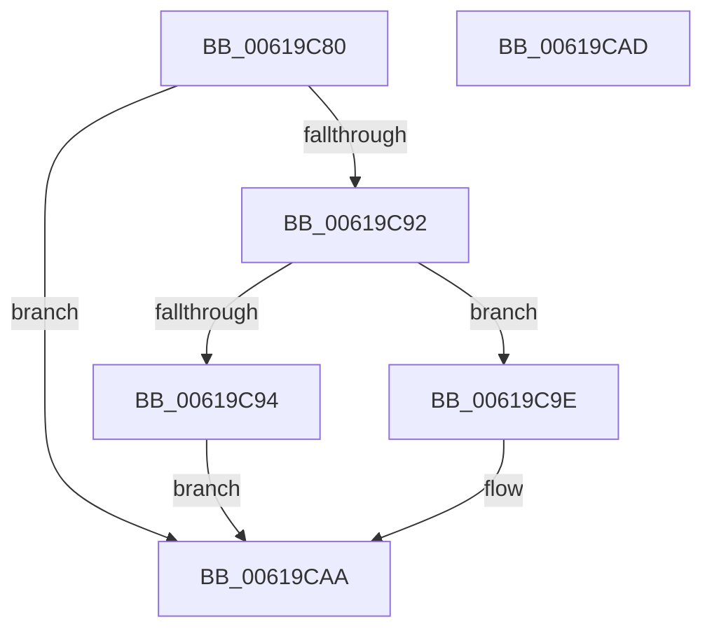

# DifObjTrkCompareNode

- RVA: `0x00619C80`–`0x00619CAE` (길이 `46` bytes)
- VA: `0x0000000140619C80`
- 실행 섹션: `.text`
- PDB 이름 있음: `예`; PDB Function 태그: `아니요`
- unwind 정보 RVA: `0x000DB714`
- 디코드: `16`개 명령, `46/46` bytes 표시
- 미해석 바이트: `0` (있으면 어셈블리에 `.byte`로 보존)

> 이 문서는 커널 이미지의 기계어와 PDB 기호를 분석해 생성했습니다. 4번과 5번은 함수 원형과 자료형을 바이너리 사용 방식에서 추정한 C 해석이며 원본 소스 복구 결과는 아닙니다.

## 1. Dependencies

- 직접 호출 지점: **0**; 고유 호출 대상: **0**
- 직접 호출자로 확인된 함수: **0**
- RIP 상대 이미지 참조: **0**

### Outgoing calls
- 직접 디코드된 call 명령이 없습니다.

### Direct callers
- 이 함수 시작 RVA로 연결되는 직접 call은 확인되지 않았습니다. 간접 호출은 완전히 역산할 수 없습니다.

### Static image references
- 디코드된 RIP-relative 메모리 참조가 없습니다.

## 2. Other-region calls and transfers

- 다른 실행 섹션으로 향하는 call: **0**
- 별도 외부 분기/꼬리 이동을 확인하지 못했습니다.

## 3. Assembly (complete function range)

```asm
00619C80  4C 8B 4A 08                     mov r9, qword ptr [rdx + 8]
00619C84  B9 02 00 00 00                  mov ecx, 2
00619C89  49 8B 40 08                     mov rax, qword ptr [r8 + 8]
00619C8D  4C 3B C8                        cmp r9, rax
00619C90  74 18                           je 0x140619caa
00619C92  73 0A                           jae 0x140619c9e
00619C94  48 3B 42 10                     cmp rax, qword ptr [rdx + 0x10]
00619C98  1B C0                           sbb eax, eax
00619C9A  23 C8                           and ecx, eax
00619C9C  EB 0C                           jmp 0x140619caa
00619C9E  4D 39 48 10                     cmp qword ptr [r8 + 0x10], r9
00619CA2  B8 01 00 00 00                  mov eax, 1
00619CA7  0F 46 C8                        cmovbe ecx, eax
00619CAA  8B C1                           mov eax, ecx
00619CAC  C3                              ret
00619CAD  CC                              int3
```

## 4. C-style interpretation (structured pseudocode)

```c
__int64 __fastcall DifObjTrkCompareNode(__int64 a1, __int64 a2, __int64 a3)
{
    if ((*(unsigned __int64 *)(a2 + 8)) == (*(unsigned __int64 *)(a3 + 8))) goto loc_00619CAA;
    if ((*(unsigned __int64 *)(a2 + 8)) >= (*(unsigned __int64 *)(a3 + 8))) goto loc_00619C9E;
    a1 = (unsigned int)((2) & ((unsigned int)(*(unsigned __int64 *)(a3 + 8))));
    goto loc_00619CAA;
loc_00619C9E:
    if ((*(unsigned __int64 *)(a3 + 16)) <= (*(unsigned __int64 *)(a2 + 8))) { a1 = 1; }
loc_00619CAA:
    return (unsigned int)((unsigned int)(a1));
}
```

## 5. (Beta) C Style

```c
int64_t DifObjTrkCompareNode(int64_t Arg1, void *Arg2, void *Arg3)
{
    uint8_t *arg2 = (uint8_t *)Arg2;
    uint8_t *arg3 = (uint8_t *)Arg3;

    if ((*(uint64_t *)(arg2 + 0x8)) == (*(uint64_t *)(arg3 + 0x8))) goto loc_00619CAA;
    if ((*(uint64_t *)(arg2 + 0x8)) >= (*(uint64_t *)(arg3 + 0x8))) goto loc_00619C9E;
    Arg1 = (uint32_t)((2) & ((uint32_t)(*(uint64_t *)(arg3 + 0x8))));
    goto loc_00619CAA;
loc_00619C9E:
    if ((*(uint64_t *)(arg3 + 0x10)) <= (*(uint64_t *)(arg2 + 0x8))) { Arg1 = 1; }
loc_00619CAA:
    return (uint32_t)((uint32_t)(Arg1));
}
```

### 관측된 메모리 오프셋

구조체 형식이 확인되지 않은 접근은 인자 기준의 오프셋으로만 기록했습니다.

| 기준 인자 | 오프셋 표현 | 폭 (bit) | 접근 |
|---|---:|---:|---|
| `Arg2` | `+ 0x8` | `64` | `R` |
| `Arg2` | `+ 0x10` | `64` | `R` |
| `Arg3` | `+ 0x8` | `64` | `R` |
| `Arg3` | `+ 0x10` | `64` | `R` |

## 6. Execution-region graph

[열기: 2D/3D 그래프와 함수 탐색 컨트롤 패널](../../../control-panel.html?section=text&rva=0x00619C80&view=graph)

- 2D 그래프는 위에서 아래로 흐르고, 3D 그래프는 빈 공간을 드래그해 회전합니다. Shift+드래그는 이동, 휠은 확대·축소, 함수 노드 선택은 대상 보고서 이동입니다.

### Static fallback


