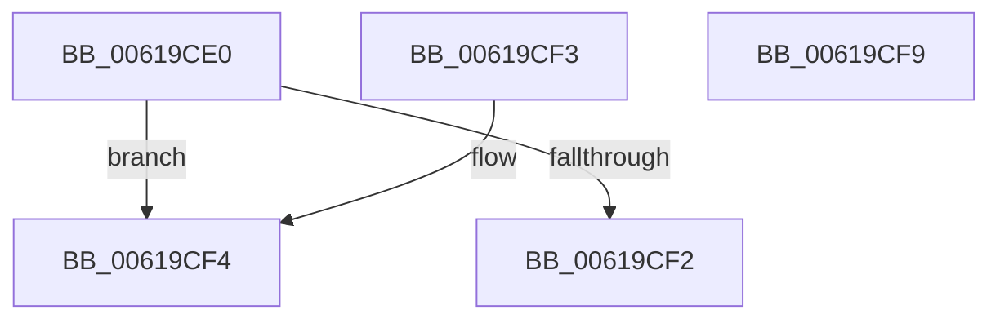

# DifObjTrkGetPluginContext

- RVA: `0x00619CE0`–`0x00619CFA` (길이 `26` bytes)
- VA: `0x0000000140619CE0`
- 실행 섹션: `.text`
- PDB 이름 있음: `예`; PDB Function 태그: `아니요`
- unwind 정보 RVA: `0x000DB714`
- 디코드: `10`개 명령, `26/26` bytes 표시
- 미해석 바이트: `0` (있으면 어셈블리에 `.byte`로 보존)

> 이 문서는 커널 이미지의 기계어와 PDB 기호를 분석해 생성했습니다. 4번과 5번은 함수 원형과 자료형을 바이너리 사용 방식에서 추정한 C 해석이며 원본 소스 복구 결과는 아닙니다.

## 1. Dependencies

- 직접 호출 지점: **0**; 고유 호출 대상: **0**
- 직접 호출자로 확인된 함수: **3**
- RIP 상대 이미지 참조: **1**

### Outgoing calls
- 직접 디코드된 call 명령이 없습니다.

### Direct callers
- [DifObjTrkInsertItem](DifObjTrkInsertItem_function_00619D00.md) at `0x00619D52`
- [DifObjTrkQeuryInvokeDeleteRange](DifObjTrkQeuryInvokeDeleteRange_function_00619EA0.md) at `0x0061A0B1`
- [DifObjTrkRemoveItem](DifObjTrkRemoveItem_function_0061A1D0.md) at `0x0061A222`

### Static image references
- `0x00619CE2` → RVA `0x00E68240` (`.data`; read)

## 2. Other-region calls and transfers

- 다른 실행 섹션으로 향하는 call: **0**
- 별도 외부 분기/꼬리 이동을 확인하지 못했습니다.

## 3. Assembly (complete function range)

```asm
00619CE0  8B C1                           mov eax, ecx
00619CE2  48 8D 0D 57 E5 84 00            lea rcx, [rip + 0x84e557]
00619CE9  48 8B 04 C1                     mov rax, qword ptr [rcx + rax*8]
00619CED  48 85 C0                        test rax, rax
00619CF0  75 02                           jne 0x140619cf4
00619CF2  C3                              ret
00619CF3  CC                              int3
00619CF4  48 8B 40 18                     mov rax, qword ptr [rax + 0x18]
00619CF8  C3                              ret
00619CF9  CC                              int3
```

## 4. C-style interpretation (structured pseudocode)

```c
__int64 __fastcall DifObjTrkGetPluginContext(int a1)
{
    if (*(unsigned __int64 *)(v_rip + 8709463 + (unsigned int)(a1) * 8) != 0) goto loc_00619CF4;
    return *(unsigned __int64 *)(v_rip + 8709463 + (unsigned int)(a1) * 8);
loc_00619CF4:
    return *(unsigned __int64 *)(*(unsigned __int64 *)(v_rip + 8709463 + (unsigned int)(a1) * 8) + 24);
}
```

## 5. (Beta) C Style

```c
int64_t DifObjTrkGetPluginContext(int32_t Arg1)
{
    if (*(uint64_t *)(v_rip + 0x84E557 + (uint32_t)(Arg1) * 8) != 0) goto loc_00619CF4;
    return *(uint64_t *)(v_rip + 0x84E557 + (uint32_t)(Arg1) * 8);
loc_00619CF4:
    return *(uint64_t *)(*(uint64_t *)(v_rip + 0x84E557 + (uint32_t)(Arg1) * 8) + 0x18);
}
```

## 6. Execution-region graph

[열기: 2D/3D 그래프와 함수 탐색 컨트롤 패널](../../../control-panel.html?section=text&rva=0x00619CE0&view=graph)

- 2D 그래프는 위에서 아래로 흐르고, 3D 그래프는 빈 공간을 드래그해 회전합니다. Shift+드래그는 이동, 휠은 확대·축소, 함수 노드 선택은 대상 보고서 이동입니다.

### Static fallback


