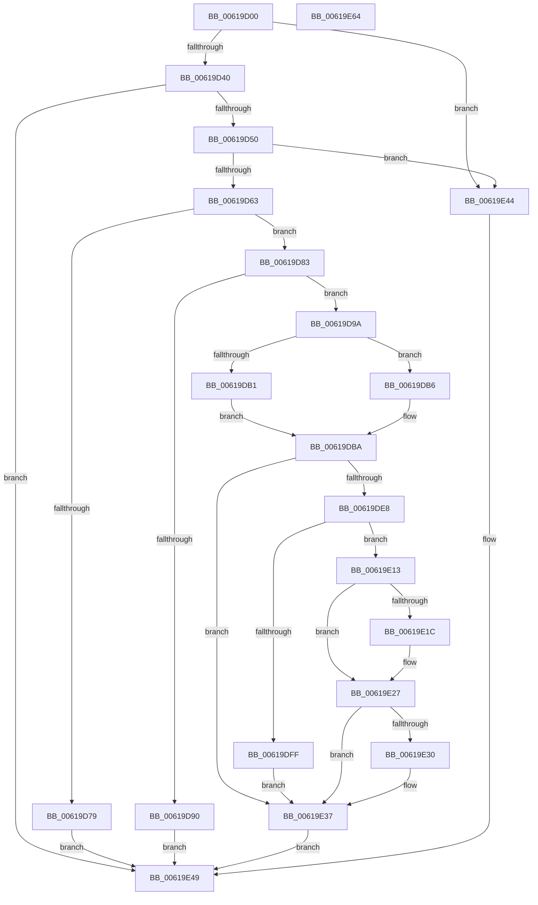

# DifObjTrkInsertItem

- RVA: `0x00619D00`–`0x00619E65` (길이 `357` bytes)
- VA: `0x0000000140619D00`
- 실행 섹션: `.text`
- PDB 이름 있음: `예`; PDB Function 태그: `아니요`
- unwind 정보 RVA: `0x000D2A54`
- 디코드: `98`개 명령, `357/357` bytes 표시
- 미해석 바이트: `0` (있으면 어셈블리에 `.byte`로 보존)

> 이 문서는 커널 이미지의 기계어와 PDB 기호를 분석해 생성했습니다. 4번과 5번은 함수 원형과 자료형을 바이너리 사용 방식에서 추정한 C 해석이며 원본 소스 복구 결과는 아닙니다.

## 1. Dependencies

- 직접 호출 지점: **7**; 고유 호출 대상: **7**
- 직접 호출자로 확인된 함수: **0**
- RIP 상대 이미지 참조: **2**

### Outgoing calls
- `0x00619D43` → [DifIsValidTrackingObject](DifIsValidTrackingObject_function_00619BCC.md) (function, `0x00619BCC`)
- `0x00619D52` → [DifObjTrkGetPluginContext](DifObjTrkGetPluginContext_function_00619CE0.md) (function, `0x00619CE0`)
- `0x00619D86` → [MmGetVaTypeForVerifier](../67/MmGetVaTypeForVerifier_function_0067B544.md) (function, `0x0067B544`)
- `0x00619DC6` → [DifAcquireSpinLockAtDpcLevelSafe](DifAcquireSpinLockAtDpcLevelSafe_function_0061BDF4.md) (function, `0x0061BDF4`)
- `0x00619DDD` → [RtlInsertElementGenericTableAvl](../3E/RtlInsertElementGenericTableAvl_function_003EE510.md) (function, `0x003EE510`)
- `0x00619E3B` → [DifReleaseSpinLockFromDpcLevelSafe](DifReleaseSpinLockFromDpcLevelSafe_function_0061BEAC.md) (function, `0x0061BEAC`)
- `0x00619E50` → [_security_check_cookie](../6A/_security_check_cookie_function_006AC640.md) (function, `0x006AC640`)

### Direct callers
- 이 함수 시작 RVA로 연결되는 직접 call은 확인되지 않았습니다. 간접 호출은 완전히 역산할 수 없습니다.

### Static image references
- `0x00619D12` → RVA `0x00E0A740` (`.data`; read)
- `0x00619D63` → RVA `0x00F03EB8` (`.data`; read)

## 2. Other-region calls and transfers

- 다른 실행 섹션으로 향하는 call: **0**
- 별도 외부 분기/꼬리 이동을 확인하지 못했습니다.

## 3. Assembly (complete function range)

```asm
00619D00  40 55                           push rbp
00619D02  53                              push rbx
00619D03  56                              push rsi
00619D04  57                              push rdi
00619D05  41 54                           push r12
00619D07  41 56                           push r14
00619D09  41 57                           push r15
00619D0B  48 8B EC                        mov rbp, rsp
00619D0E  48 83 EC 50                     sub rsp, 0x50
00619D12  48 8B 05 27 0A 7F 00            mov rax, qword ptr [rip + 0x7f0a27]
00619D19  48 33 C4                        xor rax, rsp
00619D1C  48 89 45 F0                     mov qword ptr [rbp - 0x10], rax
00619D20  45 33 E4                        xor r12d, r12d
00619D23  45 8B F8                        mov r15d, r8d
00619D26  44 89 65 DC                     mov dword ptr [rbp - 0x24], r12d
00619D2A  48 8B FA                        mov rdi, rdx
00619D2D  66 44 89 65 D4                  mov word ptr [rbp - 0x2c], r12w
00619D32  8B F1                           mov esi, ecx
00619D34  44 0F 20 C0                     mov rax, cr8
00619D38  3C 02                           cmp al, 2
00619D3A  0F 87 04 01 00 00               ja 0x140619e44
00619D40  45 8B C7                        mov r8d, r15d
00619D43  E8 84 FE FF FF                  call 0x140619bcc
00619D48  85 C0                           test eax, eax
00619D4A  0F 88 F9 00 00 00               js 0x140619e49
00619D50  8B CE                           mov ecx, esi
00619D52  E8 89 FF FF FF                  call 0x140619ce0
00619D57  4C 8B F0                        mov r14, rax
00619D5A  48 85 C0                        test rax, rax
00619D5D  0F 84 E1 00 00 00               je 0x140619e44
00619D63  48 8B 1D 4E A1 8E 00            mov rbx, qword ptr [rip + 0x8ea14e]
00619D6A  8B 8B 38 03 00 00               mov ecx, dword ptr [rbx + 0x338]
00619D70  48 3B 8B 40 03 00 00            cmp rcx, qword ptr [rbx + 0x340]
00619D77  72 0A                           jb 0x140619d83
00619D79  B8 0E 02 00 C0                  mov eax, 0xc000020e
00619D7E  E9 C6 00 00 00                  jmp 0x140619e49
00619D83  48 8B CF                        mov rcx, rdi
00619D86  E8 B9 17 06 00                  call 0x14067b544
00619D8B  83 F8 05                        cmp eax, 5
00619D8E  75 0A                           jne 0x140619d9a
00619D90  B8 0D 00 00 C0                  mov eax, 0xc000000d
00619D95  E9 AF 00 00 00                  jmp 0x140619e49
00619D9A  48 98                           cdqe
00619D9C  48 6B C8 78                     imul rcx, rax, 0x78
00619DA0  89 75 D8                        mov dword ptr [rbp - 0x28], esi
00619DA3  48 89 7D E0                     mov qword ptr [rbp - 0x20], rdi
00619DA7  48 03 D9                        add rbx, rcx
00619DAA  41 8B 06                        mov eax, dword ptr [r14]
00619DAD  85 C0                           test eax, eax
00619DAF  74 05                           je 0x140619db6
00619DB1  48 03 C7                        add rax, rdi
00619DB4  EB 04                           jmp 0x140619dba
00619DB6  4A 8D 04 3F                     lea rax, [rdi + r15]
00619DBA  48 8D 4D D4                     lea rcx, [rbp - 0x2c]
00619DBE  48 89 45 E8                     mov qword ptr [rbp - 0x18], rax
00619DC2  44 88 65 D0                     mov byte ptr [rbp - 0x30], r12b
00619DC6  E8 29 20 00 00                  call 0x14061bdf4
00619DCB  4C 8D 4D D0                     lea r9, [rbp - 0x30]
00619DCF  41 B8 18 00 00 00               mov r8d, 0x18
00619DD5  48 8D 55 D8                     lea rdx, [rbp - 0x28]
00619DD9  48 8D 4B 40                     lea rcx, [rbx + 0x40]
00619DDD  E8 2E 47 DD FF                  call 0x1403ee510
00619DE2  44 38 65 D0                     cmp byte ptr [rbp - 0x30], r12b
00619DE6  74 4F                           je 0x140619e37
00619DE8  48 8B 05 C9 A0 8E 00            mov rax, qword ptr [rip + 0x8ea0c9]
00619DEF  FF 80 38 03 00 00               inc dword ptr [rax + 0x338]
00619DF5  83 7B 6C 01                     cmp dword ptr [rbx + 0x6c], 1
00619DF9  48 8B 45 E0                     mov rax, qword ptr [rbp - 0x20]
00619DFD  75 14                           jne 0x140619e13
00619DFF  48 89 83 B0 00 00 00            mov qword ptr [rbx + 0xb0], rax
00619E06  48 8B 45 E0                     mov rax, qword ptr [rbp - 0x20]
00619E0A  48 89 83 A8 00 00 00            mov qword ptr [rbx + 0xa8], rax
00619E11  EB 24                           jmp 0x140619e37
00619E13  48 3B 83 A8 00 00 00            cmp rax, qword ptr [rbx + 0xa8]
00619E1A  73 0B                           jae 0x140619e27
00619E1C  48 89 83 A8 00 00 00            mov qword ptr [rbx + 0xa8], rax
00619E23  48 8B 45 E0                     mov rax, qword ptr [rbp - 0x20]
00619E27  48 3B 83 B0 00 00 00            cmp rax, qword ptr [rbx + 0xb0]
00619E2E  76 07                           jbe 0x140619e37
00619E30  48 89 83 B0 00 00 00            mov qword ptr [rbx + 0xb0], rax
00619E37  48 8D 4D D4                     lea rcx, [rbp - 0x2c]
00619E3B  E8 6C 20 00 00                  call 0x14061beac
00619E40  33 C0                           xor eax, eax
00619E42  EB 05                           jmp 0x140619e49
00619E44  B8 BB 00 00 C0                  mov eax, 0xc00000bb
00619E49  48 8B 4D F0                     mov rcx, qword ptr [rbp - 0x10]
00619E4D  48 33 CC                        xor rcx, rsp
00619E50  E8 EB 27 09 00                  call 0x1406ac640
00619E55  48 83 C4 50                     add rsp, 0x50
00619E59  41 5F                           pop r15
00619E5B  41 5E                           pop r14
00619E5D  41 5C                           pop r12
00619E5F  5F                              pop rdi
00619E60  5E                              pop rsi
00619E61  5B                              pop rbx
00619E62  5D                              pop rbp
00619E63  C3                              ret
00619E64  CC                              int3
```

## 4. C-style interpretation (structured pseudocode)

```c
__int64 __fastcall DifObjTrkInsertItem(int a1, __int64 a2, int a3)
{
    __int64 result;
    __int64 v_r12;
    __int64 v_rbx;
    __int64 v_rsp;
    unsigned __int64 v_stack_m48;
    unsigned __int64 v_stack_m50;
    unsigned __int64 v_stack_m58;
    unsigned int v_stack_m5C;
    unsigned int v_stack_m60;
    unsigned __int16 v_stack_m64;
    unsigned __int8 v_stack_m68;

    v_rsp = (v_rsp) - (80);
    result = (*(unsigned __int64 *)(v_rip + 8325671)) ^ (v_rsp);
    v_stack_m48 = result;
    v_r12 = 0;
    v_stack_m5C = 0;
    v_stack_m64 = 0;
    if (((unsigned __int8)(v_cr8)) > 2) goto loc_00619E44;
    result = DifIsValidTrackingObject(a1, a2, (unsigned int)((unsigned int)((unsigned int)(a3))), a4);
    if (sign_flag) goto loc_00619E49;
    result = DifObjTrkGetPluginContext((unsigned int)((unsigned int)((unsigned int)(a1))), a2, (unsigned int)((unsigned int)((unsigned int)(a3))), a4);
    if (result == 0) goto loc_00619E44;
    if (((unsigned int)(*(unsigned int *)(*(unsigned __int64 *)(v_rip + 9347406) + 824))) < (*(unsigned __int64 *)(*(unsigned __int64 *)(v_rip + 9347406) + 832))) goto loc_00619D83;
    goto loc_00619E49;
loc_00619D83:
    result = MmGetVaTypeForVerifier(a2, a2, (unsigned int)((unsigned int)((unsigned int)(a3))), a4);
    if (((unsigned int)(result)) != 5) goto loc_00619D9A;
    goto loc_00619E49;
loc_00619D9A:
    a1 = (a2) * ((unsigned int)(0xC000000DULL));
    v_stack_m60 = (unsigned int)((unsigned int)(a1));
    v_stack_m58 = a2;
    v_rbx = (*(unsigned __int64 *)(v_rip + 9347406)) + (a1);
    if ((unsigned int)((unsigned int)(*(unsigned int *)(result))) == 0) goto loc_00619DB6;
    result = ((unsigned int)(*(unsigned int *)(result))) + (a2);
    goto loc_00619DBA;
loc_00619DB6:
loc_00619DBA:
    v_stack_m50 = a2 + (unsigned int)(a3) * 1;
    v_stack_m68 = 0;
    result = DifAcquireSpinLockAtDpcLevelSafe(v_stack_m64, a2, (unsigned int)((unsigned int)((unsigned int)(a3))), a4);
    result = RtlInsertElementGenericTableAvl(v_rbx + 64, v_stack_m60, 24, v_stack_m68);
    if (v_stack_m68 == 0) goto loc_00619E37;
    if ((*(unsigned int *)(v_rbx + 108)) != 1) goto loc_00619E13;
    *(unsigned __int64 *)(v_rbx + 176) = v_stack_m58;
    *(unsigned __int64 *)(v_rbx + 168) = v_stack_m58;
    goto loc_00619E37;
loc_00619E13:
    result = v_stack_m58;
    if (v_stack_m58 < (*(unsigned __int64 *)(v_rbx + 168))) {
        *(unsigned __int64 *)(v_rbx + 168) = v_stack_m58;
        result = v_stack_m58;
    }
    if (result >= = (*(unsigned __int64 *)(v_rbx + 176))) {
        *(unsigned __int64 *)(v_rbx + 176) = result;
    }
    result = DifReleaseSpinLockFromDpcLevelSafe(v_stack_m64, v_stack_m60, 24, v_stack_m68);
    result = 0;
    goto loc_00619E49;
loc_00619E44:
loc_00619E49:
    a1 = (v_stack_m48) ^ (v_rsp);
    result = _security_check_cookie(a1, v_stack_m60, 24, v_stack_m68);
    v_rsp = (v_rsp) + (80);
    return result;
}
```

## 5. (Beta) C Style

```c
int64_t DifObjTrkInsertItem(int32_t Arg1, void *Arg2, int32_t Arg3)
{
    uint8_t *arg2 = (uint8_t *)Arg2;

    int64_t result;
    int64_t local_r12;
    int64_t local_rbx;
    int64_t local_rsp;
    uint64_t v_stack_m48;
    uint64_t v_stack_m50;
    uint64_t v_stack_m58;
    uint32_t v_stack_m5C;
    uint32_t v_stack_m60;
    uint16_t v_stack_m64;
    uint8_t v_stack_m68;

    local_rsp = (local_rsp) - (80);
    result = (*(uint64_t *)(v_rip + 0x7F0A27)) ^ (local_rsp);
    v_stack_m48 = result;
    local_r12 = 0;
    v_stack_m5C = 0;
    v_stack_m64 = 0;
    if (((uint8_t)(v_cr8)) > 2) goto loc_00619E44;
    result = DifIsValidTrackingObject(Arg1, Arg2, (uint32_t)((uint32_t)((uint32_t)(Arg3))), a4);
    if (sign_flag) goto loc_00619E49;
    result = DifObjTrkGetPluginContext((uint32_t)((uint32_t)((uint32_t)(Arg1))), Arg2, (uint32_t)((uint32_t)((uint32_t)(Arg3))), a4);
    if (result == 0) goto loc_00619E44;
    if (((uint32_t)(*(uint32_t *)(*(uint64_t *)(v_rip + 0x8EA14E) + 0x338))) < (*(uint64_t *)(*(uint64_t *)(v_rip + 0x8EA14E) + 0x340))) goto loc_00619D83;
    goto loc_00619E49;
loc_00619D83:
    result = MmGetVaTypeForVerifier(Arg2, Arg2, (uint32_t)((uint32_t)((uint32_t)(Arg3))), a4);
    if (((uint32_t)(result)) != 5) goto loc_00619D9A;
    goto loc_00619E49;
loc_00619D9A:
    Arg1 = (Arg2) * ((uint32_t)(0xC000000DULL));
    v_stack_m60 = (uint32_t)((uint32_t)(Arg1));
    v_stack_m58 = Arg2;
    local_rbx = (*(uint64_t *)(v_rip + 0x8EA14E)) + (Arg1);
    if ((uint32_t)((uint32_t)(*(uint32_t *)(result))) == 0) goto loc_00619DB6;
    result = ((uint32_t)(*(uint32_t *)(result))) + (Arg2);
    goto loc_00619DBA;
loc_00619DB6:
loc_00619DBA:
    v_stack_m50 = Arg2 + (uint32_t)(Arg3) * 1;
    v_stack_m68 = 0;
    result = DifAcquireSpinLockAtDpcLevelSafe(v_stack_m64, Arg2, (uint32_t)((uint32_t)((uint32_t)(Arg3))), a4);
    result = RtlInsertElementGenericTableAvl(local_rbx + 64, v_stack_m60, 24, v_stack_m68);
    if (v_stack_m68 == 0) goto loc_00619E37;
    if ((*(uint32_t *)(local_rbx + 0x6C)) != 1) goto loc_00619E13;
    *(uint64_t *)(local_rbx + 0xB0) = v_stack_m58;
    *(uint64_t *)(local_rbx + 0xA8) = v_stack_m58;
    goto loc_00619E37;
loc_00619E13:
    result = v_stack_m58;
    if (v_stack_m58 < (*(uint64_t *)(local_rbx + 0xA8))) {
        *(uint64_t *)(local_rbx + 0xA8) = v_stack_m58;
        result = v_stack_m58;
    }
    if (result >= = (*(uint64_t *)(local_rbx + 0xB0))) {
        *(uint64_t *)(local_rbx + 0xB0) = result;
    }
    result = DifReleaseSpinLockFromDpcLevelSafe(v_stack_m64, v_stack_m60, 24, v_stack_m68);
    result = 0;
    goto loc_00619E49;
loc_00619E44:
loc_00619E49:
    Arg1 = (v_stack_m48) ^ (local_rsp);
    result = _security_check_cookie(Arg1, v_stack_m60, 24, v_stack_m68);
    local_rsp = (local_rsp) + (80);
    return result;
}
```

### 관측된 메모리 오프셋

구조체 형식이 확인되지 않은 접근은 인자 기준의 오프셋으로만 기록했습니다.

| 기준 인자 | 오프셋 표현 | 폭 (bit) | 접근 |
|---|---:|---:|---|
| `Arg2` | `+ 0x0 + r15*1` | `64` | `R` |

## 6. Execution-region graph

[열기: 2D/3D 그래프와 함수 탐색 컨트롤 패널](../../../control-panel.html?section=text&rva=0x00619D00&view=graph)

- 2D 그래프는 위에서 아래로 흐르고, 3D 그래프는 빈 공간을 드래그해 회전합니다. Shift+드래그는 이동, 휠은 확대·축소, 함수 노드 선택은 대상 보고서 이동입니다.

### Static fallback


