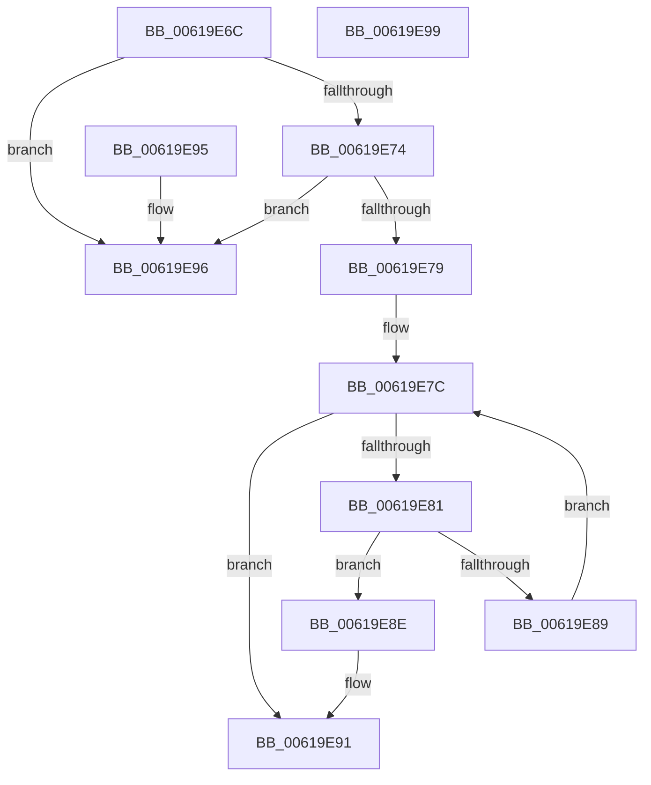

# DifObjTrkIsExceptionPluginId

- RVA: `0x00619E6C`–`0x00619E9A` (길이 `46` bytes)
- VA: `0x0000000140619E6C`
- 실행 섹션: `.text`
- PDB 이름 있음: `예`; PDB Function 태그: `아니요`
- unwind 정보 RVA: `0x000DB714`
- 디코드: `20`개 명령, `46/46` bytes 표시
- 미해석 바이트: `0` (있으면 어셈블리에 `.byte`로 보존)

> 이 문서는 커널 이미지의 기계어와 PDB 기호를 분석해 생성했습니다. 4번과 5번은 함수 원형과 자료형을 바이너리 사용 방식에서 추정한 C 해석이며 원본 소스 복구 결과는 아닙니다.

## 1. Dependencies

- 직접 호출 지점: **0**; 고유 호출 대상: **0**
- 직접 호출자로 확인된 함수: **1**
- RIP 상대 이미지 참조: **0**

### Outgoing calls
- 직접 디코드된 call 명령이 없습니다.

### Direct callers
- [DifObjTrkQeuryInvokeDeleteRange](DifObjTrkQeuryInvokeDeleteRange_function_00619EA0.md) at `0x00619FBF`
- [DifObjTrkQeuryInvokeDeleteRange](DifObjTrkQeuryInvokeDeleteRange_function_00619EA0.md) at `0x00619FFB`
- [DifObjTrkQeuryInvokeDeleteRange](DifObjTrkQeuryInvokeDeleteRange_function_00619EA0.md) at `0x0061A057`

### Static image references
- 디코드된 RIP-relative 메모리 참조가 없습니다.

## 2. Other-region calls and transfers

- 다른 실행 섹션으로 향하는 call: **0**
- 별도 외부 분기/꼬리 이동을 확인하지 못했습니다.

## 3. Assembly (complete function range)

```asm
00619E6C  45 33 C9                        xor r9d, r9d
00619E6F  48 85 D2                        test rdx, rdx
00619E72  74 22                           je 0x140619e96
00619E74  45 85 C0                        test r8d, r8d
00619E77  74 1D                           je 0x140619e96
00619E79  45 8B D1                        mov r10d, r9d
00619E7C  45 3B D0                        cmp r10d, r8d
00619E7F  73 10                           jae 0x140619e91
00619E81  41 8B C2                        mov eax, r10d
00619E84  39 0C 82                        cmp dword ptr [rdx + rax*4], ecx
00619E87  74 05                           je 0x140619e8e
00619E89  41 FF C2                        inc r10d
00619E8C  EB EE                           jmp 0x140619e7c
00619E8E  41 B1 01                        mov r9b, 1
00619E91  41 8A C1                        mov al, r9b
00619E94  C3                              ret
00619E95  CC                              int3
00619E96  32 C0                           xor al, al
00619E98  C3                              ret
00619E99  CC                              int3
```

## 4. C-style interpretation (structured pseudocode)

```c
__int64 __fastcall DifObjTrkIsExceptionPluginId(int a1, __int64 a2, int a3, int a4)
{
    __int64 result;
    __int64 v_r10;

    a4 = 0;
    if (a2 == 0) goto loc_00619E96;
    if (a3 == 0) goto loc_00619E96;
loc_00619E7C:
    if (0 >= a3) goto loc_00619E91;
    if ((*(unsigned int *)(a2 + 0 * 4)) == a1) goto loc_00619E8E;
    v_r10 = (unsigned int)((0) + 1);
    goto loc_00619E7C;
loc_00619E8E:
loc_00619E91:
    return 1;
loc_00619E96:
    result = 0;
    return result;
}
```

## 5. (Beta) C Style

```c
int64_t DifObjTrkIsExceptionPluginId(int32_t Arg1, int64_t Arg2, int32_t Arg3, int32_t Arg4)
{
    int64_t result;
    int64_t local_r10;

    Arg4 = 0;
    if (Arg2 == 0) goto loc_00619E96;
    if (Arg3 == 0) goto loc_00619E96;
loc_00619E7C:
    if (0 >= Arg3) goto loc_00619E91;
    if ((*(uint32_t *)(Arg2 + 0x0 * 4)) == Arg1) goto loc_00619E8E;
    local_r10 = (uint32_t)((0) + 1);
    goto loc_00619E7C;
loc_00619E8E:
loc_00619E91:
    return 1;
loc_00619E96:
    result = 0;
    return result;
}
```

## 6. Execution-region graph

[열기: 2D/3D 그래프와 함수 탐색 컨트롤 패널](../../../control-panel.html?section=text&rva=0x00619E6C&view=graph)

- 2D 그래프는 위에서 아래로 흐르고, 3D 그래프는 빈 공간을 드래그해 회전합니다. Shift+드래그는 이동, 휠은 확대·축소, 함수 노드 선택은 대상 보고서 이동입니다.

### Static fallback


