# DifObjTrkQeuryInvokeDeleteRange

- RVA: `0x00619EA0`–`0x0061A1C9` (길이 `809` bytes)
- VA: `0x0000000140619EA0`
- 실행 섹션: `.text`
- PDB 이름 있음: `예`; PDB Function 태그: `아니요`
- unwind 정보 RVA: `0x000D2A90`
- 디코드: `215`개 명령, `809/809` bytes 표시
- 미해석 바이트: `0` (있으면 어셈블리에 `.byte`로 보존)

> 이 문서는 커널 이미지의 기계어와 PDB 기호를 분석해 생성했습니다. 4번과 5번은 함수 원형과 자료형을 바이너리 사용 방식에서 추정한 C 해석이며 원본 소스 복구 결과는 아닙니다.

## 1. Dependencies

- 직접 호출 지점: **19**; 고유 호출 대상: **13**
- 직접 호출자로 확인된 함수: **2**
- RIP 상대 이미지 참조: **3**

### Outgoing calls
- `0x00619F1F` → [MmGetVaTypeForVerifier](../67/MmGetVaTypeForVerifier_function_0067B544.md) (function, `0x0067B544`)
- `0x00619F68` → [DifAcquireSpinLockAtDpcLevelSafe](DifAcquireSpinLockAtDpcLevelSafe_function_0061BDF4.md) (function, `0x0061BDF4`)
- `0x00619F84` → [RtlLookupElementGenericTableFullAvl](../3E/RtlLookupElementGenericTableFullAvl_function_003EF460.md) (function, `0x003EF460`)
- `0x00619FAB` → [memset](../6C/memset_function_006C6C40.md) (function, `0x006C6C40`)
- `0x00619FBF` → [DifObjTrkIsExceptionPluginId](DifObjTrkIsExceptionPluginId_function_00619E6C.md) (function, `0x00619E6C`)
- `0x00619FFB` → [DifObjTrkIsExceptionPluginId](DifObjTrkIsExceptionPluginId_function_00619E6C.md) (function, `0x00619E6C`)
- `0x0061A022` → [DifAvlRealSuccessor](../46/DifAvlRealSuccessor_function_0046114C.md) (function, `0x0046114C`)
- `0x0061A057` → [DifObjTrkIsExceptionPluginId](DifObjTrkIsExceptionPluginId_function_00619E6C.md) (function, `0x00619E6C`)
- `0x0061A07E` → [DifAvlRealPredecessor](DifAvlRealPredecessor_function_0061BF1C.md) (function, `0x0061BF1C`)
- `0x0061A0B1` → [DifObjTrkGetPluginContext](DifObjTrkGetPluginContext_function_00619CE0.md) (function, `0x00619CE0`)
- `0x0061A0CD` → [guard_dispatch_icall](../6B/guard_dispatch_icall_function_006BAAD0.md) (function, `0x006BAAD0`)
- `0x0061A0E0` → [RtlDeleteElementGenericTableAvlEx](../3E/RtlDeleteElementGenericTableAvlEx_function_003EEA70.md) (function, `0x003EEA70`)
- `0x0061A104` → [RtlDeleteElementGenericTableAvlEx](../3E/RtlDeleteElementGenericTableAvlEx_function_003EEA70.md) (function, `0x003EEA70`)
- `0x0061A11B` → [RtlGetElementGenericTableAvl](../49/RtlGetElementGenericTableAvl_function_004968F0.md) (function, `0x004968F0`)
- `0x0061A146` → [RtlDeleteElementGenericTableAvlEx](../3E/RtlDeleteElementGenericTableAvlEx_function_003EEA70.md) (function, `0x003EEA70`)
- `0x0061A162` → [RtlGetElementGenericTableAvl](../49/RtlGetElementGenericTableAvl_function_004968F0.md) (function, `0x004968F0`)
- `0x0061A17D` → [RtlGetElementGenericTableAvl](../49/RtlGetElementGenericTableAvl_function_004968F0.md) (function, `0x004968F0`)
- `0x0061A19F` → [DifReleaseSpinLockFromDpcLevelSafe](DifReleaseSpinLockFromDpcLevelSafe_function_0061BEAC.md) (function, `0x0061BEAC`)
- `0x0061A1AB` → [_security_check_cookie](../6A/_security_check_cookie_function_006AC640.md) (function, `0x006AC640`)

### Direct callers
- [VfDriverUnloadImage](../../pagevrfy/B9/VfDriverUnloadImage_function_00B9A5B0.md) at `0x00B9A5CF`
- [VfPtFreePoolNotification](../../pagevrfy/BB/VfPtFreePoolNotification_function_00BB96DC.md) at `0x00BB9731`

### Static image references
- `0x00619EB7` → RVA `0x00E0A740` (`.data`; read)
- `0x00619EC5` → RVA `0x00F03EB8` (`.data`; read)
- `0x00619EED` → RVA `0x00F03EB4` (`.data`; read)

## 2. Other-region calls and transfers

- 다른 실행 섹션으로 향하는 call: **0**
- 별도 외부 분기/꼬리 이동을 확인하지 못했습니다.

## 3. Assembly (complete function range)

```asm
00619EA0  48 89 5C 24 18                  mov qword ptr [rsp + 0x18], rbx
00619EA5  55                              push rbp
00619EA6  56                              push rsi
00619EA7  57                              push rdi
00619EA8  41 54                           push r12
00619EAA  41 55                           push r13
00619EAC  41 56                           push r14
00619EAE  41 57                           push r15
00619EB0  48 8B EC                        mov rbp, rsp
00619EB3  48 83 EC 50                     sub rsp, 0x50
00619EB7  48 8B 05 82 08 7F 00            mov rax, qword ptr [rip + 0x7f0882]
00619EBE  48 33 C4                        xor rax, rsp
00619EC1  48 89 45 F8                     mov qword ptr [rbp - 8], rax
00619EC5  48 8B 35 EC 9F 8E 00            mov rsi, qword ptr [rip + 0x8e9fec]
00619ECC  45 33 ED                        xor r13d, r13d
00619ECF  4C 89 6D E0                     mov qword ptr [rbp - 0x20], r13
00619ED3  45 8B F9                        mov r15d, r9d
00619ED6  66 44 89 6D D0                  mov word ptr [rbp - 0x30], r13w
00619EDB  4D 8B E0                        mov r12, r8
00619EDE  48 8B FA                        mov rdi, rdx
00619EE1  48 8B D9                        mov rbx, rcx
00619EE4  48 85 F6                        test rsi, rsi
00619EE7  0F 84 B7 02 00 00               je 0x14061a1a4
00619EED  44 39 2D C0 9F 8E 00            cmp dword ptr [rip + 0x8e9fc0], r13d
00619EF4  0F 84 AA 02 00 00               je 0x14061a1a4
00619EFA  48 85 C9                        test rcx, rcx
00619EFD  0F 84 A1 02 00 00               je 0x14061a1a4
00619F03  48 85 D2                        test rdx, rdx
00619F06  0F 84 98 02 00 00               je 0x14061a1a4
00619F0C  48 B8 00 00 00 00 00 80 FF FF   movabs rax, 0xffff800000000000
00619F16  48 3B C8                        cmp rcx, rax
00619F19  0F 82 85 02 00 00               jb 0x14061a1a4
00619F1F  E8 20 16 06 00                  call 0x14067b544
00619F24  83 F8 05                        cmp eax, 5
00619F27  0F 84 77 02 00 00               je 0x14061a1a4
00619F2D  48 83 C6 40                     add rsi, 0x40
00619F31  48 98                           cdqe
00619F33  48 6B C8 78                     imul rcx, rax, 0x78
00619F37  48 03 F1                        add rsi, rcx
00619F3A  44 39 6E 2C                     cmp dword ptr [rsi + 0x2c], r13d
00619F3E  0F 84 60 02 00 00               je 0x14061a1a4
00619F44  48 8D 04 3B                     lea rax, [rbx + rdi]
00619F48  48 89 5D E8                     mov qword ptr [rbp - 0x18], rbx
00619F4C  48 89 45 F0                     mov qword ptr [rbp - 0x10], rax
00619F50  48 3B 46 68                     cmp rax, qword ptr [rsi + 0x68]
00619F54  0F 86 4A 02 00 00               jbe 0x14061a1a4
00619F5A  48 3B 5E 70                     cmp rbx, qword ptr [rsi + 0x70]
00619F5E  0F 87 40 02 00 00               ja 0x14061a1a4
00619F64  48 8D 4D D0                     lea rcx, [rbp - 0x30]
00619F68  E8 87 1E 00 00                  call 0x14061bdf4
00619F6D  4C 8D 4D D4                     lea r9, [rbp - 0x2c]
00619F71  4C 89 6D D8                     mov qword ptr [rbp - 0x28], r13
00619F75  4C 8D 45 D8                     lea r8, [rbp - 0x28]
00619F79  44 89 6D D4                     mov dword ptr [rbp - 0x2c], r13d
00619F7D  48 8D 55 E0                     lea rdx, [rbp - 0x20]
00619F81  48 8B CE                        mov rcx, rsi
00619F84  E8 D7 54 DD FF                  call 0x1403ef460
00619F89  48 8B D8                        mov rbx, rax
00619F8C  48 85 C0                        test rax, rax
00619F8F  0F 84 06 02 00 00               je 0x14061a19b
00619F95  4C 8B 35 1C 9F 8E 00            mov r14, qword ptr [rip + 0x8e9f1c]
00619F9C  33 D2                           xor edx, edx
00619F9E  41 B8 A0 00 00 00               mov r8d, 0xa0
00619FA4  49 8D 8E 98 02 00 00            lea rcx, [r14 + 0x298]
00619FAB  E8 90 CC 0A 00                  call 0x1406c6c40
00619FB0  8B 0B                           mov ecx, dword ptr [rbx]
00619FB2  48 8D 7B E0                     lea rdi, [rbx - 0x20]
00619FB6  45 8B C7                        mov r8d, r15d
00619FB9  49 8B D4                        mov rdx, r12
00619FBC  45 8B DD                        mov r11d, r13d
00619FBF  E8 A8 FE FF FF                  call 0x140619e6c
00619FC4  84 C0                           test al, al
00619FC6  75 0B                           jne 0x140619fd3
00619FC8  49 89 BE 98 02 00 00            mov qword ptr [r14 + 0x298], rdi
00619FCF  45 8D 5D 01                     lea r11d, [r13 + 1]
00619FD3  48 8B CF                        mov rcx, rdi
00619FD6  EB 4A                           jmp 0x14061a022
00619FD8  41 83 FB 14                     cmp r11d, 0x14
00619FDC  77 51                           ja 0x14061a02f
00619FDE  48 8B 4B 28                     mov rcx, qword ptr [rbx + 0x28]
00619FE2  48 39 4D E8                     cmp qword ptr [rbp - 0x18], rcx
00619FE6  77 47                           ja 0x14061a02f
00619FE8  48 8B 43 30                     mov rax, qword ptr [rbx + 0x30]
00619FEC  48 39 45 F0                     cmp qword ptr [rbp - 0x10], rax
00619FF0  72 3D                           jb 0x14061a02f
00619FF2  8B 4B 20                        mov ecx, dword ptr [rbx + 0x20]
00619FF5  45 8B C7                        mov r8d, r15d
00619FF8  49 8B D4                        mov rdx, r12
00619FFB  E8 6C FE FF FF                  call 0x140619e6c
0061A000  84 C0                           test al, al
0061A002  75 1B                           jne 0x14061a01f
0061A004  41 83 FB 14                     cmp r11d, 0x14
0061A008  74 25                           je 0x14061a02f
0061A00A  48 8B 05 A7 9E 8E 00            mov rax, qword ptr [rip + 0x8e9ea7]
0061A011  41 8B CB                        mov ecx, r11d
0061A014  41 FF C3                        inc r11d
0061A017  48 89 9C C8 98 02 00 00         mov qword ptr [rax + rcx*8 + 0x298], rbx
0061A01F  48 8B CB                        mov rcx, rbx
0061A022  E8 25 71 E4 FF                  call 0x14046114c
0061A027  48 8B D8                        mov rbx, rax
0061A02A  48 85 C0                        test rax, rax
0061A02D  75 A9                           jne 0x140619fd8
0061A02F  48 8B CF                        mov rcx, rdi
0061A032  EB 4A                           jmp 0x14061a07e
0061A034  41 83 FB 14                     cmp r11d, 0x14
0061A038  77 51                           ja 0x14061a08b
0061A03A  48 8B 4B 28                     mov rcx, qword ptr [rbx + 0x28]
0061A03E  48 39 4D E8                     cmp qword ptr [rbp - 0x18], rcx
0061A042  77 47                           ja 0x14061a08b
0061A044  48 8B 4B 30                     mov rcx, qword ptr [rbx + 0x30]
0061A048  48 39 4D F0                     cmp qword ptr [rbp - 0x10], rcx
0061A04C  72 3D                           jb 0x14061a08b
0061A04E  8B 4B 20                        mov ecx, dword ptr [rbx + 0x20]
0061A051  45 8B C7                        mov r8d, r15d
0061A054  49 8B D4                        mov rdx, r12
0061A057  E8 10 FE FF FF                  call 0x140619e6c
0061A05C  84 C0                           test al, al
0061A05E  75 1B                           jne 0x14061a07b
0061A060  41 83 FB 14                     cmp r11d, 0x14
0061A064  74 25                           je 0x14061a08b
0061A066  48 8B 05 4B 9E 8E 00            mov rax, qword ptr [rip + 0x8e9e4b]
0061A06D  41 8B CB                        mov ecx, r11d
0061A070  41 FF C3                        inc r11d
0061A073  48 89 9C C8 98 02 00 00         mov qword ptr [rax + rcx*8 + 0x298], rbx
0061A07B  48 8B CB                        mov rcx, rbx
0061A07E  E8 99 1E 00 00                  call 0x14061bf1c
0061A083  48 8B D8                        mov rbx, rax
0061A086  48 85 C0                        test rax, rax
0061A089  75 A9                           jne 0x14061a034
0061A08B  45 85 DB                        test r11d, r11d
0061A08E  0F 84 07 01 00 00               je 0x14061a19b
0061A094  41 BF 98 02 00 00               mov r15d, 0x298
0061A09A  45 8B E3                        mov r12d, r11d
0061A09D  48 8B 05 14 9E 8E 00            mov rax, qword ptr [rip + 0x8e9e14]
0061A0A4  4D 8B 34 07                     mov r14, qword ptr [r15 + rax]
0061A0A8  4D 85 F6                        test r14, r14
0061A0AB  74 25                           je 0x14061a0d2
0061A0AD  41 8B 4E 20                     mov ecx, dword ptr [r14 + 0x20]
0061A0B1  E8 2A FC FF FF                  call 0x140619ce0
0061A0B6  48 85 C0                        test rax, rax
0061A0B9  74 17                           je 0x14061a0d2
0061A0BB  4C 8B 40 08                     mov r8, qword ptr [rax + 8]
0061A0BF  4D 85 C0                        test r8, r8
0061A0C2  74 0E                           je 0x14061a0d2
0061A0C4  8B 10                           mov edx, dword ptr [rax]
0061A0C6  49 8B C0                        mov rax, r8
0061A0C9  49 8B 4E 28                     mov rcx, qword ptr [r14 + 0x28]
0061A0CD  E8 FE 09 0A 00                  call 0x1406baad0
0061A0D2  8B 46 2C                        mov eax, dword ptr [rsi + 0x2c]
0061A0D5  49 8B D6                        mov rdx, r14
0061A0D8  48 8B CE                        mov rcx, rsi
0061A0DB  83 F8 01                        cmp eax, 1
0061A0DE  75 1F                           jne 0x14061a0ff
0061A0E0  E8 8B 49 DD FF                  call 0x1403eea70
0061A0E5  48 8B 05 CC 9D 8E 00            mov rax, qword ptr [rip + 0x8e9dcc]
0061A0EC  FF 88 38 03 00 00               dec dword ptr [rax + 0x338]
0061A0F2  4C 89 6E 70                     mov qword ptr [rsi + 0x70], r13
0061A0F6  4C 89 6E 68                     mov qword ptr [rsi + 0x68], r13
0061A0FA  E9 8E 00 00 00                  jmp 0x14061a18d
0061A0FF  83 F8 02                        cmp eax, 2
0061A102  75 2E                           jne 0x14061a132
0061A104  E8 67 49 DD FF                  call 0x1403eea70
0061A109  48 8B 05 A8 9D 8E 00            mov rax, qword ptr [rip + 0x8e9da8]
0061A110  33 D2                           xor edx, edx
0061A112  48 8B CE                        mov rcx, rsi
0061A115  FF 88 38 03 00 00               dec dword ptr [rax + 0x338]
0061A11B  E8 D0 C7 E7 FF                  call 0x1404968f0
0061A120  48 8B 48 10                     mov rcx, qword ptr [rax + 0x10]
0061A124  48 89 4E 70                     mov qword ptr [rsi + 0x70], rcx
0061A128  48 8B 40 08                     mov rax, qword ptr [rax + 8]
0061A12C  48 89 46 68                     mov qword ptr [rsi + 0x68], rax
0061A130  EB 5B                           jmp 0x14061a18d
0061A132  48 8B 46 70                     mov rax, qword ptr [rsi + 0x70]
0061A136  49 8B 7E 28                     mov rdi, qword ptr [r14 + 0x28]
0061A13A  48 8B 5E 68                     mov rbx, qword ptr [rsi + 0x68]
0061A13E  4D 8B 6E 30                     mov r13, qword ptr [r14 + 0x30]
0061A142  48 89 45 D8                     mov qword ptr [rbp - 0x28], rax
0061A146  E8 25 49 DD FF                  call 0x1403eea70
0061A14B  48 8B 05 66 9D 8E 00            mov rax, qword ptr [rip + 0x8e9d66]
0061A152  FF 88 38 03 00 00               dec dword ptr [rax + 0x338]
0061A158  48 3B FB                        cmp rdi, rbx
0061A15B  77 12                           ja 0x14061a16f
0061A15D  33 D2                           xor edx, edx
0061A15F  48 8B CE                        mov rcx, rsi
0061A162  E8 89 C7 E7 FF                  call 0x1404968f0
0061A167  48 8B 48 08                     mov rcx, qword ptr [rax + 8]
0061A16B  48 89 4E 68                     mov qword ptr [rsi + 0x68], rcx
0061A16F  4C 3B 6D D8                     cmp r13, qword ptr [rbp - 0x28]
0061A173  72 15                           jb 0x14061a18a
0061A175  8B 56 2C                        mov edx, dword ptr [rsi + 0x2c]
0061A178  48 8B CE                        mov rcx, rsi
0061A17B  FF CA                           dec edx
0061A17D  E8 6E C7 E7 FF                  call 0x1404968f0
0061A182  48 8B 48 08                     mov rcx, qword ptr [rax + 8]
0061A186  48 89 4E 70                     mov qword ptr [rsi + 0x70], rcx
0061A18A  45 33 ED                        xor r13d, r13d
0061A18D  49 83 C7 08                     add r15, 8
0061A191  49 83 EC 01                     sub r12, 1
0061A195  0F 85 02 FF FF FF               jne 0x14061a09d
0061A19B  48 8D 4D D0                     lea rcx, [rbp - 0x30]
0061A19F  E8 08 1D 00 00                  call 0x14061beac
0061A1A4  48 8B 4D F8                     mov rcx, qword ptr [rbp - 8]
0061A1A8  48 33 CC                        xor rcx, rsp
0061A1AB  E8 90 24 09 00                  call 0x1406ac640
0061A1B0  48 8B 9C 24 A0 00 00 00         mov rbx, qword ptr [rsp + 0xa0]
0061A1B8  48 83 C4 50                     add rsp, 0x50
0061A1BC  41 5F                           pop r15
0061A1BE  41 5E                           pop r14
0061A1C0  41 5D                           pop r13
0061A1C2  41 5C                           pop r12
0061A1C4  5F                              pop rdi
0061A1C5  5E                              pop rsi
0061A1C6  5D                              pop rbp
0061A1C7  C3                              ret
0061A1C8  CC                              int3
```

## 4. C-style interpretation (structured pseudocode)

```c
__int64 __fastcall DifObjTrkQeuryInvokeDeleteRange(__int64 a1, __int64 a2, __int64 a3, int a4)
{
    __int64 result;
    __int64 v_r11;
    __int64 v_r12;
    __int64 v_r13;
    __int64 v_r15;
    __int64 v_rsi;
    __int64 v_rsp;
    unsigned __int64 v_stack_m40;
    unsigned __int64 v_stack_m48;
    unsigned __int64 v_stack_m50;
    unsigned __int64 v_stack_m58;
    unsigned __int64 v_stack_m60;
    unsigned __int64 v_stack_m64;
    unsigned __int16 v_stack_m68;
    unsigned __int64 v_stack_p18;

    v_stack_p18 = v_rbx;
    v_rsp = (v_rsp) - (80);
    result = (*(unsigned __int64 *)(v_rip + 8325250)) ^ (v_rsp);
    v_stack_m40 = result;
    v_r13 = 0;
    v_stack_m58 = 0;
    v_stack_m68 = 0;
    if (*(unsigned __int64 *)(v_rip + 9347052) == 0) goto loc_0061A1A4;
    if ((*(unsigned int *)(v_rip + 9347008)) == 0) goto loc_0061A1A4;
    if (a1 == 0) goto loc_0061A1A4;
    if (a2 == 0) goto loc_0061A1A4;
    if (a1 < result) goto loc_0061A1A4;
    result = MmGetVaTypeForVerifier(a1, a2, a3, a4);
    if (((unsigned int)(result)) == 5) goto loc_0061A1A4;
    v_rsi = (*(unsigned __int64 *)(v_rip + 9347052)) + (64);
    a1 = (a1) * (result);
    v_rsi = (v_rsi) + (a1);
    if ((*(unsigned int *)(v_rsi + 44)) == 0) goto loc_0061A1A4;
    v_stack_m50 = a1;
    v_stack_m48 = a1 + a2 * 1;
    if ((a1 + a2 * 1) <= (*(unsigned __int64 *)(v_rsi + 104))) goto loc_0061A1A4;
    if (a1 > (*(unsigned __int64 *)(v_rsi + 112))) goto loc_0061A1A4;
    result = DifAcquireSpinLockAtDpcLevelSafe(v_stack_m68, a2, a3, a4);
    v_stack_m60 = 0;
    v_stack_m64 = 0;
    result = RtlLookupElementGenericTableFullAvl(v_rsi, v_stack_m58, v_stack_m60, v_stack_m64);
    if (result == 0) goto loc_0061A19B;
    a2 = 0;
    result = memset(*(unsigned __int64 *)(v_rip + 9346844) + 664, a2, 160, v_stack_m64);
    result = DifObjTrkIsExceptionPluginId((unsigned int)(*(unsigned int *)(result)), a3, (unsigned int)((unsigned int)((unsigned int)(a4))), v_stack_m64);
    v_r11 = 0;
    if ((unsigned __int8)(result) == 0) {
        *(unsigned __int64 *)(*(unsigned __int64 *)(v_rip + 9346844) + 664) = result - 32;
        v_r11 = v_r13 + 1;
    }
    goto loc_0061A022;
loc_00619FD8:
    if (((unsigned int)(v_r11)) > 20) goto loc_0061A02F;
    if (v_stack_m50 > (*(unsigned __int64 *)(result + 40))) goto loc_0061A02F;
    if (v_stack_m48 < (*(unsigned __int64 *)(result + 48))) goto loc_0061A02F;
    result = DifObjTrkIsExceptionPluginId((unsigned int)(*(unsigned int *)(result + 32)), a3, (unsigned int)((unsigned int)((unsigned int)(a4))), v_stack_m64);
    if ((unsigned __int8)(result) != 0) goto loc_0061A01F;
    if (((unsigned int)(v_r11)) == 20) goto loc_0061A02F;
    v_r11 = (unsigned int)((v_r11) + 1);
    *(unsigned __int64 *)(*(unsigned __int64 *)(v_rip + 9346727) + (unsigned int)((unsigned int)(v_r11)) * 8 + 664) = result;
loc_0061A01F:
loc_0061A022:
    result = DifAvlRealSuccessor(result, a3, (unsigned int)((unsigned int)((unsigned int)(a4))), v_stack_m64);
    if (result != 0) goto loc_00619FD8;
loc_0061A02F:
    goto loc_0061A07E;
loc_0061A034:
    if (((unsigned int)(v_r11)) > 20) goto loc_0061A08B;
    if (v_stack_m50 > (*(unsigned __int64 *)(result + 40))) goto loc_0061A08B;
    if (v_stack_m48 < (*(unsigned __int64 *)(result + 48))) goto loc_0061A08B;
    result = DifObjTrkIsExceptionPluginId((unsigned int)(*(unsigned int *)(result + 32)), a3, (unsigned int)((unsigned int)((unsigned int)(a4))), v_stack_m64);
    if ((unsigned __int8)(result) != 0) goto loc_0061A07B;
    if (((unsigned int)(v_r11)) == 20) goto loc_0061A08B;
    v_r11 = (unsigned int)((v_r11) + 1);
    *(unsigned __int64 *)(*(unsigned __int64 *)(v_rip + 9346635) + (unsigned int)((unsigned int)(v_r11)) * 8 + 664) = result;
loc_0061A07B:
loc_0061A07E:
    result = DifAvlRealPredecessor(result, a3, (unsigned int)((unsigned int)((unsigned int)(a4))), v_stack_m64);
    if (result != 0) goto loc_0061A034;
loc_0061A08B:
    if ((unsigned int)(v_r11) == 0) goto loc_0061A19B;
loc_0061A09D:
    if (*(unsigned __int64 *)(664 + *(unsigned __int64 *)(v_rip + 9346580) * 1) == 0) goto loc_0061A0D2;
    result = DifObjTrkGetPluginContext((unsigned int)(*(unsigned int *)(*(unsigned __int64 *)(664 + *(unsigned __int64 *)(v_rip + 9346580) * 1) + 32)), a3, (unsigned int)((unsigned int)((unsigned int)(a4))), v_stack_m64);
    if (result == 0) goto loc_0061A0D2;
    if (*(unsigned __int64 *)(result + 8) != 0) {
        a2 = *(unsigned int *)(result);
        result = *(unsigned __int64 *)(result + 8);
        a1 = *(unsigned __int64 *)(*(unsigned __int64 *)(664 + *(unsigned __int64 *)(v_rip + 9346580) * 1) + 40);
        result = guard_dispatch_icall(a1, a2, *(unsigned __int64 *)(result + 8), v_stack_m64);
    }
    if (((unsigned int)((unsigned int)(*(unsigned int *)(v_rsi + 44)))) != 1) goto loc_0061A0FF;
    result = RtlDeleteElementGenericTableAvlEx(v_rsi, *(unsigned __int64 *)(664 + *(unsigned __int64 *)(v_rip + 9346580) * 1), *(unsigned __int64 *)(result + 8), v_stack_m64);
    *(unsigned __int64 *)(v_rsi + 112) = 0;
    *(unsigned __int64 *)(v_rsi + 104) = 0;
    goto loc_0061A18D;
loc_0061A0FF:
    if (((unsigned int)(*(unsigned __int64 *)(v_rip + 9346508))) != 2) goto loc_0061A132;
    result = RtlDeleteElementGenericTableAvlEx(v_rsi, *(unsigned __int64 *)(664 + *(unsigned __int64 *)(v_rip + 9346580) * 1), *(unsigned __int64 *)(result + 8), v_stack_m64);
    a2 = 0;
    result = RtlGetElementGenericTableAvl(v_rsi, a2, *(unsigned __int64 *)(result + 8), v_stack_m64);
    *(unsigned __int64 *)(v_rsi + 112) = *(unsigned __int64 *)(result + 16);
    *(unsigned __int64 *)(v_rsi + 104) = *(unsigned __int64 *)(result + 8);
    goto loc_0061A18D;
loc_0061A132:
    v_stack_m60 = *(unsigned __int64 *)(v_rsi + 112);
    result = RtlDeleteElementGenericTableAvlEx(*(unsigned __int64 *)(result + 16), a2, *(unsigned __int64 *)(result + 8), v_stack_m64);
    result = *(unsigned __int64 *)(v_rip + 9346406);
    if ((*(unsigned __int64 *)(*(unsigned __int64 *)(664 + *(unsigned __int64 *)(v_rip + 9346580) * 1) + 40)) <= (*(unsigned __int64 *)(v_rsi + 104))) {
        a2 = 0;
        a1 = v_rsi;
        result = RtlGetElementGenericTableAvl(a1, a2, *(unsigned __int64 *)(result + 8), v_stack_m64);
        a1 = *(unsigned __int64 *)(result + 8);
        *(unsigned __int64 *)(v_rsi + 104) = a1;
    }
    if ((*(unsigned __int64 *)(*(unsigned __int64 *)(664 + *(unsigned __int64 *)(v_rip + 9346580) * 1) + 48)) >= v_stack_m60) {
        a2 = *(unsigned int *)(v_rsi + 44);
        a1 = v_rsi;
        a2 = (unsigned int)((a2) - 1);
        result = RtlGetElementGenericTableAvl(a1, a2, *(unsigned __int64 *)(result + 8), v_stack_m64);
        a1 = *(unsigned __int64 *)(result + 8);
        *(unsigned __int64 *)(v_rsi + 112) = a1;
    }
    v_r13 = 0;
loc_0061A18D:
    v_r15 = (664) + (8);
    v_r12 = ((unsigned int)((unsigned int)(v_r11))) - (1);
    if (condition_is_not_equal) goto loc_0061A09D;
loc_0061A19B:
    result = DifReleaseSpinLockFromDpcLevelSafe(v_stack_m68, a2, *(unsigned __int64 *)(result + 8), v_stack_m64);
loc_0061A1A4:
    a1 = (v_stack_m40) ^ (v_rsp);
    result = _security_check_cookie(a1, a2, *(unsigned __int64 *)(result + 8), v_stack_m64);
    v_rsp = (v_rsp) + (80);
    return result;
}
```

## 5. (Beta) C Style

```c
int64_t DifObjTrkQeuryInvokeDeleteRange(void *Arg1, int64_t Arg2, int64_t Arg3, int32_t Arg4)
{
    uint8_t *arg1 = (uint8_t *)Arg1;

    int64_t result;
    int64_t local_r11;
    int64_t local_r12;
    int64_t local_r13;
    int64_t local_r15;
    int64_t local_rsi;
    int64_t local_rsp;
    uint64_t v_stack_m40;
    uint64_t v_stack_m48;
    uint64_t v_stack_m50;
    uint64_t v_stack_m58;
    uint64_t v_stack_m60;
    uint64_t v_stack_m64;
    uint16_t v_stack_m68;
    uint64_t v_stack_p18;

    v_stack_p18 = local_rbx;
    local_rsp = (local_rsp) - (80);
    result = (*(uint64_t *)(v_rip + 0x7F0882)) ^ (local_rsp);
    v_stack_m40 = result;
    local_r13 = 0;
    v_stack_m58 = 0;
    v_stack_m68 = 0;
    if (*(uint64_t *)(v_rip + 0x8E9FEC) == 0) goto loc_0061A1A4;
    if ((*(uint32_t *)(v_rip + 0x8E9FC0)) == 0) goto loc_0061A1A4;
    if (Arg1 == NULL) goto loc_0061A1A4;
    if (Arg2 == 0) goto loc_0061A1A4;
    if (Arg1 < result) goto loc_0061A1A4;
    result = MmGetVaTypeForVerifier(Arg1, Arg2, Arg3, Arg4);
    if (((uint32_t)(result)) == 5) goto loc_0061A1A4;
    local_rsi = (*(uint64_t *)(v_rip + 0x8E9FEC)) + (64);
    Arg1 = (Arg1) * (result);
    local_rsi = (local_rsi) + (Arg1);
    if ((*(uint32_t *)(local_rsi + 0x2C)) == 0) goto loc_0061A1A4;
    v_stack_m50 = Arg1;
    v_stack_m48 = Arg1 + Arg2 * 1;
    if ((Arg1 + Arg2 * 1) <= (*(uint64_t *)(local_rsi + 0x68))) goto loc_0061A1A4;
    if (Arg1 > (*(uint64_t *)(local_rsi + 0x70))) goto loc_0061A1A4;
    result = DifAcquireSpinLockAtDpcLevelSafe(v_stack_m68, Arg2, Arg3, Arg4);
    v_stack_m60 = 0;
    v_stack_m64 = 0;
    result = RtlLookupElementGenericTableFullAvl(local_rsi, v_stack_m58, v_stack_m60, v_stack_m64);
    if (result == 0) goto loc_0061A19B;
    Arg2 = 0;
    result = memset(*(uint64_t *)(v_rip + 0x8E9F1C) + 664, Arg2, 160, v_stack_m64);
    result = DifObjTrkIsExceptionPluginId((uint32_t)(*(uint32_t *)(result)), Arg3, (uint32_t)((uint32_t)((uint32_t)(Arg4))), v_stack_m64);
    local_r11 = 0;
    if ((uint8_t)(result) == 0) {
        *(uint64_t *)(*(uint64_t *)(v_rip + 0x8E9F1C) + 0x298) = result - 32;
        local_r11 = local_r13 + 1;
    }
    goto loc_0061A022;
loc_00619FD8:
    if (((uint32_t)(local_r11)) > 20) goto loc_0061A02F;
    if (v_stack_m50 > (*(uint64_t *)(result + 0x28))) goto loc_0061A02F;
    if (v_stack_m48 < (*(uint64_t *)(result + 0x30))) goto loc_0061A02F;
    result = DifObjTrkIsExceptionPluginId((uint32_t)(*(uint32_t *)(result + 0x20)), Arg3, (uint32_t)((uint32_t)((uint32_t)(Arg4))), v_stack_m64);
    if ((uint8_t)(result) != 0) goto loc_0061A01F;
    if (((uint32_t)(local_r11)) == 20) goto loc_0061A02F;
    local_r11 = (uint32_t)((local_r11) + 1);
    *(uint64_t *)(*(uint64_t *)(v_rip + 0x8E9EA7) + (uint32_t)((uint32_t)(local_r11)) * 8 + 0x298) = result;
loc_0061A01F:
loc_0061A022:
    result = DifAvlRealSuccessor(result, Arg3, (uint32_t)((uint32_t)((uint32_t)(Arg4))), v_stack_m64);
    if (result != 0) goto loc_00619FD8;
loc_0061A02F:
    goto loc_0061A07E;
loc_0061A034:
    if (((uint32_t)(local_r11)) > 20) goto loc_0061A08B;
    if (v_stack_m50 > (*(uint64_t *)(result + 0x28))) goto loc_0061A08B;
    if (v_stack_m48 < (*(uint64_t *)(result + 0x30))) goto loc_0061A08B;
    result = DifObjTrkIsExceptionPluginId((uint32_t)(*(uint32_t *)(result + 0x20)), Arg3, (uint32_t)((uint32_t)((uint32_t)(Arg4))), v_stack_m64);
    if ((uint8_t)(result) != 0) goto loc_0061A07B;
    if (((uint32_t)(local_r11)) == 20) goto loc_0061A08B;
    local_r11 = (uint32_t)((local_r11) + 1);
    *(uint64_t *)(*(uint64_t *)(v_rip + 0x8E9E4B) + (uint32_t)((uint32_t)(local_r11)) * 8 + 0x298) = result;
loc_0061A07B:
loc_0061A07E:
    result = DifAvlRealPredecessor(result, Arg3, (uint32_t)((uint32_t)((uint32_t)(Arg4))), v_stack_m64);
    if (result != 0) goto loc_0061A034;
loc_0061A08B:
    if ((uint32_t)(local_r11) == 0) goto loc_0061A19B;
loc_0061A09D:
    if (*(uint64_t *)(664 + *(uint64_t *)(v_rip + 0x8E9E14) * 1) == 0) goto loc_0061A0D2;
    result = DifObjTrkGetPluginContext((uint32_t)(*(uint32_t *)(*(uint64_t *)(664 + *(uint64_t *)(v_rip + 0x8E9E14) * 1) + 0x20)), Arg3, (uint32_t)((uint32_t)((uint32_t)(Arg4))), v_stack_m64);
    if (result == 0) goto loc_0061A0D2;
    if (*(uint64_t *)(result + 0x8) != 0) {
        Arg2 = *(uint32_t *)(result);
        result = *(uint64_t *)(result + 0x8);
        Arg1 = *(uint64_t *)(*(uint64_t *)(664 + *(uint64_t *)(v_rip + 0x8E9E14) * 1) + 0x28);
        result = guard_dispatch_icall(Arg1, Arg2, *(uint64_t *)(result + 0x8), v_stack_m64);
    }
    if (((uint32_t)((uint32_t)(*(uint32_t *)(local_rsi + 0x2C)))) != 1) goto loc_0061A0FF;
    result = RtlDeleteElementGenericTableAvlEx(local_rsi, *(uint64_t *)(664 + *(uint64_t *)(v_rip + 0x8E9E14) * 1), *(uint64_t *)(result + 0x8), v_stack_m64);
    *(uint64_t *)(local_rsi + 0x70) = 0;
    *(uint64_t *)(local_rsi + 0x68) = 0;
    goto loc_0061A18D;
loc_0061A0FF:
    if (((uint32_t)(*(uint64_t *)(v_rip + 0x8E9DCC))) != 2) goto loc_0061A132;
    result = RtlDeleteElementGenericTableAvlEx(local_rsi, *(uint64_t *)(664 + *(uint64_t *)(v_rip + 0x8E9E14) * 1), *(uint64_t *)(result + 0x8), v_stack_m64);
    Arg2 = 0;
    result = RtlGetElementGenericTableAvl(local_rsi, Arg2, *(uint64_t *)(result + 0x8), v_stack_m64);
    *(uint64_t *)(local_rsi + 0x70) = *(uint64_t *)(result + 0x10);
    *(uint64_t *)(local_rsi + 0x68) = *(uint64_t *)(result + 0x8);
    goto loc_0061A18D;
loc_0061A132:
    v_stack_m60 = *(uint64_t *)(local_rsi + 0x70);
    result = RtlDeleteElementGenericTableAvlEx(*(uint64_t *)(result + 0x10), Arg2, *(uint64_t *)(result + 0x8), v_stack_m64);
    result = *(uint64_t *)(v_rip + 0x8E9D66);
    if ((*(uint64_t *)(*(uint64_t *)(664 + *(uint64_t *)(v_rip + 0x8E9E14) * 1) + 0x28)) <= (*(uint64_t *)(local_rsi + 0x68))) {
        Arg2 = 0;
        Arg1 = local_rsi;
        result = RtlGetElementGenericTableAvl(Arg1, Arg2, *(uint64_t *)(result + 0x8), v_stack_m64);
        Arg1 = *(uint64_t *)(result + 0x8);
        *(void **)(local_rsi + 0x68) = Arg1;
    }
    if ((*(uint64_t *)(*(uint64_t *)(664 + *(uint64_t *)(v_rip + 0x8E9E14) * 1) + 0x30)) >= v_stack_m60) {
        Arg2 = *(uint32_t *)(local_rsi + 0x2C);
        Arg1 = local_rsi;
        Arg2 = (uint32_t)((Arg2) - 1);
        result = RtlGetElementGenericTableAvl(Arg1, Arg2, *(uint64_t *)(result + 0x8), v_stack_m64);
        Arg1 = *(uint64_t *)(result + 0x8);
        *(void **)(local_rsi + 0x70) = Arg1;
    }
    local_r13 = 0;
loc_0061A18D:
    local_r15 = (664) + (8);
    local_r12 = ((uint32_t)((uint32_t)(local_r11))) - (1);
    if (condition_is_not_equal) goto loc_0061A09D;
loc_0061A19B:
    result = DifReleaseSpinLockFromDpcLevelSafe(v_stack_m68, Arg2, *(uint64_t *)(result + 0x8), v_stack_m64);
loc_0061A1A4:
    Arg1 = (v_stack_m40) ^ (local_rsp);
    result = _security_check_cookie(Arg1, Arg2, *(uint64_t *)(result + 0x8), v_stack_m64);
    local_rsp = (local_rsp) + (80);
    return result;
}
```

### 관측된 메모리 오프셋

구조체 형식이 확인되지 않은 접근은 인자 기준의 오프셋으로만 기록했습니다.

| 기준 인자 | 오프셋 표현 | 폭 (bit) | 접근 |
|---|---:|---:|---|
| `Arg1` | `+ 0x0 + rdi*1` | `64` | `R` |

## 6. Execution-region graph

[열기: 2D/3D 그래프와 함수 탐색 컨트롤 패널](../../../control-panel.html?section=text&rva=0x00619EA0&view=graph)

- 2D 그래프는 위에서 아래로 흐르고, 3D 그래프는 빈 공간을 드래그해 회전합니다. Shift+드래그는 이동, 휠은 확대·축소, 함수 노드 선택은 대상 보고서 이동입니다.

### Static fallback

```mermaid
flowchart TD
  bb_00619EA0[BB_00619EA0]
  bb_00619EED[BB_00619EED]
  bb_00619EFA[BB_00619EFA]
  bb_00619F03[BB_00619F03]
  bb_00619F0C[BB_00619F0C]
  bb_00619F1F[BB_00619F1F]
  bb_00619F2D[BB_00619F2D]
  bb_00619F44[BB_00619F44]
  bb_00619F5A[BB_00619F5A]
  bb_00619F64[BB_00619F64]
  bb_00619F95[BB_00619F95]
  bb_00619FC8[BB_00619FC8]
  bb_00619FD3[BB_00619FD3]
  bb_00619FD8[BB_00619FD8]
  bb_00619FDE[BB_00619FDE]
  bb_00619FE8[BB_00619FE8]
  bb_00619FF2[BB_00619FF2]
  bb_0061A004[BB_0061A004]
  bb_0061A00A[BB_0061A00A]
  bb_0061A01F[BB_0061A01F]
  bb_0061A022[BB_0061A022]
  bb_0061A02F[BB_0061A02F]
  bb_0061A034[BB_0061A034]
  bb_0061A03A[BB_0061A03A]
  bb_0061A044[BB_0061A044]
  bb_0061A04E[BB_0061A04E]
  bb_0061A060[BB_0061A060]
  bb_0061A066[BB_0061A066]
  bb_0061A07B[BB_0061A07B]
  bb_0061A07E[BB_0061A07E]
  bb_0061A08B[BB_0061A08B]
  bb_0061A094[BB_0061A094]
  bb_0061A09D[BB_0061A09D]
  bb_0061A0AD[BB_0061A0AD]
  bb_0061A0BB[BB_0061A0BB]
  bb_0061A0C4[BB_0061A0C4]
  bb_0061A0D2[BB_0061A0D2]
  bb_0061A0E0[BB_0061A0E0]
  bb_0061A0FF[BB_0061A0FF]
  bb_0061A104[BB_0061A104]
  bb_0061A132[BB_0061A132]
  bb_0061A15D[BB_0061A15D]
  bb_0061A16F[BB_0061A16F]
  bb_0061A175[BB_0061A175]
  bb_0061A18A[BB_0061A18A]
  bb_0061A18D[BB_0061A18D]
  bb_0061A19B[BB_0061A19B]
  bb_0061A1A4[BB_0061A1A4]
  bb_0061A1C8[BB_0061A1C8]
  bb_00619EA0 -->|branch| bb_0061A1A4
  bb_00619EA0 -->|fallthrough| bb_00619EED
  bb_00619EED -->|branch| bb_0061A1A4
  bb_00619EED -->|fallthrough| bb_00619EFA
  bb_00619EFA -->|branch| bb_0061A1A4
  bb_00619EFA -->|fallthrough| bb_00619F03
  bb_00619F03 -->|branch| bb_0061A1A4
  bb_00619F03 -->|fallthrough| bb_00619F0C
  bb_00619F0C -->|branch| bb_0061A1A4
  bb_00619F0C -->|fallthrough| bb_00619F1F
  bb_00619F1F -->|branch| bb_0061A1A4
  bb_00619F1F -->|fallthrough| bb_00619F2D
  bb_00619F2D -->|branch| bb_0061A1A4
  bb_00619F2D -->|fallthrough| bb_00619F44
  bb_00619F44 -->|branch| bb_0061A1A4
  bb_00619F44 -->|fallthrough| bb_00619F5A
  bb_00619F5A -->|branch| bb_0061A1A4
  bb_00619F5A -->|fallthrough| bb_00619F64
  bb_00619F64 -->|branch| bb_0061A19B
  bb_00619F64 -->|fallthrough| bb_00619F95
  bb_00619F95 -->|branch| bb_00619FD3
  bb_00619F95 -->|fallthrough| bb_00619FC8
  bb_00619FC8 -->|flow| bb_00619FD3
  bb_00619FD3 -->|branch| bb_0061A022
  bb_00619FD8 -->|branch| bb_0061A02F
  bb_00619FD8 -->|fallthrough| bb_00619FDE
  bb_00619FDE -->|branch| bb_0061A02F
  bb_00619FDE -->|fallthrough| bb_00619FE8
  bb_00619FE8 -->|branch| bb_0061A02F
  bb_00619FE8 -->|fallthrough| bb_00619FF2
  bb_00619FF2 -->|branch| bb_0061A01F
  bb_00619FF2 -->|fallthrough| bb_0061A004
  bb_0061A004 -->|branch| bb_0061A02F
  bb_0061A004 -->|fallthrough| bb_0061A00A
  bb_0061A00A -->|flow| bb_0061A01F
  bb_0061A01F -->|flow| bb_0061A022
  bb_0061A022 -->|branch| bb_00619FD8
  bb_0061A022 -->|fallthrough| bb_0061A02F
  bb_0061A02F -->|branch| bb_0061A07E
  bb_0061A034 -->|branch| bb_0061A08B
  bb_0061A034 -->|fallthrough| bb_0061A03A
  bb_0061A03A -->|branch| bb_0061A08B
  bb_0061A03A -->|fallthrough| bb_0061A044
  bb_0061A044 -->|branch| bb_0061A08B
  bb_0061A044 -->|fallthrough| bb_0061A04E
  bb_0061A04E -->|branch| bb_0061A07B
  bb_0061A04E -->|fallthrough| bb_0061A060
  bb_0061A060 -->|branch| bb_0061A08B
  bb_0061A060 -->|fallthrough| bb_0061A066
  bb_0061A066 -->|flow| bb_0061A07B
  bb_0061A07B -->|flow| bb_0061A07E
  bb_0061A07E -->|branch| bb_0061A034
  bb_0061A07E -->|fallthrough| bb_0061A08B
  bb_0061A08B -->|branch| bb_0061A19B
  bb_0061A08B -->|fallthrough| bb_0061A094
  bb_0061A094 -->|flow| bb_0061A09D
  bb_0061A09D -->|branch| bb_0061A0D2
  bb_0061A09D -->|fallthrough| bb_0061A0AD
  bb_0061A0AD -->|branch| bb_0061A0D2
  bb_0061A0AD -->|fallthrough| bb_0061A0BB
  bb_0061A0BB -->|branch| bb_0061A0D2
  bb_0061A0BB -->|fallthrough| bb_0061A0C4
  bb_0061A0C4 -->|flow| bb_0061A0D2
  bb_0061A0D2 -->|branch| bb_0061A0FF
  bb_0061A0D2 -->|fallthrough| bb_0061A0E0
  bb_0061A0E0 -->|branch| bb_0061A18D
  bb_0061A0FF -->|branch| bb_0061A132
  bb_0061A0FF -->|fallthrough| bb_0061A104
  bb_0061A104 -->|branch| bb_0061A18D
  bb_0061A132 -->|branch| bb_0061A16F
  bb_0061A132 -->|fallthrough| bb_0061A15D
  bb_0061A15D -->|flow| bb_0061A16F
  bb_0061A16F -->|branch| bb_0061A18A
  bb_0061A16F -->|fallthrough| bb_0061A175
  bb_0061A175 -->|flow| bb_0061A18A
  bb_0061A18A -->|flow| bb_0061A18D
  bb_0061A18D -->|branch| bb_0061A09D
  bb_0061A18D -->|fallthrough| bb_0061A19B
  bb_0061A19B -->|flow| bb_0061A1A4
```


