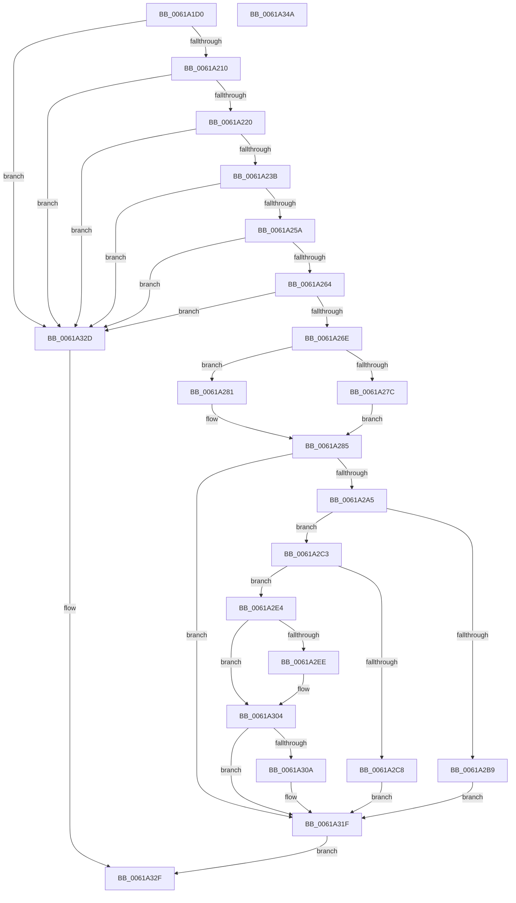

# DifObjTrkRemoveItem

- RVA: `0x0061A1D0`–`0x0061A34B` (길이 `379` bytes)
- VA: `0x000000014061A1D0`
- 실행 섹션: `.text`
- PDB 이름 있음: `예`; PDB Function 태그: `아니요`
- unwind 정보 RVA: `0x000D2A54`
- 디코드: `113`개 명령, `379/379` bytes 표시
- 미해석 바이트: `0` (있으면 어셈블리에 `.byte`로 보존)

> 이 문서는 커널 이미지의 기계어와 PDB 기호를 분석해 생성했습니다. 4번과 5번은 함수 원형과 자료형을 바이너리 사용 방식에서 추정한 C 해석이며 원본 소스 복구 결과는 아닙니다.

## 1. Dependencies

- 직접 호출 지점: **10**; 고유 호출 대상: **8**
- 직접 호출자로 확인된 함수: **0**
- RIP 상대 이미지 참조: **2**

### Outgoing calls
- `0x0061A213` → [DifIsValidTrackingObject](DifIsValidTrackingObject_function_00619BCC.md) (function, `0x00619BCC`)
- `0x0061A222` → [DifObjTrkGetPluginContext](DifObjTrkGetPluginContext_function_00619CE0.md) (function, `0x00619CE0`)
- `0x0061A22D` → [MmGetVaTypeForVerifier](../67/MmGetVaTypeForVerifier_function_0067B544.md) (function, `0x0067B544`)
- `0x0061A28D` → [DifAcquireSpinLockAtDpcLevelSafe](DifAcquireSpinLockAtDpcLevelSafe_function_0061BDF4.md) (function, `0x0061BDF4`)
- `0x0061A299` → [RtlDeleteElementGenericTableAvl](../3E/RtlDeleteElementGenericTableAvl_function_003EE750.md) (function, `0x003EE750`)
- `0x0061A2CD` → [RtlGetElementGenericTableAvl](../49/RtlGetElementGenericTableAvl_function_004968F0.md) (function, `0x004968F0`)
- `0x0061A2F3` → [RtlGetElementGenericTableAvl](../49/RtlGetElementGenericTableAvl_function_004968F0.md) (function, `0x004968F0`)
- `0x0061A312` → [RtlGetElementGenericTableAvl](../49/RtlGetElementGenericTableAvl_function_004968F0.md) (function, `0x004968F0`)
- `0x0061A323` → [DifReleaseSpinLockFromDpcLevelSafe](DifReleaseSpinLockFromDpcLevelSafe_function_0061BEAC.md) (function, `0x0061BEAC`)
- `0x0061A336` → [_security_check_cookie](../6A/_security_check_cookie_function_006AC640.md) (function, `0x006AC640`)

### Direct callers
- 이 함수 시작 RVA로 연결되는 직접 call은 확인되지 않았습니다. 간접 호출은 완전히 역산할 수 없습니다.

### Static image references
- `0x0061A1E2` → RVA `0x00E0A740` (`.data`; read)
- `0x0061A23B` → RVA `0x00F03EB8` (`.data`; read)

## 2. Other-region calls and transfers

- 다른 실행 섹션으로 향하는 call: **0**
- 별도 외부 분기/꼬리 이동을 확인하지 못했습니다.

## 3. Assembly (complete function range)

```asm
0061A1D0  40 55                           push rbp
0061A1D2  53                              push rbx
0061A1D3  56                              push rsi
0061A1D4  57                              push rdi
0061A1D5  41 54                           push r12
0061A1D7  41 56                           push r14
0061A1D9  41 57                           push r15
0061A1DB  48 8B EC                        mov rbp, rsp
0061A1DE  48 83 EC 50                     sub rsp, 0x50
0061A1E2  48 8B 05 57 05 7F 00            mov rax, qword ptr [rip + 0x7f0557]
0061A1E9  48 33 C4                        xor rax, rsp
0061A1EC  48 89 45 F0                     mov qword ptr [rbp - 0x10], rax
0061A1F0  45 33 E4                        xor r12d, r12d
0061A1F3  45 8B F0                        mov r14d, r8d
0061A1F6  44 89 65 DC                     mov dword ptr [rbp - 0x24], r12d
0061A1FA  48 8B FA                        mov rdi, rdx
0061A1FD  66 44 89 65 D0                  mov word ptr [rbp - 0x30], r12w
0061A202  8B F1                           mov esi, ecx
0061A204  44 0F 20 C0                     mov rax, cr8
0061A208  3C 02                           cmp al, 2
0061A20A  0F 87 1D 01 00 00               ja 0x14061a32d
0061A210  45 8B C6                        mov r8d, r14d
0061A213  E8 B4 F9 FF FF                  call 0x140619bcc
0061A218  85 C0                           test eax, eax
0061A21A  0F 88 0D 01 00 00               js 0x14061a32d
0061A220  8B CE                           mov ecx, esi
0061A222  E8 B9 FA FF FF                  call 0x140619ce0
0061A227  48 8B CA                        mov rcx, rdx
0061A22A  4C 8B F8                        mov r15, rax
0061A22D  E8 12 13 06 00                  call 0x14067b544
0061A232  83 F8 05                        cmp eax, 5
0061A235  0F 84 F2 00 00 00               je 0x14061a32d
0061A23B  48 8B 1D 76 9C 8E 00            mov rbx, qword ptr [rip + 0x8e9c76]
0061A242  48 83 C3 40                     add rbx, 0x40
0061A246  48 63 C8                        movsxd rcx, eax
0061A249  48 6B D1 78                     imul rdx, rcx, 0x78
0061A24D  48 03 DA                        add rbx, rdx
0061A250  44 39 63 2C                     cmp dword ptr [rbx + 0x2c], r12d
0061A254  0F 84 D3 00 00 00               je 0x14061a32d
0061A25A  48 3B 7B 68                     cmp rdi, qword ptr [rbx + 0x68]
0061A25E  0F 82 C9 00 00 00               jb 0x14061a32d
0061A264  48 3B 7B 70                     cmp rdi, qword ptr [rbx + 0x70]
0061A268  0F 87 BF 00 00 00               ja 0x14061a32d
0061A26E  89 75 D8                        mov dword ptr [rbp - 0x28], esi
0061A271  48 89 7D E0                     mov qword ptr [rbp - 0x20], rdi
0061A275  41 8B 07                        mov eax, dword ptr [r15]
0061A278  85 C0                           test eax, eax
0061A27A  74 05                           je 0x14061a281
0061A27C  48 03 C7                        add rax, rdi
0061A27F  EB 04                           jmp 0x14061a285
0061A281  4A 8D 04 37                     lea rax, [rdi + r14]
0061A285  48 8D 4D D0                     lea rcx, [rbp - 0x30]
0061A289  48 89 45 E8                     mov qword ptr [rbp - 0x18], rax
0061A28D  E8 62 1B 00 00                  call 0x14061bdf4
0061A292  48 8D 55 D8                     lea rdx, [rbp - 0x28]
0061A296  48 8B CB                        mov rcx, rbx
0061A299  E8 B2 44 DD FF                  call 0x1403ee750
0061A29E  40 8A F8                        mov dil, al
0061A2A1  84 C0                           test al, al
0061A2A3  74 7A                           je 0x14061a31f
0061A2A5  48 8B 0D 0C 9C 8E 00            mov rcx, qword ptr [rip + 0x8e9c0c]
0061A2AC  FF 89 38 03 00 00               dec dword ptr [rcx + 0x338]
0061A2B2  8B 4B 2C                        mov ecx, dword ptr [rbx + 0x2c]
0061A2B5  85 C9                           test ecx, ecx
0061A2B7  75 0A                           jne 0x14061a2c3
0061A2B9  4C 89 63 70                     mov qword ptr [rbx + 0x70], r12
0061A2BD  4C 89 63 68                     mov qword ptr [rbx + 0x68], r12
0061A2C1  EB 5C                           jmp 0x14061a31f
0061A2C3  83 F9 01                        cmp ecx, 1
0061A2C6  75 1C                           jne 0x14061a2e4
0061A2C8  33 D2                           xor edx, edx
0061A2CA  48 8B CB                        mov rcx, rbx
0061A2CD  E8 1E C6 E7 FF                  call 0x1404968f0
0061A2D2  48 8B 48 08                     mov rcx, qword ptr [rax + 8]
0061A2D6  48 89 4B 68                     mov qword ptr [rbx + 0x68], rcx
0061A2DA  48 8B 40 08                     mov rax, qword ptr [rax + 8]
0061A2DE  48 89 43 70                     mov qword ptr [rbx + 0x70], rax
0061A2E2  EB 3B                           jmp 0x14061a31f
0061A2E4  48 8B 45 E0                     mov rax, qword ptr [rbp - 0x20]
0061A2E8  48 3B 43 68                     cmp rax, qword ptr [rbx + 0x68]
0061A2EC  77 16                           ja 0x14061a304
0061A2EE  33 D2                           xor edx, edx
0061A2F0  48 8B CB                        mov rcx, rbx
0061A2F3  E8 F8 C5 E7 FF                  call 0x1404968f0
0061A2F8  48 8B 48 08                     mov rcx, qword ptr [rax + 8]
0061A2FC  48 89 4B 68                     mov qword ptr [rbx + 0x68], rcx
0061A300  48 8B 45 E0                     mov rax, qword ptr [rbp - 0x20]
0061A304  48 3B 43 70                     cmp rax, qword ptr [rbx + 0x70]
0061A308  72 15                           jb 0x14061a31f
0061A30A  8B 53 2C                        mov edx, dword ptr [rbx + 0x2c]
0061A30D  48 8B CB                        mov rcx, rbx
0061A310  FF CA                           dec edx
0061A312  E8 D9 C5 E7 FF                  call 0x1404968f0
0061A317  48 8B 48 08                     mov rcx, qword ptr [rax + 8]
0061A31B  48 89 4B 70                     mov qword ptr [rbx + 0x70], rcx
0061A31F  48 8D 4D D0                     lea rcx, [rbp - 0x30]
0061A323  E8 84 1B 00 00                  call 0x14061beac
0061A328  40 8A C7                        mov al, dil
0061A32B  EB 02                           jmp 0x14061a32f
0061A32D  32 C0                           xor al, al
0061A32F  48 8B 4D F0                     mov rcx, qword ptr [rbp - 0x10]
0061A333  48 33 CC                        xor rcx, rsp
0061A336  E8 05 23 09 00                  call 0x1406ac640
0061A33B  48 83 C4 50                     add rsp, 0x50
0061A33F  41 5F                           pop r15
0061A341  41 5E                           pop r14
0061A343  41 5C                           pop r12
0061A345  5F                              pop rdi
0061A346  5E                              pop rsi
0061A347  5B                              pop rbx
0061A348  5D                              pop rbp
0061A349  C3                              ret
0061A34A  CC                              int3
```

## 4. C-style interpretation (structured pseudocode)

```c
__int64 __fastcall DifObjTrkRemoveItem(int a1, __int64 a2, int a3)
{
    __int64 result;
    __int64 v_r12;
    __int64 v_rbx;
    __int64 v_rsp;
    unsigned __int64 v_stack_m48;
    unsigned __int64 v_stack_m50;
    unsigned __int64 v_stack_m58;
    unsigned int v_stack_m5C;
    unsigned int v_stack_m60;
    unsigned __int16 v_stack_m68;

    v_rsp = (v_rsp) - (80);
    result = (*(unsigned __int64 *)(v_rip + 8324439)) ^ (v_rsp);
    v_stack_m48 = result;
    v_r12 = 0;
    v_stack_m5C = 0;
    v_stack_m68 = 0;
    if (((unsigned __int8)(v_cr8)) > 2) goto loc_0061A32D;
    result = DifIsValidTrackingObject(a1, a2, (unsigned int)((unsigned int)((unsigned int)(a3))), a4);
    if (sign_flag) goto loc_0061A32D;
    result = DifObjTrkGetPluginContext((unsigned int)((unsigned int)((unsigned int)(a1))), a2, (unsigned int)((unsigned int)((unsigned int)(a3))), a4);
    result = MmGetVaTypeForVerifier(a2, a2, (unsigned int)((unsigned int)((unsigned int)(a3))), a4);
    if (((unsigned int)(result)) == 5) goto loc_0061A32D;
    v_rbx = (*(unsigned __int64 *)(v_rip + 9346166)) + (64);
    a2 = (a2) * ((int)((unsigned int)(result)));
    v_rbx = (v_rbx) + (a2);
    if ((*(unsigned int *)(v_rbx + 44)) == 0) goto loc_0061A32D;
    if (a2 < (*(unsigned __int64 *)(v_rbx + 104))) goto loc_0061A32D;
    if (a2 > (*(unsigned __int64 *)(v_rbx + 112))) goto loc_0061A32D;
    v_stack_m60 = (unsigned int)((unsigned int)(a1));
    v_stack_m58 = a2;
    if ((unsigned int)((unsigned int)(*(unsigned int *)(result))) == 0) goto loc_0061A281;
    result = ((unsigned int)(*(unsigned int *)(result))) + (a2);
    goto loc_0061A285;
loc_0061A281:
loc_0061A285:
    v_stack_m50 = a2 + (unsigned int)(a3) * 1;
    result = DifAcquireSpinLockAtDpcLevelSafe(v_stack_m68, a2, (unsigned int)((unsigned int)((unsigned int)(a3))), a4);
    result = RtlDeleteElementGenericTableAvl(v_rbx, v_stack_m60, (unsigned int)((unsigned int)((unsigned int)(a3))), a4);
    if ((unsigned __int8)(result) == 0) goto loc_0061A31F;
    if ((unsigned int)((unsigned int)(*(unsigned int *)(v_rbx + 44))) != 0) goto loc_0061A2C3;
    *(unsigned __int64 *)(v_rbx + 112) = 0;
    *(unsigned __int64 *)(v_rbx + 104) = 0;
    goto loc_0061A31F;
loc_0061A2C3:
    if (((unsigned int)((unsigned int)(*(unsigned int *)(v_rbx + 44)))) != 1) goto loc_0061A2E4;
    a2 = 0;
    result = RtlGetElementGenericTableAvl(v_rbx, a2, (unsigned int)((unsigned int)((unsigned int)(a3))), a4);
    *(unsigned __int64 *)(v_rbx + 104) = *(unsigned __int64 *)(result + 8);
    *(unsigned __int64 *)(v_rbx + 112) = *(unsigned __int64 *)(result + 8);
    goto loc_0061A31F;
loc_0061A2E4:
    result = v_stack_m58;
    if (v_stack_m58 <= (*(unsigned __int64 *)(v_rbx + 104))) {
        a2 = 0;
        a1 = v_rbx;
        result = RtlGetElementGenericTableAvl(a1, a2, (unsigned int)((unsigned int)((unsigned int)(a3))), a4);
        a1 = *(unsigned __int64 *)(result + 8);
        *(unsigned __int64 *)(v_rbx + 104) = a1;
        result = v_stack_m58;
    }
    if (result >= (*(unsigned __int64 *)(v_rbx + 112))) {
        a2 = *(unsigned int *)(v_rbx + 44);
        a1 = v_rbx;
        a2 = (unsigned int)((a2) - 1);
        result = RtlGetElementGenericTableAvl(a1, a2, (unsigned int)((unsigned int)((unsigned int)(a3))), a4);
        a1 = *(unsigned __int64 *)(result + 8);
        *(unsigned __int64 *)(v_rbx + 112) = a1;
    }
    result = DifReleaseSpinLockFromDpcLevelSafe(v_stack_m68, a2, (unsigned int)((unsigned int)((unsigned int)(a3))), a4);
    goto loc_0061A32F;
loc_0061A32D:
    result = 0;
loc_0061A32F:
    a1 = (v_stack_m48) ^ (v_rsp);
    result = _security_check_cookie(a1, a2, (unsigned int)((unsigned int)((unsigned int)(a3))), a4);
    v_rsp = (v_rsp) + (80);
    return result;
}
```

## 5. (Beta) C Style

```c
int64_t DifObjTrkRemoveItem(int32_t Arg1, int64_t Arg2, int32_t Arg3)
{
    int64_t result;
    int64_t local_r12;
    int64_t local_rbx;
    int64_t local_rsp;
    uint64_t v_stack_m48;
    uint64_t v_stack_m50;
    uint64_t v_stack_m58;
    uint32_t v_stack_m5C;
    uint32_t v_stack_m60;
    uint16_t v_stack_m68;

    local_rsp = (local_rsp) - (80);
    result = (*(uint64_t *)(v_rip + 0x7F0557)) ^ (local_rsp);
    v_stack_m48 = result;
    local_r12 = 0;
    v_stack_m5C = 0;
    v_stack_m68 = 0;
    if (((uint8_t)(v_cr8)) > 2) goto loc_0061A32D;
    result = DifIsValidTrackingObject(Arg1, Arg2, (uint32_t)((uint32_t)((uint32_t)(Arg3))), a4);
    if (sign_flag) goto loc_0061A32D;
    result = DifObjTrkGetPluginContext((uint32_t)((uint32_t)((uint32_t)(Arg1))), Arg2, (uint32_t)((uint32_t)((uint32_t)(Arg3))), a4);
    result = MmGetVaTypeForVerifier(Arg2, Arg2, (uint32_t)((uint32_t)((uint32_t)(Arg3))), a4);
    if (((uint32_t)(result)) == 5) goto loc_0061A32D;
    local_rbx = (*(uint64_t *)(v_rip + 0x8E9C76)) + (64);
    Arg2 = (Arg2) * ((int32_t)((uint32_t)(result)));
    local_rbx = (local_rbx) + (Arg2);
    if ((*(uint32_t *)(local_rbx + 0x2C)) == 0) goto loc_0061A32D;
    if (Arg2 < (*(uint64_t *)(local_rbx + 0x68))) goto loc_0061A32D;
    if (Arg2 > (*(uint64_t *)(local_rbx + 0x70))) goto loc_0061A32D;
    v_stack_m60 = (uint32_t)((uint32_t)(Arg1));
    v_stack_m58 = Arg2;
    if ((uint32_t)((uint32_t)(*(uint32_t *)(result))) == 0) goto loc_0061A281;
    result = ((uint32_t)(*(uint32_t *)(result))) + (Arg2);
    goto loc_0061A285;
loc_0061A281:
loc_0061A285:
    v_stack_m50 = Arg2 + (uint32_t)(Arg3) * 1;
    result = DifAcquireSpinLockAtDpcLevelSafe(v_stack_m68, Arg2, (uint32_t)((uint32_t)((uint32_t)(Arg3))), a4);
    result = RtlDeleteElementGenericTableAvl(local_rbx, v_stack_m60, (uint32_t)((uint32_t)((uint32_t)(Arg3))), a4);
    if ((uint8_t)(result) == 0) goto loc_0061A31F;
    if ((uint32_t)((uint32_t)(*(uint32_t *)(local_rbx + 0x2C))) != 0) goto loc_0061A2C3;
    *(uint64_t *)(local_rbx + 0x70) = 0;
    *(uint64_t *)(local_rbx + 0x68) = 0;
    goto loc_0061A31F;
loc_0061A2C3:
    if (((uint32_t)((uint32_t)(*(uint32_t *)(local_rbx + 0x2C)))) != 1) goto loc_0061A2E4;
    Arg2 = 0;
    result = RtlGetElementGenericTableAvl(local_rbx, Arg2, (uint32_t)((uint32_t)((uint32_t)(Arg3))), a4);
    *(uint64_t *)(local_rbx + 0x68) = *(uint64_t *)(result + 0x8);
    *(uint64_t *)(local_rbx + 0x70) = *(uint64_t *)(result + 0x8);
    goto loc_0061A31F;
loc_0061A2E4:
    result = v_stack_m58;
    if (v_stack_m58 <= (*(uint64_t *)(local_rbx + 0x68))) {
        Arg2 = 0;
        Arg1 = local_rbx;
        result = RtlGetElementGenericTableAvl(Arg1, Arg2, (uint32_t)((uint32_t)((uint32_t)(Arg3))), a4);
        Arg1 = *(uint64_t *)(result + 0x8);
        *(uint64_t *)(local_rbx + 0x68) = Arg1;
        result = v_stack_m58;
    }
    if (result >= (*(uint64_t *)(local_rbx + 0x70))) {
        Arg2 = *(uint32_t *)(local_rbx + 0x2C);
        Arg1 = local_rbx;
        Arg2 = (uint32_t)((Arg2) - 1);
        result = RtlGetElementGenericTableAvl(Arg1, Arg2, (uint32_t)((uint32_t)((uint32_t)(Arg3))), a4);
        Arg1 = *(uint64_t *)(result + 0x8);
        *(uint64_t *)(local_rbx + 0x70) = Arg1;
    }
    result = DifReleaseSpinLockFromDpcLevelSafe(v_stack_m68, Arg2, (uint32_t)((uint32_t)((uint32_t)(Arg3))), a4);
    goto loc_0061A32F;
loc_0061A32D:
    result = 0;
loc_0061A32F:
    Arg1 = (v_stack_m48) ^ (local_rsp);
    result = _security_check_cookie(Arg1, Arg2, (uint32_t)((uint32_t)((uint32_t)(Arg3))), a4);
    local_rsp = (local_rsp) + (80);
    return result;
}
```

## 6. Execution-region graph

[열기: 2D/3D 그래프와 함수 탐색 컨트롤 패널](../../../control-panel.html?section=text&rva=0x0061A1D0&view=graph)

- 2D 그래프는 위에서 아래로 흐르고, 3D 그래프는 빈 공간을 드래그해 회전합니다. Shift+드래그는 이동, 휠은 확대·축소, 함수 노드 선택은 대상 보고서 이동입니다.

### Static fallback


