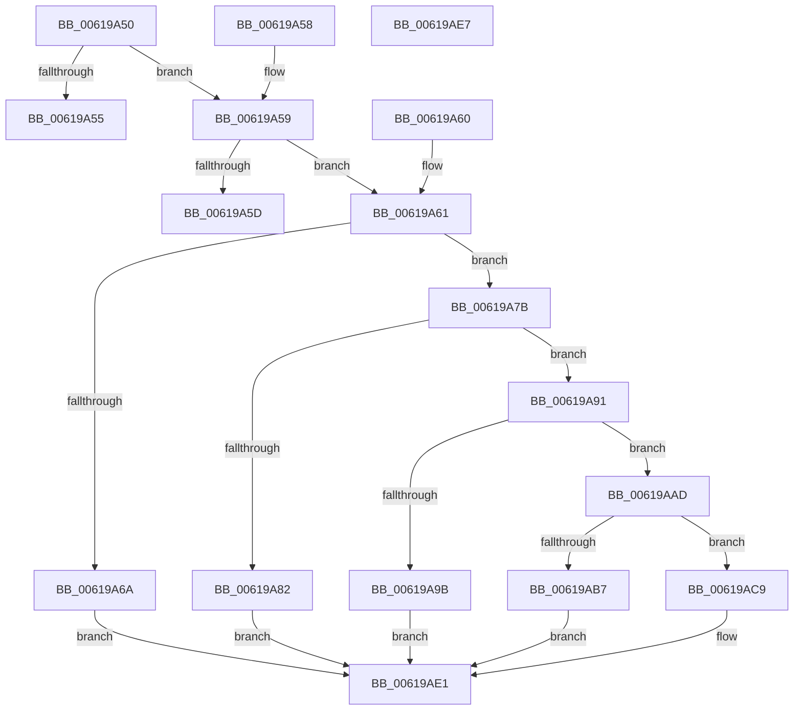

# DifPluginSimplePerfControl

- RVA: `0x00619A50`–`0x00619AE8` (길이 `152` bytes)
- VA: `0x0000000140619A50`
- 실행 섹션: `.text`
- PDB 이름 있음: `예`; PDB Function 태그: `아니요`
- unwind 정보 RVA: `0x000DB714`
- 디코드: `56`개 명령, `152/152` bytes 표시
- 미해석 바이트: `0` (있으면 어셈블리에 `.byte`로 보존)

> 이 문서는 커널 이미지의 기계어와 PDB 기호를 분석해 생성했습니다. 4번과 5번은 함수 원형과 자료형을 바이너리 사용 방식에서 추정한 C 해석이며 원본 소스 복구 결과는 아닙니다.

## 1. Dependencies

- 직접 호출 지점: **0**; 고유 호출 대상: **0**
- 직접 호출자로 확인된 함수: **0**
- RIP 상대 이미지 참조: **0**

### Outgoing calls
- 직접 디코드된 call 명령이 없습니다.

### Direct callers
- 이 함수 시작 RVA로 연결되는 직접 call은 확인되지 않았습니다. 간접 호출은 완전히 역산할 수 없습니다.

### Static image references
- 디코드된 RIP-relative 메모리 참조가 없습니다.

## 2. Other-region calls and transfers

- 다른 실행 섹션으로 향하는 call: **0**
- 별도 외부 분기/꼬리 이동을 확인하지 못했습니다.

## 3. Assembly (complete function range)

```asm
00619A50  41 3B C8                        cmp ecx, r8d
00619A53  76 04                           jbe 0x140619a59
00619A55  32 C0                           xor al, al
00619A57  C3                              ret
00619A58  CC                              int3
00619A59  3B CA                           cmp ecx, edx
00619A5B  73 04                           jae 0x140619a61
00619A5D  B0 01                           mov al, 1
00619A5F  C3                              ret
00619A60  CC                              int3
00619A61  8D 04 92                        lea eax, [rdx + rdx*4]
00619A64  03 C0                           add eax, eax
00619A66  3B C8                           cmp ecx, eax
00619A68  73 11                           jae 0x140619a7b
00619A6A  B8 CD CC CC CC                  mov eax, 0xcccccccd
00619A6F  F7 E1                           mul ecx
00619A71  C1 EA 03                        shr edx, 3
00619A74  8D 04 92                        lea eax, [rdx + rdx*4]
00619A77  03 C0                           add eax, eax
00619A79  EB 66                           jmp 0x140619ae1
00619A7B  6B C2 64                        imul eax, edx, 0x64
00619A7E  3B C8                           cmp ecx, eax
00619A80  73 0F                           jae 0x140619a91
00619A82  B8 1F 85 EB 51                  mov eax, 0x51eb851f
00619A87  F7 E1                           mul ecx
00619A89  C1 EA 05                        shr edx, 5
00619A8C  6B C2 64                        imul eax, edx, 0x64
00619A8F  EB 50                           jmp 0x140619ae1
00619A91  69 C2 E8 03 00 00               imul eax, edx, 0x3e8
00619A97  3B C8                           cmp ecx, eax
00619A99  73 12                           jae 0x140619aad
00619A9B  B8 D3 4D 62 10                  mov eax, 0x10624dd3
00619AA0  F7 E1                           mul ecx
00619AA2  C1 EA 06                        shr edx, 6
00619AA5  69 C2 E8 03 00 00               imul eax, edx, 0x3e8
00619AAB  EB 34                           jmp 0x140619ae1
00619AAD  69 C2 10 27 00 00               imul eax, edx, 0x2710
00619AB3  3B C8                           cmp ecx, eax
00619AB5  73 12                           jae 0x140619ac9
00619AB7  B8 59 17 B7 D1                  mov eax, 0xd1b71759
00619ABC  F7 E1                           mul ecx
00619ABE  C1 EA 0D                        shr edx, 0xd
00619AC1  69 C2 10 27 00 00               imul eax, edx, 0x2710
00619AC7  EB 18                           jmp 0x140619ae1
00619AC9  B8 8F 58 8B 4F                  mov eax, 0x4f8b588f
00619ACE  F7 E1                           mul ecx
00619AD0  8B C1                           mov eax, ecx
00619AD2  2B C2                           sub eax, edx
00619AD4  D1 E8                           shr eax, 1
00619AD6  03 C2                           add eax, edx
00619AD8  C1 E8 10                        shr eax, 0x10
00619ADB  69 C0 A0 86 01 00               imul eax, eax, 0x186a0
00619AE1  3B C8                           cmp ecx, eax
00619AE3  0F 94 C0                        sete al
00619AE6  C3                              ret
00619AE7  CC                              int3
```

## 4. C-style interpretation (structured pseudocode)

```c
__int64 __fastcall DifPluginSimplePerfControl(int a1, __int64 a2, int a3)
{
    __int64 result;

    if (a1 <= a3) goto loc_00619A59;
    result = 0;
    return result;
loc_00619A59:
    if (a1 >= ((unsigned int)(a2))) goto loc_00619A61;
    return 1;
loc_00619A61:
    result = (unsigned int)((a2 + a2 * 4) + ((unsigned int)(a2 + a2 * 4)));
    if (a1 >= ((unsigned int)(result))) goto loc_00619A7B;
    a2 = (unsigned int)((a2) >> (3));
    result = (unsigned int)((a2 + a2 * 4) + ((unsigned int)(a2 + a2 * 4)));
    goto loc_00619AE1;
loc_00619A7B:
    result = (unsigned int)((result) * ((unsigned int)(a2)));
    if (a1 >= ((unsigned int)(result))) goto loc_00619A91;
    a2 = (unsigned int)((a2) >> (5));
    result = (unsigned int)(((unsigned int)(0x51EB851FULL)) * ((unsigned int)(a2)));
    goto loc_00619AE1;
loc_00619A91:
    result = (unsigned int)((result) * ((unsigned int)(a2)));
    if (a1 >= ((unsigned int)(result))) goto loc_00619AAD;
    a2 = (unsigned int)((a2) >> (6));
    result = (unsigned int)(((unsigned int)(0x10624DD3ULL)) * ((unsigned int)(a2)));
    goto loc_00619AE1;
loc_00619AAD:
    result = (unsigned int)((result) * ((unsigned int)(a2)));
    if (a1 >= ((unsigned int)(result))) goto loc_00619AC9;
    a2 = (unsigned int)((a2) >> (13));
    result = (unsigned int)(((unsigned int)(0xD1B71759ULL)) * ((unsigned int)(a2)));
    goto loc_00619AE1;
loc_00619AC9:
    result = (unsigned int)(((unsigned int)(a1)) - ((unsigned int)(a2)));
    result = (unsigned int)((result) >> (1));
    result = (unsigned int)((result) + ((unsigned int)(a2)));
    result = (unsigned int)((result) >> (16));
    result = (unsigned int)((result) * ((unsigned int)(result)));
loc_00619AE1:
    result = (a1 == ((unsigned int)(result))) ? 1 : 0;
    return result;
}
```

## 5. (Beta) C Style

```c
int64_t DifPluginSimplePerfControl(int32_t Arg1, void *Arg2, int32_t Arg3)
{
    uint8_t *arg2 = (uint8_t *)Arg2;

    int64_t result;

    if (Arg1 <= Arg3) goto loc_00619A59;
    result = 0;
    return result;
loc_00619A59:
    if (Arg1 >= ((uint32_t)(Arg2))) goto loc_00619A61;
    return 1;
loc_00619A61:
    result = (uint32_t)((Arg2 + Arg2 * 4) + ((uint32_t)(Arg2 + Arg2 * 4)));
    if (Arg1 >= ((uint32_t)(result))) goto loc_00619A7B;
    Arg2 = (uint32_t)((Arg2) >> (3));
    result = (uint32_t)((Arg2 + Arg2 * 4) + ((uint32_t)(Arg2 + Arg2 * 4)));
    goto loc_00619AE1;
loc_00619A7B:
    result = (uint32_t)((result) * ((uint32_t)(Arg2)));
    if (Arg1 >= ((uint32_t)(result))) goto loc_00619A91;
    Arg2 = (uint32_t)((Arg2) >> (5));
    result = (uint32_t)(((uint32_t)(0x51EB851FULL)) * ((uint32_t)(Arg2)));
    goto loc_00619AE1;
loc_00619A91:
    result = (uint32_t)((result) * ((uint32_t)(Arg2)));
    if (Arg1 >= ((uint32_t)(result))) goto loc_00619AAD;
    Arg2 = (uint32_t)((Arg2) >> (6));
    result = (uint32_t)(((uint32_t)(0x10624DD3ULL)) * ((uint32_t)(Arg2)));
    goto loc_00619AE1;
loc_00619AAD:
    result = (uint32_t)((result) * ((uint32_t)(Arg2)));
    if (Arg1 >= ((uint32_t)(result))) goto loc_00619AC9;
    Arg2 = (uint32_t)((Arg2) >> (13));
    result = (uint32_t)(((uint32_t)(0xD1B71759ULL)) * ((uint32_t)(Arg2)));
    goto loc_00619AE1;
loc_00619AC9:
    result = (uint32_t)(((uint32_t)(Arg1)) - ((uint32_t)(Arg2)));
    result = (uint32_t)((result) >> (1));
    result = (uint32_t)((result) + ((uint32_t)(Arg2)));
    result = (uint32_t)((result) >> (16));
    result = (uint32_t)((result) * ((uint32_t)(result)));
loc_00619AE1:
    result = (Arg1 == ((uint32_t)(result))) ? 1 : 0;
    return result;
}
```

### 관측된 메모리 오프셋

구조체 형식이 확인되지 않은 접근은 인자 기준의 오프셋으로만 기록했습니다.

| 기준 인자 | 오프셋 표현 | 폭 (bit) | 접근 |
|---|---:|---:|---|
| `Arg2` | `+ 0x0 + rdx*4` | `32` | `R` |

## 6. Execution-region graph

[열기: 2D/3D 그래프와 함수 탐색 컨트롤 패널](../../../control-panel.html?section=text&rva=0x00619A50&view=graph)

- 2D 그래프는 위에서 아래로 흐르고, 3D 그래프는 빈 공간을 드래그해 회전합니다. Shift+드래그는 이동, 휠은 확대·축소, 함수 노드 선택은 대상 보고서 이동입니다.

### Static fallback


