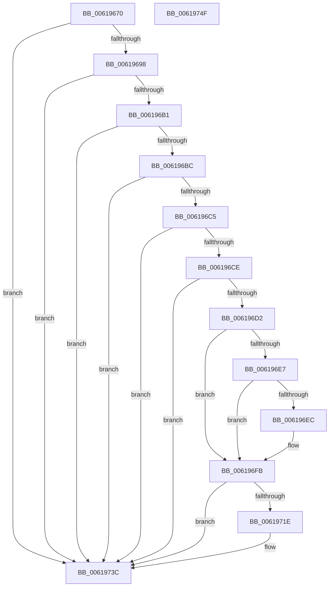

# DifPopThreadContextData

- RVA: `0x00619670`–`0x00619750` (길이 `224` bytes)
- VA: `0x0000000140619670`
- 실행 섹션: `.text`
- PDB 이름 있음: `예`; PDB Function 태그: `아니요`
- unwind 정보 RVA: `0x00060BC4`
- 디코드: `60`개 명령, `224/224` bytes 표시
- 미해석 바이트: `0` (있으면 어셈블리에 `.byte`로 보존)

> 이 문서는 커널 이미지의 기계어와 PDB 기호를 분석해 생성했습니다. 4번과 5번은 함수 원형과 자료형을 바이너리 사용 방식에서 추정한 C 해석이며 원본 소스 복구 결과는 아닙니다.

## 1. Dependencies

- 직접 호출 지점: **4**; 고유 호출 대상: **2**
- 직접 호출자로 확인된 함수: **0**
- RIP 상대 이미지 참조: **1**

### Outgoing calls
- `0x006196F6` → [memcpy](../6C/memcpy_function_006C6840.md) (function, `0x006C6840`)
- `0x00619704` → [ExFreePoolWithTag](../../poolcode/B8/ExFreePoolWithTag_function_00B82870.md) (function, `0x00B82870`)
- `0x00619711` → [ExFreePoolWithTag](../../poolcode/B8/ExFreePoolWithTag_function_00B82870.md) (function, `0x00B82870`)
- `0x00619737` → [ExFreePoolWithTag](../../poolcode/B8/ExFreePoolWithTag_function_00B82870.md) (function, `0x00B82870`)

### Direct callers
- 이 함수 시작 RVA로 연결되는 직접 call은 확인되지 않았습니다. 간접 호출은 완전히 역산할 수 없습니다.

### Static image references
- `0x00619687` → RVA `0x00E68200` (`.data`; read)

## 2. Other-region calls and transfers

- 다른 실행 섹션으로 향하는 call: **3**
  - `0x00619704` → [ExFreePoolWithTag](../../poolcode/B8/ExFreePoolWithTag_function_00B82870.md) (`.text` → `POOLCODE`)
  - `0x00619711` → [ExFreePoolWithTag](../../poolcode/B8/ExFreePoolWithTag_function_00B82870.md) (`.text` → `POOLCODE`)
  - `0x00619737` → [ExFreePoolWithTag](../../poolcode/B8/ExFreePoolWithTag_function_00B82870.md) (`.text` → `POOLCODE`)
- 별도 외부 분기/꼬리 이동을 확인하지 못했습니다.

## 3. Assembly (complete function range)

```asm
00619670  48 89 5C 24 08                  mov qword ptr [rsp + 8], rbx
00619675  48 89 74 24 10                  mov qword ptr [rsp + 0x10], rsi
0061967A  57                              push rdi
0061967B  48 83 EC 20                     sub rsp, 0x20
0061967F  8B C1                           mov eax, ecx
00619681  4C 8B CA                        mov r9, rdx
00619684  40 32 F6                        xor sil, sil
00619687  48 8D 15 72 EB 84 00            lea rdx, [rip + 0x84eb72]
0061968E  40 38 34 10                     cmp byte ptr [rax + rdx], sil
00619692  0F 84 A4 00 00 00               je 0x14061973c
00619698  65 48 8B 04 25 88 01 00 00      mov rax, qword ptr gs:[0x188]
006196A1  48 8B 98 40 06 00 00            mov rbx, qword ptr [rax + 0x640]
006196A8  48 85 DB                        test rbx, rbx
006196AB  0F 84 8B 00 00 00               je 0x14061973c
006196B1  8B 03                           mov eax, dword ptr [rbx]
006196B3  83 F8 01                        cmp eax, 1
006196B6  0F 8C 80 00 00 00               jl 0x14061973c
006196BC  48 8B 43 08                     mov rax, qword ptr [rbx + 8]
006196C0  48 85 C0                        test rax, rax
006196C3  74 77                           je 0x14061973c
006196C5  48 8D 78 F0                     lea rdi, [rax - 0x10]
006196C9  48 85 FF                        test rdi, rdi
006196CC  74 6E                           je 0x14061973c
006196CE  3B 0F                           cmp ecx, dword ptr [rdi]
006196D0  75 6A                           jne 0x14061973c
006196D2  48 8B 00                        mov rax, qword ptr [rax]
006196D5  40 B6 01                        mov sil, 1
006196D8  48 89 43 08                     mov qword ptr [rbx + 8], rax
006196DC  8B 03                           mov eax, dword ptr [rbx]
006196DE  FF C8                           dec eax
006196E0  89 03                           mov dword ptr [rbx], eax
006196E2  4D 85 C9                        test r9, r9
006196E5  74 14                           je 0x1406196fb
006196E7  45 85 C0                        test r8d, r8d
006196EA  74 0F                           je 0x1406196fb
006196EC  48 8B 57 08                     mov rdx, qword ptr [rdi + 8]
006196F0  49 8B C9                        mov rcx, r9
006196F3  45 8B C0                        mov r8d, r8d
006196F6  E8 45 D1 0A 00                  call 0x1406c6840
006196FB  48 8B 4F 08                     mov rcx, qword ptr [rdi + 8]
006196FF  BA 44 69 66 4E                  mov edx, 0x4e666944
00619704  E8 67 91 56 00                  call 0x140b82870
00619709  BA 44 69 66 4E                  mov edx, 0x4e666944
0061970E  48 8B CF                        mov rcx, rdi
00619711  E8 5A 91 56 00                  call 0x140b82870
00619716  44 8B 03                        mov r8d, dword ptr [rbx]
00619719  45 85 C0                        test r8d, r8d
0061971C  75 1E                           jne 0x14061973c
0061971E  65 4C 8B 04 25 88 01 00 00      mov r8, qword ptr gs:[0x188]
00619727  BA 44 69 66 4E                  mov edx, 0x4e666944
0061972C  48 8B CB                        mov rcx, rbx
0061972F  49 83 A0 40 06 00 00 00         and qword ptr [r8 + 0x640], 0
00619737  E8 34 91 56 00                  call 0x140b82870
0061973C  48 8B 5C 24 30                  mov rbx, qword ptr [rsp + 0x30]
00619741  40 8A C6                        mov al, sil
00619744  48 8B 74 24 38                  mov rsi, qword ptr [rsp + 0x38]
00619749  48 83 C4 20                     add rsp, 0x20
0061974D  5F                              pop rdi
0061974E  C3                              ret
0061974F  CC                              int3
```

## 4. C-style interpretation (structured pseudocode)

```c
__int64 __fastcall DifPopThreadContextData(int a1, __int64 a2, int a3)
{
    __int64 result;
    __int64 v_rsi;
    __int64 v_rsp;
    unsigned __int64 v_stack_p10;
    unsigned __int64 v_stack_p8;

    v_stack_p8 = v_rbx;
    v_stack_p10 = v_rsi;
    v_rsp = (v_rsp) - (32);
    v_rsi = 0;
    if ((*(unsigned __int8 *)((unsigned int)(a1) + v_rip + 8711026 * 1)) == 0) goto loc_0061973C;
    if (*(unsigned __int64 *)(*(unsigned __int64 *)(gs_base + (0 + 392)) + 1600) == 0) goto loc_0061973C;
    if (((unsigned int)((unsigned int)(*(unsigned int *)(*(unsigned __int64 *)(*(unsigned __int64 *)(gs_base + (0 + 392)) + 1600))))) < 1) goto loc_0061973C;
    if (*(unsigned __int64 *)(*(unsigned __int64 *)(*(unsigned __int64 *)(gs_base + (0 + 392)) + 1600) + 8) == 0) goto loc_0061973C;
    if (*(unsigned __int64 *)(*(unsigned __int64 *)(*(unsigned __int64 *)(gs_base + (0 + 392)) + 1600) + 8) - 16 == 0) goto loc_0061973C;
    if (a1 != (*(unsigned int *)(*(unsigned __int64 *)(*(unsigned __int64 *)(*(unsigned __int64 *)(gs_base + (0 + 392)) + 1600) + 8) - 16))) goto loc_0061973C;
    *(unsigned __int64 *)(*(unsigned __int64 *)(*(unsigned __int64 *)(gs_base + (0 + 392)) + 1600) + 8) = *(unsigned __int64 *)(*(unsigned __int64 *)(*(unsigned __int64 *)(*(unsigned __int64 *)(gs_base + (0 + 392)) + 1600) + 8));
    result = (unsigned int)(((unsigned int)(*(unsigned int *)(*(unsigned __int64 *)(*(unsigned __int64 *)(gs_base + (0 + 392)) + 1600)))) - 1);
    *(unsigned int *)(*(unsigned __int64 *)(*(unsigned __int64 *)(gs_base + (0 + 392)) + 1600)) = (unsigned int)(result);
    if (a2 == 0) goto loc_006196FB;
    if (a3 != 0) {
        a2 = *(unsigned __int64 *)(*(unsigned __int64 *)(*(unsigned __int64 *)(*(unsigned __int64 *)(gs_base + (0 + 392)) + 1600) + 8) - 16 + 8);
        a1 = a2;
        a3 = a3;
        result = memcpy(a1, a2, a3, a2);
    }
    result = ExFreePoolWithTag(*(unsigned __int64 *)(*(unsigned __int64 *)(*(unsigned __int64 *)(*(unsigned __int64 *)(gs_base + (0 + 392)) + 1600) + 8) - 16 + 8), (unsigned int)(0x4E666944ULL), a3, a2);
    result = ExFreePoolWithTag(*(unsigned __int64 *)(*(unsigned __int64 *)(*(unsigned __int64 *)(gs_base + (0 + 392)) + 1600) + 8) - 16, (unsigned int)(0x4E666944ULL), a3, a2);
    if ((unsigned int)((unsigned int)(*(unsigned int *)(*(unsigned __int64 *)(*(unsigned __int64 *)(gs_base + (0 + 392)) + 1600)))) == 0) {
        a3 = *(unsigned __int64 *)(gs_base + (0 + 392));
        a2 = 0x4E666944ULL;
        a1 = *(unsigned __int64 *)(*(unsigned __int64 *)(gs_base + (0 + 392)) + 1600);
        result = ExFreePoolWithTag(a1, a2, a3, a2);
    }
    v_rsp = (v_rsp) + (32);
    return 1;
}
```

## 5. (Beta) C Style

```c
int64_t DifPopThreadContextData(void *Arg1, int64_t Arg2, int32_t Arg3)
{
    uint8_t *arg1 = (uint8_t *)Arg1;

    int64_t result;
    int64_t local_rsi;
    int64_t local_rsp;
    uint64_t v_stack_p10;
    uint64_t v_stack_p8;

    v_stack_p8 = local_rbx;
    v_stack_p10 = local_rsi;
    local_rsp = (local_rsp) - (32);
    local_rsi = 0;
    if ((*(uint8_t *)((uint32_t)(arg1) + v_rip + 0x84EB72 * 1)) == 0) goto loc_0061973C;
    if (*(uint64_t *)(*(uint64_t *)(gs_base + (0 + 0x188)) + 0x640) == 0) goto loc_0061973C;
    if (((uint32_t)((uint32_t)(*(uint32_t *)(*(uint64_t *)(*(uint64_t *)(gs_base + (0 + 0x188)) + 0x640))))) < 1) goto loc_0061973C;
    if (*(uint64_t *)(*(uint64_t *)(*(uint64_t *)(gs_base + (0 + 0x188)) + 0x640) + 0x8) == 0) goto loc_0061973C;
    if (*(uint64_t *)(*(uint64_t *)(*(uint64_t *)(gs_base + (0 + 0x188)) + 0x640) + 0x8) - 16 == 0) goto loc_0061973C;
    if (Arg1 != (*(uint32_t *)(*(uint64_t *)(*(uint64_t *)(*(uint64_t *)(gs_base + (0 + 0x188)) + 0x640) + 0x8) - 0x10))) goto loc_0061973C;
    *(uint64_t *)(*(uint64_t *)(*(uint64_t *)(gs_base + (0 + 0x188)) + 0x640) + 0x8) = *(uint64_t *)(*(uint64_t *)(*(uint64_t *)(*(uint64_t *)(gs_base + (0 + 0x188)) + 0x640) + 0x8));
    result = (uint32_t)(((uint32_t)(*(uint32_t *)(*(uint64_t *)(*(uint64_t *)(gs_base + (0 + 0x188)) + 0x640)))) - 1);
    *(uint32_t *)(*(uint64_t *)(*(uint64_t *)(gs_base + (0 + 0x188)) + 0x640)) = (uint32_t)(result);
    if (Arg2 == 0) goto loc_006196FB;
    if (Arg3 != 0) {
        Arg2 = *(uint64_t *)(*(uint64_t *)(*(uint64_t *)(*(uint64_t *)(gs_base + (0 + 0x188)) + 0x640) + 0x8) - 0x10 + 0x8);
        Arg1 = Arg2;
        Arg3 = Arg3;
        result = memcpy(Arg1, Arg2, Arg3, Arg2);
    }
    result = ExFreePoolWithTag(*(uint64_t *)(*(uint64_t *)(*(uint64_t *)(*(uint64_t *)(gs_base + (0 + 0x188)) + 0x640) + 0x8) - 0x10 + 0x8), (uint32_t)(0x4E666944ULL), Arg3, Arg2);
    result = ExFreePoolWithTag(*(uint64_t *)(*(uint64_t *)(*(uint64_t *)(gs_base + (0 + 0x188)) + 0x640) + 0x8) - 16, (uint32_t)(0x4E666944ULL), Arg3, Arg2);
    if ((uint32_t)((uint32_t)(*(uint32_t *)(*(uint64_t *)(*(uint64_t *)(gs_base + (0 + 0x188)) + 0x640)))) == 0) {
        Arg3 = *(uint64_t *)(gs_base + (0 + 0x188));
        Arg2 = 0x4E666944ULL;
        Arg1 = *(uint64_t *)(*(uint64_t *)(gs_base + (0 + 0x188)) + 0x640);
        result = ExFreePoolWithTag(Arg1, Arg2, Arg3, Arg2);
    }
    local_rsp = (local_rsp) + (32);
    return 1;
}
```

### 관측된 메모리 오프셋

구조체 형식이 확인되지 않은 접근은 인자 기준의 오프셋으로만 기록했습니다.

| 기준 인자 | 오프셋 표현 | 폭 (bit) | 접근 |
|---|---:|---:|---|
| `Arg1` | `+ 0x0 + rdx*1` | `8` | `R` |

## 6. Execution-region graph

[열기: 2D/3D 그래프와 함수 탐색 컨트롤 패널](../../../control-panel.html?section=text&rva=0x00619670&view=graph)

- 2D 그래프는 위에서 아래로 흐르고, 3D 그래프는 빈 공간을 드래그해 회전합니다. Shift+드래그는 이동, 휠은 확대·축소, 함수 노드 선택은 대상 보고서 이동입니다.

### Static fallback


