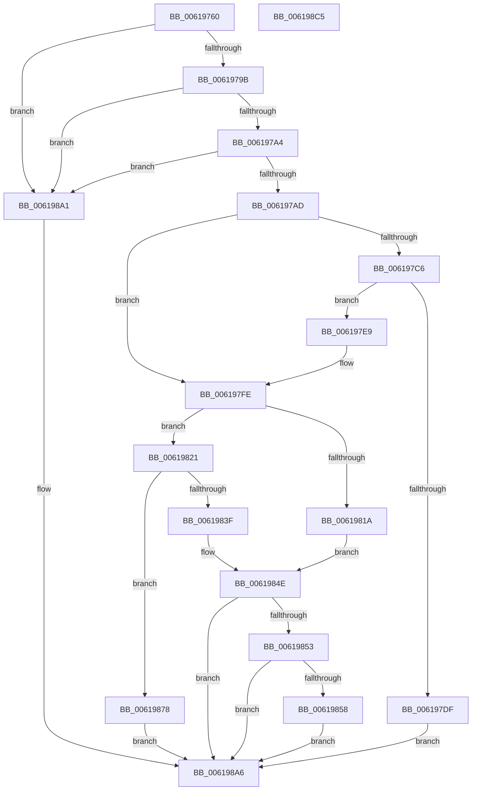

# DifPushThreadContextData

- RVA: `0x00619760`–`0x006198C6` (길이 `358` bytes)
- VA: `0x0000000140619760`
- 실행 섹션: `.text`
- PDB 이름 있음: `예`; PDB Function 태그: `아니요`
- unwind 정보 RVA: `0x00075C18`
- 디코드: `96`개 명령, `358/358` bytes 표시
- 미해석 바이트: `0` (있으면 어셈블리에 `.byte`로 보존)

> 이 문서는 커널 이미지의 기계어와 PDB 기호를 분석해 생성했습니다. 4번과 5번은 함수 원형과 자료형을 바이너리 사용 방식에서 추정한 C 해석이며 원본 소스 복구 결과는 아닙니다.

## 1. Dependencies

- 직접 호출 지점: **6**; 고유 호출 대상: **3**
- 직접 호출자로 확인된 함수: **0**
- RIP 상대 이미지 참조: **1**

### Outgoing calls
- `0x006197D2` → [ExAllocatePool2](../../poolcode/B8/ExAllocatePool2_function_00B820F0.md) (function, `0x00B820F0`)
- `0x0061980D` → [ExAllocatePool2](../../poolcode/B8/ExAllocatePool2_function_00B820F0.md) (function, `0x00B820F0`)
- `0x0061982F` → [ExAllocatePool2](../../poolcode/B8/ExAllocatePool2_function_00B820F0.md) (function, `0x00B820F0`)
- `0x00619849` → [ExFreePoolWithTag](../../poolcode/B8/ExFreePoolWithTag_function_00B82870.md) (function, `0x00B82870`)
- `0x00619860` → [ExFreePoolWithTag](../../poolcode/B8/ExFreePoolWithTag_function_00B82870.md) (function, `0x00B82870`)
- `0x0061987E` → [memcpy](../6C/memcpy_function_006C6840.md) (function, `0x006C6840`)

### Direct callers
- 이 함수 시작 RVA로 연결되는 직접 call은 확인되지 않았습니다. 간접 호출은 완전히 역산할 수 없습니다.

### Static image references
- `0x00619787` → RVA `0x00E68200` (`.data`; read)

## 2. Other-region calls and transfers

- 다른 실행 섹션으로 향하는 call: **5**
  - `0x006197D2` → [ExAllocatePool2](../../poolcode/B8/ExAllocatePool2_function_00B820F0.md) (`.text` → `POOLCODE`)
  - `0x0061980D` → [ExAllocatePool2](../../poolcode/B8/ExAllocatePool2_function_00B820F0.md) (`.text` → `POOLCODE`)
  - `0x0061982F` → [ExAllocatePool2](../../poolcode/B8/ExAllocatePool2_function_00B820F0.md) (`.text` → `POOLCODE`)
  - `0x00619849` → [ExFreePoolWithTag](../../poolcode/B8/ExFreePoolWithTag_function_00B82870.md) (`.text` → `POOLCODE`)
  - `0x00619860` → [ExFreePoolWithTag](../../poolcode/B8/ExFreePoolWithTag_function_00B82870.md) (`.text` → `POOLCODE`)
- 별도 외부 분기/꼬리 이동을 확인하지 못했습니다.

## 3. Assembly (complete function range)

```asm
00619760  48 89 5C 24 08                  mov qword ptr [rsp + 8], rbx
00619765  48 89 6C 24 10                  mov qword ptr [rsp + 0x10], rbp
0061976A  48 89 74 24 18                  mov qword ptr [rsp + 0x18], rsi
0061976F  57                              push rdi
00619770  41 54                           push r12
00619772  41 55                           push r13
00619774  41 56                           push r14
00619776  41 57                           push r15
00619778  48 83 EC 20                     sub rsp, 0x20
0061977C  44 8B E1                        mov r12d, ecx
0061977F  40 32 F6                        xor sil, sil
00619782  33 FF                           xor edi, edi
00619784  41 8B E8                        mov ebp, r8d
00619787  48 8D 0D 72 EA 84 00            lea rcx, [rip + 0x84ea72]
0061978E  4C 8B FA                        mov r15, rdx
00619791  41 38 34 0C                     cmp byte ptr [r12 + rcx], sil
00619795  0F 84 06 01 00 00               je 0x1406198a1
0061979B  48 85 D2                        test rdx, rdx
0061979E  0F 84 FD 00 00 00               je 0x1406198a1
006197A4  45 85 C0                        test r8d, r8d
006197A7  0F 84 F4 00 00 00               je 0x1406198a1
006197AD  65 48 8B 04 25 88 01 00 00      mov rax, qword ptr gs:[0x188]
006197B6  44 8D 77 40                     lea r14d, [rdi + 0x40]
006197BA  48 8B 98 40 06 00 00            mov rbx, qword ptr [rax + 0x640]
006197C1  48 85 DB                        test rbx, rbx
006197C4  75 38                           jne 0x1406197fe
006197C6  8D 57 10                        lea edx, [rdi + 0x10]
006197C9  41 B8 44 66 43 74               mov r8d, 0x74436644
006197CF  41 8B CE                        mov ecx, r14d
006197D2  E8 19 89 56 00                  call 0x140b820f0
006197D7  48 8B D8                        mov rbx, rax
006197DA  48 85 C0                        test rax, rax
006197DD  75 0A                           jne 0x1406197e9
006197DF  BF 17 00 00 C0                  mov edi, 0xc0000017
006197E4  E9 BD 00 00 00                  jmp 0x1406198a6
006197E9  89 38                           mov dword ptr [rax], edi
006197EB  40 B6 01                        mov sil, 1
006197EE  65 48 8B 04 25 88 01 00 00      mov rax, qword ptr gs:[0x188]
006197F7  48 89 98 40 06 00 00            mov qword ptr [rax + 0x640], rbx
006197FE  41 B8 44 66 50 64               mov r8d, 0x64506644
00619804  48 8B D5                        mov rdx, rbp
00619807  49 8B CE                        mov rcx, r14
0061980A  4C 8B ED                        mov r13, rbp
0061980D  E8 DE 88 56 00                  call 0x140b820f0
00619812  48 8B E8                        mov rbp, rax
00619815  48 85 C0                        test rax, rax
00619818  75 07                           jne 0x140619821
0061981A  BF 17 00 00 C0                  mov edi, 0xc0000017
0061981F  EB 2D                           jmp 0x14061984e
00619821  BA 18 00 00 00                  mov edx, 0x18
00619826  41 B8 44 66 43 74               mov r8d, 0x74436644
0061982C  49 8B CE                        mov rcx, r14
0061982F  E8 BC 88 56 00                  call 0x140b820f0
00619834  4C 8B F0                        mov r14, rax
00619837  48 8B CD                        mov rcx, rbp
0061983A  48 85 C0                        test rax, rax
0061983D  75 39                           jne 0x140619878
0061983F  BA 44 69 66 4E                  mov edx, 0x4e666944
00619844  BF 17 00 00 C0                  mov edi, 0xc0000017
00619849  E8 22 90 56 00                  call 0x140b82870
0061984E  48 85 DB                        test rbx, rbx
00619851  74 53                           je 0x1406198a6
00619853  40 84 F6                        test sil, sil
00619856  74 4E                           je 0x1406198a6
00619858  BA 44 69 66 4E                  mov edx, 0x4e666944
0061985D  48 8B CB                        mov rcx, rbx
00619860  E8 0B 90 56 00                  call 0x140b82870
00619865  65 48 8B 04 25 88 01 00 00      mov rax, qword ptr gs:[0x188]
0061986E  48 83 A0 40 06 00 00 00         and qword ptr [rax + 0x640], 0
00619876  EB 2E                           jmp 0x1406198a6
00619878  4D 8B C5                        mov r8, r13
0061987B  49 8B D7                        mov rdx, r15
0061987E  E8 BD CF 0A 00                  call 0x1406c6840
00619883  49 89 6E 08                     mov qword ptr [r14 + 8], rbp
00619887  49 8D 4E 10                     lea rcx, [r14 + 0x10]
0061988B  45 89 26                        mov dword ptr [r14], r12d
0061988E  48 8B 43 08                     mov rax, qword ptr [rbx + 8]
00619892  48 89 01                        mov qword ptr [rcx], rax
00619895  48 89 4B 08                     mov qword ptr [rbx + 8], rcx
00619899  8B 03                           mov eax, dword ptr [rbx]
0061989B  FF C0                           inc eax
0061989D  89 03                           mov dword ptr [rbx], eax
0061989F  EB 05                           jmp 0x1406198a6
006198A1  BF 0D 00 00 C0                  mov edi, 0xc000000d
006198A6  48 8B 5C 24 50                  mov rbx, qword ptr [rsp + 0x50]
006198AB  8B C7                           mov eax, edi
006198AD  48 8B 6C 24 58                  mov rbp, qword ptr [rsp + 0x58]
006198B2  48 8B 74 24 60                  mov rsi, qword ptr [rsp + 0x60]
006198B7  48 83 C4 20                     add rsp, 0x20
006198BB  41 5F                           pop r15
006198BD  41 5E                           pop r14
006198BF  41 5D                           pop r13
006198C1  41 5C                           pop r12
006198C3  5F                              pop rdi
006198C4  C3                              ret
006198C5  CC                              int3
```

## 4. C-style interpretation (structured pseudocode)

```c
__int64 __fastcall DifPushThreadContextData(int a1, __int64 a2, int a3)
{
    __int64 result;
    __int64 v_rdi;
    __int64 v_rsi;
    __int64 v_rsp;
    unsigned __int64 v_stack_p10;
    unsigned __int64 v_stack_p18;
    unsigned __int64 v_stack_p8;

    v_stack_p8 = v_rbx;
    v_stack_p10 = v_rbp;
    v_stack_p18 = v_rsi;
    v_rsp = (v_rsp) - (32);
    v_rsi = 0;
    v_rdi = 0;
    if ((*(unsigned __int8 *)((unsigned int)(a1) + v_rip + 8710770 * 1)) == 0) goto loc_006198A1;
    if (a2 == 0) goto loc_006198A1;
    if (a3 == 0) goto loc_006198A1;
    if (*(unsigned __int64 *)(*(unsigned __int64 *)(gs_base + (0 + 392)) + 1600) != 0) goto loc_006197FE;
    result = ExAllocatePool2((unsigned int)((unsigned int)(v_rdi + 64)), v_rdi + 16, (unsigned int)(0x74436644ULL), a4);
    if (result != 0) goto loc_006197E9;
    goto loc_006198A6;
loc_006197E9:
    *(unsigned int *)(result) = (unsigned int)((unsigned int)(0xC0000017ULL));
    *(unsigned __int64 *)(*(unsigned __int64 *)(gs_base + (0 + 392)) + 1600) = result;
loc_006197FE:
    result = ExAllocatePool2(v_rdi + 64, (unsigned int)(a3), (unsigned int)(0x64506644ULL), a4);
    if (result != 0) goto loc_00619821;
    goto loc_0061984E;
loc_00619821:
    result = ExAllocatePool2(v_rdi + 64, 24, (unsigned int)(0x74436644ULL), a4);
    if (result != 0) goto loc_00619878;
    result = ExFreePoolWithTag(result, (unsigned int)(0x4E666944ULL), (unsigned int)(0x74436644ULL), a4);
loc_0061984E:
    if (result == 0) goto loc_006198A6;
    if (1 == 0) goto loc_006198A6;
    result = ExFreePoolWithTag(result, (unsigned int)(0x4E666944ULL), (unsigned int)(0x74436644ULL), a4);
    goto loc_006198A6;
loc_00619878:
    result = memcpy(result, a2, (unsigned int)(a3), a4);
    *(unsigned __int64 *)(result + 8) = result;
    *(unsigned int *)(result) = (unsigned int)((unsigned int)(a1));
    *(unsigned __int64 *)(result + 16) = *(unsigned __int64 *)(result + 8);
    *(unsigned __int64 *)(result + 8) = result + 16;
    result = (unsigned int)(((unsigned int)(*(unsigned int *)(result))) + 1);
    *(unsigned int *)(result) = (unsigned int)(result);
    goto loc_006198A6;
loc_006198A1:
loc_006198A6:
    v_rsp = (v_rsp) + (32);
    return (unsigned int)((unsigned int)((unsigned int)(0xC000000DULL)));
}
```

## 5. (Beta) C Style

```c
int64_t DifPushThreadContextData(void *Arg1, int64_t Arg2, int32_t Arg3)
{
    uint8_t *arg1 = (uint8_t *)Arg1;

    int64_t result;
    int64_t local_rdi;
    int64_t local_rsi;
    int64_t local_rsp;
    uint64_t v_stack_p10;
    uint64_t v_stack_p18;
    uint64_t v_stack_p8;

    v_stack_p8 = local_rbx;
    v_stack_p10 = local_rbp;
    v_stack_p18 = local_rsi;
    local_rsp = (local_rsp) - (32);
    local_rsi = 0;
    local_rdi = 0;
    if ((*(uint8_t *)((uint32_t)(arg1) + v_rip + 0x84EA72 * 1)) == 0) goto loc_006198A1;
    if (Arg2 == 0) goto loc_006198A1;
    if (Arg3 == 0) goto loc_006198A1;
    if (*(uint64_t *)(*(uint64_t *)(gs_base + (0 + 0x188)) + 0x640) != 0) goto loc_006197FE;
    result = ExAllocatePool2((uint32_t)((uint32_t)(local_rdi + 64)), local_rdi + 16, (uint32_t)(0x74436644ULL), a4);
    if (result != 0) goto loc_006197E9;
    goto loc_006198A6;
loc_006197E9:
    *(uint32_t *)(result) = (uint32_t)((uint32_t)(0xC0000017ULL));
    *(uint64_t *)(*(uint64_t *)(gs_base + (0 + 0x188)) + 0x640) = result;
loc_006197FE:
    result = ExAllocatePool2(local_rdi + 64, (uint32_t)(Arg3), (uint32_t)(0x64506644ULL), a4);
    if (result != 0) goto loc_00619821;
    goto loc_0061984E;
loc_00619821:
    result = ExAllocatePool2(local_rdi + 64, 24, (uint32_t)(0x74436644ULL), a4);
    if (result != 0) goto loc_00619878;
    result = ExFreePoolWithTag(result, (uint32_t)(0x4E666944ULL), (uint32_t)(0x74436644ULL), a4);
loc_0061984E:
    if (result == 0) goto loc_006198A6;
    if (1 == 0) goto loc_006198A6;
    result = ExFreePoolWithTag(result, (uint32_t)(0x4E666944ULL), (uint32_t)(0x74436644ULL), a4);
    goto loc_006198A6;
loc_00619878:
    result = memcpy(result, Arg2, (uint32_t)(Arg3), a4);
    *(uint64_t *)(result + 0x8) = result;
    *(uint32_t *)(result) = (uint32_t)((uint32_t)(Arg1));
    *(uint64_t *)(result + 0x10) = *(uint64_t *)(result + 0x8);
    *(uint64_t *)(result + 0x8) = result + 16;
    result = (uint32_t)(((uint32_t)(*(uint32_t *)(result))) + 1);
    *(uint32_t *)(result) = (uint32_t)(result);
    goto loc_006198A6;
loc_006198A1:
loc_006198A6:
    local_rsp = (local_rsp) + (32);
    return (uint32_t)((uint32_t)((uint32_t)(0xC000000DULL)));
}
```

### 관측된 메모리 오프셋

구조체 형식이 확인되지 않은 접근은 인자 기준의 오프셋으로만 기록했습니다.

| 기준 인자 | 오프셋 표현 | 폭 (bit) | 접근 |
|---|---:|---:|---|
| `Arg1` | `+ 0x0 + rcx*1` | `8` | `R` |

## 6. Execution-region graph

[열기: 2D/3D 그래프와 함수 탐색 컨트롤 패널](../../../control-panel.html?section=text&rva=0x00619760&view=graph)

- 2D 그래프는 위에서 아래로 흐르고, 3D 그래프는 빈 공간을 드래그해 회전합니다. Shift+드래그는 이동, 휠은 확대·축소, 함수 노드 선택은 대상 보고서 이동입니다.

### Static fallback


