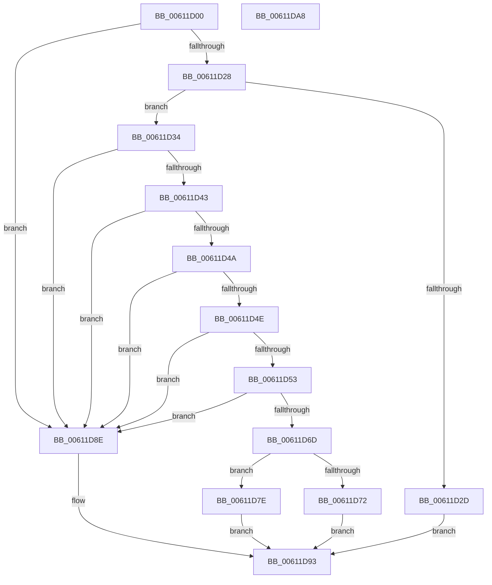

# DifRegisterClassDriverPlugin

- RVA: `0x00611D00`–`0x00611DA9` (길이 `169` bytes)
- VA: `0x0000000140611D00`
- 실행 섹션: `.text`
- PDB 이름 있음: `예`; PDB Function 태그: `아니요`
- unwind 정보 RVA: `0x0005C954`
- 디코드: `53`개 명령, `169/169` bytes 표시
- 미해석 바이트: `0` (있으면 어셈블리에 `.byte`로 보존)

> 이 문서는 커널 이미지의 기계어와 PDB 기호를 분석해 생성했습니다. 4번과 5번은 함수 원형과 자료형을 바이너리 사용 방식에서 추정한 C 해석이며 원본 소스 복구 결과는 아닙니다.

## 1. Dependencies

- 직접 호출 지점: **3**; 고유 호출 대상: **3**
- 직접 호출자로 확인된 함수: **0**
- RIP 상대 이미지 참조: **1**

### Outgoing calls
- `0x00611D39` → [VfTargetDriversGetNode](../3E/VfTargetDriversGetNode_function_003EE174.md) (function, `0x003EE174`)
- `0x00611D77` → [ViAddVerifierThunks](ViAddVerifierThunks_function_0061245C.md) (function, `0x0061245C`)
- `0x00611D87` → [ViAddVerifierSpecialThunks](ViAddVerifierSpecialThunks_function_0061233C.md) (function, `0x0061233C`)

### Direct callers
- 이 함수 시작 RVA로 연결되는 직접 call은 확인되지 않았습니다. 간접 호출은 완전히 역산할 수 없습니다.

### Static image references
- `0x00611D14` → RVA `0x00E681A0` (`.data`; read)

## 2. Other-region calls and transfers

- 다른 실행 섹션으로 향하는 call: **0**
- 별도 외부 분기/꼬리 이동을 확인하지 못했습니다.

## 3. Assembly (complete function range)

```asm
00611D00  48 89 5C 24 08                  mov qword ptr [rsp + 8], rbx
00611D05  48 89 6C 24 10                  mov qword ptr [rsp + 0x10], rbp
00611D0A  48 89 74 24 18                  mov qword ptr [rsp + 0x18], rsi
00611D0F  57                              push rdi
00611D10  48 83 EC 20                     sub rsp, 0x20
00611D14  83 3D 85 64 85 00 00            cmp dword ptr [rip + 0x856485], 0
00611D1B  49 8B F9                        mov rdi, r9
00611D1E  41 8B F0                        mov esi, r8d
00611D21  48 8B DA                        mov rbx, rdx
00611D24  8B E9                           mov ebp, ecx
00611D26  74 66                           je 0x140611d8e
00611D28  48 85 D2                        test rdx, rdx
00611D2B  75 07                           jne 0x140611d34
00611D2D  B8 0D 00 00 C0                  mov eax, 0xc000000d
00611D32  EB 5F                           jmp 0x140611d93
00611D34  48 8B 4C 24 28                  mov rcx, qword ptr [rsp + 0x28]
00611D39  E8 36 C4 DD FF                  call 0x1403ee174
00611D3E  48 85 C0                        test rax, rax
00611D41  74 4B                           je 0x140611d8e
00611D43  8B 40 38                        mov eax, dword ptr [rax + 0x38]
00611D46  85 C0                           test eax, eax
00611D48  74 44                           je 0x140611d8e
00611D4A  3B C5                           cmp eax, ebp
00611D4C  75 40                           jne 0x140611d8e
00611D4E  83 F8 40                        cmp eax, 0x40
00611D51  73 3B                           jae 0x140611d8e
00611D53  8B D0                           mov edx, eax
00611D55  24 1F                           and al, 0x1f
00611D57  0F B6 C8                        movzx ecx, al
00611D5A  48 8D 05 3F 64 85 00            lea rax, [rip + 0x85643f]
00611D61  48 C1 EA 05                     shr rdx, 5
00611D65  8B 04 90                        mov eax, dword ptr [rax + rdx*4]
00611D68  0F A3 C8                        bt eax, ecx
00611D6B  73 21                           jae 0x140611d8e
00611D6D  48 85 FF                        test rdi, rdi
00611D70  75 0C                           jne 0x140611d7e
00611D72  8B D6                           mov edx, esi
00611D74  48 8B CB                        mov rcx, rbx
00611D77  E8 E0 06 00 00                  call 0x14061245c
00611D7C  EB 15                           jmp 0x140611d93
00611D7E  44 8B C6                        mov r8d, esi
00611D81  48 8B D3                        mov rdx, rbx
00611D84  48 8B CF                        mov rcx, rdi
00611D87  E8 B0 05 00 00                  call 0x14061233c
00611D8C  EB 05                           jmp 0x140611d93
00611D8E  B8 74 0C 00 C0                  mov eax, 0xc0000c74
00611D93  48 8B 5C 24 30                  mov rbx, qword ptr [rsp + 0x30]
00611D98  48 8B 6C 24 38                  mov rbp, qword ptr [rsp + 0x38]
00611D9D  48 8B 74 24 40                  mov rsi, qword ptr [rsp + 0x40]
00611DA2  48 83 C4 20                     add rsp, 0x20
00611DA6  5F                              pop rdi
00611DA7  C3                              ret
00611DA8  CC                              int3
```

## 4. C-style interpretation (structured pseudocode)

```c
__int64 __fastcall DifRegisterClassDriverPlugin(int a1, __int64 a2, int a3, __int64 a4)
{
    __int64 result;
    __int64 v_rsp;
    unsigned __int64 v_stack_p0;
    unsigned __int64 v_stack_p10;
    unsigned __int64 v_stack_p18;
    unsigned __int64 v_stack_p8;

    v_stack_p8 = v_rbx;
    v_stack_p10 = v_rbp;
    v_stack_p18 = v_rsi;
    v_rsp = (v_rsp) - (32);
    if ((*(unsigned int *)(v_rip + 8742021)) == 0) goto loc_00611D8E;
    if (a2 != 0) goto loc_00611D34;
    goto loc_00611D93;
loc_00611D34:
    result = VfTargetDriversGetNode(v_stack_p0, a2, a3, a4);
    if (result == 0) goto loc_00611D8E;
    if ((unsigned int)((unsigned int)(*(unsigned int *)(result + 56))) == 0) goto loc_00611D8E;
    if (((unsigned int)((unsigned int)(*(unsigned int *)(result + 56)))) != ((unsigned int)((unsigned int)(a1)))) goto loc_00611D8E;
    if (((unsigned int)((unsigned int)(*(unsigned int *)(result + 56)))) >= 64) goto loc_00611D8E;
    result = (unsigned __int8)(((unsigned int)(*(unsigned int *)(result + 56))) & (31));
    a2 = ((unsigned int)((unsigned int)((unsigned int)(*(unsigned int *)(result + 56))))) >> (5);
    if (condition_is_above_or_equal) goto loc_00611D8E;
    if (a4 != 0) goto loc_00611D7E;
    result = ViAddVerifierThunks(a2, (unsigned int)((unsigned int)((unsigned int)(a3))), a3, a4);
    goto loc_00611D93;
loc_00611D7E:
    result = ViAddVerifierSpecialThunks(a4, a2, (unsigned int)((unsigned int)((unsigned int)(a3))), a4);
    goto loc_00611D93;
loc_00611D8E:
loc_00611D93:
    v_rsp = (v_rsp) + (32);
    return (unsigned int)(0xC0000C74ULL);
}
```

## 5. (Beta) C Style

```c
int64_t DifRegisterClassDriverPlugin(int32_t Arg1, int64_t Arg2, int32_t Arg3, int64_t Arg4)
{
    int64_t result;
    int64_t local_rsp;
    uint64_t v_stack_p0;
    uint64_t v_stack_p10;
    uint64_t v_stack_p18;
    uint64_t v_stack_p8;

    v_stack_p8 = local_rbx;
    v_stack_p10 = local_rbp;
    v_stack_p18 = local_rsi;
    local_rsp = (local_rsp) - (32);
    if ((*(uint32_t *)(v_rip + 0x856485)) == 0) goto loc_00611D8E;
    if (Arg2 != 0) goto loc_00611D34;
    goto loc_00611D93;
loc_00611D34:
    result = VfTargetDriversGetNode(v_stack_p0, Arg2, Arg3, Arg4);
    if (result == 0) goto loc_00611D8E;
    if ((uint32_t)((uint32_t)(*(uint32_t *)(result + 0x38))) == 0) goto loc_00611D8E;
    if (((uint32_t)((uint32_t)(*(uint32_t *)(result + 0x38)))) != ((uint32_t)((uint32_t)(Arg1)))) goto loc_00611D8E;
    if (((uint32_t)((uint32_t)(*(uint32_t *)(result + 0x38)))) >= 64) goto loc_00611D8E;
    result = (uint8_t)(((uint32_t)(*(uint32_t *)(result + 0x38))) & (31));
    Arg2 = ((uint32_t)((uint32_t)((uint32_t)(*(uint32_t *)(result + 0x38))))) >> (5);
    if (condition_is_above_or_equal) goto loc_00611D8E;
    if (Arg4 != 0) goto loc_00611D7E;
    result = ViAddVerifierThunks(Arg2, (uint32_t)((uint32_t)((uint32_t)(Arg3))), Arg3, Arg4);
    goto loc_00611D93;
loc_00611D7E:
    result = ViAddVerifierSpecialThunks(Arg4, Arg2, (uint32_t)((uint32_t)((uint32_t)(Arg3))), Arg4);
    goto loc_00611D93;
loc_00611D8E:
loc_00611D93:
    local_rsp = (local_rsp) + (32);
    return (uint32_t)(0xC0000C74ULL);
}
```

## 6. Execution-region graph

[열기: 2D/3D 그래프와 함수 탐색 컨트롤 패널](../../../control-panel.html?section=text&rva=0x00611D00&view=graph)

- 2D 그래프는 위에서 아래로 흐르고, 3D 그래프는 빈 공간을 드래그해 회전합니다. Shift+드래그는 이동, 휠은 확대·축소, 함수 노드 선택은 대상 보고서 이동입니다.

### Static fallback


