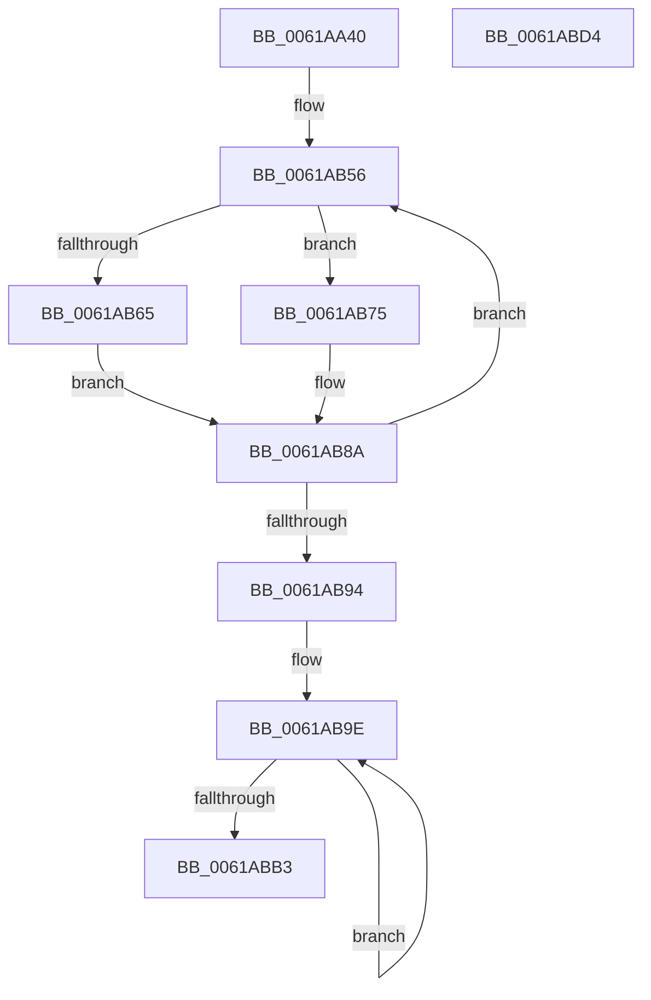

# DifRegisterKernelPlugins

- RVA: `0x0061AA40`–`0x0061ABD5` (길이 `405` bytes)
- VA: `0x000000014061AA40`
- 실행 섹션: `.text`
- PDB 이름 있음: `예`; PDB Function 태그: `아니요`
- unwind 정보 RVA: `0x000D2AF0`
- 디코드: `84`개 명령, `405/405` bytes 표시
- 미해석 바이트: `0` (있으면 어셈블리에 `.byte`로 보존)

> 이 문서는 커널 이미지의 기계어와 PDB 기호를 분석해 생성했습니다. 4번과 5번은 함수 원형과 자료형을 바이너리 사용 방식에서 추정한 C 해석이며 원본 소스 복구 결과는 아닙니다.

## 1. Dependencies

- 직접 호출 지점: **5**; 고유 호출 대상: **5**
- 직접 호출자로 확인된 함수: **2**
- RIP 상대 이미지 참조: **17**

### Outgoing calls
- `0x0061AB5C` → [CarRegisterDefaultRuleClassConfiguration](CarRegisterDefaultRuleClassConfiguration_function_00618F00.md) (function, `0x00618F00`)
- `0x0061AB6E` → [CarSetCustomRuleIdRange](CarSetCustomRuleIdRange_function_006195D0.md) (function, `0x006195D0`)
- `0x0061AB85` → [DifUtilDbgPrint](DifUtilDbgPrint_function_00619B70.md) (function, `0x00619B70`)
- `0x0061ABA4` → [DifCallPluginEntry](DifCallPluginEntry_function_0061A5A0.md) (function, `0x0061A5A0`)
- `0x0061ABBA` → [_security_check_cookie](../6A/_security_check_cookie_function_006AC640.md) (function, `0x006AC640`)

### Direct callers
- [VfVolatileSetDifRuleClass](VfVolatileSetDifRuleClass_function_00616AA4.md) at `0x00616CC0`
- [VfInitBootDriversLoaded](../../init/C4/VfInitBootDriversLoaded_function_00C4BD0C.md) at `0x00C4BF23`

### Static image references
- `0x0061AA57` → RVA `0x00E0A740` (`.data`; read)
- `0x0061AA69` → RVA `0x0064C0E0` (`VfLwSPEntry`; read)
- `0x0061AA75` → RVA `0x00E0EA8C` (`.data`; read)
- `0x0061AA7C` → RVA `0x006AA4A0` (`VfSpecialPoolEntry`; read)
- `0x0061AA94` → RVA `0x00613380` (`VfPoolTrackingEntry`; read)
- `0x0061AAA6` → RVA `0x006147E0` (`VfSecurityEntry`; read)
- `0x0061AAB1` → RVA `0x00BAE660` (`VfMiscPluginEntry`; read)
- `0x0061AABC` → RVA `0x006AAA80` (`VfIovPluginEntry`; read)
- `0x0061AAC7` → RVA `0x00616DA0` (`VfIrqlPluginEntry`; read)
- `0x0061AAD2` → RVA `0x00BA8230` (`VfDeadlockPluginEntry`; read)
- `0x0061AADD` → RVA `0x00616590` (`VfDmaPluginEntry`; read)
- `0x0061AAE8` → RVA `0x00617090` (`VfRlrsEntry`; read)
- `0x0061AAF3` → RVA `0x00614340` (`VfIoPendingEntry`; read)
- `0x0061AAFE` → RVA `0x00616680` (`VfBelow4gbPluginEntry`; read)
- `0x0061AB09` → RVA `0x006AAE60` (`VfIrpTrackingPluginEntry`; read)
- `0x0061AB75` → RVA `0x00E0EA80` (`.data`; read)
- `0x0061AB7B` → RVA `0x006CFC40` (` ?? ::FNODOBFM::`string'`; read)

## 2. Other-region calls and transfers

- 다른 실행 섹션으로 향하는 call: **0**
- 별도 외부 분기/꼬리 이동을 확인하지 못했습니다.

## 3. Assembly (complete function range)

```asm
0061AA40  48 89 5C 24 08                  mov qword ptr [rsp + 8], rbx
0061AA45  48 89 7C 24 10                  mov qword ptr [rsp + 0x10], rdi
0061AA4A  55                              push rbp
0061AA4B  48 8D 6C 24 A9                  lea rbp, [rsp - 0x57]
0061AA50  48 81 EC 00 01 00 00            sub rsp, 0x100
0061AA57  48 8B 05 E2 FC 7E 00            mov rax, qword ptr [rip + 0x7efce2]
0061AA5E  48 33 C4                        xor rax, rsp
0061AA61  48 89 45 47                     mov qword ptr [rbp + 0x47], rax
0061AA65  83 65 87 00                     and dword ptr [rbp - 0x79], 0
0061AA69  48 8D 05 70 16 03 00            lea rax, [rip + 0x31670]
0061AA70  48 89 44 24 28                  mov qword ptr [rsp + 0x28], rax
0061AA75  48 8D 1D 10 40 7F 00            lea rbx, [rip + 0x7f4010]
0061AA7C  48 8D 05 1D FA 08 00            lea rax, [rip + 0x8fa1d]
0061AA83  C7 44 24 20 27 00 00 00         mov dword ptr [rsp + 0x20], 0x27
0061AA8B  48 89 45 8F                     mov qword ptr [rbp - 0x71], rax
0061AA8F  BF 04 00 00 00                  mov edi, 4
0061AA94  48 8D 05 E5 88 FF FF            lea rax, [rip - 0x771b]
0061AA9B  C7 45 97 03 00 00 00            mov dword ptr [rbp - 0x69], 3
0061AAA2  48 89 45 9F                     mov qword ptr [rbp - 0x61], rax
0061AAA6  48 8D 05 33 9D FF FF            lea rax, [rip - 0x62cd]
0061AAAD  48 89 45 AF                     mov qword ptr [rbp - 0x51], rax
0061AAB1  48 8D 05 A8 3B 59 00            lea rax, [rip + 0x593ba8]
0061AAB8  48 89 45 BF                     mov qword ptr [rbp - 0x41], rax
0061AABC  48 8D 05 BD FF 08 00            lea rax, [rip + 0x8ffbd]
0061AAC3  48 89 45 CF                     mov qword ptr [rbp - 0x31], rax
0061AAC7  48 8D 05 D2 C2 FF FF            lea rax, [rip - 0x3d2e]
0061AACE  48 89 45 DF                     mov qword ptr [rbp - 0x21], rax
0061AAD2  48 8D 05 57 D7 58 00            lea rax, [rip + 0x58d757]
0061AAD9  48 89 45 EF                     mov qword ptr [rbp - 0x11], rax
0061AADD  48 8D 05 AC BA FF FF            lea rax, [rip - 0x4554]
0061AAE4  48 89 45 FF                     mov qword ptr [rbp - 1], rax
0061AAE8  48 8D 05 A1 C5 FF FF            lea rax, [rip - 0x3a5f]
0061AAEF  48 89 45 0F                     mov qword ptr [rbp + 0xf], rax
0061AAF3  48 8D 05 46 98 FF FF            lea rax, [rip - 0x67ba]
0061AAFA  48 89 45 1F                     mov qword ptr [rbp + 0x1f], rax
0061AAFE  48 8D 05 7B BB FF FF            lea rax, [rip - 0x4485]
0061AB05  48 89 45 2F                     mov qword ptr [rbp + 0x2f], rax
0061AB09  48 8D 05 50 03 09 00            lea rax, [rip + 0x90350]
0061AB10  48 89 45 3F                     mov qword ptr [rbp + 0x3f], rax
0061AB14  C7 45 A7 08 00 00 00            mov dword ptr [rbp - 0x59], 8
0061AB1B  C7 45 B7 0B 00 00 00            mov dword ptr [rbp - 0x49], 0xb
0061AB22  89 7D C7                        mov dword ptr [rbp - 0x39], edi
0061AB25  C7 45 D7 01 00 00 00            mov dword ptr [rbp - 0x29], 1
0061AB2C  C7 45 E7 05 00 00 00            mov dword ptr [rbp - 0x19], 5
0061AB33  C7 45 F7 07 00 00 00            mov dword ptr [rbp - 9], 7
0061AB3A  C7 45 07 02 00 00 00            mov dword ptr [rbp + 7], 2
0061AB41  C7 45 17 09 00 00 00            mov dword ptr [rbp + 0x17], 9
0061AB48  C7 45 27 1A 00 00 00            mov dword ptr [rbp + 0x27], 0x1a
0061AB4F  C7 45 37 0A 00 00 00            mov dword ptr [rbp + 0x37], 0xa
0061AB56  8B 53 F4                        mov edx, dword ptr [rbx - 0xc]
0061AB59  8B 4B F8                        mov ecx, dword ptr [rbx - 8]
0061AB5C  E8 9F E3 FF FF                  call 0x140618f00
0061AB61  85 C0                           test eax, eax
0061AB63  78 10                           js 0x14061ab75
0061AB65  44 8B 03                        mov r8d, dword ptr [rbx]
0061AB68  8B 53 FC                        mov edx, dword ptr [rbx - 4]
0061AB6B  8B 4B F4                        mov ecx, dword ptr [rbx - 0xc]
0061AB6E  E8 5D EA FF FF                  call 0x1406195d0
0061AB73  EB 15                           jmp 0x14061ab8a
0061AB75  8B 15 05 3F 7F 00               mov edx, dword ptr [rip + 0x7f3f05]
0061AB7B  48 8D 0D BE 50 0B 00            lea rcx, [rip + 0xb50be]
0061AB82  44 8B C0                        mov r8d, eax
0061AB85  E8 E6 EF FF FF                  call 0x140619b70
0061AB8A  48 83 C3 10                     add rbx, 0x10
0061AB8E  48 83 EF 01                     sub rdi, 1
0061AB92  75 C2                           jne 0x14061ab56
0061AB94  48 8D 5C 24 20                  lea rbx, [rsp + 0x20]
0061AB99  BF 0D 00 00 00                  mov edi, 0xd
0061AB9E  48 8B 53 08                     mov rdx, qword ptr [rbx + 8]
0061ABA2  8B 0B                           mov ecx, dword ptr [rbx]
0061ABA4  E8 F7 F9 FF FF                  call 0x14061a5a0
0061ABA9  48 8D 5B 10                     lea rbx, [rbx + 0x10]
0061ABAD  48 83 EF 01                     sub rdi, 1
0061ABB1  75 EB                           jne 0x14061ab9e
0061ABB3  48 8B 4D 47                     mov rcx, qword ptr [rbp + 0x47]
0061ABB7  48 33 CC                        xor rcx, rsp
0061ABBA  E8 81 1A 09 00                  call 0x1406ac640
0061ABBF  4C 8D 9C 24 00 01 00 00         lea r11, [rsp + 0x100]
0061ABC7  49 8B 5B 10                     mov rbx, qword ptr [r11 + 0x10]
0061ABCB  49 8B 7B 18                     mov rdi, qword ptr [r11 + 0x18]
0061ABCF  49 8B E3                        mov rsp, r11
0061ABD2  5D                              pop rbp
0061ABD3  C3                              ret
0061ABD4  CC                              int3
```

## 4. C-style interpretation (structured pseudocode)

```c
__int64 __fastcall DifRegisterKernelPlugins(void)
{
    __int64 result;
    __int64 v_rbx;
    __int64 v_rdi;
    __int64 v_rsp;
    unsigned __int64 v_stack_m18;
    unsigned __int64 v_stack_m20;
    unsigned int v_stack_m28;
    unsigned __int64 v_stack_m30;
    unsigned int v_stack_m38;
    unsigned __int64 v_stack_m40;
    unsigned int v_stack_m48;
    unsigned __int64 v_stack_m50;
    unsigned int v_stack_m58;
    unsigned __int64 v_stack_m5F;
    unsigned __int64 v_stack_m60;
    unsigned int v_stack_m68;
    unsigned __int64 v_stack_m70;
    unsigned int v_stack_m78;
    unsigned __int64 v_stack_m8;
    unsigned __int64 v_stack_m80;
    unsigned int v_stack_m88;
    unsigned __int64 v_stack_m90;
    unsigned int v_stack_m98;
    unsigned __int64 v_stack_mA0;
    unsigned int v_stack_mA8;
    unsigned __int64 v_stack_mB0;
    unsigned int v_stack_mB8;
    unsigned __int64 v_stack_mC0;
    unsigned int v_stack_mC8;
    unsigned __int64 v_stack_mD0;
    unsigned int v_stack_mD8;
    unsigned __int64 v_stack_mE0;
    unsigned int v_stack_mE8;
    unsigned __int64 v_stack_p10;
    unsigned __int64 v_stack_p8;

    v_stack_p8 = v_rbx;
    v_stack_p10 = v_rdi;
    v_rsp = (v_rsp) - (256);
    result = (*(unsigned __int64 *)(v_rip + 8322274)) ^ (v_rsp);
    v_stack_m18 = result;
    v_stack_mE0 = v_rip + 202352;
    v_stack_mE8 = 39;
    v_stack_mD0 = v_rip + 588317;
    v_stack_mC8 = 3;
    v_stack_mC0 = v_rip - 30491;
    v_stack_mB0 = v_rip - 25293;
    v_stack_mA0 = v_rip + 5847976;
    v_stack_m90 = v_rip + 589757;
    v_stack_m80 = v_rip - 15662;
    v_stack_m70 = v_rip + 5822295;
    v_stack_m60 = v_rip - 17748;
    v_stack_m50 = v_rip - 14943;
    v_stack_m40 = v_rip - 26554;
    v_stack_m30 = v_rip - 17541;
    v_stack_m20 = v_rip + 590672;
    v_stack_mB8 = 8;
    v_stack_mA8 = 11;
    v_stack_m98 = 4;
    v_stack_m88 = 1;
    v_stack_m78 = 5;
    v_stack_m68 = 7;
    v_stack_m58 = 2;
    v_stack_m48 = 9;
    v_stack_m38 = 26;
    v_stack_m28 = 10;
loc_0061AB56:
    result = CarRegisterDefaultRuleClassConfiguration((unsigned int)(*(unsigned int *)(v_rip + 8339472 - 8)), (unsigned int)(*(unsigned int *)(v_rip + 8339472 - 12)), a3, a4);
    if (sign_flag) goto loc_0061AB75;
    result = CarSetCustomRuleIdRange((unsigned int)(*(unsigned int *)(v_rip + 8339472 - 12)), (unsigned int)(*(unsigned int *)(v_rip + 8339472 - 4)), (unsigned int)(*(unsigned int *)(v_rip + 8339472)), a4);
    goto loc_0061AB8A;
loc_0061AB75:
    result = DifUtilDbgPrint(v_rip + 741566, (unsigned int)(*(unsigned int *)(v_rip + 8339205)), (unsigned int)((unsigned int)(result)), a4);
loc_0061AB8A:
    v_rbx = (v_rip + 8339472) + (16);
    v_rdi = (4) - (1);
    if (condition_is_not_equal) goto loc_0061AB56;
loc_0061AB9E:
    result = DifCallPluginEntry((unsigned int)(*(unsigned int *)(v_stack_mE8)), *(unsigned __int64 *)(v_stack_mE8 + 8), (unsigned int)((unsigned int)(result)), a4);
    v_rdi = (13) - (1);
    if (condition_is_not_equal) goto loc_0061AB9E;
    a1 = (v_stack_m18) ^ (v_rsp);
    result = _security_check_cookie(a1, *(unsigned __int64 *)(v_stack_mE8 + 8), (unsigned int)((unsigned int)(result)), a4);
    return result;
}
```

## 5. (Beta) C Style

```c
void DifRegisterKernelPlugins(void)
{
    int64_t result;
    int64_t local_rbx;
    int64_t local_rdi;
    int64_t local_rsp;
    uint64_t v_stack_m18;
    uint64_t v_stack_m20;
    uint32_t v_stack_m28;
    uint64_t v_stack_m30;
    uint32_t v_stack_m38;
    uint64_t v_stack_m40;
    uint32_t v_stack_m48;
    uint64_t v_stack_m50;
    uint32_t v_stack_m58;
    uint64_t v_stack_m5F;
    uint64_t v_stack_m60;
    uint32_t v_stack_m68;
    uint64_t v_stack_m70;
    uint32_t v_stack_m78;
    uint64_t v_stack_m8;
    uint64_t v_stack_m80;
    uint32_t v_stack_m88;
    uint64_t v_stack_m90;
    uint32_t v_stack_m98;
    uint64_t v_stack_mA0;
    uint32_t v_stack_mA8;
    uint64_t v_stack_mB0;
    uint32_t v_stack_mB8;
    uint64_t v_stack_mC0;
    uint32_t v_stack_mC8;
    uint64_t v_stack_mD0;
    uint32_t v_stack_mD8;
    uint64_t v_stack_mE0;
    uint32_t v_stack_mE8;
    uint64_t v_stack_p10;
    uint64_t v_stack_p8;

    v_stack_p8 = local_rbx;
    v_stack_p10 = local_rdi;
    local_rsp = (local_rsp) - (256);
    result = (*(uint64_t *)(v_rip + 0x7EFCE2)) ^ (local_rsp);
    v_stack_m18 = result;
    v_stack_mE0 = v_rip + 202352;
    v_stack_mE8 = 39;
    v_stack_mD0 = v_rip + 588317;
    v_stack_mC8 = 3;
    v_stack_mC0 = v_rip - 30491;
    v_stack_mB0 = v_rip - 25293;
    v_stack_mA0 = v_rip + 5847976;
    v_stack_m90 = v_rip + 589757;
    v_stack_m80 = v_rip - 15662;
    v_stack_m70 = v_rip + 5822295;
    v_stack_m60 = v_rip - 17748;
    v_stack_m50 = v_rip - 14943;
    v_stack_m40 = v_rip - 26554;
    v_stack_m30 = v_rip - 17541;
    v_stack_m20 = v_rip + 590672;
    v_stack_mB8 = 8;
    v_stack_mA8 = 11;
    v_stack_m98 = 4;
    v_stack_m88 = 1;
    v_stack_m78 = 5;
    v_stack_m68 = 7;
    v_stack_m58 = 2;
    v_stack_m48 = 9;
    v_stack_m38 = 26;
    v_stack_m28 = 10;
loc_0061AB56:
    result = CarRegisterDefaultRuleClassConfiguration((uint32_t)(*(uint32_t *)(v_rip + 0x7F4010 - 0x8)), (uint32_t)(*(uint32_t *)(v_rip + 0x7F4010 - 0xC)), a3, a4);
    if (sign_flag) goto loc_0061AB75;
    result = CarSetCustomRuleIdRange((uint32_t)(*(uint32_t *)(v_rip + 0x7F4010 - 0xC)), (uint32_t)(*(uint32_t *)(v_rip + 0x7F4010 - 0x4)), (uint32_t)(*(uint32_t *)(v_rip + 0x7F4010)), a4);
    goto loc_0061AB8A;
loc_0061AB75:
    result = DifUtilDbgPrint(v_rip + 741566, (uint32_t)(*(uint32_t *)(v_rip + 0x7F3F05)), (uint32_t)((uint32_t)(result)), a4);
loc_0061AB8A:
    local_rbx = (v_rip + 8339472) + (16);
    local_rdi = (4) - (1);
    if (condition_is_not_equal) goto loc_0061AB56;
loc_0061AB9E:
    result = DifCallPluginEntry((uint32_t)(*(uint32_t *)(v_stack_mE8)), *(uint64_t *)(v_stack_mE8 + 0x8), (uint32_t)((uint32_t)(result)), a4);
    local_rdi = (13) - (1);
    if (condition_is_not_equal) goto loc_0061AB9E;
    a1 = (v_stack_m18) ^ (local_rsp);
    result = _security_check_cookie(a1, *(uint64_t *)(v_stack_mE8 + 0x8), (uint32_t)((uint32_t)(result)), a4);
    return result;
}
```

## 6. Execution-region graph

[열기: 2D/3D 그래프와 함수 탐색 컨트롤 패널](../../../control-panel.html?section=text&rva=0x0061AA40&view=graph)

- 2D 그래프는 위에서 아래로 흐르고, 3D 그래프는 빈 공간을 드래그해 회전합니다. Shift+드래그는 이동, 휠은 확대·축소, 함수 노드 선택은 대상 보고서 이동입니다.

### Static fallback


