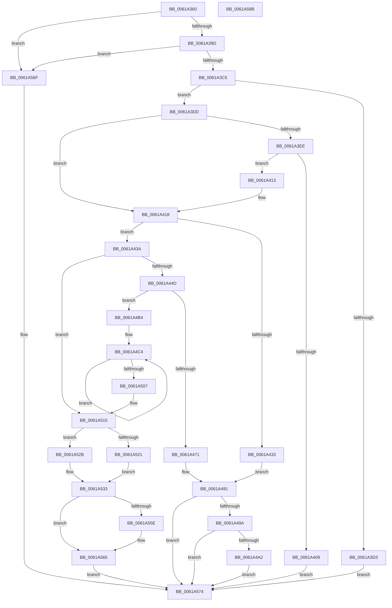

# DifRegisterObjectTracking

- RVA: `0x0061A360`–`0x0061A58C` (길이 `556` bytes)
- VA: `0x000000014061A360`
- 실행 섹션: `.text`
- PDB 이름 있음: `예`; PDB Function 태그: `아니요`
- unwind 정보 RVA: `0x000D2A74`
- 디코드: `137`개 명령, `556/556` bytes 표시
- 미해석 바이트: `0` (있으면 어셈블리에 `.byte`로 보존)

> 이 문서는 커널 이미지의 기계어와 PDB 기호를 분석해 생성했습니다. 4번과 5번은 함수 원형과 자료형을 바이너리 사용 방식에서 추정한 C 해석이며 원본 소스 복구 결과는 아닙니다.

## 1. Dependencies

- 직접 호출 지점: **7**; 고유 호출 대상: **4**
- 직접 호출자로 확인된 함수: **0**
- RIP 상대 이미지 참조: **8**

### Outgoing calls
- `0x0061A3C5` → [DifGetAvailableSystemPages](DifGetAvailableSystemPages_function_0061B704.md) (function, `0x0061B704`)
- `0x0061A3FC` → [ExAllocatePool2](../../poolcode/B8/ExAllocatePool2_function_00B820F0.md) (function, `0x00B820F0`)
- `0x0061A426` → [ExAllocatePool2](../../poolcode/B8/ExAllocatePool2_function_00B820F0.md) (function, `0x00B820F0`)
- `0x0061A45D` → [ExAllocatePool2](../../poolcode/B8/ExAllocatePool2_function_00B820F0.md) (function, `0x00B820F0`)
- `0x0061A48C` → [ExFreePoolWithTag](../../poolcode/B8/ExFreePoolWithTag_function_00B82870.md) (function, `0x00B82870`)
- `0x0061A4AA` → [ExFreePoolWithTag](../../poolcode/B8/ExFreePoolWithTag_function_00B82870.md) (function, `0x00B82870`)
- `0x0061A4D2` → [memset](../6C/memset_function_006C6C40.md) (function, `0x006C6C40`)

### Direct callers
- 이 함수 시작 RVA로 연결되는 직접 call은 확인되지 않았습니다. 간접 호출은 완전히 역산할 수 없습니다.

### Static image references
- `0x0061A3A4` → RVA `0x00000000` (`image boundary/outside`; read)
- `0x0061A43F` → RVA `0x00F03EB4` (`.data`; read)
- `0x0061A465` → RVA `0x00F03EB8` (`.data`; write)
- `0x0061A4DA` → RVA `0x00619C80` (`DifObjTrkCompareNode`; read)
- `0x0061A4E6` → RVA `0x00619C50` (`DifObjTrkAllocNode`; read)
- `0x0061A4F1` → RVA `0x00619CC0` (`DifObjTrkFreeNode`; read)
- `0x0061A533` → RVA `0x00F03EB8` (`.data`; read)
- `0x0061A565` → RVA `0x00FC6BD0` (`ALMOSTRO`; read/write)

## 2. Other-region calls and transfers

- 다른 실행 섹션으로 향하는 call: **5**
  - `0x0061A3FC` → [ExAllocatePool2](../../poolcode/B8/ExAllocatePool2_function_00B820F0.md) (`.text` → `POOLCODE`)
  - `0x0061A426` → [ExAllocatePool2](../../poolcode/B8/ExAllocatePool2_function_00B820F0.md) (`.text` → `POOLCODE`)
  - `0x0061A45D` → [ExAllocatePool2](../../poolcode/B8/ExAllocatePool2_function_00B820F0.md) (`.text` → `POOLCODE`)
  - `0x0061A48C` → [ExFreePoolWithTag](../../poolcode/B8/ExFreePoolWithTag_function_00B82870.md) (`.text` → `POOLCODE`)
  - `0x0061A4AA` → [ExFreePoolWithTag](../../poolcode/B8/ExFreePoolWithTag_function_00B82870.md) (`.text` → `POOLCODE`)
- 별도 외부 분기/꼬리 이동을 확인하지 못했습니다.

## 3. Assembly (complete function range)

```asm
0061A360  48 89 5C 24 20                  mov qword ptr [rsp + 0x20], rbx
0061A365  4C 89 44 24 18                  mov qword ptr [rsp + 0x18], r8
0061A36A  89 54 24 10                     mov dword ptr [rsp + 0x10], edx
0061A36E  55                              push rbp
0061A36F  56                              push rsi
0061A370  57                              push rdi
0061A371  41 54                           push r12
0061A373  41 55                           push r13
0061A375  41 56                           push r14
0061A377  41 57                           push r15
0061A379  48 83 EC 20                     sub rsp, 0x20
0061A37D  45 33 FF                        xor r15d, r15d
0061A380  4D 8B E0                        mov r12, r8
0061A383  44 89 7C 24 60                  mov dword ptr [rsp + 0x60], r15d
0061A388  44 8B EA                        mov r13d, edx
0061A38B  41 8B FF                        mov edi, r15d
0061A38E  41 8B F7                        mov esi, r15d
0061A391  41 8A DF                        mov bl, r15b
0061A394  83 F9 40                        cmp ecx, 0x40
0061A397  0F 83 D2 01 00 00               jae 0x14061a56f
0061A39D  8A C1                           mov al, cl
0061A39F  44 8B F1                        mov r14d, ecx
0061A3A2  24 1F                           and al, 0x1f
0061A3A4  48 8D 15 55 5C 9E FF            lea rdx, [rip - 0x61a3ab]
0061A3AB  0F B6 C8                        movzx ecx, al
0061A3AE  41 8B C6                        mov eax, r14d
0061A3B1  48 C1 E8 05                     shr rax, 5
0061A3B5  8B 84 82 A0 81 E6 00            mov eax, dword ptr [rdx + rax*4 + 0xe681a0]
0061A3BC  0F A3 C8                        bt eax, ecx
0061A3BF  0F 83 AA 01 00 00               jae 0x14061a56f
0061A3C5  E8 3A 13 00 00                  call 0x14061b704
0061A3CA  48 8B E8                        mov rbp, rax
0061A3CD  48 83 F8 64                     cmp rax, 0x64
0061A3D1  73 0A                           jae 0x14061a3dd
0061A3D3  BF 9A 00 00 C0                  mov edi, 0xc000009a
0061A3D8  E9 97 01 00 00                  jmp 0x14061a574
0061A3DD  48 8D 05 1C 5C 9E FF            lea rax, [rip - 0x61a3e4]
0061A3E4  4E 39 BC F0 40 82 E6 00         cmp qword ptr [rax + r14*8 + 0xe68240], r15
0061A3EC  75 2A                           jne 0x14061a418
0061A3EE  BA 20 00 00 00                  mov edx, 0x20
0061A3F3  41 B8 44 66 4F 74               mov r8d, 0x744f6644
0061A3F9  8D 4A 20                        lea ecx, [rdx + 0x20]
0061A3FC  E8 EF 7C 56 00                  call 0x140b820f0
0061A401  48 8B F0                        mov rsi, rax
0061A404  48 85 C0                        test rax, rax
0061A407  75 0A                           jne 0x14061a413
0061A409  BF 17 00 00 C0                  mov edi, 0xc0000017
0061A40E  E9 61 01 00 00                  jmp 0x14061a574
0061A413  BB 01 00 00 00                  mov ebx, 1
0061A418  BA 10 00 00 00                  mov edx, 0x10
0061A41D  41 B8 44 66 4F 74               mov r8d, 0x744f6644
0061A423  8D 4A 30                        lea ecx, [rdx + 0x30]
0061A426  E8 C5 7C 56 00                  call 0x140b820f0
0061A42B  4C 8B F8                        mov r15, rax
0061A42E  48 85 C0                        test rax, rax
0061A431  75 07                           jne 0x14061a43a
0061A433  BF 17 00 00 C0                  mov edi, 0xc0000017
0061A438  EB 57                           jmp 0x14061a491
0061A43A  33 C0                           xor eax, eax
0061A43C  8D 50 01                        lea edx, [rax + 1]
0061A43F  F0 0F B1 15 6D 9A 8E 00         lock cmpxchg dword ptr [rip + 0x8e9a6d], edx
0061A447  0F 85 C8 00 00 00               jne 0x14061a515
0061A44D  BA 80 03 00 00                  mov edx, 0x380
0061A452  B9 40 00 00 00                  mov ecx, 0x40
0061A457  41 B8 44 66 4F 74               mov r8d, 0x744f6644
0061A45D  E8 8E 7C 56 00                  call 0x140b820f0
0061A462  45 33 E4                        xor r12d, r12d
0061A465  48 89 05 4C 9A 8E 00            mov qword ptr [rip + 0x8e9a4c], rax
0061A46C  48 85 C0                        test rax, rax
0061A46F  75 43                           jne 0x14061a4b4
0061A471  41 8D 44 24 01                  lea eax, [r12 + 1]
0061A476  F0 44 0F B1 25 35 9A 8E 00      lock cmpxchg dword ptr [rip + 0x8e9a35], r12d
0061A47F  BA 44 69 66 4E                  mov edx, 0x4e666944
0061A484  49 8B CF                        mov rcx, r15
0061A487  BF 17 00 00 C0                  mov edi, 0xc0000017
0061A48C  E8 DF 83 56 00                  call 0x140b82870
0061A491  48 85 F6                        test rsi, rsi
0061A494  0F 84 DA 00 00 00               je 0x14061a574
0061A49A  84 DB                           test bl, bl
0061A49C  0F 84 D2 00 00 00               je 0x14061a574
0061A4A2  BA 44 69 66 4E                  mov edx, 0x4e666944
0061A4A7  48 8B CE                        mov rcx, rsi
0061A4AA  E8 C1 83 56 00                  call 0x140b82870
0061A4AF  E9 C0 00 00 00                  jmp 0x14061a574
0061A4B4  BF 01 00 00 00                  mov edi, 1
0061A4B9  4C 8D A0 90 00 00 00            lea r12, [rax + 0x90]
0061A4C0  44 8D 6F 04                     lea r13d, [rdi + 4]
0061A4C4  33 D2                           xor edx, edx
0061A4C6  49 8D 5C 24 B0                  lea rbx, [r12 - 0x50]
0061A4CB  48 8B CB                        mov rcx, rbx
0061A4CE  44 8D 42 68                     lea r8d, [rdx + 0x68]
0061A4D2  E8 69 C7 0A 00                  call 0x1406c6c40
0061A4D7  48 89 1B                        mov qword ptr [rbx], rbx
0061A4DA  48 8D 05 9F F7 FF FF            lea rax, [rip - 0x861]
0061A4E1  49 89 44 24 F8                  mov qword ptr [r12 - 8], rax
0061A4E6  48 8D 05 63 F7 FF FF            lea rax, [rip - 0x89d]
0061A4ED  49 89 04 24                     mov qword ptr [r12], rax
0061A4F1  48 8D 05 C8 F7 FF FF            lea rax, [rip - 0x838]
0061A4F8  49 89 44 24 08                  mov qword ptr [r12 + 8], rax
0061A4FD  4D 8D 64 24 78                  lea r12, [r12 + 0x78]
0061A502  4C 2B EF                        sub r13, rdi
0061A505  75 BD                           jne 0x14061a4c4
0061A507  8B 7C 24 60                     mov edi, dword ptr [rsp + 0x60]
0061A50B  4C 8B 64 24 70                  mov r12, qword ptr [rsp + 0x70]
0061A510  44 8B 6C 24 68                  mov r13d, dword ptr [rsp + 0x68]
0061A515  48 8D 05 E4 5A 9E FF            lea rax, [rip - 0x61a51c]
0061A51C  48 85 F6                        test rsi, rsi
0061A51F  75 0A                           jne 0x14061a52b
0061A521  4A 8B B4 F0 40 82 E6 00         mov rsi, qword ptr [rax + r14*8 + 0xe68240]
0061A529  EB 08                           jmp 0x14061a533
0061A52B  4A 89 B4 F0 40 82 E6 00         mov qword ptr [rax + r14*8 + 0xe68240], rsi
0061A533  48 8B 05 7E 99 8E 00            mov rax, qword ptr [rip + 0x8e997e]
0061A53A  B9 00 90 D0 03                  mov ecx, 0x3d09000
0061A53F  48 C1 E5 0C                     shl rbp, 0xc
0061A543  48 C1 ED 07                     shr rbp, 7
0061A547  45 89 2F                        mov dword ptr [r15], r13d
0061A54A  4D 89 67 08                     mov qword ptr [r15 + 8], r12
0061A54E  4C 89 7E 18                     mov qword ptr [rsi + 0x18], r15
0061A552  48 89 A8 40 03 00 00            mov qword ptr [rax + 0x340], rbp
0061A559  48 3B E9                        cmp rbp, rcx
0061A55C  76 07                           jbe 0x14061a565
0061A55E  48 89 88 40 03 00 00            mov qword ptr [rax + 0x340], rcx
0061A565  F0 83 0D 63 C6 9A 00 10         lock or dword ptr [rip + 0x9ac663], 0x10
0061A56D  EB 05                           jmp 0x14061a574
0061A56F  BF 22 00 00 C0                  mov edi, 0xc0000022
0061A574  48 8B 5C 24 78                  mov rbx, qword ptr [rsp + 0x78]
0061A579  8B C7                           mov eax, edi
0061A57B  48 83 C4 20                     add rsp, 0x20
0061A57F  41 5F                           pop r15
0061A581  41 5E                           pop r14
0061A583  41 5D                           pop r13
0061A585  41 5C                           pop r12
0061A587  5F                              pop rdi
0061A588  5E                              pop rsi
0061A589  5D                              pop rbp
0061A58A  C3                              ret
0061A58B  CC                              int3
```

## 4. C-style interpretation (structured pseudocode)

```c
__int64 __fastcall DifRegisterObjectTracking(int a1, int a2, __int64 a3)
{
    __int64 result;
    __int64 v_r12;
    __int64 v_r13;
    __int64 v_r15;
    __int64 v_rbp;
    __int64 v_rsp;
    unsigned int v_stack_p10;
    unsigned __int64 v_stack_p18;
    unsigned __int64 v_stack_p20;
    unsigned int v_stack_p8;

    v_stack_p20 = v_rbx;
    v_stack_p18 = a3;
    v_stack_p10 = a2;
    v_rsp = (v_rsp) - (32);
    v_r15 = 0;
    v_stack_p8 = 0;
    if (a1 >= 64) goto loc_0061A56F;
    result = (unsigned __int8)(((unsigned __int8)(a1)) & (31));
    result = ((unsigned int)((unsigned int)((unsigned int)(a1)))) >> (5);
    if (condition_is_above_or_equal) goto loc_0061A56F;
    result = DifGetAvailableSystemPages((unsigned __int8)(result), v_rip - 6398891, a3, a4);
    if (result >= 100) goto loc_0061A3DD;
    goto loc_0061A574;
loc_0061A3DD:
    if ((*(unsigned __int64 *)(v_rip - 6398948 + (unsigned int)(a1) * 8 + 15106624)) != 0) goto loc_0061A418;
    result = ExAllocatePool2(32 + 32, 32, (unsigned int)(0x744F6644ULL), a4);
    if (result != 0) goto loc_0061A413;
    goto loc_0061A574;
loc_0061A413:
loc_0061A418:
    result = ExAllocatePool2(16 + 48, 16, (unsigned int)(0x744F6644ULL), a4);
    if (result != 0) goto loc_0061A43A;
    goto loc_0061A491;
loc_0061A43A:
    result = 0;
    if (condition_is_not_equal) goto loc_0061A515;
    result = ExAllocatePool2(64, 896, (unsigned int)(0x744F6644ULL), a4);
    v_r12 = 0;
    *(unsigned __int64 *)(v_rip + 9345612) = result;
    if (result != 0) goto loc_0061A4B4;
    result = ExFreePoolWithTag(result, (unsigned int)(0x4E666944ULL), (unsigned int)(0x744F6644ULL), a4);
loc_0061A491:
    if (result == 0) goto loc_0061A574;
    if (1 == 0) goto loc_0061A574;
    result = ExFreePoolWithTag(result, (unsigned int)(0x4E666944ULL), (unsigned int)(0x744F6644ULL), a4);
    goto loc_0061A574;
loc_0061A4B4:
loc_0061A4C4:
    a2 = 0;
    result = memset(result + 144 - 80, a2, a2 + 104, a4);
    *(unsigned __int64 *)(result + 144 - 80) = result + 144 - 80;
    *(unsigned __int64 *)(result + 144 - 8) = v_rip - 2145;
    *(unsigned __int64 *)(result + 144) = v_rip - 2205;
    *(unsigned __int64 *)(result + 144 + 8) = v_rip - 2104;
    v_r13 = (1 + 4) - (1);
    if (condition_is_not_equal) goto loc_0061A4C4;
loc_0061A515:
    if (result != 0) goto loc_0061A52B;
    goto loc_0061A533;
loc_0061A52B:
    *(unsigned __int64 *)(v_rip - 6399260 + (unsigned int)(a1) * 8 + 15106624) = *(unsigned __int64 *)(v_rip - 6399260 + (unsigned int)(a1) * 8 + 15106624);
loc_0061A533:
    v_rbp = (result) << (12);
    v_rbp = (v_rbp) >> (7);
    *(unsigned int *)(result) = (unsigned int)((unsigned int)(v_stack_p10));
    *(unsigned __int64 *)(result + 8) = v_stack_p18;
    *(unsigned __int64 *)(*(unsigned __int64 *)(v_rip - 6399260 + (unsigned int)(a1) * 8 + 15106624) + 24) = result;
    *(unsigned __int64 *)(*(unsigned __int64 *)(v_rip + 9345406) + 832) = v_rbp;
    if (v_rbp >= = ((unsigned int)(0x3D09000ULL))) {
        *(unsigned __int64 *)(*(unsigned __int64 *)(v_rip + 9345406) + 832) = (unsigned int)(0x3D09000ULL);
    }
    goto loc_0061A574;
loc_0061A56F:
loc_0061A574:
    v_rsp = (v_rsp) + (32);
    return (unsigned int)((unsigned int)((unsigned int)(0xC0000022ULL)));
}
```

## 5. (Beta) C Style

```c
int64_t DifRegisterObjectTracking(int32_t Arg1, int32_t Arg2, int64_t Arg3)
{
    int64_t result;
    int64_t local_r12;
    int64_t local_r13;
    int64_t local_r15;
    int64_t local_rbp;
    int64_t local_rsp;
    uint32_t v_stack_p10;
    uint64_t v_stack_p18;
    uint64_t v_stack_p20;
    uint32_t v_stack_p8;

    v_stack_p20 = local_rbx;
    v_stack_p18 = Arg3;
    v_stack_p10 = Arg2;
    local_rsp = (local_rsp) - (32);
    local_r15 = 0;
    v_stack_p8 = 0;
    if (Arg1 >= 64) goto loc_0061A56F;
    result = (uint8_t)(((uint8_t)(Arg1)) & (31));
    result = ((uint32_t)((uint32_t)((uint32_t)(Arg1)))) >> (5);
    if (condition_is_above_or_equal) goto loc_0061A56F;
    result = DifGetAvailableSystemPages((uint8_t)(result), v_rip - 6398891, Arg3, a4);
    if (result >= 100) goto loc_0061A3DD;
    goto loc_0061A574;
loc_0061A3DD:
    if ((*(uint64_t *)(v_rip - 0x61A3E4 + (uint32_t)(Arg1) * 8 + 0xE68240)) != 0) goto loc_0061A418;
    result = ExAllocatePool2(32 + 32, 32, (uint32_t)(0x744F6644ULL), a4);
    if (result != 0) goto loc_0061A413;
    goto loc_0061A574;
loc_0061A413:
loc_0061A418:
    result = ExAllocatePool2(16 + 48, 16, (uint32_t)(0x744F6644ULL), a4);
    if (result != 0) goto loc_0061A43A;
    goto loc_0061A491;
loc_0061A43A:
    result = 0;
    if (condition_is_not_equal) goto loc_0061A515;
    result = ExAllocatePool2(64, 896, (uint32_t)(0x744F6644ULL), a4);
    local_r12 = 0;
    *(uint64_t *)(v_rip + 0x8E9A4C) = result;
    if (result != 0) goto loc_0061A4B4;
    result = ExFreePoolWithTag(result, (uint32_t)(0x4E666944ULL), (uint32_t)(0x744F6644ULL), a4);
loc_0061A491:
    if (result == 0) goto loc_0061A574;
    if (1 == 0) goto loc_0061A574;
    result = ExFreePoolWithTag(result, (uint32_t)(0x4E666944ULL), (uint32_t)(0x744F6644ULL), a4);
    goto loc_0061A574;
loc_0061A4B4:
loc_0061A4C4:
    Arg2 = 0;
    result = memset(result + 144 - 80, Arg2, Arg2 + 104, a4);
    *(uint64_t *)(result + 0x90 - 0x50) = result + 144 - 80;
    *(uint64_t *)(result + 0x90 - 0x8) = v_rip - 2145;
    *(uint64_t *)(result + 0x90) = v_rip - 2205;
    *(uint64_t *)(result + 0x90 + 0x8) = v_rip - 2104;
    local_r13 = (1 + 4) - (1);
    if (condition_is_not_equal) goto loc_0061A4C4;
loc_0061A515:
    if (result != 0) goto loc_0061A52B;
    goto loc_0061A533;
loc_0061A52B:
    *(uint64_t *)(v_rip - 0x61A51C + (uint32_t)(Arg1) * 8 + 0xE68240) = *(uint64_t *)(v_rip - 0x61A51C + (uint32_t)(Arg1) * 8 + 0xE68240);
loc_0061A533:
    local_rbp = (result) << (12);
    local_rbp = (local_rbp) >> (7);
    *(uint32_t *)(result) = (uint32_t)((uint32_t)(v_stack_p10));
    *(uint64_t *)(result + 0x8) = v_stack_p18;
    *(uint64_t *)(*(uint64_t *)(v_rip - 0x61A51C + (uint32_t)(Arg1) * 8 + 0xE68240) + 0x18) = result;
    *(uint64_t *)(*(uint64_t *)(v_rip + 0x8E997E) + 0x340) = local_rbp;
    if (local_rbp >= = ((uint32_t)(0x3D09000ULL))) {
        *(uint64_t *)(*(uint64_t *)(v_rip + 0x8E997E) + 0x340) = (uint32_t)(0x3D09000ULL);
    }
    goto loc_0061A574;
loc_0061A56F:
loc_0061A574:
    local_rsp = (local_rsp) + (32);
    return (uint32_t)((uint32_t)((uint32_t)(0xC0000022ULL)));
}
```

## 6. Execution-region graph

[열기: 2D/3D 그래프와 함수 탐색 컨트롤 패널](../../../control-panel.html?section=text&rva=0x0061A360&view=graph)

- 2D 그래프는 위에서 아래로 흐르고, 3D 그래프는 빈 공간을 드래그해 회전합니다. Shift+드래그는 이동, 휠은 확대·축소, 함수 노드 선택은 대상 보고서 이동입니다.

### Static fallback


