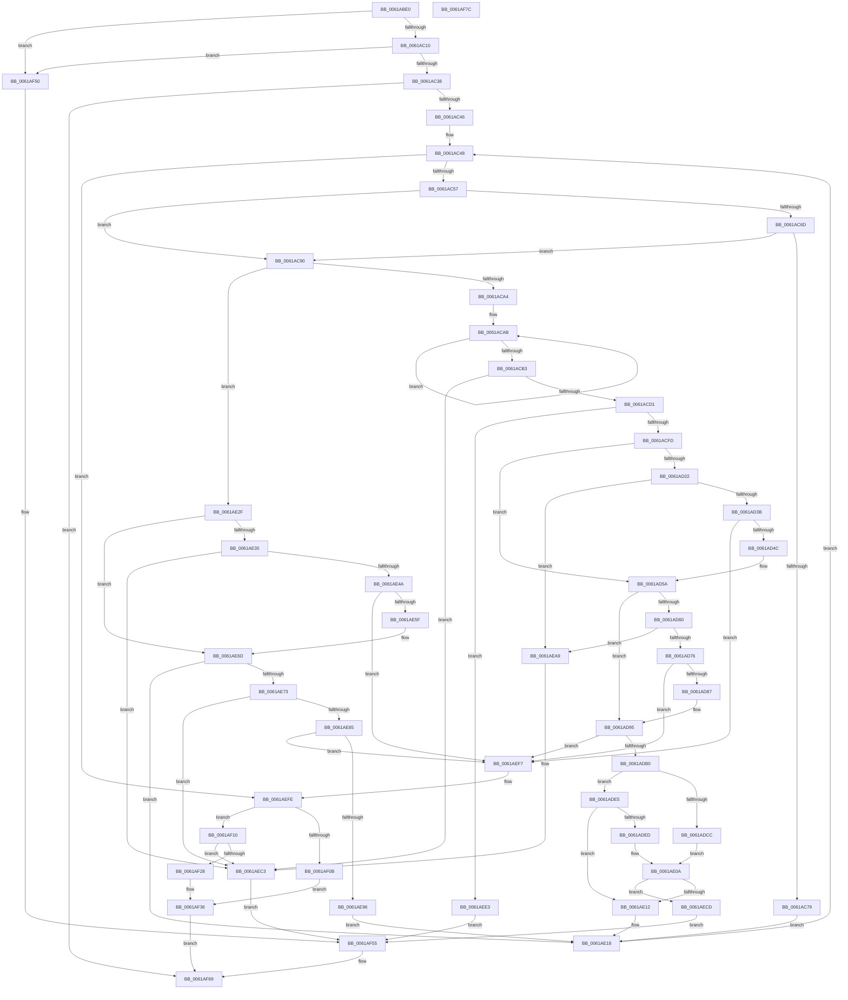

# DifRegisterPlugin

- RVA: `0x0061ABE0`–`0x0061AF7D` (길이 `925` bytes)
- VA: `0x000000014061ABE0`
- 실행 섹션: `.text`
- PDB 이름 있음: `예`; PDB Function 태그: `아니요`
- unwind 정보 RVA: `0x000D2AD4`
- 디코드: `239`개 명령, `925/925` bytes 표시
- 미해석 바이트: `0` (있으면 어셈블리에 `.byte`로 보존)

> 이 문서는 커널 이미지의 기계어와 PDB 기호를 분석해 생성했습니다. 4번과 5번은 함수 원형과 자료형을 바이너리 사용 방식에서 추정한 C 해석이며 원본 소스 복구 결과는 아닙니다.

## 1. Dependencies

- 직접 호출 지점: **19**; 고유 호출 대상: **10**
- 직접 호출자로 확인된 함수: **13**
- RIP 상대 이미지 참조: **7**

### Outgoing calls
- `0x0061AC70` → [VfCheckDifDdiExist](../../pagevrfy/B9/VfCheckDifDdiExist_function_00B99FD0.md) (function, `0x00B99FD0`)
- `0x0061AC86` → [CarpDbgPrint](CarpDbgPrint_function_0061B7B4.md) (function, `0x0061B7B4`)
- `0x0061AC93` → [DifGetAPIThunkContextById](../49/DifGetAPIThunkContextById_function_00495A34.md) (function, `0x00495A34`)
- `0x0061ACC0` → [ExAllocatePool2](../../poolcode/B8/ExAllocatePool2_function_00B820F0.md) (function, `0x00B820F0`)
- `0x0061ACDB` → [memcpy](../6C/memcpy_function_006C6840.md) (function, `0x006C6840`)
- `0x0061ACEC` → [ExAllocatePool2](../../poolcode/B8/ExAllocatePool2_function_00B820F0.md) (function, `0x00B820F0`)
- `0x0061AD2D` → [DifCreateAPIThunkContext](DifCreateAPIThunkContext_function_0061A65C.md) (function, `0x0061A65C`)
- `0x0061AD68` → [DifCreateAPIThunkContext](DifCreateAPIThunkContext_function_0061A65C.md) (function, `0x0061A65C`)
- `0x0061ADDE` → [VfBindDifDDIWrappers](../../pagevrfy/B9/VfBindDifDDIWrappers_function_00B99F70.md) (function, `0x00B99F70`)
- `0x0061AE05` → [VfBindDifCallbackWrappers](../../pagevrfy/B9/VfBindDifCallbackWrappers_function_00B99F30.md) (function, `0x00B99F30`)
- `0x0061AE40` → [DifCreateAPIThunkContext](DifCreateAPIThunkContext_function_0061A65C.md) (function, `0x0061A65C`)
- `0x0061AE7B` → [DifCreateAPIThunkContext](DifCreateAPIThunkContext_function_0061A65C.md) (function, `0x0061A65C`)
- `0x0061AEB1` → [ExFreePoolWithTag](../../poolcode/B8/ExFreePoolWithTag_function_00B82870.md) (function, `0x00B82870`)
- `0x0061AEBE` → [ExFreePoolWithTag](../../poolcode/B8/ExFreePoolWithTag_function_00B82870.md) (function, `0x00B82870`)
- `0x0061AED7` → [CarpDbgPrint](CarpDbgPrint_function_0061B7B4.md) (function, `0x0061B7B4`)
- `0x0061AEF0` → [ExFreePoolWithTag](../../poolcode/B8/ExFreePoolWithTag_function_00B82870.md) (function, `0x00B82870`)
- `0x0061AF1E` → [ExAllocatePool2](../../poolcode/B8/ExAllocatePool2_function_00B820F0.md) (function, `0x00B820F0`)
- `0x0061AF5C` → [CarpDbgPrint](CarpDbgPrint_function_0061B7B4.md) (function, `0x0061B7B4`)
- `0x0061AF64` → [DifDeregisterPlugin](DifDeregisterPlugin_function_0061A6C8.md) (function, `0x0061A6C8`)

### Direct callers
- [VfPoolTrackingEntry](VfPoolTrackingEntry_function_00613380.md) at `0x0061384F`
- [VfIoPendingEntry](VfIoPendingEntry_function_00614340.md) at `0x006143DC`
- [VfSecurityEntry](VfSecurityEntry_function_006147E0.md) at `0x00615EF3`
- [VfDmaPluginEntry](VfDmaPluginEntry_function_00616590.md) at `0x00616642`
- [VfBelow4gbPluginEntry](VfBelow4gbPluginEntry_function_00616680.md) at `0x006167A0`
- [VfIrqlPluginEntry](VfIrqlPluginEntry_function_00616DA0.md) at `0x00616FDC`
- [VfRlrsEntry](VfRlrsEntry_function_00617090.md) at `0x0061747D`
- [VfLwSPEntry](../64/VfLwSPEntry_function_0064C0E0.md) at `0x0064C2EB`
- [VfSpecialPoolEntry](../6A/VfSpecialPoolEntry_function_006AA4A0.md) at `0x006AA9A0`
- [VfIovPluginEntry](../6A/VfIovPluginEntry_function_006AAA80.md) at `0x006AAC9F`
- [VfIrpTrackingPluginEntry](../6A/VfIrpTrackingPluginEntry_function_006AAE60.md) at `0x006AAE8E`
- [VfDeadlockPluginEntry](../../pagevrfy/BA/VfDeadlockPluginEntry_function_00BA8230.md) at `0x00BA87E1`
- [VfMiscPluginEntry](../../pagevrfy/BA/VfMiscPluginEntry_function_00BAE660.md) at `0x00BAF27E`

### Static image references
- `0x0061AC13` → RVA `0x00000000` (`image boundary/outside`; read)
- `0x0061AC7C` → RVA `0x006CFBA0` (` ?? ::FNODOBFM::`string'`; read)
- `0x0061AD95` → RVA `0x00F03E98` (`.data`; read)
- `0x0061AD9C` → RVA `0x00F03E90` (`.data`; read)
- `0x0061ADBA` → RVA `0x00F03E98` (`.data`; write)
- `0x0061AED0` → RVA `0x006CFC20` (` ?? ::FNODOBFM::`string'`; read)
- `0x0061AF55` → RVA `0x006CFC00` (` ?? ::FNODOBFM::`string'`; read)

## 2. Other-region calls and transfers

- 다른 실행 섹션으로 향하는 call: **9**
  - `0x0061AC70` → [VfCheckDifDdiExist](../../pagevrfy/B9/VfCheckDifDdiExist_function_00B99FD0.md) (`.text` → `PAGEVRFY`)
  - `0x0061ACC0` → [ExAllocatePool2](../../poolcode/B8/ExAllocatePool2_function_00B820F0.md) (`.text` → `POOLCODE`)
  - `0x0061ACEC` → [ExAllocatePool2](../../poolcode/B8/ExAllocatePool2_function_00B820F0.md) (`.text` → `POOLCODE`)
  - `0x0061ADDE` → [VfBindDifDDIWrappers](../../pagevrfy/B9/VfBindDifDDIWrappers_function_00B99F70.md) (`.text` → `PAGEVRFY`)
  - `0x0061AE05` → [VfBindDifCallbackWrappers](../../pagevrfy/B9/VfBindDifCallbackWrappers_function_00B99F30.md) (`.text` → `PAGEVRFY`)
  - `0x0061AEB1` → [ExFreePoolWithTag](../../poolcode/B8/ExFreePoolWithTag_function_00B82870.md) (`.text` → `POOLCODE`)
  - `0x0061AEBE` → [ExFreePoolWithTag](../../poolcode/B8/ExFreePoolWithTag_function_00B82870.md) (`.text` → `POOLCODE`)
  - `0x0061AEF0` → [ExFreePoolWithTag](../../poolcode/B8/ExFreePoolWithTag_function_00B82870.md) (`.text` → `POOLCODE`)
  - `0x0061AF1E` → [ExAllocatePool2](../../poolcode/B8/ExAllocatePool2_function_00B820F0.md) (`.text` → `POOLCODE`)
- 별도 외부 분기/꼬리 이동을 확인하지 못했습니다.

## 3. Assembly (complete function range)

```asm
0061ABE0  4C 89 4C 24 20                  mov qword ptr [rsp + 0x20], r9
0061ABE5  89 54 24 10                     mov dword ptr [rsp + 0x10], edx
0061ABE9  48 89 4C 24 08                  mov qword ptr [rsp + 8], rcx
0061ABEE  53                              push rbx
0061ABEF  55                              push rbp
0061ABF0  56                              push rsi
0061ABF1  57                              push rdi
0061ABF2  41 54                           push r12
0061ABF4  41 55                           push r13
0061ABF6  41 56                           push r14
0061ABF8  41 57                           push r15
0061ABFA  48 83 EC 28                     sub rsp, 0x28
0061ABFE  33 DB                           xor ebx, ebx
0061AC00  45 8B E0                        mov r12d, r8d
0061AC03  44 8D 73 40                     lea r14d, [rbx + 0x40]
0061AC07  45 3B C6                        cmp r8d, r14d
0061AC0A  0F 83 40 03 00 00               jae 0x14061af50
0061AC10  41 8A C4                        mov al, r12b
0061AC13  48 8D 35 E6 53 9E FF            lea rsi, [rip - 0x61ac1a]
0061AC1A  24 1F                           and al, 0x1f
0061AC1C  44 0F B6 C8                     movzx r9d, al
0061AC20  41 8B C4                        mov eax, r12d
0061AC23  48 C1 E8 05                     shr rax, 5
0061AC27  8B 84 86 A0 81 E6 00            mov eax, dword ptr [rsi + rax*4 + 0xe681a0]
0061AC2E  44 0F A3 C8                     bt eax, r9d
0061AC32  0F 83 18 03 00 00               jae 0x14061af50
0061AC38  42 38 9C 26 00 82 E6 00         cmp byte ptr [rsi + r12 + 0xe68200], bl
0061AC40  0F 85 23 03 00 00               jne 0x14061af69
0061AC46  8B C3                           mov eax, ebx
0061AC48  89 84 24 80 00 00 00            mov dword ptr [rsp + 0x80], eax
0061AC4F  3B C2                           cmp eax, edx
0061AC51  0F 83 A7 02 00 00               jae 0x14061aefe
0061AC57  8B F8                           mov edi, eax
0061AC59  48 C1 E7 05                     shl rdi, 5
0061AC5D  48 03 F9                        add rdi, rcx
0061AC60  44 8B 4F 08                     mov r9d, dword ptr [rdi + 8]
0061AC64  41 81 F9 00 00 00 80            cmp r9d, 0x80000000
0061AC6B  73 23                           jae 0x14061ac90
0061AC6D  41 8B C9                        mov ecx, r9d
0061AC70  E8 5B F3 57 00                  call 0x140b99fd0
0061AC75  84 C0                           test al, al
0061AC77  75 17                           jne 0x14061ac90
0061AC79  45 8B C4                        mov r8d, r12d
0061AC7C  48 8D 0D 1D 4F 0B 00            lea rcx, [rip + 0xb4f1d]
0061AC83  41 8B D1                        mov edx, r9d
0061AC86  E8 29 0B 00 00                  call 0x14061b7b4
0061AC8B  E9 88 01 00 00                  jmp 0x14061ae18
0061AC90  41 8B C9                        mov ecx, r9d
0061AC93  E8 9C AD E7 FF                  call 0x140495a34
0061AC98  48 8B F0                        mov rsi, rax
0061AC9B  48 85 C0                        test rax, rax
0061AC9E  0F 85 8B 01 00 00               jne 0x14061ae2f
0061ACA4  48 8B 07                        mov rax, qword ptr [rdi]
0061ACA7  48 83 CE FF                     or rsi, 0xffffffffffffffff
0061ACAB  48 FF C6                        inc rsi
0061ACAE  38 1C 30                        cmp byte ptr [rax + rsi], bl
0061ACB1  75 F8                           jne 0x14061acab
0061ACB3  41 B8 44 66 41 70               mov r8d, 0x70416644
0061ACB9  48 8D 56 01                     lea rdx, [rsi + 1]
0061ACBD  49 8B CE                        mov rcx, r14
0061ACC0  E8 2B 74 56 00                  call 0x140b820f0
0061ACC5  48 8B E8                        mov rbp, rax
0061ACC8  48 85 C0                        test rax, rax
0061ACCB  0F 84 F2 01 00 00               je 0x14061aec3
0061ACD1  48 8B 17                        mov rdx, qword ptr [rdi]
0061ACD4  4C 8D 46 01                     lea r8, [rsi + 1]
0061ACD8  48 8B C8                        mov rcx, rax
0061ACDB  E8 60 BB 0A 00                  call 0x1406c6840
0061ACE0  41 B8 44 66 41 70               mov r8d, 0x70416644
0061ACE6  49 8B D6                        mov rdx, r14
0061ACE9  49 8B CE                        mov rcx, r14
0061ACEC  E8 FF 73 56 00                  call 0x140b820f0
0061ACF1  48 8B F0                        mov rsi, rax
0061ACF4  48 85 C0                        test rax, rax
0061ACF7  0F 84 E6 01 00 00               je 0x14061aee3
0061ACFD  48 89 28                        mov qword ptr [rax], rbp
0061AD00  4C 8D 70 20                     lea r14, [rax + 0x20]
0061AD04  8B 4F 08                        mov ecx, dword ptr [rdi + 8]
0061AD07  4C 8D 78 30                     lea r15, [rax + 0x30]
0061AD0B  89 48 08                        mov dword ptr [rax + 8], ecx
0061AD0E  4D 89 76 08                     mov qword ptr [r14 + 8], r14
0061AD12  4D 89 36                        mov qword ptr [r14], r14
0061AD15  4D 89 7F 08                     mov qword ptr [r15 + 8], r15
0061AD19  4D 89 3F                        mov qword ptr [r15], r15
0061AD1C  48 39 5F 10                     cmp qword ptr [rdi + 0x10], rbx
0061AD20  74 38                           je 0x14061ad5a
0061AD22  45 8B C4                        mov r8d, r12d
0061AD25  BA 01 00 00 00                  mov edx, 1
0061AD2A  48 8B CF                        mov rcx, rdi
0061AD2D  E8 2A F9 FF FF                  call 0x14061a65c
0061AD32  48 85 C0                        test rax, rax
0061AD35  0F 84 6E 01 00 00               je 0x14061aea9
0061AD3B  49 8B 4E 08                     mov rcx, qword ptr [r14 + 8]
0061AD3F  48 83 C0 10                     add rax, 0x10
0061AD43  4C 39 31                        cmp qword ptr [rcx], r14
0061AD46  0F 85 AB 01 00 00               jne 0x14061aef7
0061AD4C  4C 89 30                        mov qword ptr [rax], r14
0061AD4F  48 89 48 08                     mov qword ptr [rax + 8], rcx
0061AD53  48 89 01                        mov qword ptr [rcx], rax
0061AD56  49 89 46 08                     mov qword ptr [r14 + 8], rax
0061AD5A  48 39 5F 18                     cmp qword ptr [rdi + 0x18], rbx
0061AD5E  74 35                           je 0x14061ad95
0061AD60  45 8B C4                        mov r8d, r12d
0061AD63  33 D2                           xor edx, edx
0061AD65  48 8B CF                        mov rcx, rdi
0061AD68  E8 EF F8 FF FF                  call 0x14061a65c
0061AD6D  48 85 C0                        test rax, rax
0061AD70  0F 84 33 01 00 00               je 0x14061aea9
0061AD76  49 8B 0F                        mov rcx, qword ptr [r15]
0061AD79  48 83 C0 10                     add rax, 0x10
0061AD7D  4C 39 79 08                     cmp qword ptr [rcx + 8], r15
0061AD81  0F 85 70 01 00 00               jne 0x14061aef7
0061AD87  48 89 08                        mov qword ptr [rax], rcx
0061AD8A  4C 89 78 08                     mov qword ptr [rax + 8], r15
0061AD8E  48 89 41 08                     mov qword ptr [rcx + 8], rax
0061AD92  49 89 07                        mov qword ptr [r15], rax
0061AD95  48 8B 0D FC 90 8E 00            mov rcx, qword ptr [rip + 0x8e90fc]
0061AD9C  4C 8D 05 ED 90 8E 00            lea r8, [rip + 0x8e90ed]
0061ADA3  48 8D 46 10                     lea rax, [rsi + 0x10]
0061ADA7  4C 39 01                        cmp qword ptr [rcx], r8
0061ADAA  0F 85 47 01 00 00               jne 0x14061aef7
0061ADB0  4C 89 00                        mov qword ptr [rax], r8
0061ADB3  48 89 48 08                     mov qword ptr [rax + 8], rcx
0061ADB7  48 89 01                        mov qword ptr [rcx], rax
0061ADBA  48 89 05 D7 90 8E 00            mov qword ptr [rip + 0x8e90d7], rax
0061ADC1  8B 4E 08                        mov ecx, dword ptr [rsi + 8]
0061ADC4  81 F9 00 00 00 10               cmp ecx, 0x10000000
0061ADCA  73 19                           jae 0x14061ade5
0061ADCC  48 8D 05 2D 52 9E FF            lea rax, [rip - 0x61add3]
0061ADD3  4C 8B C6                        mov r8, rsi
0061ADD6  48 8B 94 C8 68 20 E0 00         mov rdx, qword ptr [rax + rcx*8 + 0xe02068]
0061ADDE  E8 8D F1 57 00                  call 0x140b99f70
0061ADE3  EB 25                           jmp 0x14061ae0a
0061ADE5  81 F9 00 00 00 80               cmp ecx, 0x80000000
0061ADEB  73 25                           jae 0x14061ae12
0061ADED  8D 91 00 00 00 F0               lea edx, [rcx - 0x10000000]
0061ADF3  4C 8B C6                        mov r8, rsi
0061ADF6  48 8D 05 03 52 9E FF            lea rax, [rip - 0x61adfd]
0061ADFD  48 8B 94 D0 58 1F E0 00         mov rdx, qword ptr [rax + rdx*8 + 0xe01f58]
0061AE05  E8 26 F1 57 00                  call 0x140b99f30
0061AE0A  84 C0                           test al, al
0061AE0C  0F 84 BB 00 00 00               je 0x14061aecd
0061AE12  41 BE 40 00 00 00               mov r14d, 0x40
0061AE18  8B 84 24 80 00 00 00            mov eax, dword ptr [rsp + 0x80]
0061AE1F  8B 54 24 78                     mov edx, dword ptr [rsp + 0x78]
0061AE23  FF C0                           inc eax
0061AE25  48 8B 4C 24 70                  mov rcx, qword ptr [rsp + 0x70]
0061AE2A  E9 19 FE FF FF                  jmp 0x14061ac48
0061AE2F  48 39 5F 10                     cmp qword ptr [rdi + 0x10], rbx
0061AE33  74 38                           je 0x14061ae6d
0061AE35  45 8B C4                        mov r8d, r12d
0061AE38  BA 01 00 00 00                  mov edx, 1
0061AE3D  48 8B CF                        mov rcx, rdi
0061AE40  E8 17 F8 FF FF                  call 0x14061a65c
0061AE45  48 85 C0                        test rax, rax
0061AE48  74 79                           je 0x14061aec3
0061AE4A  48 8D 4E 20                     lea rcx, [rsi + 0x20]
0061AE4E  48 83 C0 10                     add rax, 0x10
0061AE52  48 8B 51 08                     mov rdx, qword ptr [rcx + 8]
0061AE56  48 39 0A                        cmp qword ptr [rdx], rcx
0061AE59  0F 85 98 00 00 00               jne 0x14061aef7
0061AE5F  48 89 08                        mov qword ptr [rax], rcx
0061AE62  48 89 50 08                     mov qword ptr [rax + 8], rdx
0061AE66  48 89 02                        mov qword ptr [rdx], rax
0061AE69  48 89 41 08                     mov qword ptr [rcx + 8], rax
0061AE6D  48 39 5F 18                     cmp qword ptr [rdi + 0x18], rbx
0061AE71  74 A5                           je 0x14061ae18
0061AE73  45 8B C4                        mov r8d, r12d
0061AE76  33 D2                           xor edx, edx
0061AE78  48 8B CF                        mov rcx, rdi
0061AE7B  E8 DC F7 FF FF                  call 0x14061a65c
0061AE80  48 85 C0                        test rax, rax
0061AE83  74 3E                           je 0x14061aec3
0061AE85  48 8D 4E 30                     lea rcx, [rsi + 0x30]
0061AE89  48 83 C0 10                     add rax, 0x10
0061AE8D  48 8B 11                        mov rdx, qword ptr [rcx]
0061AE90  48 39 4A 08                     cmp qword ptr [rdx + 8], rcx
0061AE94  75 61                           jne 0x14061aef7
0061AE96  48 89 10                        mov qword ptr [rax], rdx
0061AE99  48 89 48 08                     mov qword ptr [rax + 8], rcx
0061AE9D  48 89 42 08                     mov qword ptr [rdx + 8], rax
0061AEA1  48 89 01                        mov qword ptr [rcx], rax
0061AEA4  E9 6F FF FF FF                  jmp 0x14061ae18
0061AEA9  BA 44 69 66 4E                  mov edx, 0x4e666944
0061AEAE  48 8B CD                        mov rcx, rbp
0061AEB1  E8 BA 79 56 00                  call 0x140b82870
0061AEB6  BA 44 69 66 4E                  mov edx, 0x4e666944
0061AEBB  48 8B CE                        mov rcx, rsi
0061AEBE  E8 AD 79 56 00                  call 0x140b82870
0061AEC3  BB 17 00 00 C0                  mov ebx, 0xc0000017
0061AEC8  E9 88 00 00 00                  jmp 0x14061af55
0061AECD  8B 56 08                        mov edx, dword ptr [rsi + 8]
0061AED0  48 8D 0D 49 4D 0B 00            lea rcx, [rip + 0xb4d49]
0061AED7  E8 D8 08 00 00                  call 0x14061b7b4
0061AEDC  BB 7F 0C 00 C0                  mov ebx, 0xc0000c7f
0061AEE1  EB 72                           jmp 0x14061af55
0061AEE3  BA 44 69 66 4E                  mov edx, 0x4e666944
0061AEE8  48 8B CD                        mov rcx, rbp
0061AEEB  BB 17 00 00 C0                  mov ebx, 0xc0000017
0061AEF0  E8 7B 79 56 00                  call 0x140b82870
0061AEF5  EB 5E                           jmp 0x14061af55
0061AEF7  B9 03 00 00 00                  mov ecx, 3
0061AEFC  CD 29                           int 0x29
0061AEFE  48 8B BC 24 88 00 00 00         mov rdi, qword ptr [rsp + 0x88]
0061AF06  48 85 FF                        test rdi, rdi
0061AF09  75 05                           jne 0x14061af10
0061AF0B  48 8B C3                        mov rax, rbx
0061AF0E  EB 26                           jmp 0x14061af36
0061AF10  BA 20 00 00 00                  mov edx, 0x20
0061AF15  41 B8 44 66 41 70               mov r8d, 0x70416644
0061AF1B  49 8B CE                        mov rcx, r14
0061AF1E  E8 CD 71 56 00                  call 0x140b820f0
0061AF23  48 85 C0                        test rax, rax
0061AF26  74 9B                           je 0x14061aec3
0061AF28  0F 10 07                        movups xmm0, xmmword ptr [rdi]
0061AF2B  0F 11 00                        movups xmmword ptr [rax], xmm0
0061AF2E  0F 10 4F 10                     movups xmm1, xmmword ptr [rdi + 0x10]
0061AF32  0F 11 48 10                     movups xmmword ptr [rax + 0x10], xmm1
0061AF36  48 8D 0D C3 50 9E FF            lea rcx, [rip - 0x61af3d]
0061AF3D  4A 89 84 E1 40 82 E6 00         mov qword ptr [rcx + r12*8 + 0xe68240], rax
0061AF45  42 C6 84 21 00 82 E6 00 01      mov byte ptr [rcx + r12 + 0xe68200], 1
0061AF4E  EB 19                           jmp 0x14061af69
0061AF50  BB 74 0C 00 C0                  mov ebx, 0xc0000c74
0061AF55  48 8D 0D A4 4C 0B 00            lea rcx, [rip + 0xb4ca4]
0061AF5C  E8 53 08 00 00                  call 0x14061b7b4
0061AF61  41 8B CC                        mov ecx, r12d
0061AF64  E8 5F F7 FF FF                  call 0x14061a6c8
0061AF69  8B C3                           mov eax, ebx
0061AF6B  48 83 C4 28                     add rsp, 0x28
0061AF6F  41 5F                           pop r15
0061AF71  41 5E                           pop r14
0061AF73  41 5D                           pop r13
0061AF75  41 5C                           pop r12
0061AF77  5F                              pop rdi
0061AF78  5E                              pop rsi
0061AF79  5D                              pop rbp
0061AF7A  5B                              pop rbx
0061AF7B  C3                              ret
0061AF7C  CC                              int3
```

## 4. C-style interpretation (structured pseudocode)

```c
__int64 __fastcall DifRegisterPlugin(__int64 a1, int a2, int a3, __int64 a4)
{
    __int64 result;
    __int64 v_rbx;
    __int64 v_rdi;
    __int64 v_rsi;
    __int64 v_rsp;
    unsigned int v_stack_p10;
    unsigned int v_stack_p18;
    unsigned __int64 v_stack_p20;
    unsigned __int64 v_stack_p8;

    v_stack_p20 = a4;
    v_stack_p10 = a2;
    v_stack_p8 = a1;
    v_rsp = (v_rsp) - (40);
    v_rbx = 0;
    if (a3 >= ((unsigned int)(v_rbx + 64))) goto loc_0061AF50;
    result = (unsigned __int8)(((unsigned __int8)((unsigned int)(a3))) & (31));
    result = ((unsigned int)((unsigned int)((unsigned int)(a3)))) >> (5);
    if (condition_is_above_or_equal) goto loc_0061AF50;
    if ((*(unsigned __int8 *)(v_rip - 6401050 + (unsigned int)(a3) * 1 + 15106560)) != 0) goto loc_0061AF69;
loc_0061AC48:
    v_stack_p18 = 0;
    if (0 >= a2) goto loc_0061AEFE;
    v_rdi = (0) << (5);
    v_rdi = (v_rdi) + (a1);
    if (((unsigned int)((unsigned int)(*(unsigned int *)(v_rdi + 8)))) >= 0x80000000ULL) goto loc_0061AC90;
    result = VfCheckDifDdiExist((unsigned int)((unsigned int)((unsigned int)(*(unsigned int *)(v_rdi + 8)))), a2, a3, (unsigned int)(*(unsigned int *)(v_rdi + 8)));
    if ((unsigned __int8)(result) != 0) goto loc_0061AC90;
    result = CarpDbgPrint(v_rip + 741149, (unsigned int)((unsigned int)((unsigned int)(*(unsigned int *)(v_rdi + 8)))), (unsigned int)((unsigned int)((unsigned int)(a3))), (unsigned int)(*(unsigned int *)(v_rdi + 8)));
    goto loc_0061AE18;
loc_0061AC90:
    result = DifGetAPIThunkContextById((unsigned int)((unsigned int)((unsigned int)(*(unsigned int *)(v_rdi + 8)))), (unsigned int)((unsigned int)((unsigned int)(*(unsigned int *)(v_rdi + 8)))), (unsigned int)((unsigned int)((unsigned int)(a3))), (unsigned int)(*(unsigned int *)(v_rdi + 8)));
    if (result != 0) goto loc_0061AE2F;
    v_rsi = (result) | (-1);
loc_0061ACAB:
    v_rsi = (v_rsi) + 1;
    if ((*(unsigned __int8 *)(*(unsigned __int64 *)(v_rdi) + v_rsi * 1)) != 0) goto loc_0061ACAB;
    result = ExAllocatePool2(v_rbx + 64, v_rsi + 1, (unsigned int)(0x70416644ULL), (unsigned int)(*(unsigned int *)(v_rdi + 8)));
    if (result == 0) goto loc_0061AEC3;
    result = memcpy(result, *(unsigned __int64 *)(v_rdi), v_rsi + 1, (unsigned int)(*(unsigned int *)(v_rdi + 8)));
    result = ExAllocatePool2(v_rbx + 64, v_rbx + 64, (unsigned int)(0x70416644ULL), (unsigned int)(*(unsigned int *)(v_rdi + 8)));
    if (result == 0) goto loc_0061AEE3;
    *(unsigned __int64 *)(result) = result;
    *(unsigned int *)(result + 8) = (unsigned int)((unsigned int)(*(unsigned int *)(v_rdi + 8)));
    *(unsigned __int64 *)(result + 32 + 8) = result + 32;
    *(unsigned __int64 *)(result + 32) = result + 32;
    *(unsigned __int64 *)(result + 48 + 8) = result + 48;
    *(unsigned __int64 *)(result + 48) = result + 48;
    if ((*(unsigned __int64 *)(v_rdi + 16)) == 0) goto loc_0061AD5A;
    result = DifCreateAPIThunkContext(v_rdi, 1, (unsigned int)((unsigned int)((unsigned int)(a3))), (unsigned int)(*(unsigned int *)(v_rdi + 8)));
    if (result == 0) goto loc_0061AEA9;
    result = (result) + (16);
    if ((*(unsigned __int64 *)(*(unsigned __int64 *)(result + 32 + 8))) != (result + 32)) goto loc_0061AEF7;
    *(unsigned __int64 *)(result) = result + 32;
    *(unsigned __int64 *)(result + 8) = *(unsigned __int64 *)(result + 32 + 8);
    *(unsigned __int64 *)(*(unsigned __int64 *)(result + 32 + 8)) = result;
    *(unsigned __int64 *)(result + 32 + 8) = result;
loc_0061AD5A:
    if ((*(unsigned __int64 *)(v_rdi + 24)) == 0) goto loc_0061AD95;
    a2 = 0;
    result = DifCreateAPIThunkContext(v_rdi, a2, (unsigned int)((unsigned int)((unsigned int)(a3))), (unsigned int)(*(unsigned int *)(v_rdi + 8)));
    if (result == 0) goto loc_0061AEA9;
    result = (result) + (16);
    if ((*(unsigned __int64 *)(*(unsigned __int64 *)(result + 48) + 8)) != (result + 48)) goto loc_0061AEF7;
    *(unsigned __int64 *)(result) = *(unsigned __int64 *)(result + 48);
    *(unsigned __int64 *)(result + 8) = result + 48;
    *(unsigned __int64 *)(*(unsigned __int64 *)(result + 48) + 8) = result;
    *(unsigned __int64 *)(result + 48) = result;
loc_0061AD95:
    if ((*(unsigned __int64 *)(*(unsigned __int64 *)(v_rip + 9343228))) != (v_rip + 9343213)) goto loc_0061AEF7;
    *(unsigned __int64 *)(result + 16) = v_rip + 9343213;
    *(unsigned __int64 *)(result + 16 + 8) = *(unsigned __int64 *)(v_rip + 9343228);
    *(unsigned __int64 *)(*(unsigned __int64 *)(v_rip + 9343228)) = result + 16;
    *(unsigned __int64 *)(v_rip + 9343191) = result + 16;
    if (((unsigned int)((unsigned int)(*(unsigned int *)(result + 8)))) >= 0x10000000ULL) goto loc_0061ADE5;
    result = VfBindDifDDIWrappers((unsigned int)(*(unsigned int *)(result + 8)), *(unsigned __int64 *)(v_rip - 6401491 + (unsigned int)(*(unsigned int *)(result + 8)) * 8 + 14688360), result, (unsigned int)(*(unsigned int *)(v_rdi + 8)));
    goto loc_0061AE0A;
loc_0061ADE5:
    if (((unsigned int)((unsigned int)(*(unsigned int *)(result + 8)))) >= 0x80000000ULL) goto loc_0061AE12;
    result = VfBindDifCallbackWrappers((unsigned int)(*(unsigned int *)(result + 8)), *(unsigned __int64 *)(v_rip - 6401533 + (unsigned int)(*(unsigned int *)(result + 8)) - 268435456 * 8 + 14688088), result, (unsigned int)(*(unsigned int *)(v_rdi + 8)));
loc_0061AE0A:
    if ((unsigned __int8)(result) == 0) goto loc_0061AECD;
loc_0061AE12:
loc_0061AE18:
    result = (unsigned int)(((unsigned int)(v_stack_p18)) + 1);
    goto loc_0061AC48;
loc_0061AE2F:
    if ((*(unsigned __int64 *)(v_rdi + 16)) == 0) goto loc_0061AE6D;
    result = DifCreateAPIThunkContext(v_rdi, 1, (unsigned int)((unsigned int)((unsigned int)(a3))), (unsigned int)(*(unsigned int *)(v_rdi + 8)));
    if (result == 0) goto loc_0061AEC3;
    result = (result) + (16);
    if ((*(unsigned __int64 *)(*(unsigned __int64 *)(result + 32 + 8))) != (result + 32)) goto loc_0061AEF7;
    *(unsigned __int64 *)(result) = result + 32;
    *(unsigned __int64 *)(result + 8) = *(unsigned __int64 *)(result + 32 + 8);
    *(unsigned __int64 *)(*(unsigned __int64 *)(result + 32 + 8)) = result;
    *(unsigned __int64 *)(result + 32 + 8) = result;
loc_0061AE6D:
    if ((*(unsigned __int64 *)(v_rdi + 24)) == 0) goto loc_0061AE18;
    a2 = 0;
    result = DifCreateAPIThunkContext(v_rdi, a2, (unsigned int)((unsigned int)((unsigned int)(a3))), (unsigned int)(*(unsigned int *)(v_rdi + 8)));
    if (result == 0) goto loc_0061AEC3;
    result = (result) + (16);
    if ((*(unsigned __int64 *)(*(unsigned __int64 *)(result + 48) + 8)) != (result + 48)) goto loc_0061AEF7;
    *(unsigned __int64 *)(result) = *(unsigned __int64 *)(result + 48);
    *(unsigned __int64 *)(result + 8) = result + 48;
    *(unsigned __int64 *)(*(unsigned __int64 *)(result + 48) + 8) = result;
    *(unsigned __int64 *)(result + 48) = result;
    goto loc_0061AE18;
loc_0061AEA9:
    result = ExFreePoolWithTag(result, (unsigned int)(0x4E666944ULL), (unsigned int)((unsigned int)((unsigned int)(a3))), (unsigned int)(*(unsigned int *)(v_rdi + 8)));
    result = ExFreePoolWithTag(result, (unsigned int)(0x4E666944ULL), (unsigned int)((unsigned int)((unsigned int)(a3))), (unsigned int)(*(unsigned int *)(v_rdi + 8)));
loc_0061AEC3:
    goto loc_0061AF55;
loc_0061AECD:
    result = CarpDbgPrint(v_rip + 740681, (unsigned int)(*(unsigned int *)(result + 8)), (unsigned int)((unsigned int)((unsigned int)(a3))), (unsigned int)(*(unsigned int *)(v_rdi + 8)));
    goto loc_0061AF55;
loc_0061AEE3:
    result = ExFreePoolWithTag(result, (unsigned int)(0x4E666944ULL), (unsigned int)((unsigned int)((unsigned int)(a3))), (unsigned int)(*(unsigned int *)(v_rdi + 8)));
    goto loc_0061AF55;
loc_0061AEF7:
loc_0061AEFE:
    if (v_stack_p20 != 0) goto loc_0061AF10;
    goto loc_0061AF36;
loc_0061AF10:
    result = ExAllocatePool2(64, 32, (unsigned int)(0x70416644ULL), (unsigned int)(*(unsigned int *)(v_rdi + 8)));
    if (result == 0) goto loc_0061AEC3;
    *(unsigned __int64 *)(result) = v_xmm0;
    *(unsigned __int64 *)(result + 16) = v_xmm1;
loc_0061AF36:
    *(unsigned __int64 *)(v_rip - 6401853 + (unsigned int)(a3) * 8 + 15106624) = result;
    *(unsigned __int8 *)(v_rip - 6401853 + (unsigned int)(a3) * 1 + 15106560) = 1;
    goto loc_0061AF69;
loc_0061AF50:
loc_0061AF55:
    result = CarpDbgPrint(v_rip + 740516, 32, (unsigned int)(0x70416644ULL), (unsigned int)(*(unsigned int *)(v_rdi + 8)));
    result = DifDeregisterPlugin((unsigned int)((unsigned int)((unsigned int)(a3))), 32, (unsigned int)(0x70416644ULL), (unsigned int)(*(unsigned int *)(v_rdi + 8)));
loc_0061AF69:
    v_rsp = (v_rsp) + (40);
    return (unsigned int)((unsigned int)((unsigned int)(0xC0000C74ULL)));
}
```

## 5. (Beta) C Style

```c
int64_t DifRegisterPlugin(int64_t Arg1, int32_t Arg2, int32_t Arg3, int64_t Arg4)
{
    int64_t result;
    int64_t local_rbx;
    int64_t local_rdi;
    int64_t local_rsi;
    int64_t local_rsp;
    uint32_t v_stack_p10;
    uint32_t v_stack_p18;
    uint64_t v_stack_p20;
    uint64_t v_stack_p8;

    v_stack_p20 = Arg4;
    v_stack_p10 = Arg2;
    v_stack_p8 = Arg1;
    local_rsp = (local_rsp) - (40);
    local_rbx = 0;
    if (Arg3 >= ((uint32_t)(local_rbx + 64))) goto loc_0061AF50;
    result = (uint8_t)(((uint8_t)((uint32_t)(Arg3))) & (31));
    result = ((uint32_t)((uint32_t)((uint32_t)(Arg3)))) >> (5);
    if (condition_is_above_or_equal) goto loc_0061AF50;
    if ((*(uint8_t *)(v_rip - 0x61AC1A + (uint32_t)(Arg3) * 1 + 0xE68200)) != 0) goto loc_0061AF69;
loc_0061AC48:
    v_stack_p18 = 0;
    if (0 >= Arg2) goto loc_0061AEFE;
    local_rdi = (0) << (5);
    local_rdi = (local_rdi) + (Arg1);
    if (((uint32_t)((uint32_t)(*(uint32_t *)(local_rdi + 0x8)))) >= 0x80000000ULL) goto loc_0061AC90;
    result = VfCheckDifDdiExist((uint32_t)((uint32_t)((uint32_t)(*(uint32_t *)(local_rdi + 0x8)))), Arg2, Arg3, (uint32_t)(*(uint32_t *)(local_rdi + 0x8)));
    if ((uint8_t)(result) != 0) goto loc_0061AC90;
    result = CarpDbgPrint(v_rip + 741149, (uint32_t)((uint32_t)((uint32_t)(*(uint32_t *)(local_rdi + 0x8)))), (uint32_t)((uint32_t)((uint32_t)(Arg3))), (uint32_t)(*(uint32_t *)(local_rdi + 0x8)));
    goto loc_0061AE18;
loc_0061AC90:
    result = DifGetAPIThunkContextById((uint32_t)((uint32_t)((uint32_t)(*(uint32_t *)(local_rdi + 0x8)))), (uint32_t)((uint32_t)((uint32_t)(*(uint32_t *)(local_rdi + 0x8)))), (uint32_t)((uint32_t)((uint32_t)(Arg3))), (uint32_t)(*(uint32_t *)(local_rdi + 0x8)));
    if (result != 0) goto loc_0061AE2F;
    local_rsi = (result) | (-1);
loc_0061ACAB:
    local_rsi = (local_rsi) + 1;
    if ((*(uint8_t *)(*(uint64_t *)(local_rdi) + local_rsi * 1)) != 0) goto loc_0061ACAB;
    result = ExAllocatePool2(local_rbx + 64, local_rsi + 1, (uint32_t)(0x70416644ULL), (uint32_t)(*(uint32_t *)(local_rdi + 0x8)));
    if (result == 0) goto loc_0061AEC3;
    result = memcpy(result, *(uint64_t *)(local_rdi), local_rsi + 1, (uint32_t)(*(uint32_t *)(local_rdi + 0x8)));
    result = ExAllocatePool2(local_rbx + 64, local_rbx + 64, (uint32_t)(0x70416644ULL), (uint32_t)(*(uint32_t *)(local_rdi + 0x8)));
    if (result == 0) goto loc_0061AEE3;
    *(uint64_t *)(result) = result;
    *(uint32_t *)(result + 0x8) = (uint32_t)((uint32_t)(*(uint32_t *)(local_rdi + 0x8)));
    *(uint64_t *)(result + 0x20 + 0x8) = result + 32;
    *(uint64_t *)(result + 0x20) = result + 32;
    *(uint64_t *)(result + 0x30 + 0x8) = result + 48;
    *(uint64_t *)(result + 0x30) = result + 48;
    if ((*(uint64_t *)(local_rdi + 0x10)) == 0) goto loc_0061AD5A;
    result = DifCreateAPIThunkContext(local_rdi, 1, (uint32_t)((uint32_t)((uint32_t)(Arg3))), (uint32_t)(*(uint32_t *)(local_rdi + 0x8)));
    if (result == 0) goto loc_0061AEA9;
    result = (result) + (16);
    if ((*(uint64_t *)(*(uint64_t *)(result + 0x20 + 0x8))) != (result + 32)) goto loc_0061AEF7;
    *(uint64_t *)(result) = result + 32;
    *(uint64_t *)(result + 0x8) = *(uint64_t *)(result + 0x20 + 0x8);
    *(uint64_t *)(*(uint64_t *)(result + 0x20 + 0x8)) = result;
    *(uint64_t *)(result + 0x20 + 0x8) = result;
loc_0061AD5A:
    if ((*(uint64_t *)(local_rdi + 0x18)) == 0) goto loc_0061AD95;
    Arg2 = 0;
    result = DifCreateAPIThunkContext(local_rdi, Arg2, (uint32_t)((uint32_t)((uint32_t)(Arg3))), (uint32_t)(*(uint32_t *)(local_rdi + 0x8)));
    if (result == 0) goto loc_0061AEA9;
    result = (result) + (16);
    if ((*(uint64_t *)(*(uint64_t *)(result + 0x30) + 0x8)) != (result + 48)) goto loc_0061AEF7;
    *(uint64_t *)(result) = *(uint64_t *)(result + 0x30);
    *(uint64_t *)(result + 0x8) = result + 48;
    *(uint64_t *)(*(uint64_t *)(result + 0x30) + 0x8) = result;
    *(uint64_t *)(result + 0x30) = result;
loc_0061AD95:
    if ((*(uint64_t *)(*(uint64_t *)(v_rip + 0x8E90FC))) != (v_rip + 9343213)) goto loc_0061AEF7;
    *(uint64_t *)(result + 0x10) = v_rip + 9343213;
    *(uint64_t *)(result + 0x10 + 0x8) = *(uint64_t *)(v_rip + 0x8E90FC);
    *(uint64_t *)(*(uint64_t *)(v_rip + 0x8E90FC)) = result + 16;
    *(uint64_t *)(v_rip + 0x8E90D7) = result + 16;
    if (((uint32_t)((uint32_t)(*(uint32_t *)(result + 0x8)))) >= 0x10000000ULL) goto loc_0061ADE5;
    result = VfBindDifDDIWrappers((uint32_t)(*(uint32_t *)(result + 0x8)), *(uint64_t *)(v_rip - 0x61ADD3 + (uint32_t)(*(uint32_t *)(result + 0x8)) * 8 + 0xE02068), result, (uint32_t)(*(uint32_t *)(local_rdi + 0x8)));
    goto loc_0061AE0A;
loc_0061ADE5:
    if (((uint32_t)((uint32_t)(*(uint32_t *)(result + 0x8)))) >= 0x80000000ULL) goto loc_0061AE12;
    result = VfBindDifCallbackWrappers((uint32_t)(*(uint32_t *)(result + 0x8)), *(uint64_t *)(v_rip - 0x61ADFD + (uint32_t)(*(uint32_t *)(result + 0x8)) - 0x10000000 * 8 + 0xE01F58), result, (uint32_t)(*(uint32_t *)(local_rdi + 0x8)));
loc_0061AE0A:
    if ((uint8_t)(result) == 0) goto loc_0061AECD;
loc_0061AE12:
loc_0061AE18:
    result = (uint32_t)(((uint32_t)(v_stack_p18)) + 1);
    goto loc_0061AC48;
loc_0061AE2F:
    if ((*(uint64_t *)(local_rdi + 0x10)) == 0) goto loc_0061AE6D;
    result = DifCreateAPIThunkContext(local_rdi, 1, (uint32_t)((uint32_t)((uint32_t)(Arg3))), (uint32_t)(*(uint32_t *)(local_rdi + 0x8)));
    if (result == 0) goto loc_0061AEC3;
    result = (result) + (16);
    if ((*(uint64_t *)(*(uint64_t *)(result + 0x20 + 0x8))) != (result + 32)) goto loc_0061AEF7;
    *(uint64_t *)(result) = result + 32;
    *(uint64_t *)(result + 0x8) = *(uint64_t *)(result + 0x20 + 0x8);
    *(uint64_t *)(*(uint64_t *)(result + 0x20 + 0x8)) = result;
    *(uint64_t *)(result + 0x20 + 0x8) = result;
loc_0061AE6D:
    if ((*(uint64_t *)(local_rdi + 0x18)) == 0) goto loc_0061AE18;
    Arg2 = 0;
    result = DifCreateAPIThunkContext(local_rdi, Arg2, (uint32_t)((uint32_t)((uint32_t)(Arg3))), (uint32_t)(*(uint32_t *)(local_rdi + 0x8)));
    if (result == 0) goto loc_0061AEC3;
    result = (result) + (16);
    if ((*(uint64_t *)(*(uint64_t *)(result + 0x30) + 0x8)) != (result + 48)) goto loc_0061AEF7;
    *(uint64_t *)(result) = *(uint64_t *)(result + 0x30);
    *(uint64_t *)(result + 0x8) = result + 48;
    *(uint64_t *)(*(uint64_t *)(result + 0x30) + 0x8) = result;
    *(uint64_t *)(result + 0x30) = result;
    goto loc_0061AE18;
loc_0061AEA9:
    result = ExFreePoolWithTag(result, (uint32_t)(0x4E666944ULL), (uint32_t)((uint32_t)((uint32_t)(Arg3))), (uint32_t)(*(uint32_t *)(local_rdi + 0x8)));
    result = ExFreePoolWithTag(result, (uint32_t)(0x4E666944ULL), (uint32_t)((uint32_t)((uint32_t)(Arg3))), (uint32_t)(*(uint32_t *)(local_rdi + 0x8)));
loc_0061AEC3:
    goto loc_0061AF55;
loc_0061AECD:
    result = CarpDbgPrint(v_rip + 740681, (uint32_t)(*(uint32_t *)(result + 0x8)), (uint32_t)((uint32_t)((uint32_t)(Arg3))), (uint32_t)(*(uint32_t *)(local_rdi + 0x8)));
    goto loc_0061AF55;
loc_0061AEE3:
    result = ExFreePoolWithTag(result, (uint32_t)(0x4E666944ULL), (uint32_t)((uint32_t)((uint32_t)(Arg3))), (uint32_t)(*(uint32_t *)(local_rdi + 0x8)));
    goto loc_0061AF55;
loc_0061AEF7:
loc_0061AEFE:
    if (v_stack_p20 != 0) goto loc_0061AF10;
    goto loc_0061AF36;
loc_0061AF10:
    result = ExAllocatePool2(64, 32, (uint32_t)(0x70416644ULL), (uint32_t)(*(uint32_t *)(local_rdi + 0x8)));
    if (result == 0) goto loc_0061AEC3;
    *(uint64_t *)(result) = v_xmm0;
    *(uint64_t *)(result + 0x10) = v_xmm1;
loc_0061AF36:
    *(uint64_t *)(v_rip - 0x61AF3D + (uint32_t)(Arg3) * 8 + 0xE68240) = result;
    *(uint8_t *)(v_rip - 0x61AF3D + (uint32_t)(Arg3) * 1 + 0xE68200) = 1;
    goto loc_0061AF69;
loc_0061AF50:
loc_0061AF55:
    result = CarpDbgPrint(v_rip + 740516, 32, (uint32_t)(0x70416644ULL), (uint32_t)(*(uint32_t *)(local_rdi + 0x8)));
    result = DifDeregisterPlugin((uint32_t)((uint32_t)((uint32_t)(Arg3))), 32, (uint32_t)(0x70416644ULL), (uint32_t)(*(uint32_t *)(local_rdi + 0x8)));
loc_0061AF69:
    local_rsp = (local_rsp) + (40);
    return (uint32_t)((uint32_t)((uint32_t)(0xC0000C74ULL)));
}
```

## 6. Execution-region graph

[열기: 2D/3D 그래프와 함수 탐색 컨트롤 패널](../../../control-panel.html?section=text&rva=0x0061ABE0&view=graph)

- 2D 그래프는 위에서 아래로 흐르고, 3D 그래프는 빈 공간을 드래그해 회전합니다. Shift+드래그는 이동, 휠은 확대·축소, 함수 노드 선택은 대상 보고서 이동입니다.

### Static fallback


