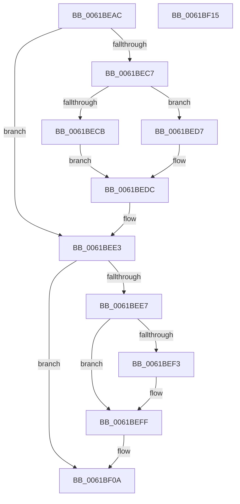

# DifReleaseSpinLockFromDpcLevelSafe

- RVA: `0x0061BEAC`–`0x0061BF16` (길이 `106` bytes)
- VA: `0x000000014061BEAC`
- 실행 섹션: `.text`
- PDB 이름 있음: `예`; PDB Function 태그: `아니요`
- unwind 정보 RVA: `0x0005CAAC`
- 디코드: `32`개 명령, `106/106` bytes 표시
- 미해석 바이트: `0` (있으면 어셈블리에 `.byte`로 보존)

> 이 문서는 커널 이미지의 기계어와 PDB 기호를 분석해 생성했습니다. 4번과 5번은 함수 원형과 자료형을 바이너리 사용 방식에서 추정한 C 해석이며 원본 소스 복구 결과는 아닙니다.

## 1. Dependencies

- 직접 호출 지점: **3**; 고유 호출 대상: **3**
- 직접 호출자로 확인된 함수: **3**
- RIP 상대 이미지 참조: **2**

### Outgoing calls
- `0x0061BED0` → [ExReleaseSpinLockExclusiveFromDpcLevel](../24/ExReleaseSpinLockExclusiveFromDpcLevel_function_002497E0.md) (function, `0x002497E0`)
- `0x0061BED7` → [ExReleaseSpinLockSharedFromDpcLevel](../24/ExReleaseSpinLockSharedFromDpcLevel_function_0024A590.md) (function, `0x0024A590`)
- `0x0061BEFA` → [KiLowerIrqlProcessIrqlFlags](../4F/KiLowerIrqlProcessIrqlFlags_function_004F5698.md) (function, `0x004F5698`)

### Direct callers
- [DifObjTrkInsertItem](DifObjTrkInsertItem_function_00619D00.md) at `0x00619E3B`
- [DifObjTrkQeuryInvokeDeleteRange](DifObjTrkQeuryInvokeDeleteRange_function_00619EA0.md) at `0x0061A19F`
- [DifObjTrkRemoveItem](DifObjTrkRemoveItem_function_0061A1D0.md) at `0x0061A323`

### Static image references
- `0x0061BEB9` → RVA `0x00F03EB8` (`.data`; read)
- `0x0061BEE7` → RVA `0x00FC6D20` (`ALMOSTRO`; read)

## 2. Other-region calls and transfers

- 다른 실행 섹션으로 향하는 call: **0**
- 별도 외부 분기/꼬리 이동을 확인하지 못했습니다.

## 3. Assembly (complete function range)

```asm
0061BEAC  48 89 5C 24 08                  mov qword ptr [rsp + 8], rbx
0061BEB1  57                              push rdi
0061BEB2  48 83 EC 20                     sub rsp, 0x20
0061BEB6  48 8B D9                        mov rbx, rcx
0061BEB9  48 8B 0D F8 7F 8E 00            mov rcx, qword ptr [rip + 0x8e7ff8]
0061BEC0  8A 43 01                        mov al, byte ptr [rbx + 1]
0061BEC3  A8 02                           test al, 2
0061BEC5  74 1C                           je 0x14061bee3
0061BEC7  A8 04                           test al, 4
0061BEC9  74 0C                           je 0x14061bed7
0061BECB  48 83 61 08 00                  and qword ptr [rcx + 8], 0
0061BED0  E8 0B D9 C2 FF                  call 0x1402497e0
0061BED5  EB 05                           jmp 0x14061bedc
0061BED7  E8 B4 E6 C2 FF                  call 0x14024a590
0061BEDC  80 63 01 FD                     and byte ptr [rbx + 1], 0xfd
0061BEE0  8A 43 01                        mov al, byte ptr [rbx + 1]
0061BEE3  A8 01                           test al, 1
0061BEE5  74 23                           je 0x14061bf0a
0061BEE7  83 3D 32 AE 9A 00 00            cmp dword ptr [rip + 0x9aae32], 0
0061BEEE  0F B6 3B                        movzx edi, byte ptr [rbx]
0061BEF1  74 0C                           je 0x14061beff
0061BEF3  44 0F 20 C1                     mov rcx, cr8
0061BEF7  40 8A D7                        mov dl, dil
0061BEFA  E8 99 97 ED FF                  call 0x1404f5698
0061BEFF  44 0F 22 C7                     mov cr8, rdi
0061BF03  80 63 01 FE                     and byte ptr [rbx + 1], 0xfe
0061BF07  C6 03 00                        mov byte ptr [rbx], 0
0061BF0A  48 8B 5C 24 30                  mov rbx, qword ptr [rsp + 0x30]
0061BF0F  48 83 C4 20                     add rsp, 0x20
0061BF13  5F                              pop rdi
0061BF14  C3                              ret
0061BF15  CC                              int3
```

## 4. C-style interpretation (structured pseudocode)

```c
__int64 __fastcall DifReleaseSpinLockFromDpcLevelSafe(__int64 a1)
{
    __int64 result;
    __int64 v_rsp;
    unsigned __int64 v_stack_p8;

    v_stack_p8 = v_rbx;
    v_rsp = (v_rsp) - (32);
    if ((((unsigned __int8)(*(unsigned __int8 *)(a1 + 1))) & (2)) == 0) goto loc_0061BEE3;
    if ((((unsigned __int8)(*(unsigned __int8 *)(a1 + 1))) & (4)) == 0) goto loc_0061BED7;
    result = ExReleaseSpinLockExclusiveFromDpcLevel(*(unsigned __int64 *)(v_rip + 9338872), a2, a3, a4);
    goto loc_0061BEDC;
loc_0061BED7:
    result = ExReleaseSpinLockSharedFromDpcLevel(*(unsigned __int64 *)(v_rip + 9338872), a2, a3, a4);
loc_0061BEDC:
loc_0061BEE3:
    if ((((unsigned __int8)(*(unsigned __int8 *)(a1 + 1))) & (1)) == 0) goto loc_0061BF0A;
    result = *(unsigned __int8 *)(a1 + 1);
    if ((*(unsigned int *)(v_rip + 10137138)) != 0) {
        a1 = v_cr8;
        a2 = (unsigned __int8)(*(unsigned __int8 *)(a1));
        result = KiLowerIrqlProcessIrqlFlags(a1, a2, a3, a4);
    }
    *(unsigned __int8 *)(a1) = 0;
loc_0061BF0A:
    v_rsp = (v_rsp) + (32);
    return result;
}
```

## 5. (Beta) C Style

```c
int64_t DifReleaseSpinLockFromDpcLevelSafe(void *Arg1)
{
    uint8_t *arg1 = (uint8_t *)Arg1;

    int64_t result;
    int64_t local_rsp;
    uint64_t v_stack_p8;

    v_stack_p8 = local_rbx;
    local_rsp = (local_rsp) - (32);
    if ((((uint8_t)(*(uint8_t *)(arg1 + 0x1))) & (2)) == 0) goto loc_0061BEE3;
    if ((((uint8_t)(*(uint8_t *)(arg1 + 0x1))) & (4)) == 0) goto loc_0061BED7;
    result = ExReleaseSpinLockExclusiveFromDpcLevel(*(uint64_t *)(v_rip + 0x8E7FF8), a2, a3, a4);
    goto loc_0061BEDC;
loc_0061BED7:
    result = ExReleaseSpinLockSharedFromDpcLevel(*(uint64_t *)(v_rip + 0x8E7FF8), a2, a3, a4);
loc_0061BEDC:
loc_0061BEE3:
    if ((((uint8_t)(*(uint8_t *)(arg1 + 0x1))) & (1)) == 0) goto loc_0061BF0A;
    result = *(uint8_t *)(arg1 + 0x1);
    if ((*(uint32_t *)(v_rip + 0x9AAE32)) != 0) {
        Arg1 = v_cr8;
        a2 = (uint8_t)(*(uint8_t *)(arg1));
        result = KiLowerIrqlProcessIrqlFlags(Arg1, a2, a3, a4);
    }
    *(uint8_t *)(arg1) = 0;
loc_0061BF0A:
    local_rsp = (local_rsp) + (32);
    return result;
}
```

### 관측된 메모리 오프셋

구조체 형식이 확인되지 않은 접근은 인자 기준의 오프셋으로만 기록했습니다.

| 기준 인자 | 오프셋 표현 | 폭 (bit) | 접근 |
|---|---:|---:|---|
| `Arg1` | `+ 0x0` | `8` | `R` |
| `Arg1` | `+ 0x0` | `8` | `W` |
| `Arg1` | `+ 0x1` | `8` | `R` |
| `Arg1` | `+ 0x1` | `8` | `R/W` |

## 6. Execution-region graph

[열기: 2D/3D 그래프와 함수 탐색 컨트롤 패널](../../../control-panel.html?section=text&rva=0x0061BEAC&view=graph)

- 2D 그래프는 위에서 아래로 흐르고, 3D 그래프는 빈 공간을 드래그해 회전합니다. Shift+드래그는 이동, 휠은 확대·축소, 함수 노드 선택은 대상 보고서 이동입니다.

### Static fallback


