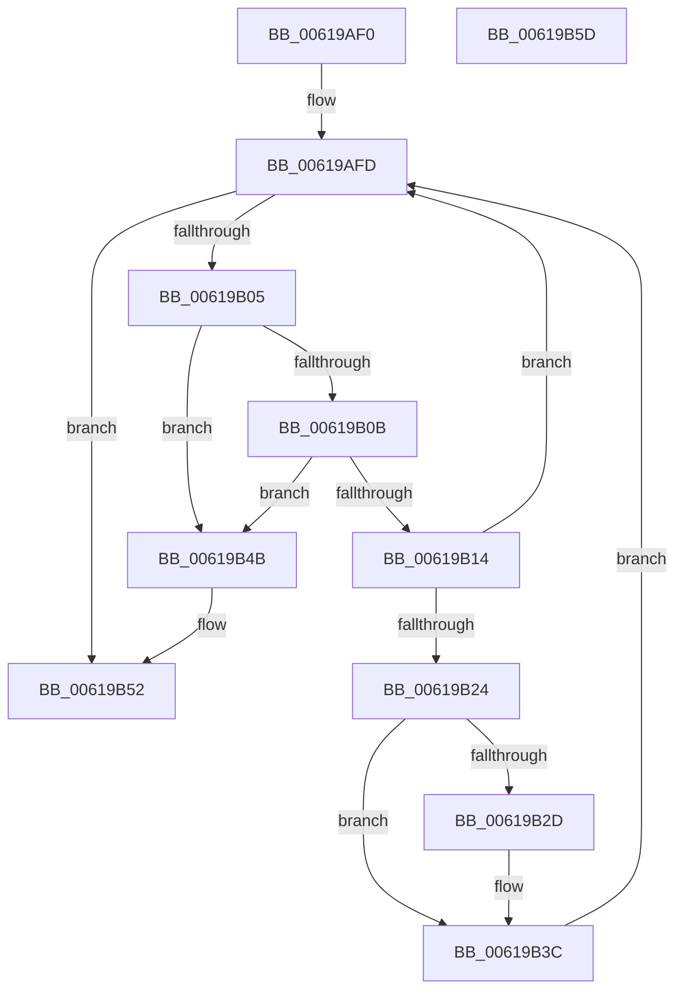

# DifRemovePerDriverDataForPlugins

- RVA: `0x00619AF0`–`0x00619B5E` (길이 `110` bytes)
- VA: `0x0000000140619AF0`
- 실행 섹션: `.text`
- PDB 이름 있음: `예`; PDB Function 태그: `아니요`
- unwind 정보 RVA: `0x0005CAAC`
- 디코드: `34`개 명령, `110/110` bytes 표시
- 미해석 바이트: `0` (있으면 어셈블리에 `.byte`로 보존)

> 이 문서는 커널 이미지의 기계어와 PDB 기호를 분석해 생성했습니다. 4번과 5번은 함수 원형과 자료형을 바이너리 사용 방식에서 추정한 C 해석이며 원본 소스 복구 결과는 아닙니다.

## 1. Dependencies

- 직접 호출 지점: **2**; 고유 호출 대상: **1**
- 직접 호출자로 확인된 함수: **2**
- RIP 상대 이미지 참조: **0**

### Outgoing calls
- `0x00619B32` → [ExFreePoolWithTag](../../poolcode/B8/ExFreePoolWithTag_function_00B82870.md) (function, `0x00B82870`)
- `0x00619B44` → [ExFreePoolWithTag](../../poolcode/B8/ExFreePoolWithTag_function_00B82870.md) (function, `0x00B82870`)

### Direct callers
- [VfTargetDriversRemove](../3E/VfTargetDriversRemove_function_003EEF9C.md) at `0x003EF158`
- [VfTargetDriversDisableVerifier](../../pagevrfy/B9/VfTargetDriversDisableVerifier_function_00B9B2CC.md) at `0x00B9B322`

### Static image references
- 디코드된 RIP-relative 메모리 참조가 없습니다.

## 2. Other-region calls and transfers

- 다른 실행 섹션으로 향하는 call: **2**
  - `0x00619B32` → [ExFreePoolWithTag](../../poolcode/B8/ExFreePoolWithTag_function_00B82870.md) (`.text` → `POOLCODE`)
  - `0x00619B44` → [ExFreePoolWithTag](../../poolcode/B8/ExFreePoolWithTag_function_00B82870.md) (`.text` → `POOLCODE`)
- 별도 외부 분기/꼬리 이동을 확인하지 못했습니다.

## 3. Assembly (complete function range)

```asm
00619AF0  48 89 5C 24 08                  mov qword ptr [rsp + 8], rbx
00619AF5  57                              push rdi
00619AF6  48 83 EC 20                     sub rsp, 0x20
00619AFA  48 8B D9                        mov rbx, rcx
00619AFD  48 8B 03                        mov rax, qword ptr [rbx]
00619B00  48 3B C3                        cmp rax, rbx
00619B03  74 4D                           je 0x140619b52
00619B05  48 39 58 08                     cmp qword ptr [rax + 8], rbx
00619B09  75 40                           jne 0x140619b4b
00619B0B  48 8B 08                        mov rcx, qword ptr [rax]
00619B0E  48 39 41 08                     cmp qword ptr [rcx + 8], rax
00619B12  75 37                           jne 0x140619b4b
00619B14  48 8D 78 F0                     lea rdi, [rax - 0x10]
00619B18  48 89 0B                        mov qword ptr [rbx], rcx
00619B1B  48 89 59 08                     mov qword ptr [rcx + 8], rbx
00619B1F  48 85 FF                        test rdi, rdi
00619B22  74 D9                           je 0x140619afd
00619B24  48 8B 4F 08                     mov rcx, qword ptr [rdi + 8]
00619B28  48 85 C9                        test rcx, rcx
00619B2B  74 0F                           je 0x140619b3c
00619B2D  BA 44 69 66 4E                  mov edx, 0x4e666944
00619B32  E8 39 8D 56 00                  call 0x140b82870
00619B37  48 83 67 08 00                  and qword ptr [rdi + 8], 0
00619B3C  BA 44 69 66 4E                  mov edx, 0x4e666944
00619B41  48 8B CF                        mov rcx, rdi
00619B44  E8 27 8D 56 00                  call 0x140b82870
00619B49  EB B2                           jmp 0x140619afd
00619B4B  B9 03 00 00 00                  mov ecx, 3
00619B50  CD 29                           int 0x29
00619B52  48 8B 5C 24 30                  mov rbx, qword ptr [rsp + 0x30]
00619B57  48 83 C4 20                     add rsp, 0x20
00619B5B  5F                              pop rdi
00619B5C  C3                              ret
00619B5D  CC                              int3
```

## 4. C-style interpretation (structured pseudocode)

```c
__int64 __fastcall DifRemovePerDriverDataForPlugins(__int64 a1)
{
    __int64 result;
    __int64 v_rsp;
    unsigned __int64 v_stack_p8;

    v_stack_p8 = v_rbx;
    v_rsp = (v_rsp) - (32);
loc_00619AFD:
    if ((*(unsigned __int64 *)(a1)) == a1) goto loc_00619B52;
    if ((*(unsigned __int64 *)(*(unsigned __int64 *)(a1) + 8)) != a1) goto loc_00619B4B;
    if ((*(unsigned __int64 *)(*(unsigned __int64 *)(*(unsigned __int64 *)(a1)) + 8)) != (*(unsigned __int64 *)(a1))) goto loc_00619B4B;
    *(unsigned __int64 *)(a1) = *(unsigned __int64 *)(*(unsigned __int64 *)(a1));
    *(unsigned __int64 *)(*(unsigned __int64 *)(*(unsigned __int64 *)(a1)) + 8) = a1;
    if (*(unsigned __int64 *)(a1) - 16 == 0) goto loc_00619AFD;
    result = *(unsigned __int64 *)(a1);
    if (*(unsigned __int64 *)(*(unsigned __int64 *)(a1) - 16 + 8) != 0) {
        a2 = 0x4E666944ULL;
        result = ExFreePoolWithTag(*(unsigned __int64 *)(*(unsigned __int64 *)(a1) - 16 + 8), a2, a3, a4);
    }
    result = ExFreePoolWithTag(*(unsigned __int64 *)(a1) - 16, (unsigned int)(0x4E666944ULL), a3, a4);
    goto loc_00619AFD;
loc_00619B4B:
loc_00619B52:
    v_rsp = (v_rsp) + (32);
    return result;
}
```

## 5. (Beta) C Style

```c
int64_t DifRemovePerDriverDataForPlugins(void *Arg1)
{
    uint8_t *arg1 = (uint8_t *)Arg1;

    int64_t result;
    int64_t local_rsp;
    uint64_t v_stack_p8;

    v_stack_p8 = local_rbx;
    local_rsp = (local_rsp) - (32);
loc_00619AFD:
    if ((*(uint64_t *)(arg1)) == Arg1) goto loc_00619B52;
    if ((*(uint64_t *)(*(uint64_t *)(arg1) + 0x8)) != Arg1) goto loc_00619B4B;
    if ((*(uint64_t *)(*(uint64_t *)(*(uint64_t *)(arg1)) + 0x8)) != (*(uint64_t *)(arg1))) goto loc_00619B4B;
    *(uint64_t *)(arg1) = *(uint64_t *)(*(uint64_t *)(arg1));
    *(void **)(*(uint64_t *)(*(uint64_t *)(arg1)) + 0x8) = Arg1;
    if (*(uint64_t *)(arg1) - 16 == 0) goto loc_00619AFD;
    result = *(uint64_t *)(arg1);
    if (*(uint64_t *)(*(uint64_t *)(arg1) - 0x10 + 0x8) != 0) {
        a2 = 0x4E666944ULL;
        result = ExFreePoolWithTag(*(uint64_t *)(*(uint64_t *)(arg1) - 0x10 + 0x8), a2, a3, a4);
    }
    result = ExFreePoolWithTag(*(uint64_t *)(arg1) - 16, (uint32_t)(0x4E666944ULL), a3, a4);
    goto loc_00619AFD;
loc_00619B4B:
loc_00619B52:
    local_rsp = (local_rsp) + (32);
    return result;
}
```

### 관측된 메모리 오프셋

구조체 형식이 확인되지 않은 접근은 인자 기준의 오프셋으로만 기록했습니다.

| 기준 인자 | 오프셋 표현 | 폭 (bit) | 접근 |
|---|---:|---:|---|
| `Arg1` | `+ 0x0` | `64` | `R` |
| `Arg1` | `+ 0x0` | `64` | `W` |

## 6. Execution-region graph

[열기: 2D/3D 그래프와 함수 탐색 컨트롤 패널](../../../control-panel.html?section=text&rva=0x00619AF0&view=graph)

- 2D 그래프는 위에서 아래로 흐르고, 3D 그래프는 빈 공간을 드래그해 회전합니다. Shift+드래그는 이동, 휠은 확대·축소, 함수 노드 선택은 대상 보고서 이동입니다.

### Static fallback


