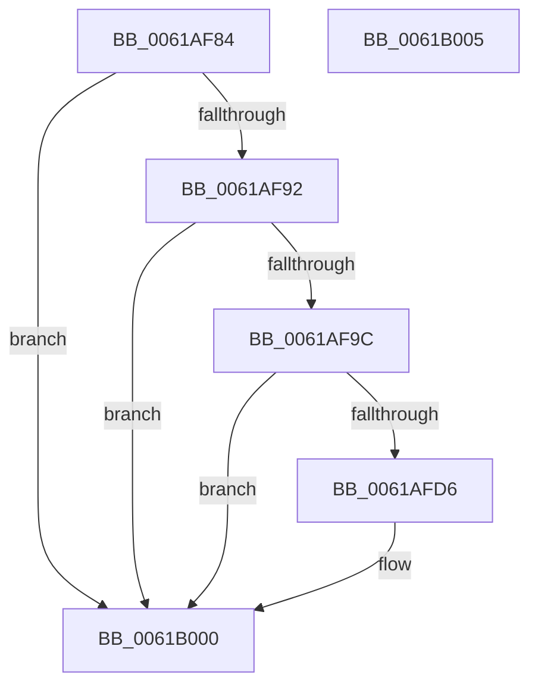

# DifUpdatePluginState

- RVA: `0x0061AF84`–`0x0061B006` (길이 `130` bytes)
- VA: `0x000000014061AF84`
- 실행 섹션: `.text`
- PDB 이름 있음: `예`; PDB Function 태그: `아니요`
- unwind 정보 RVA: `0x0005C788`
- 디코드: `29`개 명령, `130/130` bytes 표시
- 미해석 바이트: `0` (있으면 어셈블리에 `.byte`로 보존)

> 이 문서는 커널 이미지의 기계어와 PDB 기호를 분석해 생성했습니다. 4번과 5번은 함수 원형과 자료형을 바이너리 사용 방식에서 추정한 C 해석이며 원본 소스 복구 결과는 아닙니다.

## 1. Dependencies

- 직접 호출 지점: **2**; 고유 호출 대상: **2**
- 직접 호출자로 확인된 함수: **1**
- RIP 상대 이미지 참조: **10**

### Outgoing calls
- `0x0061AFAB` → [memset](../6C/memset_function_006C6C40.md) (function, `0x006C6C40`)
- `0x0061AFCD` → [MmManagePartitionMemoryInformation](../../page/90/MmManagePartitionMemoryInformation_function_0090343C.md) (function, `0x0090343C`)

### Direct callers
- [VfNotifyVerifierOfEvent](../../pagevrfy/B9/VfNotifyVerifierOfEvent_function_00B92E90.md) at `0x00B92F0A`

### Static image references
- `0x0061AF88` → RVA `0x00E681A4` (`.data`; read)
- `0x0061AF92` → RVA `0x00F03DE0` (`.data`; read)
- `0x0061AF9E` → RVA `0x00E28B00` (`.data`; read)
- `0x0061AFC1` → RVA `0x00E28B04` (`.data`; write)
- `0x0061AFC7` → RVA `0x00E28B08` (`.data`; write)
- `0x0061AFD6` → RVA `0x00E28B38` (`.data`; read)
- `0x0061AFDF` → RVA `0x00F03E74` (`.data`; read)
- `0x0061AFE5` → RVA `0x00F03DC8` (`.data`; write)
- `0x0061AFEF` → RVA `0x00F03E70` (`.data`; read)
- `0x0061AFF9` → RVA `0x00F03DC0` (`.data`; write)

## 2. Other-region calls and transfers

- 다른 실행 섹션으로 향하는 call: **1**
  - `0x0061AFCD` → [MmManagePartitionMemoryInformation](../../page/90/MmManagePartitionMemoryInformation_function_0090343C.md) (`.text` → `PAGE`)
- 별도 외부 분기/꼬리 이동을 확인하지 못했습니다.

## 3. Assembly (complete function range)

```asm
0061AF84  48 83 EC 28                     sub rsp, 0x28
0061AF88  8B 05 16 D2 84 00               mov eax, dword ptr [rip + 0x84d216]
0061AF8E  84 C0                           test al, al
0061AF90  79 6E                           jns 0x14061b000
0061AF92  48 83 3D 46 8E 8E 00 00         cmp qword ptr [rip + 0x8e8e46], 0
0061AF9A  74 64                           je 0x14061b000
0061AF9C  33 D2                           xor edx, edx
0061AF9E  48 8D 0D 5B DB 80 00            lea rcx, [rip + 0x80db5b]
0061AFA5  41 B8 F0 00 00 00               mov r8d, 0xf0
0061AFAB  E8 90 BC 0A 00                  call 0x1406c6c40
0061AFB0  83 C8 FF                        or eax, 0xffffffff
0061AFB3  48 8D 15 46 DB 80 00            lea rdx, [rip + 0x80db46]
0061AFBA  48 8D 0D 1F 8E 8E 00            lea rcx, [rip + 0x8e8e1f]
0061AFC1  89 05 3D DB 80 00               mov dword ptr [rip + 0x80db3d], eax
0061AFC7  89 05 3B DB 80 00               mov dword ptr [rip + 0x80db3b], eax
0061AFCD  E8 6A 84 2E 00                  call 0x14090343c
0061AFD2  85 C0                           test eax, eax
0061AFD4  78 2A                           js 0x14061b000
0061AFD6  48 8B 05 5B DB 80 00            mov rax, qword ptr [rip + 0x80db5b]
0061AFDD  33 D2                           xor edx, edx
0061AFDF  8B 0D 8F 8E 8E 00               mov ecx, dword ptr [rip + 0x8e8e8f]
0061AFE5  48 89 05 DC 8D 8E 00            mov qword ptr [rip + 0x8e8ddc], rax
0061AFEC  48 F7 F1                        div rcx
0061AFEF  8B 0D 7B 8E 8E 00               mov ecx, dword ptr [rip + 0x8e8e7b]
0061AFF5  48 0F AF C1                     imul rax, rcx
0061AFF9  48 89 05 C0 8D 8E 00            mov qword ptr [rip + 0x8e8dc0], rax
0061B000  48 83 C4 28                     add rsp, 0x28
0061B004  C3                              ret
0061B005  CC                              int3
```

## 4. C-style interpretation (structured pseudocode)

```c
__int64 __fastcall DifUpdatePluginState(__int64 a1, int a2)
{
    __int64 result;
    __int64 v_rsp;

    v_rsp = (v_rsp) - (40);
    if (!sign_flag) goto loc_0061B000;
    if ((*(unsigned __int64 *)(v_rip + 9342534)) == 0) goto loc_0061B000;
    a2 = 0;
    result = memset(v_rip + 8444763, a2, 240, a4);
    result = (unsigned int)((result) | (0xFFFFFFFFULL));
    *(unsigned int *)(v_rip + 8444733) = (unsigned int)(result);
    *(unsigned int *)(v_rip + 8444731) = (unsigned int)(result);
    result = MmManagePartitionMemoryInformation(v_rip + 9342495, v_rip + 8444742, 240, a4);
    if (!(sign_flag)) {
        result = *(unsigned __int64 *)(v_rip + 8444763);
        a2 = 0;
        a1 = *(unsigned int *)(v_rip + 9342607);
        *(unsigned __int64 *)(v_rip + 9342428) = result;
        a1 = *(unsigned int *)(v_rip + 9342587);
        result = (result) * (a1);
        *(unsigned __int64 *)(v_rip + 9342400) = result;
    }
    v_rsp = (v_rsp) + (40);
    return result;
}
```

## 5. (Beta) C Style

```c
int64_t DifUpdatePluginState(int64_t Arg1, int32_t Arg2)
{
    int64_t result;
    int64_t local_rsp;

    local_rsp = (local_rsp) - (40);
    if (!sign_flag) goto loc_0061B000;
    if ((*(uint64_t *)(v_rip + 0x8E8E46)) == 0) goto loc_0061B000;
    Arg2 = 0;
    result = memset(v_rip + 8444763, Arg2, 240, a4);
    result = (uint32_t)((result) | (0xFFFFFFFFULL));
    *(uint32_t *)(v_rip + 0x80DB3D) = (uint32_t)(result);
    *(uint32_t *)(v_rip + 0x80DB3B) = (uint32_t)(result);
    result = MmManagePartitionMemoryInformation(v_rip + 9342495, v_rip + 8444742, 240, a4);
    if (!(sign_flag)) {
        result = *(uint64_t *)(v_rip + 0x80DB5B);
        Arg2 = 0;
        Arg1 = *(uint32_t *)(v_rip + 0x8E8E8F);
        *(uint64_t *)(v_rip + 0x8E8DDC) = result;
        Arg1 = *(uint32_t *)(v_rip + 0x8E8E7B);
        result = (result) * (Arg1);
        *(uint64_t *)(v_rip + 0x8E8DC0) = result;
    }
    local_rsp = (local_rsp) + (40);
    return result;
}
```

## 6. Execution-region graph

[열기: 2D/3D 그래프와 함수 탐색 컨트롤 패널](../../../control-panel.html?section=text&rva=0x0061AF84&view=graph)

- 2D 그래프는 위에서 아래로 흐르고, 3D 그래프는 빈 공간을 드래그해 회전합니다. Shift+드래그는 이동, 휠은 확대·축소, 함수 노드 선택은 대상 보고서 이동입니다.

### Static fallback


