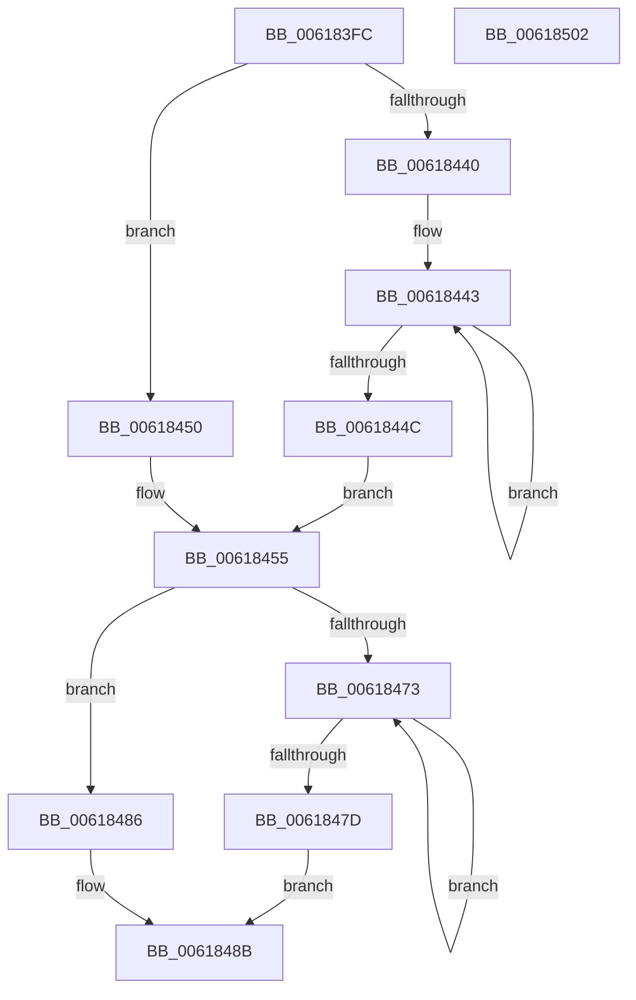

# McTemplateK0dszud_EtwWriteTransfer

- RVA: `0x006183FC`–`0x00618503` (길이 `263` bytes)
- VA: `0x00000001406183FC`
- 실행 섹션: `.text`
- PDB 이름 있음: `예`; PDB Function 태그: `아니요`
- unwind 정보 RVA: `0x000C6160`
- 디코드: `63`개 명령, `263/263` bytes 표시
- 미해석 바이트: `0` (있으면 어셈블리에 `.byte`로 보존)

> 이 문서는 커널 이미지의 기계어와 PDB 기호를 분석해 생성했습니다. 4번과 5번은 함수 원형과 자료형을 바이너리 사용 방식에서 추정한 C 해석이며 원본 소스 복구 결과는 아닙니다.

## 1. Dependencies

- 직접 호출 지점: **2**; 고유 호출 대상: **2**
- 직접 호출자로 확인된 함수: **2**
- RIP 상대 이미지 참조: **6**

### Outgoing calls
- `0x006184E8` → [McGenEventWrite_EtwWriteTransfer](../42/McGenEventWrite_EtwWriteTransfer_function_00424FC8.md) (function, `0x00424FC8`)
- `0x006184F4` → [_security_check_cookie](../6A/_security_check_cookie_function_006AC640.md) (function, `0x006AC640`)

### Direct callers
- [CarEtwWriteBugCheckEvent](CarEtwWriteBugCheckEvent_function_00617B68.md) at `0x00617CA8`
- [CarEtwWriteLiveDumpEvent](CarEtwWriteLiveDumpEvent_function_00617CD8.md) at `0x00617E1E`

### Static image references
- `0x0061840E` → RVA `0x00E0A740` (`.data`; read)
- `0x0061845B` → RVA `0x006CFB90` (` ?? ::FNODOBFM::`string'`; read)
- `0x00618491` → RVA `0x006CB080` (` ?? ::FNODOBFM::`string'`; read)
- `0x006184B4` → RVA `0x000382D0` (`.rdata`; read)
- `0x006184CB` → RVA `0x000382E0` (`.rdata`; read)
- `0x006184DC` → RVA `0x00E09080` (`.data`; read)

## 2. Other-region calls and transfers

- 다른 실행 섹션으로 향하는 call: **0**
- 별도 외부 분기/꼬리 이동을 확인하지 못했습니다.

## 3. Assembly (complete function range)

```asm
006183FC  44 89 4C 24 20                  mov dword ptr [rsp + 0x20], r9d
00618401  55                              push rbp
00618402  48 8D 6C 24 C9                  lea rbp, [rsp - 0x37]
00618407  48 81 EC A0 00 00 00            sub rsp, 0xa0
0061840E  48 8B 05 2B 23 7F 00            mov rax, qword ptr [rip + 0x7f232b]
00618415  48 33 C4                        xor rax, rsp
00618418  48 89 45 27                     mov qword ptr [rbp + 0x27], rax
0061841C  48 8B 4D 67                     mov rcx, qword ptr [rbp + 0x67]
00618420  48 8D 45 5F                     lea rax, [rbp + 0x5f]
00618424  4C 8B 45 6F                     mov r8, qword ptr [rbp + 0x6f]
00618428  45 33 D2                        xor r10d, r10d
0061842B  48 83 CA FF                     or rdx, 0xffffffffffffffff
0061842F  48 89 45 D7                     mov qword ptr [rbp - 0x29], rax
00618433  48 C7 45 DF 04 00 00 00         mov qword ptr [rbp - 0x21], 4
0061843B  48 85 C9                        test rcx, rcx
0061843E  74 10                           je 0x140618450
00618440  48 8B C2                        mov rax, rdx
00618443  48 FF C0                        inc rax
00618446  44 38 14 01                     cmp byte ptr [rcx + rax], r10b
0061844A  75 F7                           jne 0x140618443
0061844C  FF C0                           inc eax
0061844E  EB 05                           jmp 0x140618455
00618450  B8 05 00 00 00                  mov eax, 5
00618455  48 85 C9                        test rcx, rcx
00618458  89 45 EF                        mov dword ptr [rbp - 0x11], eax
0061845B  4C 8D 0D 2E 77 0B 00            lea r9, [rip + 0xb772e]
00618462  44 89 55 F3                     mov dword ptr [rbp - 0xd], r10d
00618466  49 0F 44 C9                     cmove rcx, r9
0061846A  48 89 4D E7                     mov qword ptr [rbp - 0x19], rcx
0061846E  4D 85 C0                        test r8, r8
00618471  74 13                           je 0x140618486
00618473  48 FF C2                        inc rdx
00618476  66 45 39 14 50                  cmp word ptr [r8 + rdx*2], r10w
0061847B  75 F6                           jne 0x140618473
0061847D  8D 14 55 02 00 00 00            lea edx, [rdx*2 + 2]
00618484  EB 05                           jmp 0x14061848b
00618486  BA 0A 00 00 00                  mov edx, 0xa
0061848B  4D 85 C0                        test r8, r8
0061848E  89 55 FF                        mov dword ptr [rbp - 1], edx
00618491  48 8D 05 E8 2B 0B 00            lea rax, [rip + 0xb2be8]
00618498  44 89 55 03                     mov dword ptr [rbp + 3], r10d
0061849C  4C 0F 44 C0                     cmove r8, rax
006184A0  48 C7 45 0F 01 00 00 00         mov qword ptr [rbp + 0xf], 1
006184A8  48 8D 45 77                     lea rax, [rbp + 0x77]
006184AC  4C 89 45 F7                     mov qword ptr [rbp - 9], r8
006184B0  48 89 45 07                     mov qword ptr [rbp + 7], rax
006184B4  4C 8D 05 15 FE A1 FF            lea r8, [rip - 0x5e01eb]
006184BB  48 8D 45 7F                     lea rax, [rbp + 0x7f]
006184BF  48 C7 45 1F 04 00 00 00         mov qword ptr [rbp + 0x1f], 4
006184C7  48 89 45 17                     mov qword ptr [rbp + 0x17], rax
006184CB  48 8D 15 0E FE A1 FF            lea rdx, [rip - 0x5e01f2]
006184D2  48 8D 45 C7                     lea rax, [rbp - 0x39]
006184D6  41 B9 06 00 00 00               mov r9d, 6
006184DC  48 8D 0D 9D 0B 7F 00            lea rcx, [rip + 0x7f0b9d]
006184E3  48 89 44 24 20                  mov qword ptr [rsp + 0x20], rax
006184E8  E8 DB CA E0 FF                  call 0x140424fc8
006184ED  48 8B 4D 27                     mov rcx, qword ptr [rbp + 0x27]
006184F1  48 33 CC                        xor rcx, rsp
006184F4  E8 47 41 09 00                  call 0x1406ac640
006184F9  48 81 C4 A0 00 00 00            add rsp, 0xa0
00618500  5D                              pop rbp
00618501  C3                              ret
00618502  CC                              int3
```

## 4. C-style interpretation (structured pseudocode)

```c
__int64 __fastcall McTemplateK0dszud_EtwWriteTransfer(__int64 a1, __int64 a2, __int64 a3, int a4, __int64 a5, __int64 a6, __int64 a7, __int64 a8)
{
    __int64 result;
    __int64 v_r10;
    __int64 v_rsp;
    unsigned __int64 v_stack_m18;
    unsigned __int64 v_stack_m20;
    unsigned __int64 v_stack_m28;
    unsigned __int64 v_stack_m30;
    unsigned __int64 v_stack_m38;
    unsigned int v_stack_m3C;
    unsigned __int64 v_stack_m3F;
    unsigned int v_stack_m40;
    unsigned __int64 v_stack_m48;
    unsigned int v_stack_m4C;
    unsigned int v_stack_m50;
    unsigned __int64 v_stack_m58;
    unsigned __int64 v_stack_m60;
    unsigned __int64 v_stack_m68;
    unsigned __int64 v_stack_m78;
    unsigned __int64 v_stack_m88;
    unsigned int v_stack_p20;

    v_stack_p20 = a4;
    v_rsp = (v_rsp) - (160);
    result = (*(unsigned __int64 *)(v_rip + 8332075)) ^ (v_rsp);
    v_stack_m18 = result;
    v_r10 = 0;
    a2 = (a2) | (-1);
    v_stack_m68 = v_stack_p20;
    v_stack_m60 = 4;
    if (a5 == 0) goto loc_00618450;
loc_00618443:
    result = (a2) + 1;
    if ((*(unsigned __int8 *)(a5 + result * 1)) != 0) goto loc_00618443;
    result = (unsigned int)((result) + 1);
    goto loc_00618455;
loc_00618450:
loc_00618455:
    v_stack_m50 = 5;
    v_stack_m4C = 0;
    if (a5 == 0) { a5 = v_rip + 751406; }
    v_stack_m58 = a5;
    if (a6 == 0) goto loc_00618486;
loc_00618473:
    a2 = (a2) + 1;
    if ((*(unsigned __int16 *)(a6 + a2 * 2)) != 0) goto loc_00618473;
    goto loc_0061848B;
loc_00618486:
loc_0061848B:
    v_stack_m40 = 10;
    v_stack_m3C = 0;
    if (a6 == 0) { a6 = v_rip + 732136; }
    v_stack_m30 = 1;
    v_stack_m48 = a6;
    v_stack_m38 = a7;
    v_stack_m20 = 4;
    v_stack_m28 = a8;
    v_stack_m88 = v_stack_m78;
    result = McGenEventWrite_EtwWriteTransfer(v_rip + 8326045, v_rip - 6160882, v_rip - 6160875, 6);
    a1 = (v_stack_m18) ^ (v_rsp);
    result = _security_check_cookie(a1, v_rip - 6160882, v_rip - 6160875, 6);
    v_rsp = (v_rsp) + (160);
    return result;
}
```

## 5. (Beta) C Style

```c
int64_t McTemplateK0dszud_EtwWriteTransfer(int64_t Arg1, int64_t Arg2, int64_t Arg3, int32_t Arg4, int64_t Arg5, int64_t Arg6, int64_t Arg7, int64_t Arg8)
{
    int64_t result;
    int64_t local_r10;
    int64_t local_rsp;
    uint64_t v_stack_m18;
    uint64_t v_stack_m20;
    uint64_t v_stack_m28;
    uint64_t v_stack_m30;
    uint64_t v_stack_m38;
    uint32_t v_stack_m3C;
    uint64_t v_stack_m3F;
    uint32_t v_stack_m40;
    uint64_t v_stack_m48;
    uint32_t v_stack_m4C;
    uint32_t v_stack_m50;
    uint64_t v_stack_m58;
    uint64_t v_stack_m60;
    uint64_t v_stack_m68;
    uint64_t v_stack_m78;
    uint64_t v_stack_m88;
    uint32_t v_stack_p20;

    v_stack_p20 = Arg4;
    local_rsp = (local_rsp) - (160);
    result = (*(uint64_t *)(v_rip + 0x7F232B)) ^ (local_rsp);
    v_stack_m18 = result;
    local_r10 = 0;
    Arg2 = (Arg2) | (-1);
    v_stack_m68 = v_stack_p20;
    v_stack_m60 = 4;
    if (Arg5 == 0) goto loc_00618450;
loc_00618443:
    result = (Arg2) + 1;
    if ((*(uint8_t *)(Arg5 + result * 1)) != 0) goto loc_00618443;
    result = (uint32_t)((result) + 1);
    goto loc_00618455;
loc_00618450:
loc_00618455:
    v_stack_m50 = 5;
    v_stack_m4C = 0;
    if (Arg5 == 0) { Arg5 = v_rip + 751406; }
    v_stack_m58 = Arg5;
    if (Arg6 == 0) goto loc_00618486;
loc_00618473:
    Arg2 = (Arg2) + 1;
    if ((*(uint16_t *)(Arg6 + Arg2 * 2)) != 0) goto loc_00618473;
    goto loc_0061848B;
loc_00618486:
loc_0061848B:
    v_stack_m40 = 10;
    v_stack_m3C = 0;
    if (Arg6 == 0) { Arg6 = v_rip + 732136; }
    v_stack_m30 = 1;
    v_stack_m48 = Arg6;
    v_stack_m38 = Arg7;
    v_stack_m20 = 4;
    v_stack_m28 = Arg8;
    v_stack_m88 = v_stack_m78;
    result = McGenEventWrite_EtwWriteTransfer(v_rip + 8326045, v_rip - 6160882, v_rip - 6160875, 6);
    Arg1 = (v_stack_m18) ^ (local_rsp);
    result = _security_check_cookie(Arg1, v_rip - 6160882, v_rip - 6160875, 6);
    local_rsp = (local_rsp) + (160);
    return result;
}
```

## 6. Execution-region graph

[열기: 2D/3D 그래프와 함수 탐색 컨트롤 패널](../../../control-panel.html?section=text&rva=0x006183FC&view=graph)

- 2D 그래프는 위에서 아래로 흐르고, 3D 그래프는 빈 공간을 드래그해 회전합니다. Shift+드래그는 이동, 휠은 확대·축소, 함수 노드 선택은 대상 보고서 이동입니다.

### Static fallback


