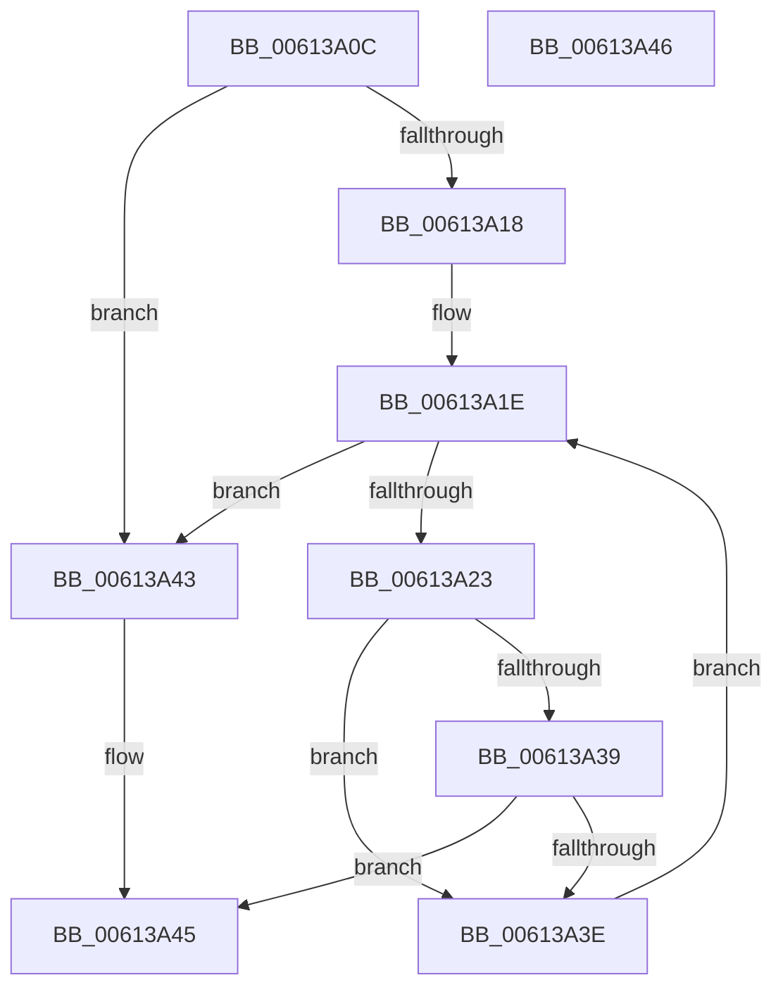

# MdlInvariantFindMdlInfo

- RVA: `0x00613A0C`–`0x00613A47` (길이 `59` bytes)
- VA: `0x0000000140613A0C`
- 실행 섹션: `.text`
- PDB 이름 있음: `예`; PDB Function 태그: `아니요`
- unwind 정보 RVA: `0x000DB714`
- 디코드: `21`개 명령, `59/59` bytes 표시
- 미해석 바이트: `0` (있으면 어셈블리에 `.byte`로 보존)

> 이 문서는 커널 이미지의 기계어와 PDB 기호를 분석해 생성했습니다. 4번과 5번은 함수 원형과 자료형을 바이너리 사용 방식에서 추정한 C 해석이며 원본 소스 복구 결과는 아닙니다.

## 1. Dependencies

- 직접 호출 지점: **0**; 고유 호출 대상: **0**
- 직접 호출자로 확인된 함수: **3**
- RIP 상대 이미지 참조: **0**

### Outgoing calls
- 직접 디코드된 call 명령이 없습니다.

### Direct callers
- [MdlInvariantPostDriverCompletion](MdlInvariantPostDriverCompletion_function_00613A50.md) at `0x00613A7D`
- [MdlInvariantPostDriverCompletion](MdlInvariantPostDriverCompletion_function_00613A50.md) at `0x00613AA2`
- [MdlInvariantPostProcessing1](MdlInvariantPostProcessing1_function_00613AE0.md) at `0x00613B70`
- [MdlInvariantPreProcessing1](MdlInvariantPreProcessing1_function_00613CEC.md) at `0x00613DA3`

### Static image references
- 디코드된 RIP-relative 메모리 참조가 없습니다.

## 2. Other-region calls and transfers

- 다른 실행 섹션으로 향하는 call: **0**
- 별도 외부 분기/꼬리 이동을 확인하지 못했습니다.

## 3. Assembly (complete function range)

```asm
00613A0C  4C 8B 89 E0 00 00 00            mov r9, qword ptr [rcx + 0xe0]
00613A13  4D 85 C9                        test r9, r9
00613A16  74 2B                           je 0x140613a43
00613A18  45 8B 11                        mov r10d, dword ptr [r9]
00613A1B  45 33 C0                        xor r8d, r8d
00613A1E  45 3B C2                        cmp r8d, r10d
00613A21  73 20                           jae 0x140613a43
00613A23  49 8B 41 08                     mov rax, qword ptr [r9 + 8]
00613A27  41 8B C8                        mov ecx, r8d
00613A2A  48 C1 E1 05                     shl rcx, 5
00613A2E  48 03 C1                        add rax, rcx
00613A31  48 8B 08                        mov rcx, qword ptr [rax]
00613A34  48 85 C9                        test rcx, rcx
00613A37  74 05                           je 0x140613a3e
00613A39  48 3B CA                        cmp rcx, rdx
00613A3C  74 07                           je 0x140613a45
00613A3E  41 FF C0                        inc r8d
00613A41  EB DB                           jmp 0x140613a1e
00613A43  33 C0                           xor eax, eax
00613A45  C3                              ret
00613A46  CC                              int3
```

## 4. C-style interpretation (structured pseudocode)

```c
__int64 __fastcall MdlInvariantFindMdlInfo(__int64 a1, __int64 a2, int a3)
{
    __int64 result;

    if (*(unsigned __int64 *)(a1 + 224) == 0) goto loc_00613A43;
    a3 = 0;
loc_00613A1E:
    if (0 >= ((unsigned int)((unsigned int)(*(unsigned int *)(*(unsigned __int64 *)(a1 + 224)))))) goto loc_00613A43;
    a1 = (0) << (5);
    result = (*(unsigned __int64 *)(*(unsigned __int64 *)(a1 + 224) + 8)) + (a1);
    if (*(unsigned __int64 *)(result) == 0) goto loc_00613A3E;
    if ((*(unsigned __int64 *)(result)) == a2) goto loc_00613A45;
loc_00613A3E:
    a3 = (unsigned int)((a3) + 1);
    goto loc_00613A1E;
loc_00613A43:
    result = 0;
loc_00613A45:
    return result;
}
```

## 5. (Beta) C Style

```c
int64_t MdlInvariantFindMdlInfo(void *Arg1, int64_t Arg2, int32_t Arg3)
{
    uint8_t *arg1 = (uint8_t *)Arg1;

    int64_t result;

    if (*(uint64_t *)(arg1 + 0xE0) == 0) goto loc_00613A43;
    Arg3 = 0;
loc_00613A1E:
    if (0 >= ((uint32_t)((uint32_t)(*(uint32_t *)(*(uint64_t *)(arg1 + 0xE0)))))) goto loc_00613A43;
    Arg1 = (0) << (5);
    result = (*(uint64_t *)(*(uint64_t *)(arg1 + 0xE0) + 0x8)) + (Arg1);
    if (*(uint64_t *)(result) == 0) goto loc_00613A3E;
    if ((*(uint64_t *)(result)) == Arg2) goto loc_00613A45;
loc_00613A3E:
    Arg3 = (uint32_t)((Arg3) + 1);
    goto loc_00613A1E;
loc_00613A43:
    result = 0;
loc_00613A45:
    return result;
}
```

### 관측된 메모리 오프셋

구조체 형식이 확인되지 않은 접근은 인자 기준의 오프셋으로만 기록했습니다.

| 기준 인자 | 오프셋 표현 | 폭 (bit) | 접근 |
|---|---:|---:|---|
| `Arg1` | `+ 0xE0` | `64` | `R` |

## 6. Execution-region graph

[열기: 2D/3D 그래프와 함수 탐색 컨트롤 패널](../../../control-panel.html?section=text&rva=0x00613A0C&view=graph)

- 2D 그래프는 위에서 아래로 흐르고, 3D 그래프는 빈 공간을 드래그해 회전합니다. Shift+드래그는 이동, 휠은 확대·축소, 함수 노드 선택은 대상 보고서 이동입니다.

### Static fallback


