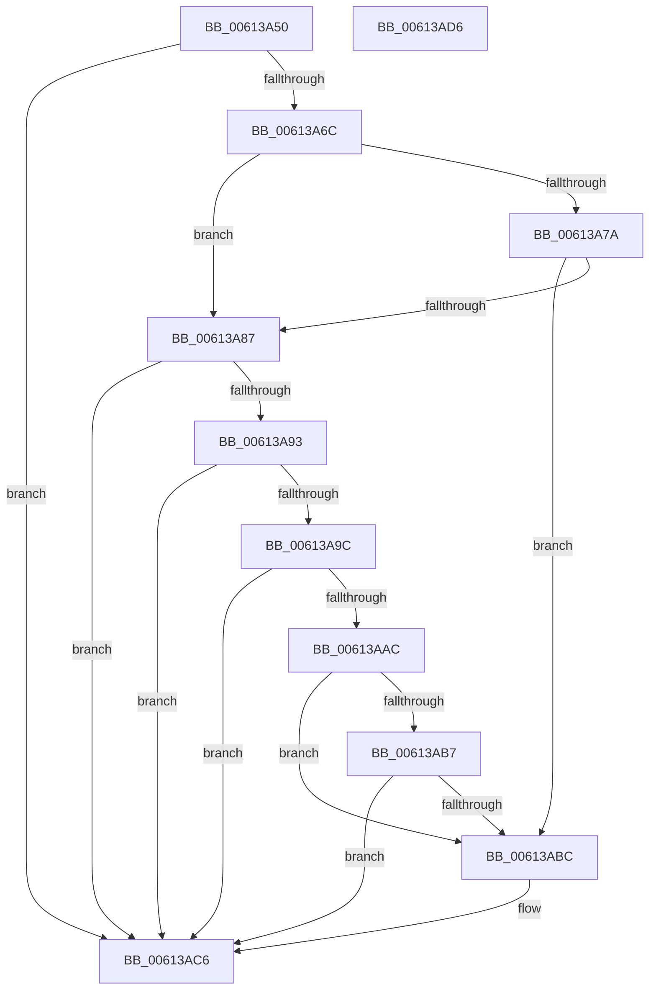

# MdlInvariantPostDriverCompletion

- RVA: `0x00613A50`–`0x00613AD7` (길이 `135` bytes)
- VA: `0x0000000140613A50`
- 실행 섹션: `.text`
- PDB 이름 있음: `예`; PDB Function 태그: `아니요`
- unwind 정보 RVA: `0x00060BC4`
- 디코드: `43`개 명령, `135/135` bytes 표시
- 미해석 바이트: `0` (있으면 어셈블리에 `.byte`로 보존)

> 이 문서는 커널 이미지의 기계어와 PDB 기호를 분석해 생성했습니다. 4번과 5번은 함수 원형과 자료형을 바이너리 사용 방식에서 추정한 C 해석이며 원본 소스 복구 결과는 아닙니다.

## 1. Dependencies

- 직접 호출 지점: **2**; 고유 호출 대상: **1**
- 직접 호출자로 확인된 함수: **1**
- RIP 상대 이미지 참조: **0**

### Outgoing calls
- `0x00613A7D` → [MdlInvariantFindMdlInfo](MdlInvariantFindMdlInfo_function_00613A0C.md) (function, `0x00613A0C`)
- `0x00613AA2` → [MdlInvariantFindMdlInfo](MdlInvariantFindMdlInfo_function_00613A0C.md) (function, `0x00613A0C`)

### Direct callers
- [sub_00BBBD62](../../pagevrfy/BB/Unknown_function_00BBBD62.md) at `0x00BBBDAD`

### Static image references
- 디코드된 RIP-relative 메모리 참조가 없습니다.

## 2. Other-region calls and transfers

- 다른 실행 섹션으로 향하는 call: **0**
- 별도 외부 분기/꼬리 이동을 확인하지 못했습니다.

## 3. Assembly (complete function range)

```asm
00613A50  48 89 5C 24 08                  mov qword ptr [rsp + 8], rbx
00613A55  48 89 74 24 10                  mov qword ptr [rsp + 0x10], rsi
00613A5A  57                              push rdi
00613A5B  48 83 EC 20                     sub rsp, 0x20
00613A5F  48 8B 5A 08                     mov rbx, qword ptr [rdx + 8]
00613A63  48 8B F9                        mov rdi, rcx
00613A66  48 83 3B 00                     cmp qword ptr [rbx], 0
00613A6A  75 5A                           jne 0x140613ac6
00613A6C  0F BE 42 42                     movsx eax, byte ptr [rdx + 0x42]
00613A70  0F BE 72 43                     movsx esi, byte ptr [rdx + 0x43]
00613A74  FF C8                           dec eax
00613A76  3B F0                           cmp esi, eax
00613A78  7C 0D                           jl 0x140613a87
00613A7A  48 8B D3                        mov rdx, rbx
00613A7D  E8 8A FF FF FF                  call 0x140613a0c
00613A82  48 85 C0                        test rax, rax
00613A85  75 35                           jne 0x140613abc
00613A87  4C 8B 9F E0 00 00 00            mov r11, qword ptr [rdi + 0xe0]
00613A8E  4D 85 DB                        test r11, r11
00613A91  74 33                           je 0x140613ac6
00613A93  4D 8B 5B 10                     mov r11, qword ptr [r11 + 0x10]
00613A97  4D 85 DB                        test r11, r11
00613A9A  74 2A                           je 0x140613ac6
00613A9C  49 8B D3                        mov rdx, r11
00613A9F  48 8B CF                        mov rcx, rdi
00613AA2  E8 65 FF FF FF                  call 0x140613a0c
00613AA7  48 85 C0                        test rax, rax
00613AAA  74 1A                           je 0x140613ac6
00613AAC  0F BE 50 1C                     movsx edx, byte ptr [rax + 0x1c]
00613AB0  8D 4E 01                        lea ecx, [rsi + 1]
00613AB3  3B D1                           cmp edx, ecx
00613AB5  74 05                           je 0x140613abc
00613AB7  4C 3B DB                        cmp r11, rbx
00613ABA  74 0A                           je 0x140613ac6
00613ABC  0F 57 C0                        xorps xmm0, xmm0
00613ABF  0F 11 00                        movups xmmword ptr [rax], xmm0
00613AC2  0F 11 40 10                     movups xmmword ptr [rax + 0x10], xmm0
00613AC6  48 8B 5C 24 30                  mov rbx, qword ptr [rsp + 0x30]
00613ACB  48 8B 74 24 38                  mov rsi, qword ptr [rsp + 0x38]
00613AD0  48 83 C4 20                     add rsp, 0x20
00613AD4  5F                              pop rdi
00613AD5  C3                              ret
00613AD6  CC                              int3
```

## 4. C-style interpretation (structured pseudocode)

```c
__int64 __fastcall MdlInvariantPostDriverCompletion(__int64 a1, __int64 a2)
{
    __int64 result;
    __int64 v_rsp;
    unsigned __int64 v_stack_p10;
    unsigned __int64 v_stack_p8;

    v_stack_p8 = v_rbx;
    v_stack_p10 = v_rsi;
    v_rsp = (v_rsp) - (32);
    if ((*(unsigned __int64 *)(*(unsigned __int64 *)(a2 + 8))) != 0) goto loc_00613AC6;
    result = (unsigned int)(((__int8)(*(unsigned __int8 *)(a2 + 66))) - 1);
    if (((unsigned int)((__int8)(*(unsigned __int8 *)(a2 + 67)))) < ((unsigned int)(result))) goto loc_00613A87;
    result = MdlInvariantFindMdlInfo(a1, *(unsigned __int64 *)(a2 + 8), a3, a4);
    if (result != 0) goto loc_00613ABC;
loc_00613A87:
    if (*(unsigned __int64 *)(a1 + 224) == 0) goto loc_00613AC6;
    if (*(unsigned __int64 *)(*(unsigned __int64 *)(a1 + 224) + 16) == 0) goto loc_00613AC6;
    result = MdlInvariantFindMdlInfo(a1, *(unsigned __int64 *)(*(unsigned __int64 *)(a1 + 224) + 16), a3, a4);
    if (result == 0) goto loc_00613AC6;
    if (((unsigned int)((__int8)(*(unsigned __int8 *)(result + 28)))) == ((unsigned int)((__int8)(*(unsigned __int8 *)(a2 + 67)) + 1))) goto loc_00613ABC;
    if ((*(unsigned __int64 *)(*(unsigned __int64 *)(a1 + 224) + 16)) != (*(unsigned __int64 *)(a2 + 8))) {
        *(unsigned __int64 *)(result) = v_xmm0;
        *(unsigned __int64 *)(result + 16) = v_xmm0;
    }
    v_rsp = (v_rsp) + (32);
    return result;
}
```

## 5. (Beta) C Style

```c
int64_t MdlInvariantPostDriverCompletion(void *Arg1, void *Arg2)
{
    uint8_t *arg1 = (uint8_t *)Arg1;
    uint8_t *arg2 = (uint8_t *)Arg2;

    int64_t result;
    int64_t local_rsp;
    uint64_t v_stack_p10;
    uint64_t v_stack_p8;

    v_stack_p8 = local_rbx;
    v_stack_p10 = local_rsi;
    local_rsp = (local_rsp) - (32);
    if ((*(uint64_t *)(*(uint64_t *)(arg2 + 0x8))) != 0) goto loc_00613AC6;
    result = (uint32_t)(((int8_t)(*(uint8_t *)(arg2 + 0x42))) - 1);
    if (((uint32_t)((int8_t)(*(uint8_t *)(arg2 + 0x43)))) < ((uint32_t)(result))) goto loc_00613A87;
    result = MdlInvariantFindMdlInfo(Arg1, *(uint64_t *)(arg2 + 0x8), a3, a4);
    if (result != 0) goto loc_00613ABC;
loc_00613A87:
    if (*(uint64_t *)(arg1 + 0xE0) == 0) goto loc_00613AC6;
    if (*(uint64_t *)(*(uint64_t *)(arg1 + 0xE0) + 0x10) == 0) goto loc_00613AC6;
    result = MdlInvariantFindMdlInfo(Arg1, *(uint64_t *)(*(uint64_t *)(arg1 + 0xE0) + 0x10), a3, a4);
    if (result == 0) goto loc_00613AC6;
    if (((uint32_t)((int8_t)(*(uint8_t *)(result + 0x1C)))) == ((uint32_t)((int8_t)(*(uint8_t *)(arg2 + 0x43)) + 1))) goto loc_00613ABC;
    if ((*(uint64_t *)(*(uint64_t *)(arg1 + 0xE0) + 0x10)) != (*(uint64_t *)(arg2 + 0x8))) {
        *(uint64_t *)(result) = v_xmm0;
        *(uint64_t *)(result + 0x10) = v_xmm0;
    }
    local_rsp = (local_rsp) + (32);
    return result;
}
```

### 관측된 메모리 오프셋

구조체 형식이 확인되지 않은 접근은 인자 기준의 오프셋으로만 기록했습니다.

| 기준 인자 | 오프셋 표현 | 폭 (bit) | 접근 |
|---|---:|---:|---|
| `Arg1` | `+ 0xE0` | `64` | `R` |
| `Arg2` | `+ 0x8` | `64` | `R` |
| `Arg2` | `+ 0x42` | `8` | `R` |
| `Arg2` | `+ 0x43` | `8` | `R` |

## 6. Execution-region graph

[열기: 2D/3D 그래프와 함수 탐색 컨트롤 패널](../../../control-panel.html?section=text&rva=0x00613A50&view=graph)

- 2D 그래프는 위에서 아래로 흐르고, 3D 그래프는 빈 공간을 드래그해 회전합니다. Shift+드래그는 이동, 휠은 확대·축소, 함수 노드 선택은 대상 보고서 이동입니다.

### Static fallback


