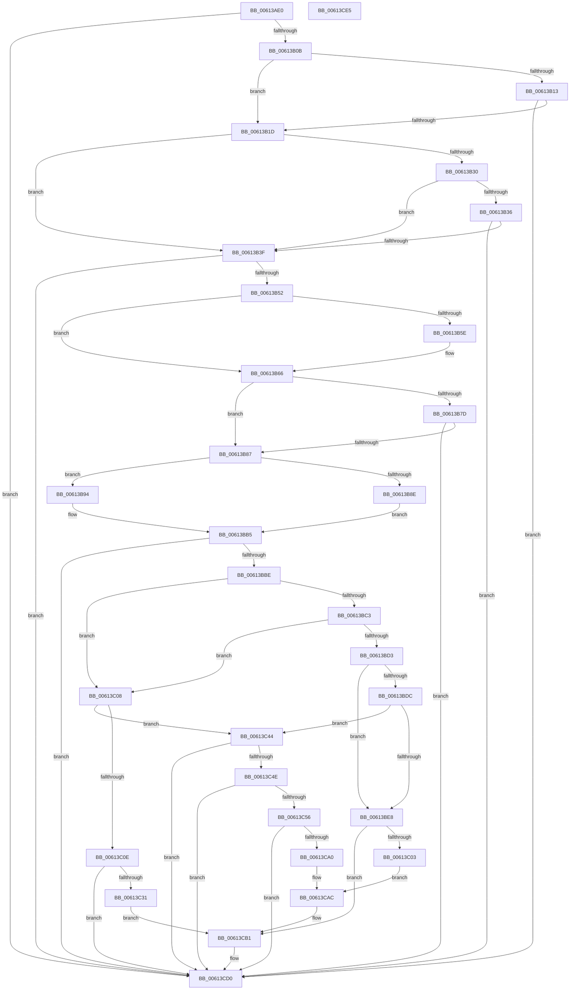

# MdlInvariantPostProcessing1

- RVA: `0x00613AE0`–`0x00613CE6` (길이 `518` bytes)
- VA: `0x0000000140613AE0`
- 실행 섹션: `.text`
- PDB 이름 있음: `예`; PDB Function 태그: `아니요`
- unwind 정보 RVA: `0x0007D3C0`
- 디코드: `134`개 명령, `518/518` bytes 표시
- 미해석 바이트: `0` (있으면 어셈블리에 `.byte`로 보존)

> 이 문서는 커널 이미지의 기계어와 PDB 기호를 분석해 생성했습니다. 4번과 5번은 함수 원형과 자료형을 바이너리 사용 방식에서 추정한 C 해석이며 원본 소스 복구 결과는 아닙니다.

## 1. Dependencies

- 직접 호출 지점: **8**; 고유 호출 대상: **6**
- 직접 호출자로 확인된 함수: **1**
- RIP 상대 이미지 참조: **3**

### Outgoing calls
- `0x00613B44` → [MmMdlPageContentsState](../45/MmMdlPageContentsState_function_00452790.md) (function, `0x00452790`)
- `0x00613B70` → [MdlInvariantFindMdlInfo](MdlInvariantFindMdlInfo_function_00613A0C.md) (function, `0x00613A0C`)
- `0x00613BAD` → [MmMapLockedPagesSpecifyCache](../31/MmMapLockedPagesSpecifyCache_function_00318800.md) (function, `0x00318800`)
- `0x00613C22` → [RtlpComputeCrcInternal](../45/RtlpComputeCrcInternal_function_0045A800.md) (function, `0x0045A800`)
- `0x00613C6A` → [RtlpComputeCrcInternal](../45/RtlpComputeCrcInternal_function_0045A800.md) (function, `0x0045A800`)
- `0x00613C7D` → [KeDelayExecutionThread](../20/KeDelayExecutionThread_function_00209550.md) (function, `0x00209550`)
- `0x00613C96` → [RtlpComputeCrcInternal](../45/RtlpComputeCrcInternal_function_0045A800.md) (function, `0x0045A800`)
- `0x00613CCB` → [CarReportRuleViolationFromNt](../../pagevrfy/B9/CarReportRuleViolationFromNt_function_00B9D904.md) (function, `0x00B9D904`)

### Direct callers
- [sub_00BBBE00](../../pagevrfy/BB/Unknown_function_00BBBE00.md) at `0x00BBBE85`

### Static image references
- `0x00613B1D` → RVA `0x00F04A20` (`.data`; read)
- `0x00613C12` → RVA `0x0000B640` (`.rdata`; read)
- `0x00613C6F` → RVA `0x000382A8` (`.rdata`; read)

## 2. Other-region calls and transfers

- 다른 실행 섹션으로 향하는 call: **1**
  - `0x00613CCB` → [CarReportRuleViolationFromNt](../../pagevrfy/B9/CarReportRuleViolationFromNt_function_00B9D904.md) (`.text` → `PAGEVRFY`)
- 별도 외부 분기/꼬리 이동을 확인하지 못했습니다.

## 3. Assembly (complete function range)

```asm
00613AE0  48 89 5C 24 08                  mov qword ptr [rsp + 8], rbx
00613AE5  48 89 6C 24 10                  mov qword ptr [rsp + 0x10], rbp
00613AEA  48 89 74 24 18                  mov qword ptr [rsp + 0x18], rsi
00613AEF  57                              push rdi
00613AF0  48 83 EC 40                     sub rsp, 0x40
00613AF4  48 8B D9                        mov rbx, rcx
00613AF7  49 8B E8                        mov rbp, r8
00613AFA  48 8B 4A 08                     mov rcx, qword ptr [rdx + 8]
00613AFE  48 8B FA                        mov rdi, rdx
00613B01  48 83 39 00                     cmp qword ptr [rcx], 0
00613B05  0F 85 C5 01 00 00               jne 0x140613cd0
00613B0B  44 0F 20 C0                     mov rax, cr8
00613B0F  3C 02                           cmp al, 2
00613B11  73 0A                           jae 0x140613b1d
00613B13  83 79 28 FF                     cmp dword ptr [rcx + 0x28], -1
00613B17  0F 83 B3 01 00 00               jae 0x140613cd0
00613B1D  8B 05 FD 0E 8F 00               mov eax, dword ptr [rip + 0x8f0efd]
00613B23  8A 52 43                        mov dl, byte ptr [rdx + 0x43]
00613B26  44 8A 47 42                     mov r8b, byte ptr [rdi + 0x42]
00613B2A  0F BA E0 0D                     bt eax, 0xd
00613B2E  73 0F                           jae 0x140613b3f
00613B30  0F BA E0 0E                     bt eax, 0xe
00613B34  72 09                           jb 0x140613b3f
00613B36  41 3A D0                        cmp dl, r8b
00613B39  0F 85 91 01 00 00               jne 0x140613cd0
00613B3F  BA 02 00 00 00                  mov edx, 2
00613B44  E8 47 EC E3 FF                  call 0x140452790
00613B49  83 F8 01                        cmp eax, 1
00613B4C  0F 85 7E 01 00 00               jne 0x140613cd0
00613B52  48 8B 8B E0 00 00 00            mov rcx, qword ptr [rbx + 0xe0]
00613B59  48 85 C9                        test rcx, rcx
00613B5C  74 08                           je 0x140613b66
00613B5E  48 8B 47 08                     mov rax, qword ptr [rdi + 8]
00613B62  48 89 41 10                     mov qword ptr [rcx + 0x10], rax
00613B66  4C 8B 5F 08                     mov r11, qword ptr [rdi + 8]
00613B6A  48 8B CB                        mov rcx, rbx
00613B6D  49 8B D3                        mov rdx, r11
00613B70  E8 97 FE FF FF                  call 0x140613a0c
00613B75  48 8B D8                        mov rbx, rax
00613B78  48 85 C0                        test rax, rax
00613B7B  75 0A                           jne 0x140613b87
00613B7D  80 7D 00 04                     cmp byte ptr [rbp], 4
00613B81  0F 84 49 01 00 00               je 0x140613cd0
00613B87  41 F6 43 0A 05                  test byte ptr [r11 + 0xa], 5
00613B8C  74 06                           je 0x140613b94
00613B8E  49 8B 73 18                     mov rsi, qword ptr [r11 + 0x18]
00613B92  EB 21                           jmp 0x140613bb5
00613B94  45 33 C9                        xor r9d, r9d
00613B97  C7 44 24 28 20 00 00 40         mov dword ptr [rsp + 0x28], 0x40000020
00613B9F  83 64 24 20 00                  and dword ptr [rsp + 0x20], 0
00613BA4  33 D2                           xor edx, edx
00613BA6  49 8B CB                        mov rcx, r11
00613BA9  45 8D 41 01                     lea r8d, [r9 + 1]
00613BAD  E8 4E 4C D0 FF                  call 0x140318800
00613BB2  48 8B F0                        mov rsi, rax
00613BB5  48 85 F6                        test rsi, rsi
00613BB8  0F 84 12 01 00 00               je 0x140613cd0
00613BBE  48 85 DB                        test rbx, rbx
00613BC1  74 45                           je 0x140613c08
00613BC3  48 8B 4F 08                     mov rcx, qword ptr [rdi + 8]
00613BC7  8B 43 18                        mov eax, dword ptr [rbx + 0x18]
00613BCA  44 8B 41 28                     mov r8d, dword ptr [rcx + 0x28]
00613BCE  41 3B C0                        cmp eax, r8d
00613BD1  74 35                           je 0x140613c08
00613BD3  48 8B 53 10                     mov rdx, qword ptr [rbx + 0x10]
00613BD7  48 3B F2                        cmp rsi, rdx
00613BDA  72 0C                           jb 0x140613be8
00613BDC  4A 8D 0C 06                     lea rcx, [rsi + r8]
00613BE0  48 03 C2                        add rax, rdx
00613BE3  48 3B C8                        cmp rcx, rax
00613BE6  76 5C                           jbe 0x140613c44
00613BE8  80 7D 00 04                     cmp byte ptr [rbp], 4
00613BEC  BA 10 10 00 00                  mov edx, 0x1010
00613BF1  4C 8B 45 28                     mov r8, qword ptr [rbp + 0x28]
00613BF5  49 8B 40 08                     mov rax, qword ptr [r8 + 8]
00613BF9  48 8B 48 18                     mov rcx, qword ptr [rax + 0x18]
00613BFD  0F 84 AE 00 00 00               je 0x140613cb1
00613C03  E9 A4 00 00 00                  jmp 0x140613cac
00613C08  80 7D 00 04                     cmp byte ptr [rbp], 4
00613C0C  75 36                           jne 0x140613c44
00613C0E  48 8B 47 08                     mov rax, qword ptr [rdi + 8]
00613C12  4C 8D 0D 27 7A 9F FF            lea r9, [rip - 0x6085d9]
00613C19  45 33 C0                        xor r8d, r8d
00613C1C  48 8B CE                        mov rcx, rsi
00613C1F  8B 50 28                        mov edx, dword ptr [rax + 0x28]
00613C22  E8 D9 6B E4 FF                  call 0x14045a800
00613C27  48 3B 43 08                     cmp rax, qword ptr [rbx + 8]
00613C2B  0F 84 9F 00 00 00               je 0x140613cd0
00613C31  4C 8B 45 28                     mov r8, qword ptr [rbp + 0x28]
00613C35  BA 10 10 00 00                  mov edx, 0x1010
00613C3A  49 8B 40 08                     mov rax, qword ptr [r8 + 8]
00613C3E  48 8B 48 18                     mov rcx, qword ptr [rax + 0x18]
00613C42  EB 6D                           jmp 0x140613cb1
00613C44  80 7D 00 03                     cmp byte ptr [rbp], 3
00613C48  0F 85 82 00 00 00               jne 0x140613cd0
00613C4E  44 0F 20 C0                     mov rax, cr8
00613C52  3C 02                           cmp al, 2
00613C54  73 7A                           jae 0x140613cd0
00613C56  48 8B 47 08                     mov rax, qword ptr [rdi + 8]
00613C5A  4C 8D 0D DF 79 9F FF            lea r9, [rip - 0x608621]
00613C61  45 33 C0                        xor r8d, r8d
00613C64  48 8B CE                        mov rcx, rsi
00613C67  8B 50 28                        mov edx, dword ptr [rax + 0x28]
00613C6A  E8 91 6B E4 FF                  call 0x14045a800
00613C6F  4C 8D 05 32 46 A2 FF            lea r8, [rip - 0x5db9ce]
00613C76  33 D2                           xor edx, edx
00613C78  33 C9                           xor ecx, ecx
00613C7A  48 8B D8                        mov rbx, rax
00613C7D  E8 CE 58 BF FF                  call 0x140209550
00613C82  48 8B 4F 08                     mov rcx, qword ptr [rdi + 8]
00613C86  4C 8D 0D B3 79 9F FF            lea r9, [rip - 0x60864d]
00613C8D  45 33 C0                        xor r8d, r8d
00613C90  8B 51 28                        mov edx, dword ptr [rcx + 0x28]
00613C93  48 8B CE                        mov rcx, rsi
00613C96  E8 65 6B E4 FF                  call 0x14045a800
00613C9B  48 3B D8                        cmp rbx, rax
00613C9E  74 30                           je 0x140613cd0
00613CA0  4C 8B 45 28                     mov r8, qword ptr [rbp + 0x28]
00613CA4  49 8B 40 08                     mov rax, qword ptr [r8 + 8]
00613CA8  48 8B 48 18                     mov rcx, qword ptr [rax + 0x18]
00613CAC  BA 11 10 00 00                  mov edx, 0x1011
00613CB1  48 89 4C 24 30                  mov qword ptr [rsp + 0x30], rcx
00613CB6  4C 8B CF                        mov r9, rdi
00613CB9  C7 44 24 28 0E 00 00 00         mov dword ptr [rsp + 0x28], 0xe
00613CC1  B9 C4 00 00 00                  mov ecx, 0xc4
00613CC6  48 89 74 24 20                  mov qword ptr [rsp + 0x20], rsi
00613CCB  E8 34 9C 58 00                  call 0x140b9d904
00613CD0  48 8B 5C 24 50                  mov rbx, qword ptr [rsp + 0x50]
00613CD5  48 8B 6C 24 58                  mov rbp, qword ptr [rsp + 0x58]
00613CDA  48 8B 74 24 60                  mov rsi, qword ptr [rsp + 0x60]
00613CDF  48 83 C4 40                     add rsp, 0x40
00613CE3  5F                              pop rdi
00613CE4  C3                              ret
00613CE5  CC                              int3
```

## 4. C-style interpretation (structured pseudocode)

```c
__int64 __fastcall MdlInvariantPostProcessing1(__int64 a1, __int64 a2, __int64 a3, int a4)
{
    __int64 result;
    __int64 v_rsp;
    unsigned __int64 v_stack_m18;
    unsigned int v_stack_m20;
    unsigned int v_stack_m28;
    unsigned __int64 v_stack_p10;
    unsigned __int64 v_stack_p18;
    unsigned __int64 v_stack_p8;

    v_stack_p8 = v_rbx;
    v_stack_p10 = v_rbp;
    v_stack_p18 = v_rsi;
    v_rsp = (v_rsp) - (64);
    if ((*(unsigned __int64 *)(*(unsigned __int64 *)(a2 + 8))) != 0) goto loc_00613CD0;
    if (((unsigned __int8)(v_cr8)) >= 2) goto loc_00613B1D;
    if ((*(unsigned int *)(*(unsigned __int64 *)(a2 + 8) + 40)) >= -1) goto loc_00613CD0;
loc_00613B1D:
    if ((*(unsigned int *)(*(unsigned __int64 *)(a2 + 8) + 40)) >= -1) goto loc_00613B3F;
    if ((*(unsigned int *)(*(unsigned __int64 *)(a2 + 8) + 40)) < -1) goto loc_00613B3F;
    if (((unsigned __int8)(*(unsigned __int8 *)(a2 + 67))) != ((unsigned __int8)(*(unsigned __int8 *)(a2 + 66)))) goto loc_00613CD0;
loc_00613B3F:
    result = MmMdlPageContentsState(*(unsigned __int64 *)(a2 + 8), 2, *(unsigned __int8 *)(a2 + 66), a4);
    if (((unsigned int)(result)) != 1) goto loc_00613CD0;
    if (*(unsigned __int64 *)(a1 + 224) != 0) {
        result = *(unsigned __int64 *)(a2 + 8);
        *(unsigned __int64 *)(*(unsigned __int64 *)(a1 + 224) + 16) = result;
    }
    result = MdlInvariantFindMdlInfo(a1, *(unsigned __int64 *)(a2 + 8), *(unsigned __int8 *)(a2 + 66), a4);
    if (result != 0) goto loc_00613B87;
    if ((*(unsigned __int8 *)(a3)) == 4) goto loc_00613CD0;
loc_00613B87:
    if (((*(unsigned __int8 *)(*(unsigned __int64 *)(a2 + 8) + 10)) & (5)) == 0) goto loc_00613B94;
    goto loc_00613BB5;
loc_00613B94:
    a4 = 0;
    v_stack_m20 = 0x40000020ULL;
    a2 = 0;
    result = MmMapLockedPagesSpecifyCache(*(unsigned __int64 *)(a2 + 8), a2, a4 + 1, a4);
loc_00613BB5:
    if (result == 0) goto loc_00613CD0;
    if (result == 0) goto loc_00613C08;
    if (((unsigned int)((unsigned int)(*(unsigned int *)(result + 24)))) == ((unsigned int)((unsigned int)(*(unsigned int *)(*(unsigned __int64 *)(a2 + 8) + 40))))) goto loc_00613C08;
    if (result < (*(unsigned __int64 *)(result + 16))) goto loc_00613BE8;
    result = ((unsigned int)(*(unsigned int *)(result + 24))) + (*(unsigned __int64 *)(result + 16));
    if ((result + (unsigned int)(*(unsigned int *)(*(unsigned __int64 *)(a2 + 8) + 40)) * 1) <= result) goto loc_00613C44;
loc_00613BE8:
    if ((*(unsigned __int8 *)(a3)) == 4) goto loc_00613CB1;
    goto loc_00613CAC;
loc_00613C08:
    if ((*(unsigned __int8 *)(a3)) != 4) goto loc_00613C44;
    a3 = 0;
    result = RtlpComputeCrcInternal(result, (unsigned int)(*(unsigned int *)(*(unsigned __int64 *)(a2 + 8) + 40)), a3, v_rip - 6325721);
    if (result == (*(unsigned __int64 *)(result + 8))) goto loc_00613CD0;
    goto loc_00613CB1;
loc_00613C44:
    if ((*(unsigned __int8 *)(a3)) != 3) goto loc_00613CD0;
    if (((unsigned __int8)(v_cr8)) >= 2) goto loc_00613CD0;
    a3 = 0;
    result = RtlpComputeCrcInternal(result, (unsigned int)(*(unsigned int *)(*(unsigned __int64 *)(a2 + 8) + 40)), a3, v_rip - 6325793);
    a2 = 0;
    a1 = 0;
    result = KeDelayExecutionThread(a1, a2, v_rip - 6142414, v_rip - 6325793);
    a3 = 0;
    result = RtlpComputeCrcInternal(result, (unsigned int)(*(unsigned int *)(*(unsigned __int64 *)(a2 + 8) + 40)), a3, v_rip - 6325837);
    if (result == result) goto loc_00613CD0;
loc_00613CAC:
loc_00613CB1:
    v_stack_m18 = *(unsigned __int64 *)(*(unsigned __int64 *)(*(unsigned __int64 *)(a3 + 40) + 8) + 24);
    v_stack_m20 = 14;
    v_stack_m28 = result;
    result = CarReportRuleViolationFromNt(196, (unsigned int)(0x1011ULL), *(unsigned __int64 *)(a3 + 40), 0);
loc_00613CD0:
    v_rsp = (v_rsp) + (64);
    return result;
}
```

## 5. (Beta) C Style

```c
int64_t MdlInvariantPostProcessing1(void *Arg1, void *Arg2, void *Arg3, int32_t Arg4)
{
    uint8_t *arg1 = (uint8_t *)Arg1;
    uint8_t *arg2 = (uint8_t *)Arg2;
    uint8_t *arg3 = (uint8_t *)Arg3;

    int64_t result;
    int64_t local_rsp;
    uint64_t v_stack_m18;
    uint32_t v_stack_m20;
    uint32_t v_stack_m28;
    uint64_t v_stack_p10;
    uint64_t v_stack_p18;
    uint64_t v_stack_p8;

    v_stack_p8 = local_rbx;
    v_stack_p10 = local_rbp;
    v_stack_p18 = local_rsi;
    local_rsp = (local_rsp) - (64);
    if ((*(uint64_t *)(*(uint64_t *)(arg2 + 0x8))) != 0) goto loc_00613CD0;
    if (((uint8_t)(v_cr8)) >= 2) goto loc_00613B1D;
    if ((*(uint32_t *)(*(uint64_t *)(arg2 + 0x8) + 0x28)) >= -1) goto loc_00613CD0;
loc_00613B1D:
    if ((*(uint32_t *)(*(uint64_t *)(arg2 + 0x8) + 0x28)) >= -1) goto loc_00613B3F;
    if ((*(uint32_t *)(*(uint64_t *)(arg2 + 0x8) + 0x28)) < -1) goto loc_00613B3F;
    if (((uint8_t)(*(uint8_t *)(arg2 + 0x43))) != ((uint8_t)(*(uint8_t *)(arg2 + 0x42)))) goto loc_00613CD0;
loc_00613B3F:
    result = MmMdlPageContentsState(*(uint64_t *)(arg2 + 0x8), 2, *(uint8_t *)(arg2 + 0x42), Arg4);
    if (((uint32_t)(result)) != 1) goto loc_00613CD0;
    if (*(uint64_t *)(arg1 + 0xE0) != 0) {
        result = *(uint64_t *)(arg2 + 0x8);
        *(uint64_t *)(*(uint64_t *)(arg1 + 0xE0) + 0x10) = result;
    }
    result = MdlInvariantFindMdlInfo(Arg1, *(uint64_t *)(arg2 + 0x8), *(uint8_t *)(arg2 + 0x42), Arg4);
    if (result != 0) goto loc_00613B87;
    if ((*(uint8_t *)(arg3)) == 4) goto loc_00613CD0;
loc_00613B87:
    if (((*(uint8_t *)(*(uint64_t *)(arg2 + 0x8) + 0xA)) & (5)) == 0) goto loc_00613B94;
    goto loc_00613BB5;
loc_00613B94:
    Arg4 = 0;
    v_stack_m20 = 0x40000020ULL;
    Arg2 = 0;
    result = MmMapLockedPagesSpecifyCache(*(uint64_t *)(arg2 + 0x8), Arg2, Arg4 + 1, Arg4);
loc_00613BB5:
    if (result == 0) goto loc_00613CD0;
    if (result == 0) goto loc_00613C08;
    if (((uint32_t)((uint32_t)(*(uint32_t *)(result + 0x18)))) == ((uint32_t)((uint32_t)(*(uint32_t *)(*(uint64_t *)(arg2 + 0x8) + 0x28))))) goto loc_00613C08;
    if (result < (*(uint64_t *)(result + 0x10))) goto loc_00613BE8;
    result = ((uint32_t)(*(uint32_t *)(result + 0x18))) + (*(uint64_t *)(result + 0x10));
    if ((result + (uint32_t)(*(uint32_t *)(*(uint64_t *)(arg2 + 0x8) + 0x28)) * 1) <= result) goto loc_00613C44;
loc_00613BE8:
    if ((*(uint8_t *)(arg3)) == 4) goto loc_00613CB1;
    goto loc_00613CAC;
loc_00613C08:
    if ((*(uint8_t *)(arg3)) != 4) goto loc_00613C44;
    Arg3 = 0;
    result = RtlpComputeCrcInternal(result, (uint32_t)(*(uint32_t *)(*(uint64_t *)(arg2 + 0x8) + 0x28)), Arg3, v_rip - 6325721);
    if (result == (*(uint64_t *)(result + 0x8))) goto loc_00613CD0;
    goto loc_00613CB1;
loc_00613C44:
    if ((*(uint8_t *)(arg3)) != 3) goto loc_00613CD0;
    if (((uint8_t)(v_cr8)) >= 2) goto loc_00613CD0;
    Arg3 = 0;
    result = RtlpComputeCrcInternal(result, (uint32_t)(*(uint32_t *)(*(uint64_t *)(arg2 + 0x8) + 0x28)), Arg3, v_rip - 6325793);
    Arg2 = 0;
    Arg1 = 0;
    result = KeDelayExecutionThread(Arg1, Arg2, v_rip - 6142414, v_rip - 6325793);
    Arg3 = 0;
    result = RtlpComputeCrcInternal(result, (uint32_t)(*(uint32_t *)(*(uint64_t *)(arg2 + 0x8) + 0x28)), Arg3, v_rip - 6325837);
    if (result == result) goto loc_00613CD0;
loc_00613CAC:
loc_00613CB1:
    v_stack_m18 = *(uint64_t *)(*(uint64_t *)(*(uint64_t *)(arg3 + 0x28) + 0x8) + 0x18);
    v_stack_m20 = 14;
    v_stack_m28 = result;
    result = CarReportRuleViolationFromNt(196, (uint32_t)(0x1011ULL), *(uint64_t *)(arg3 + 0x28), 0);
loc_00613CD0:
    local_rsp = (local_rsp) + (64);
    return result;
}
```

### 관측된 메모리 오프셋

구조체 형식이 확인되지 않은 접근은 인자 기준의 오프셋으로만 기록했습니다.

| 기준 인자 | 오프셋 표현 | 폭 (bit) | 접근 |
|---|---:|---:|---|
| `Arg1` | `+ 0xE0` | `64` | `R` |
| `Arg2` | `+ 0x8` | `64` | `R` |
| `Arg2` | `+ 0x42` | `8` | `R` |
| `Arg2` | `+ 0x43` | `8` | `R` |
| `Arg3` | `+ 0x0` | `8` | `R` |
| `Arg3` | `+ 0x28` | `64` | `R` |

## 6. Execution-region graph

[열기: 2D/3D 그래프와 함수 탐색 컨트롤 패널](../../../control-panel.html?section=text&rva=0x00613AE0&view=graph)

- 2D 그래프는 위에서 아래로 흐르고, 3D 그래프는 빈 공간을 드래그해 회전합니다. Shift+드래그는 이동, 휠은 확대·축소, 함수 노드 선택은 대상 보고서 이동입니다.

### Static fallback


