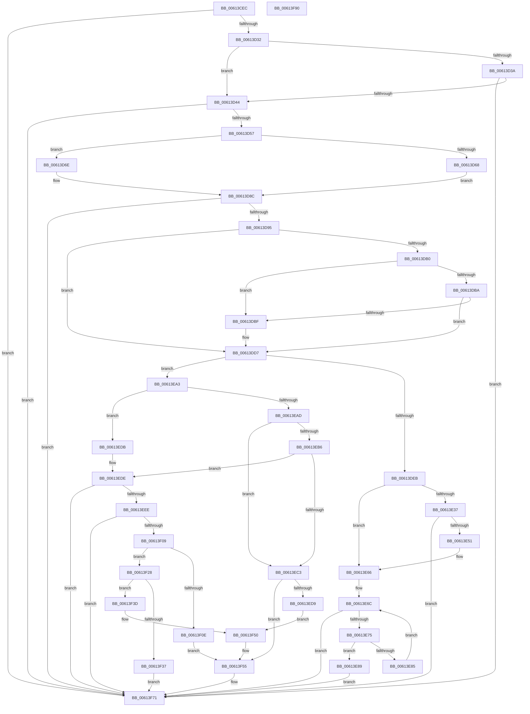

# MdlInvariantPreProcessing1

- RVA: `0x00613CEC`–`0x00613F91` (길이 `677` bytes)
- VA: `0x0000000140613CEC`
- 실행 섹션: `.text`
- PDB 이름 있음: `예`; PDB Function 태그: `아니요`
- unwind 정보 RVA: `0x000BD2A0`
- 디코드: `173`개 명령, `677/677` bytes 표시
- 미해석 바이트: `0` (있으면 어셈블리에 `.byte`로 보존)

> 이 문서는 커널 이미지의 기계어와 PDB 기호를 분석해 생성했습니다. 4번과 5번은 함수 원형과 자료형을 바이너리 사용 방식에서 추정한 C 해석이며 원본 소스 복구 결과는 아닙니다.

## 1. Dependencies

- 직접 호출 지점: **7**; 고유 호출 대상: **6**
- 직접 호출자로 확인된 함수: **1**
- RIP 상대 이미지 참조: **2**

### Outgoing calls
- `0x00613D49` → [MmMdlPageContentsState](../45/MmMdlPageContentsState_function_00452790.md) (function, `0x00452790`)
- `0x00613D84` → [MmMapLockedPagesSpecifyCache](../31/MmMapLockedPagesSpecifyCache_function_00318800.md) (function, `0x00318800`)
- `0x00613DA3` → [MdlInvariantFindMdlInfo](MdlInvariantFindMdlInfo_function_00613A0C.md) (function, `0x00613A0C`)
- `0x00613DFB` → [RtlpComputeCrcInternal](../45/RtlpComputeCrcInternal_function_0045A800.md) (function, `0x0045A800`)
- `0x00613E43` → [ExAllocatePool2](../../poolcode/B8/ExAllocatePool2_function_00B820F0.md) (function, `0x00B820F0`)
- `0x00613EFB` → [RtlpComputeCrcInternal](../45/RtlpComputeCrcInternal_function_0045A800.md) (function, `0x0045A800`)
- `0x00613F6C` → [CarReportRuleViolationFromNt](../../pagevrfy/B9/CarReportRuleViolationFromNt_function_00B9D904.md) (function, `0x00B9D904`)

### Direct callers
- [IovpCallDriver1](../../pagevrfy/B9/IovpCallDriver1_function_00B9CCA4.md) at `0x00B9CEB1`

### Static image references
- `0x00613DEE` → RVA `0x0000B640` (`.rdata`; read)
- `0x00613EDE` → RVA `0x00F04A20` (`.data`; read)

## 2. Other-region calls and transfers

- 다른 실행 섹션으로 향하는 call: **2**
  - `0x00613E43` → [ExAllocatePool2](../../poolcode/B8/ExAllocatePool2_function_00B820F0.md) (`.text` → `POOLCODE`)
  - `0x00613F6C` → [CarReportRuleViolationFromNt](../../pagevrfy/B9/CarReportRuleViolationFromNt_function_00B9D904.md) (`.text` → `PAGEVRFY`)
- 별도 외부 분기/꼬리 이동을 확인하지 못했습니다.

## 3. Assembly (complete function range)

```asm
00613CEC  48 8B C4                        mov rax, rsp
00613CEF  48 89 58 08                     mov qword ptr [rax + 8], rbx
00613CF3  48 89 68 10                     mov qword ptr [rax + 0x10], rbp
00613CF7  48 89 70 18                     mov qword ptr [rax + 0x18], rsi
00613CFB  48 89 78 20                     mov qword ptr [rax + 0x20], rdi
00613CFF  41 54                           push r12
00613D01  41 56                           push r14
00613D03  41 57                           push r15
00613D05  48 83 EC 60                     sub rsp, 0x60
00613D09  4C 8B B9 A8 00 00 00            mov r15, qword ptr [rcx + 0xa8]
00613D10  45 33 E4                        xor r12d, r12d
00613D13  48 8B E9                        mov rbp, rcx
00613D16  66 44 89 60 E5                  mov word ptr [rax - 0x1b], r12w
00613D1B  49 8B F0                        mov rsi, r8
00613D1E  44 88 60 E7                     mov byte ptr [rax - 0x19], r12b
00613D22  4C 8B F2                        mov r14, rdx
00613D25  49 8B 4F 08                     mov rcx, qword ptr [r15 + 8]
00613D29  4C 39 21                        cmp qword ptr [rcx], r12
00613D2C  0F 85 3F 02 00 00               jne 0x140613f71
00613D32  44 0F 20 C0                     mov rax, cr8
00613D36  3C 02                           cmp al, 2
00613D38  73 0A                           jae 0x140613d44
00613D3A  83 79 28 FF                     cmp dword ptr [rcx + 0x28], -1
00613D3E  0F 83 2D 02 00 00               jae 0x140613f71
00613D44  BA 02 00 00 00                  mov edx, 2
00613D49  E8 42 EA E3 FF                  call 0x140452790
00613D4E  83 F8 01                        cmp eax, 1
00613D51  0F 85 1A 02 00 00               jne 0x140613f71
00613D57  48 8B 85 A8 00 00 00            mov rax, qword ptr [rbp + 0xa8]
00613D5E  48 8B 48 08                     mov rcx, qword ptr [rax + 8]
00613D62  F6 41 0A 05                     test byte ptr [rcx + 0xa], 5
00613D66  74 06                           je 0x140613d6e
00613D68  48 8B 79 18                     mov rdi, qword ptr [rcx + 0x18]
00613D6C  EB 1E                           jmp 0x140613d8c
00613D6E  45 33 C9                        xor r9d, r9d
00613D71  C7 44 24 28 20 00 00 40         mov dword ptr [rsp + 0x28], 0x40000020
00613D79  33 D2                           xor edx, edx
00613D7B  44 89 64 24 20                  mov dword ptr [rsp + 0x20], r12d
00613D80  45 8D 41 01                     lea r8d, [r9 + 1]
00613D84  E8 77 4A D0 FF                  call 0x140318800
00613D89  48 8B F8                        mov rdi, rax
00613D8C  48 85 FF                        test rdi, rdi
00613D8F  0F 84 DC 01 00 00               je 0x140613f71
00613D95  4C 8B 9D A8 00 00 00            mov r11, qword ptr [rbp + 0xa8]
00613D9C  49 8B CE                        mov rcx, r14
00613D9F  49 8B 53 08                     mov rdx, qword ptr [r11 + 8]
00613DA3  E8 64 FC FF FF                  call 0x140613a0c
00613DA8  48 8B D8                        mov rbx, rax
00613DAB  48 85 C0                        test rax, rax
00613DAE  74 27                           je 0x140613dd7
00613DB0  41 8A 43 43                     mov al, byte ptr [r11 + 0x43]
00613DB4  41 3A 43 42                     cmp al, byte ptr [r11 + 0x42]
00613DB8  74 05                           je 0x140613dbf
00613DBA  38 43 1C                        cmp byte ptr [rbx + 0x1c], al
00613DBD  75 18                           jne 0x140613dd7
00613DBF  0F 57 C0                        xorps xmm0, xmm0
00613DC2  0F 11 03                        movups xmmword ptr [rbx], xmm0
00613DC5  0F 11 43 10                     movups xmmword ptr [rbx + 0x10], xmm0
00613DC9  49 8B 86 E0 00 00 00            mov rax, qword ptr [r14 + 0xe0]
00613DD0  49 8B DC                        mov rbx, r12
00613DD3  4C 89 60 10                     mov qword ptr [rax + 0x10], r12
00613DD7  4C 8B 8D A8 00 00 00            mov r9, qword ptr [rbp + 0xa8]
00613DDE  49 8B 41 08                     mov rax, qword ptr [r9 + 8]
00613DE2  48 85 DB                        test rbx, rbx
00613DE5  0F 85 B8 00 00 00               jne 0x140613ea3
00613DEB  8B 50 28                        mov edx, dword ptr [rax + 0x28]
00613DEE  4C 8D 0D 4B 78 9F FF            lea r9, [rip - 0x6087b5]
00613DF5  45 33 C0                        xor r8d, r8d
00613DF8  48 8B CF                        mov rcx, rdi
00613DFB  E8 00 6A E4 FF                  call 0x14045a800
00613E00  48 8B 95 A8 00 00 00            mov rdx, qword ptr [rbp + 0xa8]
00613E07  48 8B C8                        mov rcx, rax
00613E0A  48 89 4C 24 48                  mov qword ptr [rsp + 0x48], rcx
00613E0F  48 89 7C 24 50                  mov qword ptr [rsp + 0x50], rdi
00613E14  48 8B 42 08                     mov rax, qword ptr [rdx + 8]
00613E18  48 89 44 24 40                  mov qword ptr [rsp + 0x40], rax
00613E1D  8B 40 28                        mov eax, dword ptr [rax + 0x28]
00613E20  89 44 24 58                     mov dword ptr [rsp + 0x58], eax
00613E24  8A 42 43                        mov al, byte ptr [rdx + 0x43]
00613E27  88 44 24 5C                     mov byte ptr [rsp + 0x5c], al
00613E2B  49 8B 86 E0 00 00 00            mov rax, qword ptr [r14 + 0xe0]
00613E32  48 85 C0                        test rax, rax
00613E35  75 2F                           jne 0x140613e66
00613E37  8D 53 58                        lea edx, [rbx + 0x58]
00613E3A  41 B8 56 6C 64 6D               mov r8d, 0x6d646c56
00613E40  8D 4B 40                        lea ecx, [rbx + 0x40]
00613E43  E8 A8 E2 56 00                  call 0x140b820f0
00613E48  48 85 C0                        test rax, rax
00613E4B  0F 84 20 01 00 00               je 0x140613f71
00613E51  48 8D 48 18                     lea rcx, [rax + 0x18]
00613E55  C7 00 02 00 00 00               mov dword ptr [rax], 2
00613E5B  48 89 48 08                     mov qword ptr [rax + 8], rcx
00613E5F  49 89 86 E0 00 00 00            mov qword ptr [r14 + 0xe0], rax
00613E66  44 8B 08                        mov r9d, dword ptr [rax]
00613E69  41 8B D4                        mov edx, r12d
00613E6C  41 3B D1                        cmp edx, r9d
00613E6F  0F 83 FC 00 00 00               jae 0x140613f71
00613E75  4C 8B 40 08                     mov r8, qword ptr [rax + 8]
00613E79  8B CA                           mov ecx, edx
00613E7B  48 C1 E1 05                     shl rcx, 5
00613E7F  4E 39 24 01                     cmp qword ptr [rcx + r8], r12
00613E83  74 04                           je 0x140613e89
00613E85  FF C2                           inc edx
00613E87  EB E3                           jmp 0x140613e6c
00613E89  0F 10 44 24 40                  movups xmm0, xmmword ptr [rsp + 0x40]
00613E8E  0F 10 4C 24 50                  movups xmm1, xmmword ptr [rsp + 0x50]
00613E93  42 0F 11 04 01                  movups xmmword ptr [rcx + r8], xmm0
00613E98  42 0F 11 4C 01 10               movups xmmword ptr [rcx + r8 + 0x10], xmm1
00613E9E  E9 CE 00 00 00                  jmp 0x140613f71
00613EA3  8B 4B 18                        mov ecx, dword ptr [rbx + 0x18]
00613EA6  8B 40 28                        mov eax, dword ptr [rax + 0x28]
00613EA9  3B C8                           cmp ecx, eax
00613EAB  74 2E                           je 0x140613edb
00613EAD  4C 8B 43 10                     mov r8, qword ptr [rbx + 0x10]
00613EB1  49 3B F8                        cmp rdi, r8
00613EB4  72 0D                           jb 0x140613ec3
00613EB6  8B D0                           mov edx, eax
00613EB8  49 03 C8                        add rcx, r8
00613EBB  48 03 C7                        add rax, rdi
00613EBE  48 3B C1                        cmp rax, rcx
00613EC1  76 1B                           jbe 0x140613ede
00613EC3  80 3E 04                        cmp byte ptr [rsi], 4
00613EC6  BA 10 10 00 00                  mov edx, 0x1010
00613ECB  4C 8B 46 28                     mov r8, qword ptr [rsi + 0x28]
00613ECF  49 8B 40 08                     mov rax, qword ptr [r8 + 8]
00613ED3  48 8B 48 18                     mov rcx, qword ptr [rax + 0x18]
00613ED7  74 7C                           je 0x140613f55
00613ED9  EB 75                           jmp 0x140613f50
00613EDB  48 8B D0                        mov rdx, rax
00613EDE  F7 05 38 0B 8F 00 00 40 00 00   test dword ptr [rip + 0x8f0b38], 0x4000
00613EE8  0F 84 83 00 00 00               je 0x140613f71
00613EEE  4C 8D 0D 4B 77 9F FF            lea r9, [rip - 0x6088b5]
00613EF5  45 33 C0                        xor r8d, r8d
00613EF8  48 8B CF                        mov rcx, rdi
00613EFB  E8 00 69 E4 FF                  call 0x14045a800
00613F00  48 8B D0                        mov rdx, rax
00613F03  48 39 43 08                     cmp qword ptr [rbx + 8], rax
00613F07  74 68                           je 0x140613f71
00613F09  80 3E 04                        cmp byte ptr [rsi], 4
00613F0C  75 1A                           jne 0x140613f28
00613F0E  4C 8B 46 28                     mov r8, qword ptr [rsi + 0x28]
00613F12  BA 10 10 00 00                  mov edx, 0x1010
00613F17  4C 8B 8D A8 00 00 00            mov r9, qword ptr [rbp + 0xa8]
00613F1E  49 8B 40 08                     mov rax, qword ptr [r8 + 8]
00613F22  48 8B 48 18                     mov rcx, qword ptr [rax + 0x18]
00613F26  EB 2D                           jmp 0x140613f55
00613F28  49 8B 8F B8 00 00 00            mov rcx, qword ptr [r15 + 0xb8]
00613F2F  8B 46 08                        mov eax, dword ptr [rsi + 8]
00613F32  39 41 08                        cmp dword ptr [rcx + 8], eax
00613F35  74 06                           je 0x140613f3d
00613F37  48 89 53 08                     mov qword ptr [rbx + 8], rdx
00613F3B  EB 34                           jmp 0x140613f71
00613F3D  4C 8B 46 28                     mov r8, qword ptr [rsi + 0x28]
00613F41  4C 8B 8D A8 00 00 00            mov r9, qword ptr [rbp + 0xa8]
00613F48  49 8B 40 08                     mov rax, qword ptr [r8 + 8]
00613F4C  48 8B 48 18                     mov rcx, qword ptr [rax + 0x18]
00613F50  BA 11 10 00 00                  mov edx, 0x1011
00613F55  48 89 4C 24 30                  mov qword ptr [rsp + 0x30], rcx
00613F5A  B9 C4 00 00 00                  mov ecx, 0xc4
00613F5F  C7 44 24 28 0E 00 00 00         mov dword ptr [rsp + 0x28], 0xe
00613F67  48 89 7C 24 20                  mov qword ptr [rsp + 0x20], rdi
00613F6C  E8 93 99 58 00                  call 0x140b9d904
00613F71  4C 8D 5C 24 60                  lea r11, [rsp + 0x60]
00613F76  49 8B 5B 20                     mov rbx, qword ptr [r11 + 0x20]
00613F7A  49 8B 6B 28                     mov rbp, qword ptr [r11 + 0x28]
00613F7E  49 8B 73 30                     mov rsi, qword ptr [r11 + 0x30]
00613F82  49 8B 7B 38                     mov rdi, qword ptr [r11 + 0x38]
00613F86  49 8B E3                        mov rsp, r11
00613F89  41 5F                           pop r15
00613F8B  41 5E                           pop r14
00613F8D  41 5C                           pop r12
00613F8F  C3                              ret
00613F90  CC                              int3
```

## 4. C-style interpretation (structured pseudocode)

```c
__int64 __fastcall MdlInvariantPreProcessing1(__int64 a1, __int64 a2, __int64 a3, int a4)
{
    __int64 result;
    __int64 v_r12;
    __int64 v_rbx;
    __int64 v_rsp;
    unsigned __int64 v_stack_m18;
    unsigned __int8 v_stack_m1C;
    unsigned int v_stack_m20;
    unsigned __int64 v_stack_m28;
    unsigned __int64 v_stack_m30;
    unsigned __int64 v_stack_m38;
    unsigned __int64 v_stack_m48;
    unsigned int v_stack_m50;
    unsigned int v_stack_m58;

    *(unsigned __int64 *)(v_rsp + 8) = v_rbx;
    *(unsigned __int64 *)(v_rsp + 16) = v_rbp;
    *(unsigned __int64 *)(v_rsp + 24) = v_rsi;
    *(unsigned __int64 *)(v_rsp + 32) = v_rdi;
    v_rsp = (v_rsp) - (96);
    v_r12 = 0;
    *(unsigned __int16 *)(v_rsp - 27) = 0;
    *(unsigned __int8 *)(v_rsp - 25) = 0;
    if ((*(unsigned __int64 *)(*(unsigned __int64 *)(*(unsigned __int64 *)(a1 + 168) + 8))) != 0) goto loc_00613F71;
    if (((unsigned __int8)(v_cr8)) >= 2) goto loc_00613D44;
    if ((*(unsigned int *)(*(unsigned __int64 *)(*(unsigned __int64 *)(a1 + 168) + 8) + 40)) >= -1) goto loc_00613F71;
loc_00613D44:
    result = MmMdlPageContentsState(*(unsigned __int64 *)(*(unsigned __int64 *)(a1 + 168) + 8), 2, a3, a4);
    if (((unsigned int)(result)) != 1) goto loc_00613F71;
    if (((*(unsigned __int8 *)(*(unsigned __int64 *)(*(unsigned __int64 *)(a1 + 168) + 8) + 10)) & (5)) == 0) goto loc_00613D6E;
    goto loc_00613D8C;
loc_00613D6E:
    a4 = 0;
    v_stack_m50 = 0x40000020ULL;
    a2 = 0;
    v_stack_m58 = 0;
    result = MmMapLockedPagesSpecifyCache(*(unsigned __int64 *)(*(unsigned __int64 *)(a1 + 168) + 8), a2, a4 + 1, a4);
loc_00613D8C:
    if (result == 0) goto loc_00613F71;
    result = MdlInvariantFindMdlInfo(0, *(unsigned __int64 *)(*(unsigned __int64 *)(a1 + 168) + 8), a4 + 1, a4);
    if (result == 0) goto loc_00613DD7;
    if (((unsigned __int8)(*(unsigned __int8 *)(*(unsigned __int64 *)(a1 + 168) + 67))) == (*(unsigned __int8 *)(*(unsigned __int64 *)(a1 + 168) + 66))) goto loc_00613DBF;
    result = *(unsigned __int8 *)(*(unsigned __int64 *)(a1 + 168) + 67);
    v_rbx = result;
    if ((*(unsigned __int8 *)(result + 28)) == ((unsigned __int8)(*(unsigned __int8 *)(*(unsigned __int64 *)(a1 + 168) + 67)))) {
        *(unsigned __int64 *)(result) = v_xmm0;
        *(unsigned __int64 *)(result + 16) = v_xmm0;
        result = *(unsigned __int64 *)(a2 + 224);
        v_rbx = 0;
        *(unsigned __int64 *)(result + 16) = 0;
    }
    if (v_rbx != 0) goto loc_00613EA3;
    a3 = 0;
    result = RtlpComputeCrcInternal(result, (unsigned int)(*(unsigned int *)(*(unsigned __int64 *)(*(unsigned __int64 *)(a1 + 168) + 8) + 40)), a3, v_rip - 6326197);
    v_stack_m30 = result;
    v_stack_m28 = result;
    v_stack_m38 = *(unsigned __int64 *)(*(unsigned __int64 *)(a1 + 168) + 8);
    v_stack_m20 = (unsigned int)((unsigned int)(*(unsigned int *)(*(unsigned __int64 *)(*(unsigned __int64 *)(a1 + 168) + 8) + 40)));
    v_stack_m1C = (unsigned __int8)(*(unsigned __int8 *)(*(unsigned __int64 *)(a1 + 168) + 67));
    if (*(unsigned __int64 *)(a2 + 224) != 0) goto loc_00613E66;
    result = ExAllocatePool2(v_rbx + 64, v_rbx + 88, (unsigned int)(0x6D646C56ULL), v_rip - 6326197);
    if (result == 0) goto loc_00613F71;
    *(unsigned int *)(result) = 2;
    *(unsigned __int64 *)(result + 8) = result + 24;
    *(unsigned __int64 *)(a2 + 224) = result;
loc_00613E66:
loc_00613E6C:
    if (0 >= ((unsigned int)((unsigned int)(*(unsigned int *)(result))))) goto loc_00613F71;
    a1 = (0) << (5);
    if ((*(unsigned __int64 *)(a1 + *(unsigned __int64 *)(result + 8) * 1)) == 0) goto loc_00613E89;
    a2 = (unsigned int)((0) + 1);
    goto loc_00613E6C;
loc_00613E89:
    *(unsigned __int64 *)(a1 + *(unsigned __int64 *)(result + 8) * 1) = v_xmm0;
    *(unsigned __int64 *)(a1 + *(unsigned __int64 *)(result + 8) * 1 + 16) = v_xmm1;
    goto loc_00613F71;
loc_00613EA3:
    if (((unsigned int)((unsigned int)(*(unsigned int *)(v_rbx + 24)))) == ((unsigned int)((unsigned int)(*(unsigned int *)(result + 40))))) goto loc_00613EDB;
    if (result < (*(unsigned __int64 *)(v_rbx + 16))) goto loc_00613EC3;
    a1 = ((unsigned int)(*(unsigned int *)(v_rbx + 24))) + (*(unsigned __int64 *)(v_rbx + 16));
    result = ((unsigned int)(*(unsigned int *)(result + 40))) + (result);
    if (result <= a1) goto loc_00613EDE;
loc_00613EC3:
    if ((*(unsigned __int8 *)(a3)) == 4) goto loc_00613F55;
    goto loc_00613F50;
loc_00613EDB:
loc_00613EDE:
    if (((*(unsigned int *)(v_rip + 9374520)) & (0x4000ULL)) == 0) goto loc_00613F71;
    a3 = 0;
    result = RtlpComputeCrcInternal(result, *(unsigned __int64 *)(*(unsigned __int64 *)(a3 + 40) + 8), a3, v_rip - 6326453);
    if ((*(unsigned __int64 *)(v_rbx + 8)) == result) goto loc_00613F71;
    if ((*(unsigned __int8 *)(a3)) != 4) goto loc_00613F28;
    goto loc_00613F55;
loc_00613F28:
    if ((*(unsigned int *)(*(unsigned __int64 *)(*(unsigned __int64 *)(a1 + 168) + 184) + 8)) == ((unsigned int)((unsigned int)(*(unsigned int *)(a3 + 8))))) goto loc_00613F3D;
    *(unsigned __int64 *)(v_rbx + 8) = (unsigned int)(0x1010ULL);
    goto loc_00613F71;
loc_00613F3D:
loc_00613F50:
loc_00613F55:
    v_stack_m48 = *(unsigned __int64 *)(*(unsigned __int64 *)(*(unsigned __int64 *)(a3 + 40) + 8) + 24);
    v_stack_m50 = 14;
    v_stack_m58 = result;
    result = CarReportRuleViolationFromNt(196, (unsigned int)(0x1011ULL), *(unsigned __int64 *)(a3 + 40), *(unsigned __int64 *)(a1 + 168));
loc_00613F71:
    return result;
}
```

## 5. (Beta) C Style

```c
int64_t MdlInvariantPreProcessing1(void *Arg1, void *Arg2, void *Arg3, int32_t Arg4)
{
    uint8_t *arg1 = (uint8_t *)Arg1;
    uint8_t *arg2 = (uint8_t *)Arg2;
    uint8_t *arg3 = (uint8_t *)Arg3;

    int64_t result;
    int64_t local_r12;
    int64_t local_rbx;
    int64_t local_rsp;
    uint64_t v_stack_m18;
    uint8_t v_stack_m1C;
    uint32_t v_stack_m20;
    uint64_t v_stack_m28;
    uint64_t v_stack_m30;
    uint64_t v_stack_m38;
    uint64_t v_stack_m48;
    uint32_t v_stack_m50;
    uint32_t v_stack_m58;

    *(uint64_t *)(local_rsp + 0x8) = local_rbx;
    *(uint64_t *)(local_rsp + 0x10) = local_rbp;
    *(uint64_t *)(local_rsp + 0x18) = local_rsi;
    *(uint64_t *)(local_rsp + 0x20) = local_rdi;
    local_rsp = (local_rsp) - (96);
    local_r12 = 0;
    *(uint16_t *)(local_rsp - 0x1B) = 0;
    *(uint8_t *)(local_rsp - 0x19) = 0;
    if ((*(uint64_t *)(*(uint64_t *)(*(uint64_t *)(arg1 + 0xA8) + 0x8))) != 0) goto loc_00613F71;
    if (((uint8_t)(v_cr8)) >= 2) goto loc_00613D44;
    if ((*(uint32_t *)(*(uint64_t *)(*(uint64_t *)(arg1 + 0xA8) + 0x8) + 0x28)) >= -1) goto loc_00613F71;
loc_00613D44:
    result = MmMdlPageContentsState(*(uint64_t *)(*(uint64_t *)(arg1 + 0xA8) + 0x8), 2, Arg3, Arg4);
    if (((uint32_t)(result)) != 1) goto loc_00613F71;
    if (((*(uint8_t *)(*(uint64_t *)(*(uint64_t *)(arg1 + 0xA8) + 0x8) + 0xA)) & (5)) == 0) goto loc_00613D6E;
    goto loc_00613D8C;
loc_00613D6E:
    Arg4 = 0;
    v_stack_m50 = 0x40000020ULL;
    Arg2 = 0;
    v_stack_m58 = 0;
    result = MmMapLockedPagesSpecifyCache(*(uint64_t *)(*(uint64_t *)(arg1 + 0xA8) + 0x8), Arg2, Arg4 + 1, Arg4);
loc_00613D8C:
    if (result == 0) goto loc_00613F71;
    result = MdlInvariantFindMdlInfo(0, *(uint64_t *)(*(uint64_t *)(arg1 + 0xA8) + 0x8), Arg4 + 1, Arg4);
    if (result == 0) goto loc_00613DD7;
    if (((uint8_t)(*(uint8_t *)(*(uint64_t *)(arg1 + 0xA8) + 0x43))) == (*(uint8_t *)(*(uint64_t *)(arg1 + 0xA8) + 0x42))) goto loc_00613DBF;
    result = *(uint8_t *)(*(uint64_t *)(arg1 + 0xA8) + 0x43);
    local_rbx = result;
    if ((*(uint8_t *)(result + 0x1C)) == ((uint8_t)(*(uint8_t *)(*(uint64_t *)(arg1 + 0xA8) + 0x43)))) {
        *(uint64_t *)(result) = v_xmm0;
        *(uint64_t *)(result + 0x10) = v_xmm0;
        result = *(uint64_t *)(arg2 + 0xE0);
        local_rbx = 0;
        *(uint64_t *)(result + 0x10) = 0;
    }
    if (local_rbx != 0) goto loc_00613EA3;
    Arg3 = 0;
    result = RtlpComputeCrcInternal(result, (uint32_t)(*(uint32_t *)(*(uint64_t *)(*(uint64_t *)(arg1 + 0xA8) + 0x8) + 0x28)), Arg3, v_rip - 6326197);
    v_stack_m30 = result;
    v_stack_m28 = result;
    v_stack_m38 = *(uint64_t *)(*(uint64_t *)(arg1 + 0xA8) + 0x8);
    v_stack_m20 = (uint32_t)((uint32_t)(*(uint32_t *)(*(uint64_t *)(*(uint64_t *)(arg1 + 0xA8) + 0x8) + 0x28)));
    v_stack_m1C = (uint8_t)(*(uint8_t *)(*(uint64_t *)(arg1 + 0xA8) + 0x43));
    if (*(uint64_t *)(arg2 + 0xE0) != 0) goto loc_00613E66;
    result = ExAllocatePool2(local_rbx + 64, local_rbx + 88, (uint32_t)(0x6D646C56ULL), v_rip - 6326197);
    if (result == 0) goto loc_00613F71;
    *(uint32_t *)(result) = 2;
    *(uint64_t *)(result + 0x8) = result + 24;
    *(uint64_t *)(arg2 + 0xE0) = result;
loc_00613E66:
loc_00613E6C:
    if (0 >= ((uint32_t)((uint32_t)(*(uint32_t *)(result))))) goto loc_00613F71;
    Arg1 = (0) << (5);
    if ((*(uint64_t *)(arg1 + *(uint64_t *)(result + 0x8) * 1)) == 0) goto loc_00613E89;
    Arg2 = (uint32_t)((0) + 1);
    goto loc_00613E6C;
loc_00613E89:
    *(uint64_t *)(arg1 + *(uint64_t *)(result + 0x8) * 1) = v_xmm0;
    *(uint64_t *)(arg1 + *(uint64_t *)(result + 0x8) * 1 + 0x10) = v_xmm1;
    goto loc_00613F71;
loc_00613EA3:
    if (((uint32_t)((uint32_t)(*(uint32_t *)(local_rbx + 0x18)))) == ((uint32_t)((uint32_t)(*(uint32_t *)(result + 0x28))))) goto loc_00613EDB;
    if (result < (*(uint64_t *)(local_rbx + 0x10))) goto loc_00613EC3;
    Arg1 = ((uint32_t)(*(uint32_t *)(local_rbx + 0x18))) + (*(uint64_t *)(local_rbx + 0x10));
    result = ((uint32_t)(*(uint32_t *)(result + 0x28))) + (result);
    if (result <= Arg1) goto loc_00613EDE;
loc_00613EC3:
    if ((*(uint8_t *)(arg3)) == 4) goto loc_00613F55;
    goto loc_00613F50;
loc_00613EDB:
loc_00613EDE:
    if (((*(uint32_t *)(v_rip + 0x8F0B38)) & (0x4000ULL)) == 0) goto loc_00613F71;
    Arg3 = 0;
    result = RtlpComputeCrcInternal(result, *(uint64_t *)(*(uint64_t *)(arg3 + 0x28) + 0x8), Arg3, v_rip - 6326453);
    if ((*(uint64_t *)(local_rbx + 0x8)) == result) goto loc_00613F71;
    if ((*(uint8_t *)(arg3)) != 4) goto loc_00613F28;
    goto loc_00613F55;
loc_00613F28:
    if ((*(uint32_t *)(*(uint64_t *)(*(uint64_t *)(arg1 + 0xA8) + 0xB8) + 0x8)) == ((uint32_t)((uint32_t)(*(uint32_t *)(arg3 + 0x8))))) goto loc_00613F3D;
    *(uint64_t *)(local_rbx + 0x8) = (uint32_t)(0x1010ULL);
    goto loc_00613F71;
loc_00613F3D:
loc_00613F50:
loc_00613F55:
    v_stack_m48 = *(uint64_t *)(*(uint64_t *)(*(uint64_t *)(arg3 + 0x28) + 0x8) + 0x18);
    v_stack_m50 = 14;
    v_stack_m58 = result;
    result = CarReportRuleViolationFromNt(196, (uint32_t)(0x1011ULL), *(uint64_t *)(arg3 + 0x28), *(uint64_t *)(arg1 + 0xA8));
loc_00613F71:
    return result;
}
```

### 관측된 메모리 오프셋

구조체 형식이 확인되지 않은 접근은 인자 기준의 오프셋으로만 기록했습니다.

| 기준 인자 | 오프셋 표현 | 폭 (bit) | 접근 |
|---|---:|---:|---|
| `Arg1` | `+ 0xA8` | `64` | `R` |
| `Arg2` | `+ 0xE0` | `64` | `R` |
| `Arg2` | `+ 0xE0` | `64` | `W` |
| `Arg3` | `+ 0x0` | `8` | `R` |
| `Arg3` | `+ 0x8` | `32` | `R` |
| `Arg3` | `+ 0x28` | `64` | `R` |

## 6. Execution-region graph

[열기: 2D/3D 그래프와 함수 탐색 컨트롤 패널](../../../control-panel.html?section=text&rva=0x00613CEC&view=graph)

- 2D 그래프는 위에서 아래로 흐르고, 3D 그래프는 빈 공간을 드래그해 회전합니다. Shift+드래그는 이동, 휠은 확대·축소, 함수 노드 선택은 대상 보고서 이동입니다.

### Static fallback


