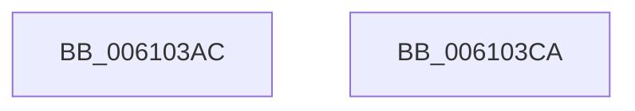

# SMKM_STORE_MGR&lt;SM_TRAITS&gt;::SmEvictKeys

- RVA: `0x006103AC`–`0x006103CB` (길이 `31` bytes)
- VA: `0x00000001406103AC`
- 실행 섹션: `.text`
- PDB 이름 있음: `예`; PDB Function 태그: `아니요`
- unwind 정보 RVA: `0x00085914`
- 디코드: `9`개 명령, `31/31` bytes 표시
- 미해석 바이트: `0` (있으면 어셈블리에 `.byte`로 보존)

> 이 문서는 커널 이미지의 기계어와 PDB 기호를 분석해 생성했습니다. 4번과 5번은 함수 원형과 자료형을 바이너리 사용 방식에서 추정한 C 해석이며 원본 소스 복구 결과는 아닙니다.

## 1. Dependencies

- 직접 호출 지점: **1**; 고유 호출 대상: **1**
- 직접 호출자로 확인된 함수: **1**
- RIP 상대 이미지 참조: **0**

### Outgoing calls
- `0x006103C0` → [SMKM_STORE_MGR<SM_TRAITS>::SmFeStoreEvictKeys](SMKM_STORE_MGR_SM_TRAITS_SmFeStoreEvictKeys_function_0061041C.md) (function, `0x0061041C`)

### Direct callers
- [ST_STORE&lt;SM_TRAITS&gt;::StDmPageRemove](../20/ST_STORE_SM_TRAITS_StDmPageRemove_function_002049A0.md) at `0x00204DBE`
- [ST_STORE&lt;SM_TRAITS&gt;::StDmPageRemove](../20/ST_STORE_SM_TRAITS_StDmPageRemove_function_002049A0.md) at `0x00204E76`

### Static image references
- 디코드된 RIP-relative 메모리 참조가 없습니다.

## 2. Other-region calls and transfers

- 다른 실행 섹션으로 향하는 call: **0**
- 별도 외부 분기/꼬리 이동을 확인하지 못했습니다.

## 3. Assembly (complete function range)

```asm
006103AC  4C 89 4C 24 20                  mov qword ptr [rsp + 0x20], r9
006103B1  48 83 EC 28                     sub rsp, 0x28
006103B5  8B 02                           mov eax, dword ptr [rdx]
006103B7  48 8D 54 24 48                  lea rdx, [rsp + 0x48]
006103BC  89 44 24 48                     mov dword ptr [rsp + 0x48], eax
006103C0  E8 57 00 00 00                  call 0x14061041c
006103C5  48 83 C4 28                     add rsp, 0x28
006103C9  C3                              ret
006103CA  CC                              int3
```

## 4. C-style interpretation (structured pseudocode)

```c
__int64 __fastcall SMKM_STORE_MGR_SM_TRAITS___SmEvictKeys(__int64 a1, __int64 a2, __int64 a3, __int64 a4)
{
    __int64 result;
    __int64 v_rsp;
    unsigned __int64 v_stack_p20;

    v_stack_p20 = a4;
    v_rsp = (v_rsp) - (40);
    v_stack_p20 = (unsigned int)((unsigned int)(*(unsigned int *)(a2)));
    result = SMKM_STORE_MGR_SM_TRAITS___SmFeStoreEvictKeys(a1, v_stack_p20, a3, a4);
    v_rsp = (v_rsp) + (40);
    return result;
}
```

## 5. (Beta) C Style

```c
int64_t SMKM_STORE_MGR_SM_TRAITS___SmEvictKeys(int64_t Arg1, void *Arg2, int64_t Arg3, int64_t Arg4)
{
    uint8_t *arg2 = (uint8_t *)Arg2;

    int64_t result;
    int64_t local_rsp;
    uint64_t v_stack_p20;

    v_stack_p20 = Arg4;
    local_rsp = (local_rsp) - (40);
    v_stack_p20 = (uint32_t)((uint32_t)(*(uint32_t *)(arg2)));
    result = SMKM_STORE_MGR_SM_TRAITS___SmFeStoreEvictKeys(Arg1, v_stack_p20, Arg3, Arg4);
    local_rsp = (local_rsp) + (40);
    return result;
}
```

### 관측된 메모리 오프셋

구조체 형식이 확인되지 않은 접근은 인자 기준의 오프셋으로만 기록했습니다.

| 기준 인자 | 오프셋 표현 | 폭 (bit) | 접근 |
|---|---:|---:|---|
| `Arg2` | `+ 0x0` | `32` | `R` |

## 6. Execution-region graph

[열기: 2D/3D 그래프와 함수 탐색 컨트롤 패널](../../../control-panel.html?section=text&rva=0x006103AC&view=graph)

- 2D 그래프는 위에서 아래로 흐르고, 3D 그래프는 빈 공간을 드래그해 회전합니다. Shift+드래그는 이동, 휠은 확대·축소, 함수 노드 선택은 대상 보고서 이동입니다.

### Static fallback


