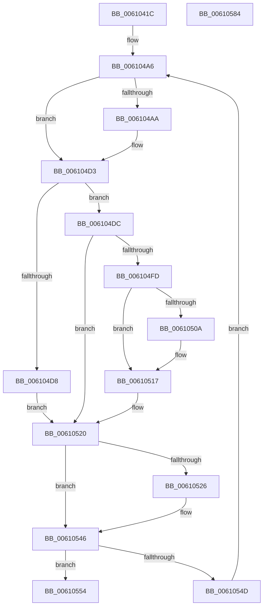

# SMKM_STORE_MGR&lt;SM_TRAITS&gt;::SmFeStoreEvictKeys

- RVA: `0x0061041C`–`0x00610585` (길이 `361` bytes)
- VA: `0x000000014061041C`
- 실행 섹션: `.text`
- PDB 이름 있음: `예`; PDB Function 태그: `아니요`
- unwind 정보 RVA: `0x000D1FF0`
- 디코드: `98`개 명령, `361/361` bytes 표시
- 미해석 바이트: `0` (있으면 어셈블리에 `.byte`로 보존)

> 이 문서는 커널 이미지의 기계어와 PDB 기호를 분석해 생성했습니다. 4번과 5번은 함수 원형과 자료형을 바이너리 사용 방식에서 추정한 C 해석이며 원본 소스 복구 결과는 아닙니다.

## 1. Dependencies

- 직접 호출 지점: **7**; 고유 호출 대상: **7**
- 직접 호출자로 확인된 함수: **2**
- RIP 상대 이미지 참조: **1**

### Outgoing calls
- `0x0061045C` → [memset](../6C/memset_function_006C6C40.md) (function, `0x006C6C40`)
- `0x0061049C` → [StLockAcquireExclusive](../26/StLockAcquireExclusive_function_00266FF0.md) (function, `0x00266FF0`)
- `0x006104B8` → [B_TREE<_SM_PAGE_KEY,SMKM_STORE_MGR<SM_TRAITS>::SMKM_FRONTEND_ENTRY,4096,B_TREE_DUMMY_NODE_POOL,B_TREE_KEY_COMPARATOR<_SM_PAGE_KEY> >::BTreeSearchKey](../26/B_TREE__SM_PAGE_KEY_SMKM_STORE_MGR_SM_TRAITS_SMKM_FRONTEND_ENTRY_4096_B_TREE_DUMMY_NODE_POOL_B_TREE__function_00266E10.md) (function, `0x00266E10`)
- `0x006104C7` → [B_TREE<_SM_PAGE_KEY,SMKM_STORE_MGR<SM_TRAITS>::SMKM_FRONTEND_ENTRY,4096,B_TREE_DUMMY_NODE_POOL,B_TREE_KEY_COMPARATOR<_SM_PAGE_KEY> >::BTreeIteratorFromSearchResult](../2E/B_TREE__SM_PAGE_KEY_SMKM_STORE_MGR_SM_TRAITS_SMKM_FRONTEND_ENTRY_4096_B_TREE_DUMMY_NODE_POOL_B_TREE__function_002E07E0.md) (function, `0x002E07E0`)
- `0x00610537` → [SMKM_STORE_MGR<SM_TRAITS>::SmFeDeleteEntry](../26/SMKM_STORE_MGR_SM_TRAITS_SmFeDeleteEntry_function_00266B70.md) (function, `0x00266B70`)
- `0x00610557` → [StLockReleaseExclusive](../26/StLockReleaseExclusive_function_00267050.md) (function, `0x00267050`)
- `0x00610563` → [_security_check_cookie](../6A/_security_check_cookie_function_006AC640.md) (function, `0x006AC640`)

### Direct callers
- [sub_002E07A1](../2E/Unknown_function_002E07A1.md) at `0x002E07A6`
- [SMKM_STORE_MGR&lt;SM_TRAITS&gt;::SmEvictKeys](SMKM_STORE_MGR_SM_TRAITS_SmEvictKeys_function_006103AC.md) at `0x006103C0`

### Static image references
- `0x0061043A` → RVA `0x00E0A740` (`.data`; read)

## 2. Other-region calls and transfers

- 다른 실행 섹션으로 향하는 call: **0**
- 별도 외부 분기/꼬리 이동을 확인하지 못했습니다.

## 3. Assembly (complete function range)

```asm
0061041C  48 89 5C 24 18                  mov qword ptr [rsp + 0x18], rbx
00610421  48 89 74 24 20                  mov qword ptr [rsp + 0x20], rsi
00610426  55                              push rbp
00610427  57                              push rdi
00610428  41 54                           push r12
0061042A  41 56                           push r14
0061042C  41 57                           push r15
0061042E  48 8D 6C 24 C9                  lea rbp, [rsp - 0x37]
00610433  48 81 EC F0 00 00 00            sub rsp, 0xf0
0061043A  48 8B 05 FF A2 7F 00            mov rax, qword ptr [rip + 0x7fa2ff]
00610441  48 33 C4                        xor rax, rsp
00610444  48 89 45 27                     mov qword ptr [rbp + 0x27], rax
00610448  8B 1A                           mov ebx, dword ptr [rdx]
0061044A  45 8B E0                        mov r12d, r8d
0061044D  4C 8B F1                        mov r14, rcx
00610450  33 D2                           xor edx, edx
00610452  41 B8 80 00 00 00               mov r8d, 0x80
00610458  48 8D 4D 9F                     lea rcx, [rbp - 0x61]
0061045C  E8 DF 67 0B 00                  call 0x1406c6c40
00610461  48 83 64 24 38 00               and qword ptr [rsp + 0x38], 0
00610467  48 8D 45 9F                     lea rax, [rbp - 0x61]
0061046B  48 83 65 87 00                  and qword ptr [rbp - 0x79], 0
00610470  4D 8D BE B8 01 00 00            lea r15, [r14 + 0x1b8]
00610477  48 83 65 97 00                  and qword ptr [rbp - 0x69], 0
0061047C  33 FF                           xor edi, edi
0061047E  83 65 8F 00                     and dword ptr [rbp - 0x71], 0
00610482  0F 57 C0                        xorps xmm0, xmm0
00610485  49 8B CF                        mov rcx, r15
00610488  48 89 44 24 30                  mov qword ptr [rsp + 0x30], rax
0061048D  0F 11 44 24 20                  movups xmmword ptr [rsp + 0x20], xmm0
00610492  8D 77 01                        lea esi, [rdi + 1]
00610495  C7 45 93 08 00 00 00            mov dword ptr [rbp - 0x6d], 8
0061049C  E8 4F 6B C5 FF                  call 0x140266ff0
006104A1  4C 8B 44 24 20                  mov r8, qword ptr [rsp + 0x20]
006104A6  85 F6                           test esi, esi
006104A8  74 29                           je 0x1406104d3
006104AA  49 8D 8E C0 01 00 00            lea rcx, [r14 + 0x1c0]
006104B1  8B D3                           mov edx, ebx
006104B3  4C 8D 44 24 30                  lea r8, [rsp + 0x30]
006104B8  E8 53 69 C5 FF                  call 0x140266e10
006104BD  4C 8D 44 24 30                  lea r8, [rsp + 0x30]
006104C2  48 8D 54 24 20                  lea rdx, [rsp + 0x20]
006104C7  E8 14 03 CD FF                  call 0x1402e07e0
006104CC  4C 8B 44 24 20                  mov r8, qword ptr [rsp + 0x20]
006104D1  33 F6                           xor esi, esi
006104D3  4D 85 C0                        test r8, r8
006104D6  75 04                           jne 0x1406104dc
006104D8  33 D2                           xor edx, edx
006104DA  EB 44                           jmp 0x140610520
006104DC  48 8B 54 24 28                  mov rdx, qword ptr [rsp + 0x28]
006104E1  41 8B 00                        mov eax, dword ptr [r8]
006104E4  48 83 C2 08                     add rdx, 8
006104E8  0F B7 C0                        movzx eax, ax
006104EB  48 83 C0 02                     add rax, 2
006104EF  48 89 54 24 28                  mov qword ptr [rsp + 0x28], rdx
006104F4  49 8D 04 C0                     lea rax, [r8 + rax*8]
006104F8  48 3B D0                        cmp rdx, rax
006104FB  72 23                           jb 0x140610520
006104FD  49 8B 40 08                     mov rax, qword ptr [r8 + 8]
00610501  48 8D 48 10                     lea rcx, [rax + 0x10]
00610505  48 85 C0                        test rax, rax
00610508  74 0D                           je 0x140610517
0061050A  4C 8B C0                        mov r8, rax
0061050D  48 89 44 24 20                  mov qword ptr [rsp + 0x20], rax
00610512  48 89 4C 24 28                  mov qword ptr [rsp + 0x28], rcx
00610517  48 F7 D8                        neg rax
0061051A  48 1B D2                        sbb rdx, rdx
0061051D  48 23 D1                        and rdx, rcx
00610520  80 7A 06 03                     cmp byte ptr [rdx + 6], 3
00610524  75 20                           jne 0x140610546
00610526  C6 42 06 00                     mov byte ptr [rdx + 6], 0
0061052A  4C 8D 44 24 20                  lea r8, [rsp + 0x20]
0061052F  48 8D 54 24 30                  lea rdx, [rsp + 0x30]
00610534  49 8B CE                        mov rcx, r14
00610537  E8 34 66 C5 FF                  call 0x140266b70
0061053C  4C 8B 44 24 20                  mov r8, qword ptr [rsp + 0x20]
00610541  BE 01 00 00 00                  mov esi, 1
00610546  FF C7                           inc edi
00610548  41 3B FC                        cmp edi, r12d
0061054B  74 07                           je 0x140610554
0061054D  FF C3                           inc ebx
0061054F  E9 52 FF FF FF                  jmp 0x1406104a6
00610554  49 8B CF                        mov rcx, r15
00610557  E8 F4 6A C5 FF                  call 0x140267050
0061055C  48 8B 4D 27                     mov rcx, qword ptr [rbp + 0x27]
00610560  48 33 CC                        xor rcx, rsp
00610563  E8 D8 C0 09 00                  call 0x1406ac640
00610568  4C 8D 9C 24 F0 00 00 00         lea r11, [rsp + 0xf0]
00610570  49 8B 5B 40                     mov rbx, qword ptr [r11 + 0x40]
00610574  49 8B 73 48                     mov rsi, qword ptr [r11 + 0x48]
00610578  49 8B E3                        mov rsp, r11
0061057B  41 5F                           pop r15
0061057D  41 5E                           pop r14
0061057F  41 5C                           pop r12
00610581  5F                              pop rdi
00610582  5D                              pop rbp
00610583  C3                              ret
00610584  CC                              int3
```

## 4. C-style interpretation (structured pseudocode)

```c
__int64 __fastcall SMKM_STORE_MGR_SM_TRAITS___SmFeStoreEvictKeys(__int64 a1, __int64 a2, int a3)
{
    __int64 result;
    __int64 v_rbx;
    __int64 v_rdi;
    __int64 v_rsi;
    __int64 v_rsp;
    unsigned __int64 v_stack_m28;
    unsigned __int64 v_stack_m38;
    unsigned __int64 v_stack_m5F;
    unsigned __int64 v_stack_mC0;
    unsigned __int64 v_stack_mC8;
    unsigned int v_stack_mCC;
    unsigned int v_stack_mD0;
    unsigned __int64 v_stack_mD8;
    unsigned __int64 v_stack_mE0;
    unsigned __int64 v_stack_mE8;
    unsigned __int64 v_stack_mF0;
    unsigned __int64 v_stack_mF8;
    unsigned __int64 v_stack_p18;
    unsigned __int64 v_stack_p20;

    v_stack_p18 = v_rbx;
    v_stack_p20 = v_rsi;
    v_rsp = (v_rsp) - (240);
    result = (*(unsigned __int64 *)(v_rip + 8364799)) ^ (v_rsp);
    v_stack_m38 = result;
    a2 = 0;
    result = memset(v_stack_mC0, a2, 128, a4);
    v_rdi = 0;
    v_stack_mE8 = v_stack_mC0;
    v_stack_mF8 = v_xmm0;
    v_stack_mCC = 8;
    result = StLockAcquireExclusive(a1 + 440, a2, 128, a4);
loc_006104A6:
    v_rsi = v_rdi + 1;
    if ((unsigned int)(v_rdi + 1) != 0) {
        a1 = a1 + 448;
        a2 = (unsigned int)((unsigned int)(*(unsigned int *)(a2)));
        a3 = v_stack_mE8;
        result = B_TREE__SM_PAGE_KEY_SMKM_STORE_MGR_SM_TRAITS___SMKM_FRONTEND_ENTRY_4096_B_TREE_DUMMY_NODE_POOL_B_TRE(a1, a2, a3, a4);
        a3 = v_stack_mE8;
        a2 = v_stack_mF8;
        result = B_TREE__SM_PAGE_KEY_SMKM_STORE_MGR_SM_TRAITS___SMKM_FRONTEND_ENTRY_4096_B_TREE_DUMMY_NODE_POOL_B_TRE(a1, a2, a3, a4);
        a3 = v_stack_mF8;
        v_rsi = 0;
    }
    if (a3 != 0) goto loc_006104DC;
    a2 = 0;
    goto loc_00610520;
loc_006104DC:
    a2 = (v_stack_mF0) + (8);
    result = ((unsigned __int16)((unsigned int)(*(unsigned int *)(a3)))) + (2);
    v_stack_mF0 = a2;
    if (a2 < (a3 + result * 8)) goto loc_00610520;
    if (*(unsigned __int64 *)(a3 + 8) != 0) {
        a3 = *(unsigned __int64 *)(a3 + 8);
        v_stack_mF8 = *(unsigned __int64 *)(a3 + 8);
        v_stack_mF0 = *(unsigned __int64 *)(a3 + 8) + 16;
    }
    result = -(*(unsigned __int64 *)(a3 + 8));
    a2 = (a2) & (*(unsigned __int64 *)(a3 + 8) + 16);
loc_00610520:
    if ((*(unsigned __int8 *)(a2 + 6)) == 3) {
        *(unsigned __int8 *)(a2 + 6) = 0;
        a3 = v_stack_mF8;
        a2 = v_stack_mE8;
        a1 = a1;
        result = SMKM_STORE_MGR_SM_TRAITS___SmFeDeleteEntry(a1, a2, a3, a4);
        a3 = v_stack_mF8;
        v_rsi = 1;
    }
    v_rdi = (unsigned int)((v_rdi) + 1);
    if (((unsigned int)(v_rdi)) == ((unsigned int)((unsigned int)(a3)))) goto loc_00610554;
    v_rbx = (unsigned int)(((unsigned int)(*(unsigned int *)(a2))) + 1);
    goto loc_006104A6;
loc_00610554:
    result = StLockReleaseExclusive(a1 + 440, a2, a3, a4);
    a1 = (v_stack_m38) ^ (v_rsp);
    result = _security_check_cookie(a1, a2, a3, a4);
    return result;
}
```

## 5. (Beta) C Style

```c
int64_t SMKM_STORE_MGR_SM_TRAITS___SmFeStoreEvictKeys(void *Arg1, void *Arg2, int32_t Arg3)
{
    uint8_t *arg1 = (uint8_t *)Arg1;
    uint8_t *arg2 = (uint8_t *)Arg2;

    int64_t result;
    int64_t local_rbx;
    int64_t local_rdi;
    int64_t local_rsi;
    int64_t local_rsp;
    uint64_t v_stack_m28;
    uint64_t v_stack_m38;
    uint64_t v_stack_m5F;
    uint64_t v_stack_mC0;
    uint64_t v_stack_mC8;
    uint32_t v_stack_mCC;
    uint32_t v_stack_mD0;
    uint64_t v_stack_mD8;
    uint64_t v_stack_mE0;
    uint64_t v_stack_mE8;
    uint64_t v_stack_mF0;
    uint64_t v_stack_mF8;
    uint64_t v_stack_p18;
    uint64_t v_stack_p20;

    v_stack_p18 = local_rbx;
    v_stack_p20 = local_rsi;
    local_rsp = (local_rsp) - (240);
    result = (*(uint64_t *)(v_rip + 0x7FA2FF)) ^ (local_rsp);
    v_stack_m38 = result;
    Arg2 = 0;
    result = memset(v_stack_mC0, Arg2, 128, a4);
    local_rdi = 0;
    v_stack_mE8 = v_stack_mC0;
    v_stack_mF8 = v_xmm0;
    v_stack_mCC = 8;
    result = StLockAcquireExclusive(Arg1 + 440, Arg2, 128, a4);
loc_006104A6:
    local_rsi = local_rdi + 1;
    if ((uint32_t)(local_rdi + 1) != 0) {
        Arg1 = Arg1 + 448;
        Arg2 = (uint32_t)((uint32_t)(*(uint32_t *)(arg2)));
        Arg3 = v_stack_mE8;
        result = B_TREE__SM_PAGE_KEY_SMKM_STORE_MGR_SM_TRAITS___SMKM_FRONTEND_ENTRY_4096_B_TREE_DUMMY_NODE_POOL_B_TRE(Arg1, Arg2, Arg3, a4);
        Arg3 = v_stack_mE8;
        Arg2 = v_stack_mF8;
        result = B_TREE__SM_PAGE_KEY_SMKM_STORE_MGR_SM_TRAITS___SMKM_FRONTEND_ENTRY_4096_B_TREE_DUMMY_NODE_POOL_B_TRE(Arg1, Arg2, Arg3, a4);
        Arg3 = v_stack_mF8;
        local_rsi = 0;
    }
    if (Arg3 != 0) goto loc_006104DC;
    Arg2 = 0;
    goto loc_00610520;
loc_006104DC:
    Arg2 = (v_stack_mF0) + (8);
    result = ((uint16_t)((uint32_t)(*(uint32_t *)(Arg3)))) + (2);
    v_stack_mF0 = Arg2;
    if (Arg2 < (Arg3 + result * 8)) goto loc_00610520;
    if (*(uint64_t *)(Arg3 + 0x8) != 0) {
        Arg3 = *(uint64_t *)(Arg3 + 0x8);
        v_stack_mF8 = *(uint64_t *)(Arg3 + 0x8);
        v_stack_mF0 = *(uint64_t *)(Arg3 + 0x8) + 16;
    }
    result = -(*(uint64_t *)(Arg3 + 0x8));
    Arg2 = (Arg2) & (*(uint64_t *)(Arg3 + 0x8) + 16);
loc_00610520:
    if ((*(uint8_t *)(arg2 + 0x6)) == 3) {
        *(uint8_t *)(arg2 + 0x6) = 0;
        Arg3 = v_stack_mF8;
        Arg2 = v_stack_mE8;
        Arg1 = Arg1;
        result = SMKM_STORE_MGR_SM_TRAITS___SmFeDeleteEntry(Arg1, Arg2, Arg3, a4);
        Arg3 = v_stack_mF8;
        local_rsi = 1;
    }
    local_rdi = (uint32_t)((local_rdi) + 1);
    if (((uint32_t)(local_rdi)) == ((uint32_t)((uint32_t)(Arg3)))) goto loc_00610554;
    local_rbx = (uint32_t)(((uint32_t)(*(uint32_t *)(arg2))) + 1);
    goto loc_006104A6;
loc_00610554:
    result = StLockReleaseExclusive(Arg1 + 440, Arg2, Arg3, a4);
    Arg1 = (v_stack_m38) ^ (local_rsp);
    result = _security_check_cookie(Arg1, Arg2, Arg3, a4);
    return result;
}
```

### 관측된 메모리 오프셋

구조체 형식이 확인되지 않은 접근은 인자 기준의 오프셋으로만 기록했습니다.

| 기준 인자 | 오프셋 표현 | 폭 (bit) | 접근 |
|---|---:|---:|---|
| `Arg1` | `+ 0x1B8` | `64` | `R` |
| `Arg1` | `+ 0x1C0` | `64` | `R` |
| `Arg2` | `+ 0x0` | `32` | `R` |

## 6. Execution-region graph

[열기: 2D/3D 그래프와 함수 탐색 컨트롤 패널](../../../control-panel.html?section=text&rva=0x0061041C&view=graph)

- 2D 그래프는 위에서 아래로 흐르고, 3D 그래프는 빈 공간을 드래그해 회전합니다. Shift+드래그는 이동, 휠은 확대·축소, 함수 노드 선택은 대상 보고서 이동입니다.

### Static fallback


