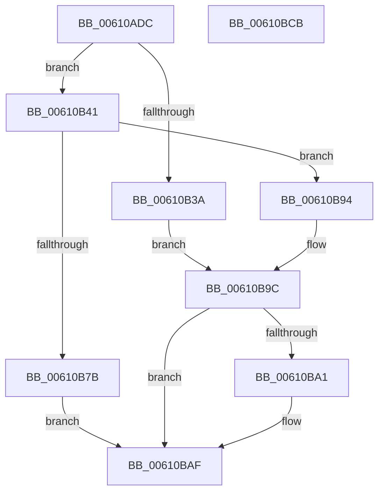

# SMKM_STORE_MGR&lt;SM_TRAITS&gt;::SmStoreContentsRundown

- RVA: `0x00610ADC`–`0x00610BCC` (길이 `240` bytes)
- VA: `0x0000000140610ADC`
- 실행 섹션: `.text`
- PDB 이름 있음: `예`; PDB Function 태그: `아니요`
- unwind 정보 RVA: `0x00083BEC`
- 디코드: `68`개 명령, `240/240` bytes 표시
- 미해석 바이트: `0` (있으면 어셈블리에 `.byte`로 보존)

> 이 문서는 커널 이미지의 기계어와 PDB 기호를 분석해 생성했습니다. 4번과 5번은 함수 원형과 자료형을 바이너리 사용 방식에서 추정한 C 해석이며 원본 소스 복구 결과는 아닙니다.

## 1. Dependencies

- 직접 호출 지점: **5**; 고유 호출 대상: **5**
- 직접 호출자로 확인된 함수: **1**
- RIP 상대 이미지 참조: **0**

### Outgoing calls
- `0x00610B2D` → [SmAllocEx](../34/SmAllocEx_function_0034C794.md) (function, `0x0034C794`)
- `0x00610B6E` → [SMKM_STORE_MGR<SM_TRAITS>::SmStoreRequestEx](../4A/SMKM_STORE_MGR_SM_TRAITS_SmStoreRequestEx_function_004A21D8.md) (function, `0x004A21D8`)
- `0x00610B8A` → [KeWaitForSingleObject](../20/KeWaitForSingleObject_function_0020E6B0.md) (function, `0x0020E6B0`)
- `0x00610B97` → [ExFreePoolWithTag](../../poolcode/B8/ExFreePoolWithTag_function_00B82870.md) (function, `0x00B82870`)
- `0x00610BAA` → [SmKmStoreDereference](../20/SmKmStoreDereference_function_00206574.md) (function, `0x00206574`)

### Direct callers
- [SmEtwEnableCallback](../../page/7A/SmEtwEnableCallback_function_007AA080.md) at `0x007AA1A0`

### Static image references
- 디코드된 RIP-relative 메모리 참조가 없습니다.

## 2. Other-region calls and transfers

- 다른 실행 섹션으로 향하는 call: **1**
  - `0x00610B97` → [ExFreePoolWithTag](../../poolcode/B8/ExFreePoolWithTag_function_00B82870.md) (`.text` → `POOLCODE`)
- 별도 외부 분기/꼬리 이동을 확인하지 못했습니다.

## 3. Assembly (complete function range)

```asm
00610ADC  48 8B C4                        mov rax, rsp
00610ADF  48 89 58 08                     mov qword ptr [rax + 8], rbx
00610AE3  48 89 70 10                     mov qword ptr [rax + 0x10], rsi
00610AE7  48 89 78 18                     mov qword ptr [rax + 0x18], rdi
00610AEB  4C 89 70 20                     mov qword ptr [rax + 0x20], r14
00610AEF  55                              push rbp
00610AF0  48 8B EC                        mov rbp, rsp
00610AF3  48 83 EC 60                     sub rsp, 0x60
00610AF7  83 65 E4 00                     and dword ptr [rbp - 0x1c], 0
00610AFB  48 8D 45 E8                     lea rax, [rbp - 0x18]
00610AFF  48 89 45 F0                     mov qword ptr [rbp - 0x10], rax
00610B03  48 8B DA                        mov rbx, rdx
00610B06  48 8D 45 E8                     lea rax, [rbp - 0x18]
00610B0A  C7 45 E0 00 00 06 00            mov dword ptr [rbp - 0x20], 0x60000
00610B11  4C 8B F1                        mov r14, rcx
00610B14  48 89 45 E8                     mov qword ptr [rbp - 0x18], rax
00610B18  0F 57 C0                        xorps xmm0, xmm0
00610B1B  41 83 C8 FF                     or r8d, 0xffffffff
00610B1F  BA 73 6D 57 64                  mov edx, 0x64576d73
00610B24  B9 28 00 00 00                  mov ecx, 0x28
00610B29  0F 11 45 D0                     movups xmmword ptr [rbp - 0x30], xmm0
00610B2D  E8 62 BC D3 FF                  call 0x14034c794
00610B32  48 8B F0                        mov rsi, rax
00610B35  48 85 C0                        test rax, rax
00610B38  75 07                           jne 0x140610b41
00610B3A  BF 9A 00 00 C0                  mov edi, 0xc000009a
00610B3F  EB 5B                           jmp 0x140610b9c
00610B41  0F 57 C0                        xorps xmm0, xmm0
00610B44  4C 8D 4D E0                     lea r9, [rbp - 0x20]
00610B48  0F 11 06                        movups xmmword ptr [rsi], xmm0
00610B4B  33 C0                           xor eax, eax
00610B4D  4C 8B C6                        mov r8, rsi
00610B50  0F 11 46 10                     movups xmmword ptr [rsi + 0x10], xmm0
00610B54  48 89 46 20                     mov qword ptr [rsi + 0x20], rax
00610B58  48 8B D3                        mov rdx, rbx
00610B5B  83 4E 08 FF                     or dword ptr [rsi + 8], 0xffffffff
00610B5F  48 8D 45 D0                     lea rax, [rbp - 0x30]
00610B63  48 89 44 24 20                  mov qword ptr [rsp + 0x20], rax
00610B68  C7 06 03 00 00 00               mov dword ptr [rsi], 3
00610B6E  E8 65 16 E9 FF                  call 0x1404a21d8
00610B73  33 D2                           xor edx, edx
00610B75  8B F8                           mov edi, eax
00610B77  85 C0                           test eax, eax
00610B79  78 19                           js 0x140610b94
00610B7B  48 21 54 24 20                  and qword ptr [rsp + 0x20], rdx
00610B80  48 8D 4D E0                     lea rcx, [rbp - 0x20]
00610B84  45 33 C9                        xor r9d, r9d
00610B87  45 33 C0                        xor r8d, r8d
00610B8A  E8 21 DB BF FF                  call 0x14020e6b0
00610B8F  8B 7D D0                        mov edi, dword ptr [rbp - 0x30]
00610B92  EB 1B                           jmp 0x140610baf
00610B94  48 8B CE                        mov rcx, rsi
00610B97  E8 D4 1C 57 00                  call 0x140b82870
00610B9C  48 85 DB                        test rbx, rbx
00610B9F  74 0E                           je 0x140610baf
00610BA1  8B 93 90 1A 00 00               mov edx, dword ptr [rbx + 0x1a90]
00610BA7  49 8B CE                        mov rcx, r14
00610BAA  E8 C5 59 BF FF                  call 0x140206574
00610BAF  4C 8D 5C 24 60                  lea r11, [rsp + 0x60]
00610BB4  8B C7                           mov eax, edi
00610BB6  49 8B 5B 10                     mov rbx, qword ptr [r11 + 0x10]
00610BBA  49 8B 73 18                     mov rsi, qword ptr [r11 + 0x18]
00610BBE  49 8B 7B 20                     mov rdi, qword ptr [r11 + 0x20]
00610BC2  4D 8B 73 28                     mov r14, qword ptr [r11 + 0x28]
00610BC6  49 8B E3                        mov rsp, r11
00610BC9  5D                              pop rbp
00610BCA  C3                              ret
00610BCB  CC                              int3
```

## 4. C-style interpretation (structured pseudocode)

```c
__int64 __fastcall SMKM_STORE_MGR_SM_TRAITS___SmStoreContentsRundown(__int64 a1, __int64 a2, int a3)
{
    __int64 result;
    __int64 v_rsp;
    unsigned __int64 v_stack_m18;
    unsigned __int64 v_stack_m20;
    unsigned int v_stack_m24;
    unsigned int v_stack_m28;
    unsigned __int64 v_stack_m38;
    unsigned __int64 v_stack_m48;
    unsigned __int64 v_stack_m8;

    *(unsigned __int64 *)(v_rsp + 8) = v_rbx;
    *(unsigned __int64 *)(v_rsp + 16) = v_rsi;
    *(unsigned __int64 *)(v_rsp + 24) = v_rdi;
    *(unsigned __int64 *)(v_rsp + 32) = v_r14;
    v_rsp = (v_rsp) - (96);
    v_stack_m18 = v_stack_m20;
    v_stack_m28 = 0x60000ULL;
    v_stack_m20 = v_stack_m20;
    a3 = (unsigned int)((a3) | (0xFFFFFFFFULL));
    v_stack_m38 = v_xmm0;
    result = SmAllocEx(40, (unsigned int)(0x64576D73ULL), a3, a4);
    if (result != 0) goto loc_00610B41;
    goto loc_00610B9C;
loc_00610B41:
    *(unsigned __int64 *)(result) = v_xmm0;
    result = 0;
    *(unsigned __int64 *)(result + 16) = v_xmm0;
    *(unsigned __int64 *)(result + 32) = 0;
    v_stack_m48 = v_stack_m38;
    *(unsigned int *)(result) = 3;
    result = SMKM_STORE_MGR_SM_TRAITS___SmStoreRequestEx(40, a2, 0, v_stack_m28);
    a2 = 0;
    if (sign_flag) goto loc_00610B94;
    a4 = 0;
    a3 = 0;
    result = KeWaitForSingleObject(v_stack_m28, a2, a3, a4);
    goto loc_00610BAF;
loc_00610B94:
    result = ExFreePoolWithTag(result, a2, a3, a4);
loc_00610B9C:
    if (0 != 0) {
        a2 = *(unsigned int *)(a2 + 6800);
        a1 = a1;
        result = SmKmStoreDereference(a1, a2, a3, a4);
    }
    return (unsigned int)((unsigned int)((unsigned int)(v_stack_m38)));
}
```

## 5. (Beta) C Style

```c
int64_t SMKM_STORE_MGR_SM_TRAITS___SmStoreContentsRundown(int64_t Arg1, int64_t Arg2, int32_t Arg3)
{
    int64_t result;
    int64_t local_rsp;
    uint64_t v_stack_m18;
    uint64_t v_stack_m20;
    uint32_t v_stack_m24;
    uint32_t v_stack_m28;
    uint64_t v_stack_m38;
    uint64_t v_stack_m48;
    uint64_t v_stack_m8;

    *(uint64_t *)(local_rsp + 0x8) = local_rbx;
    *(uint64_t *)(local_rsp + 0x10) = local_rsi;
    *(uint64_t *)(local_rsp + 0x18) = local_rdi;
    *(uint64_t *)(local_rsp + 0x20) = local_r14;
    local_rsp = (local_rsp) - (96);
    v_stack_m18 = v_stack_m20;
    v_stack_m28 = 0x60000ULL;
    v_stack_m20 = v_stack_m20;
    Arg3 = (uint32_t)((Arg3) | (0xFFFFFFFFULL));
    v_stack_m38 = v_xmm0;
    result = SmAllocEx(40, (uint32_t)(0x64576D73ULL), Arg3, a4);
    if (result != 0) goto loc_00610B41;
    goto loc_00610B9C;
loc_00610B41:
    *(uint64_t *)(result) = v_xmm0;
    result = 0;
    *(uint64_t *)(result + 0x10) = v_xmm0;
    *(uint64_t *)(result + 0x20) = 0;
    v_stack_m48 = v_stack_m38;
    *(uint32_t *)(result) = 3;
    result = SMKM_STORE_MGR_SM_TRAITS___SmStoreRequestEx(40, Arg2, 0, v_stack_m28);
    Arg2 = 0;
    if (sign_flag) goto loc_00610B94;
    a4 = 0;
    Arg3 = 0;
    result = KeWaitForSingleObject(v_stack_m28, Arg2, Arg3, a4);
    goto loc_00610BAF;
loc_00610B94:
    result = ExFreePoolWithTag(result, Arg2, Arg3, a4);
loc_00610B9C:
    if (0 != 0) {
        Arg2 = *(uint32_t *)(Arg2 + 0x1A90);
        Arg1 = Arg1;
        result = SmKmStoreDereference(Arg1, Arg2, Arg3, a4);
    }
    return (uint32_t)((uint32_t)((uint32_t)(v_stack_m38)));
}
```

## 6. Execution-region graph

[열기: 2D/3D 그래프와 함수 탐색 컨트롤 패널](../../../control-panel.html?section=text&rva=0x00610ADC&view=graph)

- 2D 그래프는 위에서 아래로 흐르고, 3D 그래프는 빈 공간을 드래그해 회전합니다. Shift+드래그는 이동, 휠은 확대·축소, 함수 노드 선택은 대상 보고서 이동입니다.

### Static fallback


