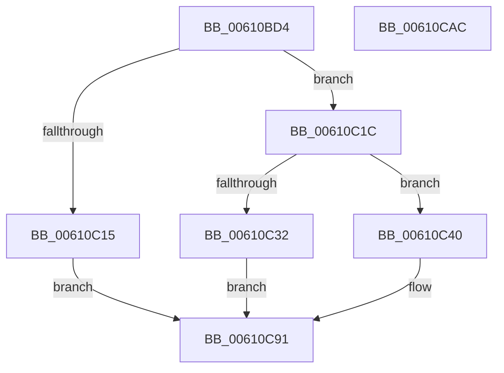

# SMKM_STORE_MGR&lt;SM_TRAITS&gt;::SmStoreTerminate

- RVA: `0x00610BD4`–`0x00610CAD` (길이 `217` bytes)
- VA: `0x0000000140610BD4`
- 실행 섹션: `.text`
- PDB 이름 있음: `예`; PDB Function 태그: `아니요`
- unwind 정보 RVA: `0x00060300`
- 디코드: `60`개 명령, `217/217` bytes 표시
- 미해석 바이트: `0` (있으면 어셈블리에 `.byte`로 보존)

> 이 문서는 커널 이미지의 기계어와 PDB 기호를 분석해 생성했습니다. 4번과 5번은 함수 원형과 자료형을 바이너리 사용 방식에서 추정한 C 해석이며 원본 소스 복구 결과는 아닙니다.

## 1. Dependencies

- 직접 호출 지점: **4**; 고유 호출 대상: **4**
- 직접 호출자로 확인된 함수: **1**
- RIP 상대 이미지 참조: **1**

### Outgoing calls
- `0x00610C06` → [SmAllocEx](../34/SmAllocEx_function_0034C794.md) (function, `0x0034C794`)
- `0x00610C25` → [SmKmStoreReference](../34/SmKmStoreReference_function_0034BFB0.md) (function, `0x0034BFB0`)
- `0x00610C39` → [ExFreePoolWithTag](../../poolcode/B8/ExFreePoolWithTag_function_00B82870.md) (function, `0x00B82870`)
- `0x00610C8C` → [ExQueueWorkItem](../2F/ExQueueWorkItem_function_002F9520.md) (function, `0x002F9520`)

### Direct callers
- [ST_STORE&lt;SM_TRAITS&gt;::StDmDeviceError](../60/ST_STORE_SM_TRAITS_StDmDeviceError_function_0060D2C4.md) at `0x0060D3F1`

### Static image references
- `0x00610C4F` → RVA `0x0060FB30` (`SmKmStoreTerminateWorker`; read)

## 2. Other-region calls and transfers

- 다른 실행 섹션으로 향하는 call: **1**
  - `0x00610C39` → [ExFreePoolWithTag](../../poolcode/B8/ExFreePoolWithTag_function_00B82870.md) (`.text` → `POOLCODE`)
- 별도 외부 분기/꼬리 이동을 확인하지 못했습니다.

## 3. Assembly (complete function range)

```asm
00610BD4  48 89 5C 24 08                  mov qword ptr [rsp + 8], rbx
00610BD9  48 89 6C 24 10                  mov qword ptr [rsp + 0x10], rbp
00610BDE  48 89 74 24 18                  mov qword ptr [rsp + 0x18], rsi
00610BE3  57                              push rdi
00610BE4  41 56                           push r14
00610BE6  41 57                           push r15
00610BE8  48 83 EC 20                     sub rsp, 0x20
00610BEC  45 8B F8                        mov r15d, r8d
00610BEF  48 8B F2                        mov rsi, rdx
00610BF2  48 8B E9                        mov rbp, rcx
00610BF5  41 83 C8 FF                     or r8d, 0xffffffff
00610BF9  BA 73 6D 54 6D                  mov edx, 0x6d546d73
00610BFE  B9 40 00 00 00                  mov ecx, 0x40
00610C03  45 8B F1                        mov r14d, r9d
00610C06  E8 89 BB D3 FF                  call 0x14034c794
00610C0B  33 FF                           xor edi, edi
00610C0D  48 8B D8                        mov rbx, rax
00610C10  48 85 C0                        test rax, rax
00610C13  75 07                           jne 0x140610c1c
00610C15  BF 9A 00 00 C0                  mov edi, 0xc000009a
00610C1A  EB 75                           jmp 0x140610c91
00610C1C  8B 96 90 1A 00 00               mov edx, dword ptr [rsi + 0x1a90]
00610C22  48 8B CD                        mov rcx, rbp
00610C25  E8 86 B3 D3 FF                  call 0x14034bfb0
00610C2A  48 8B CB                        mov rcx, rbx
00610C2D  48 85 C0                        test rax, rax
00610C30  75 0E                           jne 0x140610c40
00610C32  33 D2                           xor edx, edx
00610C34  BF 89 01 00 C0                  mov edi, 0xc0000189
00610C39  E8 32 1C 57 00                  call 0x140b82870
00610C3E  EB 51                           jmp 0x140610c91
00610C40  48 89 7B 08                     mov qword ptr [rbx + 8], rdi
00610C44  48 8D 96 68 1B 00 00            lea rdx, [rsi + 0x1b68]
00610C4B  48 89 7B 30                     mov qword ptr [rbx + 0x30], rdi
00610C4F  48 8D 05 DA EE FF FF            lea rax, [rip - 0x1126]
00610C56  48 89 7B 38                     mov qword ptr [rbx + 0x38], rdi
00610C5A  48 89 43 10                     mov qword ptr [rbx + 0x10], rax
00610C5E  48 89 5B 18                     mov qword ptr [rbx + 0x18], rbx
00610C62  48 89 3B                        mov qword ptr [rbx], rdi
00610C65  48 89 53 28                     mov qword ptr [rbx + 0x28], rdx
00610C69  48 89 6B 20                     mov qword ptr [rbx + 0x20], rbp
00610C6D  8B 96 90 1A 00 00               mov edx, dword ptr [rsi + 0x1a90]
00610C73  89 53 30                        mov dword ptr [rbx + 0x30], edx
00610C76  8B 95 D0 07 00 00               mov edx, dword ptr [rbp + 0x7d0]
00610C7C  83 E2 01                        and edx, 1
00610C7F  44 89 7B 38                     mov dword ptr [rbx + 0x38], r15d
00610C83  89 53 34                        mov dword ptr [rbx + 0x34], edx
00610C86  33 D2                           xor edx, edx
00610C88  44 89 73 3C                     mov dword ptr [rbx + 0x3c], r14d
00610C8C  E8 8F 88 CE FF                  call 0x1402f9520
00610C91  48 8B 5C 24 40                  mov rbx, qword ptr [rsp + 0x40]
00610C96  8B C7                           mov eax, edi
00610C98  48 8B 6C 24 48                  mov rbp, qword ptr [rsp + 0x48]
00610C9D  48 8B 74 24 50                  mov rsi, qword ptr [rsp + 0x50]
00610CA2  48 83 C4 20                     add rsp, 0x20
00610CA6  41 5F                           pop r15
00610CA8  41 5E                           pop r14
00610CAA  5F                              pop rdi
00610CAB  C3                              ret
00610CAC  CC                              int3
```

## 4. C-style interpretation (structured pseudocode)

```c
__int64 __fastcall SMKM_STORE_MGR_SM_TRAITS___SmStoreTerminate(__int64 a1, __int64 a2, int a3, int a4)
{
    __int64 result;
    __int64 v_rdi;
    __int64 v_rsp;
    unsigned __int64 v_stack_p10;
    unsigned __int64 v_stack_p18;
    unsigned __int64 v_stack_p8;

    v_stack_p8 = v_rbx;
    v_stack_p10 = v_rbp;
    v_stack_p18 = v_rsi;
    v_rsp = (v_rsp) - (32);
    a3 = (unsigned int)((a3) | (0xFFFFFFFFULL));
    result = SmAllocEx(64, (unsigned int)(0x6D546D73ULL), a3, a4);
    v_rdi = 0;
    if (result != 0) goto loc_00610C1C;
    goto loc_00610C91;
loc_00610C1C:
    result = SmKmStoreReference(a1, (unsigned int)(*(unsigned int *)(a2 + 6800)), a3, a4);
    if (result != 0) goto loc_00610C40;
    a2 = 0;
    result = ExFreePoolWithTag(result, a2, a3, a4);
    goto loc_00610C91;
loc_00610C40:
    *(unsigned __int64 *)(result + 8) = (unsigned int)(0xC0000189ULL);
    *(unsigned __int64 *)(result + 48) = (unsigned int)(0xC0000189ULL);
    *(unsigned __int64 *)(result + 56) = (unsigned int)(0xC0000189ULL);
    *(unsigned __int64 *)(result + 16) = v_rip - 4390;
    *(unsigned __int64 *)(result + 24) = result;
    *(unsigned __int64 *)(result) = (unsigned int)(0xC0000189ULL);
    *(unsigned __int64 *)(result + 40) = a2 + 7016;
    *(unsigned __int64 *)(result + 32) = a1;
    *(unsigned int *)(result + 48) = (unsigned int)((unsigned int)(*(unsigned int *)(a2 + 6800)));
    a2 = (unsigned int)(((unsigned int)(*(unsigned int *)(a1 + 2000))) & (1));
    *(unsigned int *)(result + 56) = (unsigned int)((unsigned int)(a3));
    *(unsigned int *)(result + 52) = (unsigned int)(a2);
    a2 = 0;
    *(unsigned int *)(result + 60) = (unsigned int)((unsigned int)(a4));
    result = ExQueueWorkItem(result, a2, a3, a4);
loc_00610C91:
    v_rsp = (v_rsp) + (32);
    return (unsigned int)((unsigned int)((unsigned int)(0xC0000189ULL)));
}
```

## 5. (Beta) C Style

```c
int64_t SMKM_STORE_MGR_SM_TRAITS___SmStoreTerminate(void *Arg1, void *Arg2, int32_t Arg3, int32_t Arg4)
{
    uint8_t *arg1 = (uint8_t *)Arg1;
    uint8_t *arg2 = (uint8_t *)Arg2;

    int64_t result;
    int64_t local_rdi;
    int64_t local_rsp;
    uint64_t v_stack_p10;
    uint64_t v_stack_p18;
    uint64_t v_stack_p8;

    v_stack_p8 = local_rbx;
    v_stack_p10 = local_rbp;
    v_stack_p18 = local_rsi;
    local_rsp = (local_rsp) - (32);
    Arg3 = (uint32_t)((Arg3) | (0xFFFFFFFFULL));
    result = SmAllocEx(64, (uint32_t)(0x6D546D73ULL), Arg3, Arg4);
    local_rdi = 0;
    if (result != 0) goto loc_00610C1C;
    goto loc_00610C91;
loc_00610C1C:
    result = SmKmStoreReference(Arg1, (uint32_t)(*(uint32_t *)(arg2 + 0x1A90)), Arg3, Arg4);
    if (result != 0) goto loc_00610C40;
    Arg2 = 0;
    result = ExFreePoolWithTag(result, Arg2, Arg3, Arg4);
    goto loc_00610C91;
loc_00610C40:
    *(uint64_t *)(result + 0x8) = (uint32_t)(0xC0000189ULL);
    *(uint64_t *)(result + 0x30) = (uint32_t)(0xC0000189ULL);
    *(uint64_t *)(result + 0x38) = (uint32_t)(0xC0000189ULL);
    *(uint64_t *)(result + 0x10) = v_rip - 4390;
    *(uint64_t *)(result + 0x18) = result;
    *(uint64_t *)(result) = (uint32_t)(0xC0000189ULL);
    *(void **)(result + 0x28) = Arg2 + 7016;
    *(void **)(result + 0x20) = Arg1;
    *(uint32_t *)(result + 0x30) = (uint32_t)((uint32_t)(*(uint32_t *)(arg2 + 0x1A90)));
    Arg2 = (uint32_t)(((uint32_t)(*(uint32_t *)(arg1 + 0x7D0))) & (1));
    *(uint32_t *)(result + 0x38) = (uint32_t)((uint32_t)(Arg3));
    *(uint32_t *)(result + 0x34) = (uint32_t)(Arg2);
    Arg2 = 0;
    *(uint32_t *)(result + 0x3C) = (uint32_t)((uint32_t)(Arg4));
    result = ExQueueWorkItem(result, Arg2, Arg3, Arg4);
loc_00610C91:
    local_rsp = (local_rsp) + (32);
    return (uint32_t)((uint32_t)((uint32_t)(0xC0000189ULL)));
}
```

### 관측된 메모리 오프셋

구조체 형식이 확인되지 않은 접근은 인자 기준의 오프셋으로만 기록했습니다.

| 기준 인자 | 오프셋 표현 | 폭 (bit) | 접근 |
|---|---:|---:|---|
| `Arg1` | `+ 0x7D0` | `32` | `R` |
| `Arg2` | `+ 0x1A90` | `32` | `R` |
| `Arg2` | `+ 0x1B68` | `64` | `R` |

## 6. Execution-region graph

[열기: 2D/3D 그래프와 함수 탐색 컨트롤 패널](../../../control-panel.html?section=text&rva=0x00610BD4&view=graph)

- 2D 그래프는 위에서 아래로 흐르고, 3D 그래프는 빈 공간을 드래그해 회전합니다. Shift+드래그는 이동, 휠은 확대·축소, 함수 노드 선택은 대상 보고서 이동입니다.

### Static fallback


