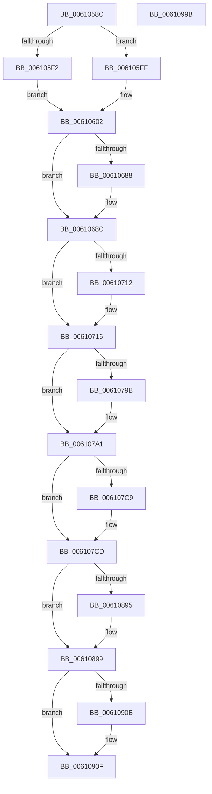

# SMKM_STORE&lt;SM_TRAITS&gt;::SmStEtwFillStoreEvent

- RVA: `0x0061058C`–`0x0061099C` (길이 `1,040` bytes)
- VA: `0x000000014061058C`
- 실행 섹션: `.text`
- PDB 이름 있음: `예`; PDB Function 태그: `아니요`
- unwind 정보 RVA: `0x000D2018`
- 디코드: `302`개 명령, `1,040/1,040` bytes 표시
- 미해석 바이트: `0` (있으면 어셈블리에 `.byte`로 보존)

> 이 문서는 커널 이미지의 기계어와 PDB 기호를 분석해 생성했습니다. 4번과 5번은 함수 원형과 자료형을 바이너리 사용 방식에서 추정한 C 해석이며 원본 소스 복구 결과는 아닙니다.

## 1. Dependencies

- 직접 호출 지점: **3**; 고유 호출 대상: **2**
- 직접 호출자로 확인된 함수: **1**
- RIP 상대 이미지 참조: **0**

### Outgoing calls
- `0x006107F5` → [ST_STORE<SM_TRAITS>::StDmGetSpaceStats](../41/ST_STORE_SM_TRAITS_StDmGetSpaceStats_function_0041DCF0.md) (function, `0x0041DCF0`)
- `0x00610805` → [ST_STORE<SM_TRAITS>::StDmGetSpaceStats](../41/ST_STORE_SM_TRAITS_StDmGetSpaceStats_function_0041DCF0.md) (function, `0x0041DCF0`)
- `0x0061092B` → [SmGetStoreOwnerProcessId](SmGetStoreOwnerProcessId_function_00610E4C.md) (function, `0x00610E4C`)

### Direct callers
- [SmKmEtwLogStoreChange](../../page/7A/SmKmEtwLogStoreChange_function_007A8194.md) at `0x007A8255`

### Static image references
- 디코드된 RIP-relative 메모리 참조가 없습니다.

## 2. Other-region calls and transfers

- 다른 실행 섹션으로 향하는 call: **0**
- 별도 외부 분기/꼬리 이동을 확인하지 못했습니다.

## 3. Assembly (complete function range)

```asm
0061058C  40 55                           push rbp
0061058E  53                              push rbx
0061058F  56                              push rsi
00610590  57                              push rdi
00610591  41 54                           push r12
00610593  41 55                           push r13
00610595  41 56                           push r14
00610597  41 57                           push r15
00610599  48 8B EC                        mov rbp, rsp
0061059C  48 83 EC 28                     sub rsp, 0x28
006105A0  48 8B DA                        mov rbx, rdx
006105A3  45 33 FF                        xor r15d, r15d
006105A6  8B 52 18                        mov edx, dword ptr [rdx + 0x18]
006105A9  48 8B F9                        mov rdi, rcx
006105AC  44 89 7D 48                     mov dword ptr [rbp + 0x48], r15d
006105B0  44 89 7D 58                     mov dword ptr [rbp + 0x58], r15d
006105B4  48 03 53 08                     add rdx, qword ptr [rbx + 8]
006105B8  45 8D 57 08                     lea r10d, [r15 + 8]
006105BC  45 8D 6F 01                     lea r13d, [r15 + 1]
006105C0  44 89 7D 50                     mov dword ptr [rbp + 0x50], r15d
006105C4  44 89 7D 60                     mov dword ptr [rbp + 0x60], r15d
006105C8  48 89 0A                        mov qword ptr [rdx], rcx
006105CB  8B 43 10                        mov eax, dword ptr [rbx + 0x10]
006105CE  48 C1 E0 04                     shl rax, 4
006105D2  48 03 03                        add rax, qword ptr [rbx]
006105D5  48 89 10                        mov qword ptr [rax], rdx
006105D8  4C 89 50 08                     mov qword ptr [rax + 8], r10
006105DC  8B 4B 18                        mov ecx, dword ptr [rbx + 0x18]
006105DF  44 01 6B 10                     add dword ptr [rbx + 0x10], r13d
006105E3  41 03 CA                        add ecx, r10d
006105E6  89 4B 18                        mov dword ptr [rbx + 0x18], ecx
006105E9  44 38 AF 94 1A 00 00            cmp byte ptr [rdi + 0x1a94], r13b
006105F0  75 0D                           jne 0x1406105ff
006105F2  48 8B 87 70 1B 00 00            mov rax, qword ptr [rdi + 0x1b70]
006105F9  4C 8B 40 18                     mov r8, qword ptr [rax + 0x18]
006105FD  EB 03                           jmp 0x140610602
006105FF  4D 8B C7                        mov r8, r15
00610602  8B D1                           mov edx, ecx
00610604  4C 8D 4F 50                     lea r9, [rdi + 0x50]
00610608  48 03 53 08                     add rdx, qword ptr [rbx + 8]
0061060C  4C 8D B7 60 09 00 00            lea r14, [rdi + 0x960]
00610613  4C 89 02                        mov qword ptr [rdx], r8
00610616  8B 43 10                        mov eax, dword ptr [rbx + 0x10]
00610619  48 C1 E0 04                     shl rax, 4
0061061D  48 03 03                        add rax, qword ptr [rbx]
00610620  48 89 10                        mov qword ptr [rax], rdx
00610623  4C 89 50 08                     mov qword ptr [rax + 8], r10
00610627  44 01 53 18                     add dword ptr [rbx + 0x18], r10d
0061062B  44 01 6B 10                     add dword ptr [rbx + 0x10], r13d
0061062F  8B 4B 18                        mov ecx, dword ptr [rbx + 0x18]
00610632  48 03 4B 08                     add rcx, qword ptr [rbx + 8]
00610636  4C 89 09                        mov qword ptr [rcx], r9
00610639  8B 43 10                        mov eax, dword ptr [rbx + 0x10]
0061063C  48 C1 E0 04                     shl rax, 4
00610640  48 03 03                        add rax, qword ptr [rbx]
00610643  48 89 08                        mov qword ptr [rax], rcx
00610646  4C 89 50 08                     mov qword ptr [rax + 8], r10
0061064A  44 01 53 18                     add dword ptr [rbx + 0x18], r10d
0061064E  44 01 6B 10                     add dword ptr [rbx + 0x10], r13d
00610652  8B 4B 18                        mov ecx, dword ptr [rbx + 0x18]
00610655  48 03 4B 08                     add rcx, qword ptr [rbx + 8]
00610659  4C 89 31                        mov qword ptr [rcx], r14
0061065C  8B 43 10                        mov eax, dword ptr [rbx + 0x10]
0061065F  48 C1 E0 04                     shl rax, 4
00610663  48 03 03                        add rax, qword ptr [rbx]
00610666  48 89 08                        mov qword ptr [rax], rcx
00610669  4C 89 50 08                     mov qword ptr [rax + 8], r10
0061066D  48 8D 87 60 1B 00 00            lea rax, [rdi + 0x1b60]
00610674  44 01 53 18                     add dword ptr [rbx + 0x18], r10d
00610678  8B 4B 18                        mov ecx, dword ptr [rbx + 0x18]
0061067B  48 03 4B 08                     add rcx, qword ptr [rbx + 8]
0061067F  44 01 6B 10                     add dword ptr [rbx + 0x10], r13d
00610683  48 85 C0                        test rax, rax
00610686  74 04                           je 0x14061068c
00610688  8B 00                           mov eax, dword ptr [rax]
0061068A  89 01                           mov dword ptr [rcx], eax
0061068C  8B 43 10                        mov eax, dword ptr [rbx + 0x10]
0061068F  48 8D B7 B8 0C 00 00            lea rsi, [rdi + 0xcb8]
00610696  48 C1 E0 04                     shl rax, 4
0061069A  41 BC 04 00 00 00               mov r12d, 4
006106A0  48 03 03                        add rax, qword ptr [rbx]
006106A3  48 89 08                        mov qword ptr [rax], rcx
006106A6  4C 89 60 08                     mov qword ptr [rax + 8], r12
006106AA  44 01 63 18                     add dword ptr [rbx + 0x18], r12d
006106AE  44 01 6B 10                     add dword ptr [rbx + 0x10], r13d
006106B2  8B 87 A8 03 00 00               mov eax, dword ptr [rdi + 0x3a8]
006106B8  03 06                           add eax, dword ptr [rsi]
006106BA  8B 4B 18                        mov ecx, dword ptr [rbx + 0x18]
006106BD  48 03 4B 08                     add rcx, qword ptr [rbx + 8]
006106C1  89 01                           mov dword ptr [rcx], eax
006106C3  8B 43 10                        mov eax, dword ptr [rbx + 0x10]
006106C6  48 C1 E0 04                     shl rax, 4
006106CA  48 03 03                        add rax, qword ptr [rbx]
006106CD  48 89 08                        mov qword ptr [rax], rcx
006106D0  4C 89 60 08                     mov qword ptr [rax + 8], r12
006106D4  44 01 63 18                     add dword ptr [rbx + 0x18], r12d
006106D8  44 01 6B 10                     add dword ptr [rbx + 0x10], r13d
006106DC  8B 4B 18                        mov ecx, dword ptr [rbx + 0x18]
006106DF  48 03 4B 08                     add rcx, qword ptr [rbx + 8]
006106E3  C7 01 00 10 00 00               mov dword ptr [rcx], 0x1000
006106E9  8B 43 10                        mov eax, dword ptr [rbx + 0x10]
006106EC  48 C1 E0 04                     shl rax, 4
006106F0  48 03 03                        add rax, qword ptr [rbx]
006106F3  48 89 08                        mov qword ptr [rax], rcx
006106F6  4C 89 60 08                     mov qword ptr [rax + 8], r12
006106FA  48 8D 47 10                     lea rax, [rdi + 0x10]
006106FE  44 01 63 18                     add dword ptr [rbx + 0x18], r12d
00610702  8B 4B 18                        mov ecx, dword ptr [rbx + 0x18]
00610705  48 03 4B 08                     add rcx, qword ptr [rbx + 8]
00610709  44 01 6B 10                     add dword ptr [rbx + 0x10], r13d
0061070D  48 85 C0                        test rax, rax
00610710  74 04                           je 0x140610716
00610712  8B 00                           mov eax, dword ptr [rax]
00610714  89 01                           mov dword ptr [rcx], eax
00610716  8B 43 10                        mov eax, dword ptr [rbx + 0x10]
00610719  BA 02 00 00 00                  mov edx, 2
0061071E  48 C1 E0 04                     shl rax, 4
00610722  48 03 03                        add rax, qword ptr [rbx]
00610725  48 89 08                        mov qword ptr [rax], rcx
00610728  4C 89 60 08                     mov qword ptr [rax + 8], r12
0061072C  44 01 63 18                     add dword ptr [rbx + 0x18], r12d
00610730  44 01 6B 10                     add dword ptr [rbx + 0x10], r13d
00610734  8B 87 F8 12 00 00               mov eax, dword ptr [rdi + 0x12f8]
0061073A  8B 4B 18                        mov ecx, dword ptr [rbx + 0x18]
0061073D  48 03 4B 08                     add rcx, qword ptr [rbx + 8]
00610741  C1 E0 03                        shl eax, 3
00610744  89 01                           mov dword ptr [rcx], eax
00610746  8B 43 10                        mov eax, dword ptr [rbx + 0x10]
00610749  48 C1 E0 04                     shl rax, 4
0061074D  48 03 03                        add rax, qword ptr [rbx]
00610750  48 89 08                        mov qword ptr [rax], rcx
00610753  4C 89 60 08                     mov qword ptr [rax + 8], r12
00610757  44 01 63 18                     add dword ptr [rbx + 0x18], r12d
0061075B  44 01 6B 10                     add dword ptr [rbx + 0x10], r13d
0061075F  0F B6 87 94 1A 00 00            movzx eax, byte ptr [rdi + 0x1a94]
00610766  8B 4B 18                        mov ecx, dword ptr [rbx + 0x18]
00610769  48 03 4B 08                     add rcx, qword ptr [rbx + 8]
0061076D  66 89 01                        mov word ptr [rcx], ax
00610770  8B 43 10                        mov eax, dword ptr [rbx + 0x10]
00610773  48 C1 E0 04                     shl rax, 4
00610777  48 03 03                        add rax, qword ptr [rbx]
0061077A  48 89 08                        mov qword ptr [rax], rcx
0061077D  48 89 50 08                     mov qword ptr [rax + 8], rdx
00610781  48 8D 87 90 1A 00 00            lea rax, [rdi + 0x1a90]
00610788  01 53 18                        add dword ptr [rbx + 0x18], edx
0061078B  8B 4B 18                        mov ecx, dword ptr [rbx + 0x18]
0061078E  48 03 4B 08                     add rcx, qword ptr [rbx + 8]
00610792  44 01 6B 10                     add dword ptr [rbx + 0x10], r13d
00610796  48 85 C0                        test rax, rax
00610799  74 06                           je 0x1406107a1
0061079B  0F B7 00                        movzx eax, word ptr [rax]
0061079E  66 89 01                        mov word ptr [rcx], ax
006107A1  8B 43 10                        mov eax, dword ptr [rbx + 0x10]
006107A4  48 C1 E0 04                     shl rax, 4
006107A8  48 03 03                        add rax, qword ptr [rbx]
006107AB  48 89 08                        mov qword ptr [rax], rcx
006107AE  48 89 50 08                     mov qword ptr [rax + 8], rdx
006107B2  48 8D 47 58                     lea rax, [rdi + 0x58]
006107B6  01 53 18                        add dword ptr [rbx + 0x18], edx
006107B9  8B 53 18                        mov edx, dword ptr [rbx + 0x18]
006107BC  48 03 53 08                     add rdx, qword ptr [rbx + 8]
006107C0  44 01 6B 10                     add dword ptr [rbx + 0x10], r13d
006107C4  48 85 C0                        test rax, rax
006107C7  74 04                           je 0x1406107cd
006107C9  8B 00                           mov eax, dword ptr [rax]
006107CB  89 02                           mov dword ptr [rdx], eax
006107CD  8B 43 10                        mov eax, dword ptr [rbx + 0x10]
006107D0  4C 8D 45 58                     lea r8, [rbp + 0x58]
006107D4  48 C1 E0 04                     shl rax, 4
006107D8  49 8B C9                        mov rcx, r9
006107DB  48 03 03                        add rax, qword ptr [rbx]
006107DE  48 89 10                        mov qword ptr [rax], rdx
006107E1  48 8D 55 48                     lea rdx, [rbp + 0x48]
006107E5  4C 89 60 08                     mov qword ptr [rax + 8], r12
006107E9  44 01 63 18                     add dword ptr [rbx + 0x18], r12d
006107ED  44 8B 5B 18                     mov r11d, dword ptr [rbx + 0x18]
006107F1  44 01 6B 10                     add dword ptr [rbx + 0x10], r13d
006107F5  E8 F6 D4 E0 FF                  call 0x14041dcf0
006107FA  48 8D 55 50                     lea rdx, [rbp + 0x50]
006107FE  49 8B CE                        mov rcx, r14
00610801  4C 8D 45 60                     lea r8, [rbp + 0x60]
00610805  E8 E6 D4 E0 FF                  call 0x14041dcf0
0061080A  4C 03 5B 08                     add r11, qword ptr [rbx + 8]
0061080E  44 8B 45 48                     mov r8d, dword ptr [rbp + 0x48]
00610812  44 8B 4D 50                     mov r9d, dword ptr [rbp + 0x50]
00610816  45 03 C1                        add r8d, r9d
00610819  8B 55 58                        mov edx, dword ptr [rbp + 0x58]
0061081C  44 8B 55 60                     mov r10d, dword ptr [rbp + 0x60]
00610820  41 03 D2                        add edx, r10d
00610823  45 89 03                        mov dword ptr [r11], r8d
00610826  8B 43 10                        mov eax, dword ptr [rbx + 0x10]
00610829  48 C1 E0 04                     shl rax, 4
0061082D  48 03 03                        add rax, qword ptr [rbx]
00610830  4C 89 18                        mov qword ptr [rax], r11
00610833  4C 89 60 08                     mov qword ptr [rax + 8], r12
00610837  44 01 63 18                     add dword ptr [rbx + 0x18], r12d
0061083B  44 01 6B 10                     add dword ptr [rbx + 0x10], r13d
0061083F  8B 4B 18                        mov ecx, dword ptr [rbx + 0x18]
00610842  48 03 4B 08                     add rcx, qword ptr [rbx + 8]
00610846  89 11                           mov dword ptr [rcx], edx
00610848  8B 43 10                        mov eax, dword ptr [rbx + 0x10]
0061084B  48 C1 E0 04                     shl rax, 4
0061084F  48 03 03                        add rax, qword ptr [rbx]
00610852  48 89 08                        mov qword ptr [rax], rcx
00610855  4C 89 60 08                     mov qword ptr [rax + 8], r12
00610859  44 01 63 18                     add dword ptr [rbx + 0x18], r12d
0061085D  44 01 6B 10                     add dword ptr [rbx + 0x10], r13d
00610861  8B 87 58 03 00 00               mov eax, dword ptr [rdi + 0x358]
00610867  8B 4B 18                        mov ecx, dword ptr [rbx + 0x18]
0061086A  48 03 4B 08                     add rcx, qword ptr [rbx + 8]
0061086E  89 01                           mov dword ptr [rcx], eax
00610870  8B 43 10                        mov eax, dword ptr [rbx + 0x10]
00610873  48 C1 E0 04                     shl rax, 4
00610877  48 03 03                        add rax, qword ptr [rbx]
0061087A  48 89 08                        mov qword ptr [rax], rcx
0061087D  4C 89 60 08                     mov qword ptr [rax + 8], r12
00610881  44 01 63 18                     add dword ptr [rbx + 0x18], r12d
00610885  8B 4B 18                        mov ecx, dword ptr [rbx + 0x18]
00610888  48 03 4B 08                     add rcx, qword ptr [rbx + 8]
0061088C  44 01 6B 10                     add dword ptr [rbx + 0x10], r13d
00610890  48 85 F6                        test rsi, rsi
00610893  74 04                           je 0x140610899
00610895  8B 06                           mov eax, dword ptr [rsi]
00610897  89 01                           mov dword ptr [rcx], eax
00610899  8B 43 10                        mov eax, dword ptr [rbx + 0x10]
0061089C  48 C1 E0 04                     shl rax, 4
006108A0  48 03 03                        add rax, qword ptr [rbx]
006108A3  48 89 08                        mov qword ptr [rax], rcx
006108A6  4C 89 60 08                     mov qword ptr [rax + 8], r12
006108AA  44 01 63 18                     add dword ptr [rbx + 0x18], r12d
006108AE  44 01 6B 10                     add dword ptr [rbx + 0x10], r13d
006108B2  8B 4B 18                        mov ecx, dword ptr [rbx + 0x18]
006108B5  48 03 4B 08                     add rcx, qword ptr [rbx + 8]
006108B9  44 89 09                        mov dword ptr [rcx], r9d
006108BC  8B 43 10                        mov eax, dword ptr [rbx + 0x10]
006108BF  48 C1 E0 04                     shl rax, 4
006108C3  48 03 03                        add rax, qword ptr [rbx]
006108C6  48 89 08                        mov qword ptr [rax], rcx
006108C9  4C 89 60 08                     mov qword ptr [rax + 8], r12
006108CD  44 01 63 18                     add dword ptr [rbx + 0x18], r12d
006108D1  44 01 6B 10                     add dword ptr [rbx + 0x10], r13d
006108D5  8B 4B 18                        mov ecx, dword ptr [rbx + 0x18]
006108D8  48 03 4B 08                     add rcx, qword ptr [rbx + 8]
006108DC  44 89 11                        mov dword ptr [rcx], r10d
006108DF  8B 43 10                        mov eax, dword ptr [rbx + 0x10]
006108E2  48 C1 E0 04                     shl rax, 4
006108E6  48 03 03                        add rax, qword ptr [rbx]
006108E9  48 89 08                        mov qword ptr [rax], rcx
006108EC  4C 89 60 08                     mov qword ptr [rax + 8], r12
006108F0  48 8D 87 0C 06 00 00            lea rax, [rdi + 0x60c]
006108F7  44 01 63 18                     add dword ptr [rbx + 0x18], r12d
006108FB  8B 4B 18                        mov ecx, dword ptr [rbx + 0x18]
006108FE  48 03 4B 08                     add rcx, qword ptr [rbx + 8]
00610902  44 01 6B 10                     add dword ptr [rbx + 0x10], r13d
00610906  48 85 C0                        test rax, rax
00610909  74 04                           je 0x14061090f
0061090B  8B 00                           mov eax, dword ptr [rax]
0061090D  89 01                           mov dword ptr [rcx], eax
0061090F  8B 43 10                        mov eax, dword ptr [rbx + 0x10]
00610912  48 C1 E0 04                     shl rax, 4
00610916  48 03 03                        add rax, qword ptr [rbx]
00610919  48 89 08                        mov qword ptr [rax], rcx
0061091C  48 8B CF                        mov rcx, rdi
0061091F  4C 89 60 08                     mov qword ptr [rax + 8], r12
00610923  44 01 6B 10                     add dword ptr [rbx + 0x10], r13d
00610927  44 01 63 18                     add dword ptr [rbx + 0x18], r12d
0061092B  E8 1C 05 00 00                  call 0x140610e4c
00610930  44 8B 43 18                     mov r8d, dword ptr [rbx + 0x18]
00610934  4C 03 43 08                     add r8, qword ptr [rbx + 8]
00610938  41 89 00                        mov dword ptr [r8], eax
0061093B  8B 43 10                        mov eax, dword ptr [rbx + 0x10]
0061093E  48 C1 E0 04                     shl rax, 4
00610942  48 03 03                        add rax, qword ptr [rbx]
00610945  4C 89 00                        mov qword ptr [rax], r8
00610948  4C 89 60 08                     mov qword ptr [rax + 8], r12
0061094C  44 01 6B 10                     add dword ptr [rbx + 0x10], r13d
00610950  44 01 63 18                     add dword ptr [rbx + 0x18], r12d
00610954  48 8B 87 90 1D 00 00            mov rax, qword ptr [rdi + 0x1d90]
0061095B  8B 53 18                        mov edx, dword ptr [rbx + 0x18]
0061095E  48 03 53 08                     add rdx, qword ptr [rbx + 8]
00610962  48 8B 88 30 08 00 00            mov rcx, qword ptr [rax + 0x830]
00610969  48 8B 01                        mov rax, qword ptr [rcx]
0061096C  0F B7 08                        movzx ecx, word ptr [rax]
0061096F  89 0A                           mov dword ptr [rdx], ecx
00610971  8B 43 10                        mov eax, dword ptr [rbx + 0x10]
00610974  48 C1 E0 04                     shl rax, 4
00610978  48 03 03                        add rax, qword ptr [rbx]
0061097B  48 89 10                        mov qword ptr [rax], rdx
0061097E  4C 89 60 08                     mov qword ptr [rax + 8], r12
00610982  44 01 6B 10                     add dword ptr [rbx + 0x10], r13d
00610986  44 01 63 18                     add dword ptr [rbx + 0x18], r12d
0061098A  48 83 C4 28                     add rsp, 0x28
0061098E  41 5F                           pop r15
00610990  41 5E                           pop r14
00610992  41 5D                           pop r13
00610994  41 5C                           pop r12
00610996  5F                              pop rdi
00610997  5E                              pop rsi
00610998  5B                              pop rbx
00610999  5D                              pop rbp
0061099A  C3                              ret
0061099B  CC                              int3
```

## 4. C-style interpretation (structured pseudocode)

```c
__int64 __fastcall SMKM_STORE_SM_TRAITS___SmStEtwFillStoreEvent(__int64 a1, __int64 a2)
{
    __int64 result;
    __int64 v_r11;
    __int64 v_r15;
    __int64 v_rsp;
    unsigned int v_stack_p10;
    unsigned int v_stack_p18;
    unsigned int v_stack_p20;
    unsigned int v_stack_p8;

    v_rsp = (v_rsp) - (40);
    v_r15 = 0;
    v_stack_p8 = 0;
    v_stack_p18 = 0;
    a2 = ((unsigned int)(*(unsigned int *)(a2 + 24))) + (*(unsigned __int64 *)(a2 + 8));
    v_stack_p10 = 0;
    v_stack_p20 = 0;
    *(unsigned __int64 *)(a2) = a1;
    result = ((unsigned int)(*(unsigned int *)(a2 + 16))) << (4);
    result = (result) + (*(unsigned __int64 *)(a2));
    *(unsigned __int64 *)(result) = a2;
    *(unsigned __int64 *)(result + 8) = v_r15 + 8;
    a1 = (unsigned int)(((unsigned int)(*(unsigned int *)(a2 + 24))) + ((unsigned int)(v_r15 + 8)));
    *(unsigned int *)(a2 + 24) = (unsigned int)(a1);
    if ((*(unsigned __int8 *)(a1 + 6804)) != ((unsigned __int8)(v_r15 + 1))) goto loc_006105FF;
    goto loc_00610602;
loc_006105FF:
loc_00610602:
    a2 = ((unsigned int)((unsigned int)(a1))) + (*(unsigned __int64 *)(a2 + 8));
    *(unsigned __int64 *)(a2) = 0;
    result = ((unsigned int)(*(unsigned int *)(a2 + 16))) << (4);
    result = (result) + (*(unsigned __int64 *)(a2));
    *(unsigned __int64 *)(result) = a2;
    *(unsigned __int64 *)(result + 8) = v_r15 + 8;
    a1 = ((unsigned int)(*(unsigned int *)(a2 + 24))) + (*(unsigned __int64 *)(a2 + 8));
    *(unsigned __int64 *)(a1) = a1 + 80;
    result = ((unsigned int)(*(unsigned int *)(a2 + 16))) << (4);
    result = (result) + (*(unsigned __int64 *)(a2));
    *(unsigned __int64 *)(result) = a1;
    *(unsigned __int64 *)(result + 8) = v_r15 + 8;
    a1 = ((unsigned int)(*(unsigned int *)(a2 + 24))) + (*(unsigned __int64 *)(a2 + 8));
    *(unsigned __int64 *)(a1) = a1 + 2400;
    result = ((unsigned int)(*(unsigned int *)(a2 + 16))) << (4);
    result = (result) + (*(unsigned __int64 *)(a2));
    *(unsigned __int64 *)(result) = a1;
    *(unsigned __int64 *)(result + 8) = v_r15 + 8;
    a1 = ((unsigned int)(*(unsigned int *)(a2 + 24))) + (*(unsigned __int64 *)(a2 + 8));
    result = a1 + 7008;
    if (a1 + 7008 != 0) {
        result = *(unsigned int *)(a1 + 7008);
        *(unsigned int *)(a1) = (unsigned int)(result);
    }
    result = ((unsigned int)(*(unsigned int *)(a2 + 16))) << (4);
    result = (result) + (*(unsigned __int64 *)(a2));
    *(unsigned __int64 *)(result) = a1;
    *(unsigned __int64 *)(result + 8) = 4;
    result = (unsigned int)(((unsigned int)(*(unsigned int *)(a1 + 936))) + (*(unsigned int *)(a1 + 3256)));
    a1 = ((unsigned int)(*(unsigned int *)(a2 + 24))) + (*(unsigned __int64 *)(a2 + 8));
    *(unsigned int *)(a1) = (unsigned int)(result);
    result = ((unsigned int)(*(unsigned int *)(a2 + 16))) << (4);
    result = (result) + (*(unsigned __int64 *)(a2));
    *(unsigned __int64 *)(result) = a1;
    *(unsigned __int64 *)(result + 8) = 4;
    a1 = ((unsigned int)(*(unsigned int *)(a2 + 24))) + (*(unsigned __int64 *)(a2 + 8));
    *(unsigned int *)(a1) = 0x1000ULL;
    result = ((unsigned int)(*(unsigned int *)(a2 + 16))) << (4);
    result = (result) + (*(unsigned __int64 *)(a2));
    *(unsigned __int64 *)(result) = a1;
    *(unsigned __int64 *)(result + 8) = 4;
    a1 = ((unsigned int)(*(unsigned int *)(a2 + 24))) + (*(unsigned __int64 *)(a2 + 8));
    result = a1 + 16;
    if (a1 + 16 != 0) {
        result = *(unsigned int *)(a1 + 16);
        *(unsigned int *)(a1) = (unsigned int)(result);
    }
    result = ((unsigned int)(*(unsigned int *)(a2 + 16))) << (4);
    result = (result) + (*(unsigned __int64 *)(a2));
    *(unsigned __int64 *)(result) = a1;
    *(unsigned __int64 *)(result + 8) = 4;
    a1 = ((unsigned int)(*(unsigned int *)(a2 + 24))) + (*(unsigned __int64 *)(a2 + 8));
    result = (unsigned int)(((unsigned int)(*(unsigned int *)(a1 + 4856))) << (3));
    *(unsigned int *)(a1) = (unsigned int)(result);
    result = ((unsigned int)(*(unsigned int *)(a2 + 16))) << (4);
    result = (result) + (*(unsigned __int64 *)(a2));
    *(unsigned __int64 *)(result) = a1;
    *(unsigned __int64 *)(result + 8) = 4;
    a1 = ((unsigned int)(*(unsigned int *)(a2 + 24))) + (*(unsigned __int64 *)(a2 + 8));
    *(unsigned __int16 *)(a1) = (unsigned __int16)(*(unsigned __int8 *)(a1 + 6804));
    result = ((unsigned int)(*(unsigned int *)(a2 + 16))) << (4);
    result = (result) + (*(unsigned __int64 *)(a2));
    *(unsigned __int64 *)(result) = a1;
    *(unsigned __int64 *)(result + 8) = 2;
    a1 = ((unsigned int)(*(unsigned int *)(a2 + 24))) + (*(unsigned __int64 *)(a2 + 8));
    result = a1 + 6800;
    if (a1 + 6800 != 0) {
        result = *(unsigned __int16 *)(a1 + 6800);
        *(unsigned __int16 *)(a1) = (unsigned __int16)(result);
    }
    result = ((unsigned int)(*(unsigned int *)(a2 + 16))) << (4);
    result = (result) + (*(unsigned __int64 *)(a2));
    *(unsigned __int64 *)(result) = a1;
    *(unsigned __int64 *)(result + 8) = 2;
    a2 = ((unsigned int)(*(unsigned int *)(a2 + 24))) + (*(unsigned __int64 *)(a2 + 8));
    result = a1 + 88;
    if (a1 + 88 != 0) {
        result = *(unsigned int *)(a1 + 88);
        *(unsigned int *)(a2) = (unsigned int)(result);
    }
    result = ((unsigned int)(*(unsigned int *)(a2 + 16))) << (4);
    result = (result) + (*(unsigned __int64 *)(a2));
    *(unsigned __int64 *)(result) = a2;
    *(unsigned __int64 *)(result + 8) = 4;
    result = ST_STORE_SM_TRAITS___StDmGetSpaceStats(a1 + 80, v_stack_p8, v_stack_p18, a1 + 80);
    result = ST_STORE_SM_TRAITS___StDmGetSpaceStats(a1 + 2400, v_stack_p10, v_stack_p20, a1 + 80);
    v_r11 = ((unsigned int)(*(unsigned int *)(a2 + 24))) + (*(unsigned __int64 *)(a2 + 8));
    a3 = (unsigned int)(((unsigned int)(v_stack_p8)) + ((unsigned int)((unsigned int)(v_stack_p10))));
    a2 = (unsigned int)(((unsigned int)(v_stack_p18)) + ((unsigned int)((unsigned int)(v_stack_p20))));
    *(unsigned int *)(v_r11) = (unsigned int)(a3);
    result = ((unsigned int)(*(unsigned int *)(a2 + 16))) << (4);
    result = (result) + (*(unsigned __int64 *)(a2));
    *(unsigned __int64 *)(result) = v_r11;
    *(unsigned __int64 *)(result + 8) = 4;
    a1 = ((unsigned int)(*(unsigned int *)(a2 + 24))) + (*(unsigned __int64 *)(a2 + 8));
    *(unsigned int *)(a1) = (unsigned int)(a2);
    result = ((unsigned int)(*(unsigned int *)(a2 + 16))) << (4);
    result = (result) + (*(unsigned __int64 *)(a2));
    *(unsigned __int64 *)(result) = a1;
    *(unsigned __int64 *)(result + 8) = 4;
    a1 = ((unsigned int)(*(unsigned int *)(a2 + 24))) + (*(unsigned __int64 *)(a2 + 8));
    *(unsigned int *)(a1) = (unsigned int)((unsigned int)(*(unsigned int *)(a1 + 856)));
    result = ((unsigned int)(*(unsigned int *)(a2 + 16))) << (4);
    result = (result) + (*(unsigned __int64 *)(a2));
    *(unsigned __int64 *)(result) = a1;
    *(unsigned __int64 *)(result + 8) = 4;
    a1 = ((unsigned int)(*(unsigned int *)(a2 + 24))) + (*(unsigned __int64 *)(a2 + 8));
    if (a1 + 3256 != 0) {
        result = *(unsigned int *)(a1 + 3256);
        *(unsigned int *)(a1) = (unsigned int)(result);
    }
    result = ((unsigned int)(*(unsigned int *)(a2 + 16))) << (4);
    result = (result) + (*(unsigned __int64 *)(a2));
    *(unsigned __int64 *)(result) = a1;
    *(unsigned __int64 *)(result + 8) = 4;
    a1 = ((unsigned int)(*(unsigned int *)(a2 + 24))) + (*(unsigned __int64 *)(a2 + 8));
    *(unsigned int *)(a1) = (unsigned int)((unsigned int)(v_stack_p10));
    result = ((unsigned int)(*(unsigned int *)(a2 + 16))) << (4);
    result = (result) + (*(unsigned __int64 *)(a2));
    *(unsigned __int64 *)(result) = a1;
    *(unsigned __int64 *)(result + 8) = 4;
    a1 = ((unsigned int)(*(unsigned int *)(a2 + 24))) + (*(unsigned __int64 *)(a2 + 8));
    *(unsigned int *)(a1) = (unsigned int)((unsigned int)(v_stack_p20));
    result = ((unsigned int)(*(unsigned int *)(a2 + 16))) << (4);
    result = (result) + (*(unsigned __int64 *)(a2));
    *(unsigned __int64 *)(result) = a1;
    *(unsigned __int64 *)(result + 8) = 4;
    a1 = ((unsigned int)(*(unsigned int *)(a2 + 24))) + (*(unsigned __int64 *)(a2 + 8));
    result = a1 + 1548;
    if (a1 + 1548 != 0) {
        result = *(unsigned int *)(a1 + 1548);
        *(unsigned int *)(a1) = (unsigned int)(result);
    }
    result = ((unsigned int)(*(unsigned int *)(a2 + 16))) << (4);
    result = (result) + (*(unsigned __int64 *)(a2));
    *(unsigned __int64 *)(result) = a1;
    *(unsigned __int64 *)(result + 8) = 4;
    result = SmGetStoreOwnerProcessId(a1, a2, a3, (unsigned int)(v_stack_p10));
    a3 = ((unsigned int)(*(unsigned int *)(a2 + 24))) + (*(unsigned __int64 *)(a2 + 8));
    *(unsigned int *)(a3) = (unsigned int)(result);
    result = ((unsigned int)(*(unsigned int *)(a2 + 16))) << (4);
    result = (result) + (*(unsigned __int64 *)(a2));
    *(unsigned __int64 *)(result) = a3;
    *(unsigned __int64 *)(result + 8) = 4;
    a2 = ((unsigned int)(*(unsigned int *)(a2 + 24))) + (*(unsigned __int64 *)(a2 + 8));
    *(unsigned int *)(a2) = (unsigned int)(*(unsigned __int16 *)(*(unsigned __int64 *)(*(unsigned __int64 *)(*(unsigned __int64 *)(a1 + 7568) + 2096))));
    result = ((unsigned int)(*(unsigned int *)(a2 + 16))) << (4);
    result = (result) + (*(unsigned __int64 *)(a2));
    *(unsigned __int64 *)(result) = a2;
    *(unsigned __int64 *)(result + 8) = 4;
    v_rsp = (v_rsp) + (40);
    return result;
}
```

## 5. (Beta) C Style

```c
int64_t SMKM_STORE_SM_TRAITS___SmStEtwFillStoreEvent(void *Arg1, void *Arg2)
{
    uint8_t *arg1 = (uint8_t *)Arg1;
    uint8_t *arg2 = (uint8_t *)Arg2;

    int64_t result;
    int64_t local_r11;
    int64_t local_r15;
    int64_t local_rsp;
    uint32_t v_stack_p10;
    uint32_t v_stack_p18;
    uint32_t v_stack_p20;
    uint32_t v_stack_p8;

    local_rsp = (local_rsp) - (40);
    local_r15 = 0;
    v_stack_p8 = 0;
    v_stack_p18 = 0;
    Arg2 = ((uint32_t)(*(uint32_t *)(arg2 + 0x18))) + (*(uint64_t *)(arg2 + 0x8));
    v_stack_p10 = 0;
    v_stack_p20 = 0;
    *(void **)(arg2) = Arg1;
    result = ((uint32_t)(*(uint32_t *)(arg2 + 0x10))) << (4);
    result = (result) + (*(uint64_t *)(arg2));
    *(void **)(result) = Arg2;
    *(uint64_t *)(result + 0x8) = local_r15 + 8;
    Arg1 = (uint32_t)(((uint32_t)(*(uint32_t *)(arg2 + 0x18))) + ((uint32_t)(local_r15 + 8)));
    *(uint32_t *)(arg2 + 0x18) = (uint32_t)(Arg1);
    if ((*(uint8_t *)(arg1 + 0x1A94)) != ((uint8_t)(local_r15 + 1))) goto loc_006105FF;
    goto loc_00610602;
loc_006105FF:
loc_00610602:
    Arg2 = ((uint32_t)((uint32_t)(Arg1))) + (*(uint64_t *)(arg2 + 0x8));
    *(uint64_t *)(arg2) = 0;
    result = ((uint32_t)(*(uint32_t *)(arg2 + 0x10))) << (4);
    result = (result) + (*(uint64_t *)(arg2));
    *(void **)(result) = Arg2;
    *(uint64_t *)(result + 0x8) = local_r15 + 8;
    Arg1 = ((uint32_t)(*(uint32_t *)(arg2 + 0x18))) + (*(uint64_t *)(arg2 + 0x8));
    *(void **)(arg1) = Arg1 + 80;
    result = ((uint32_t)(*(uint32_t *)(arg2 + 0x10))) << (4);
    result = (result) + (*(uint64_t *)(arg2));
    *(void **)(result) = Arg1;
    *(uint64_t *)(result + 0x8) = local_r15 + 8;
    Arg1 = ((uint32_t)(*(uint32_t *)(arg2 + 0x18))) + (*(uint64_t *)(arg2 + 0x8));
    *(void **)(arg1) = Arg1 + 2400;
    result = ((uint32_t)(*(uint32_t *)(arg2 + 0x10))) << (4);
    result = (result) + (*(uint64_t *)(arg2));
    *(void **)(result) = Arg1;
    *(uint64_t *)(result + 0x8) = local_r15 + 8;
    Arg1 = ((uint32_t)(*(uint32_t *)(arg2 + 0x18))) + (*(uint64_t *)(arg2 + 0x8));
    result = Arg1 + 7008;
    if (Arg1 + 7008 != 0) {
        result = *(uint32_t *)(arg1 + 0x1B60);
        *(uint32_t *)(arg1) = (uint32_t)(result);
    }
    result = ((uint32_t)(*(uint32_t *)(arg2 + 0x10))) << (4);
    result = (result) + (*(uint64_t *)(arg2));
    *(void **)(result) = Arg1;
    *(uint64_t *)(result + 0x8) = 4;
    result = (uint32_t)(((uint32_t)(*(uint32_t *)(arg1 + 0x3A8))) + (*(uint32_t *)(arg1 + 0xCB8)));
    Arg1 = ((uint32_t)(*(uint32_t *)(arg2 + 0x18))) + (*(uint64_t *)(arg2 + 0x8));
    *(uint32_t *)(arg1) = (uint32_t)(result);
    result = ((uint32_t)(*(uint32_t *)(arg2 + 0x10))) << (4);
    result = (result) + (*(uint64_t *)(arg2));
    *(void **)(result) = Arg1;
    *(uint64_t *)(result + 0x8) = 4;
    Arg1 = ((uint32_t)(*(uint32_t *)(arg2 + 0x18))) + (*(uint64_t *)(arg2 + 0x8));
    *(uint32_t *)(arg1) = 0x1000ULL;
    result = ((uint32_t)(*(uint32_t *)(arg2 + 0x10))) << (4);
    result = (result) + (*(uint64_t *)(arg2));
    *(void **)(result) = Arg1;
    *(uint64_t *)(result + 0x8) = 4;
    Arg1 = ((uint32_t)(*(uint32_t *)(arg2 + 0x18))) + (*(uint64_t *)(arg2 + 0x8));
    result = Arg1 + 16;
    if (Arg1 + 16 != 0) {
        result = *(uint32_t *)(arg1 + 0x10);
        *(uint32_t *)(arg1) = (uint32_t)(result);
    }
    result = ((uint32_t)(*(uint32_t *)(arg2 + 0x10))) << (4);
    result = (result) + (*(uint64_t *)(arg2));
    *(void **)(result) = Arg1;
    *(uint64_t *)(result + 0x8) = 4;
    Arg1 = ((uint32_t)(*(uint32_t *)(arg2 + 0x18))) + (*(uint64_t *)(arg2 + 0x8));
    result = (uint32_t)(((uint32_t)(*(uint32_t *)(arg1 + 0x12F8))) << (3));
    *(uint32_t *)(arg1) = (uint32_t)(result);
    result = ((uint32_t)(*(uint32_t *)(arg2 + 0x10))) << (4);
    result = (result) + (*(uint64_t *)(arg2));
    *(void **)(result) = Arg1;
    *(uint64_t *)(result + 0x8) = 4;
    Arg1 = ((uint32_t)(*(uint32_t *)(arg2 + 0x18))) + (*(uint64_t *)(arg2 + 0x8));
    *(uint16_t *)(arg1) = (uint16_t)(*(uint8_t *)(arg1 + 0x1A94));
    result = ((uint32_t)(*(uint32_t *)(arg2 + 0x10))) << (4);
    result = (result) + (*(uint64_t *)(arg2));
    *(void **)(result) = Arg1;
    *(uint64_t *)(result + 0x8) = 2;
    Arg1 = ((uint32_t)(*(uint32_t *)(arg2 + 0x18))) + (*(uint64_t *)(arg2 + 0x8));
    result = Arg1 + 6800;
    if (Arg1 + 6800 != 0) {
        result = *(uint16_t *)(arg1 + 0x1A90);
        *(uint16_t *)(arg1) = (uint16_t)(result);
    }
    result = ((uint32_t)(*(uint32_t *)(arg2 + 0x10))) << (4);
    result = (result) + (*(uint64_t *)(arg2));
    *(void **)(result) = Arg1;
    *(uint64_t *)(result + 0x8) = 2;
    Arg2 = ((uint32_t)(*(uint32_t *)(arg2 + 0x18))) + (*(uint64_t *)(arg2 + 0x8));
    result = Arg1 + 88;
    if (Arg1 + 88 != 0) {
        result = *(uint32_t *)(arg1 + 0x58);
        *(uint32_t *)(arg2) = (uint32_t)(result);
    }
    result = ((uint32_t)(*(uint32_t *)(arg2 + 0x10))) << (4);
    result = (result) + (*(uint64_t *)(arg2));
    *(void **)(result) = Arg2;
    *(uint64_t *)(result + 0x8) = 4;
    result = ST_STORE_SM_TRAITS___StDmGetSpaceStats(Arg1 + 80, v_stack_p8, v_stack_p18, Arg1 + 80);
    result = ST_STORE_SM_TRAITS___StDmGetSpaceStats(Arg1 + 2400, v_stack_p10, v_stack_p20, Arg1 + 80);
    local_r11 = ((uint32_t)(*(uint32_t *)(arg2 + 0x18))) + (*(uint64_t *)(arg2 + 0x8));
    a3 = (uint32_t)(((uint32_t)(v_stack_p8)) + ((uint32_t)((uint32_t)(v_stack_p10))));
    Arg2 = (uint32_t)(((uint32_t)(v_stack_p18)) + ((uint32_t)((uint32_t)(v_stack_p20))));
    *(uint32_t *)(local_r11) = (uint32_t)(a3);
    result = ((uint32_t)(*(uint32_t *)(arg2 + 0x10))) << (4);
    result = (result) + (*(uint64_t *)(arg2));
    *(uint64_t *)(result) = local_r11;
    *(uint64_t *)(result + 0x8) = 4;
    Arg1 = ((uint32_t)(*(uint32_t *)(arg2 + 0x18))) + (*(uint64_t *)(arg2 + 0x8));
    *(uint32_t *)(arg1) = (uint32_t)(Arg2);
    result = ((uint32_t)(*(uint32_t *)(arg2 + 0x10))) << (4);
    result = (result) + (*(uint64_t *)(arg2));
    *(void **)(result) = Arg1;
    *(uint64_t *)(result + 0x8) = 4;
    Arg1 = ((uint32_t)(*(uint32_t *)(arg2 + 0x18))) + (*(uint64_t *)(arg2 + 0x8));
    *(uint32_t *)(arg1) = (uint32_t)((uint32_t)(*(uint32_t *)(arg1 + 0x358)));
    result = ((uint32_t)(*(uint32_t *)(arg2 + 0x10))) << (4);
    result = (result) + (*(uint64_t *)(arg2));
    *(void **)(result) = Arg1;
    *(uint64_t *)(result + 0x8) = 4;
    Arg1 = ((uint32_t)(*(uint32_t *)(arg2 + 0x18))) + (*(uint64_t *)(arg2 + 0x8));
    if (Arg1 + 3256 != 0) {
        result = *(uint32_t *)(arg1 + 0xCB8);
        *(uint32_t *)(arg1) = (uint32_t)(result);
    }
    result = ((uint32_t)(*(uint32_t *)(arg2 + 0x10))) << (4);
    result = (result) + (*(uint64_t *)(arg2));
    *(void **)(result) = Arg1;
    *(uint64_t *)(result + 0x8) = 4;
    Arg1 = ((uint32_t)(*(uint32_t *)(arg2 + 0x18))) + (*(uint64_t *)(arg2 + 0x8));
    *(uint32_t *)(arg1) = (uint32_t)((uint32_t)(v_stack_p10));
    result = ((uint32_t)(*(uint32_t *)(arg2 + 0x10))) << (4);
    result = (result) + (*(uint64_t *)(arg2));
    *(void **)(result) = Arg1;
    *(uint64_t *)(result + 0x8) = 4;
    Arg1 = ((uint32_t)(*(uint32_t *)(arg2 + 0x18))) + (*(uint64_t *)(arg2 + 0x8));
    *(uint32_t *)(arg1) = (uint32_t)((uint32_t)(v_stack_p20));
    result = ((uint32_t)(*(uint32_t *)(arg2 + 0x10))) << (4);
    result = (result) + (*(uint64_t *)(arg2));
    *(void **)(result) = Arg1;
    *(uint64_t *)(result + 0x8) = 4;
    Arg1 = ((uint32_t)(*(uint32_t *)(arg2 + 0x18))) + (*(uint64_t *)(arg2 + 0x8));
    result = Arg1 + 1548;
    if (Arg1 + 1548 != 0) {
        result = *(uint32_t *)(arg1 + 0x60C);
        *(uint32_t *)(arg1) = (uint32_t)(result);
    }
    result = ((uint32_t)(*(uint32_t *)(arg2 + 0x10))) << (4);
    result = (result) + (*(uint64_t *)(arg2));
    *(void **)(result) = Arg1;
    *(uint64_t *)(result + 0x8) = 4;
    result = SmGetStoreOwnerProcessId(Arg1, Arg2, a3, (uint32_t)(v_stack_p10));
    a3 = ((uint32_t)(*(uint32_t *)(arg2 + 0x18))) + (*(uint64_t *)(arg2 + 0x8));
    *(uint32_t *)(a3) = (uint32_t)(result);
    result = ((uint32_t)(*(uint32_t *)(arg2 + 0x10))) << (4);
    result = (result) + (*(uint64_t *)(arg2));
    *(uint64_t *)(result) = a3;
    *(uint64_t *)(result + 0x8) = 4;
    Arg2 = ((uint32_t)(*(uint32_t *)(arg2 + 0x18))) + (*(uint64_t *)(arg2 + 0x8));
    *(uint32_t *)(arg2) = (uint32_t)(*(uint16_t *)(*(uint64_t *)(*(uint64_t *)(*(uint64_t *)(arg1 + 0x1D90) + 0x830))));
    result = ((uint32_t)(*(uint32_t *)(arg2 + 0x10))) << (4);
    result = (result) + (*(uint64_t *)(arg2));
    *(void **)(result) = Arg2;
    *(uint64_t *)(result + 0x8) = 4;
    local_rsp = (local_rsp) + (40);
    return result;
}
```

### 관측된 메모리 오프셋

구조체 형식이 확인되지 않은 접근은 인자 기준의 오프셋으로만 기록했습니다.

| 기준 인자 | 오프셋 표현 | 폭 (bit) | 접근 |
|---|---:|---:|---|
| `Arg1` | `+ 0x0` | `32` | `R` |
| `Arg1` | `+ 0x10` | `64` | `R` |
| `Arg1` | `+ 0x50` | `64` | `R` |
| `Arg1` | `+ 0x58` | `64` | `R` |
| `Arg1` | `+ 0x358` | `32` | `R` |
| `Arg1` | `+ 0x3A8` | `32` | `R` |
| `Arg1` | `+ 0x60C` | `64` | `R` |
| `Arg1` | `+ 0x960` | `64` | `R` |
| `Arg1` | `+ 0xCB8` | `64` | `R` |
| `Arg1` | `+ 0x12F8` | `32` | `R` |
| `Arg1` | `+ 0x1A90` | `64` | `R` |
| `Arg1` | `+ 0x1A94` | `8` | `R` |
| `Arg1` | `+ 0x1B60` | `64` | `R` |
| `Arg1` | `+ 0x1B70` | `64` | `R` |
| `Arg1` | `+ 0x1D90` | `64` | `R` |
| `Arg2` | `+ 0x0` | `64` | `R` |
| `Arg2` | `+ 0x8` | `64` | `R` |
| `Arg2` | `+ 0x10` | `32` | `R` |
| `Arg2` | `+ 0x10` | `32` | `R/W` |
| `Arg2` | `+ 0x18` | `32` | `R` |
| `Arg2` | `+ 0x18` | `32` | `R/W` |
| `Arg2` | `+ 0x18` | `32` | `W` |

## 6. Execution-region graph

[열기: 2D/3D 그래프와 함수 탐색 컨트롤 패널](../../../control-panel.html?section=text&rva=0x0061058C&view=graph)

- 2D 그래프는 위에서 아래로 흐르고, 3D 그래프는 빈 공간을 드래그해 회전합니다. Shift+드래그는 이동, 휠은 확대·축소, 함수 노드 선택은 대상 보고서 이동입니다.

### Static fallback


