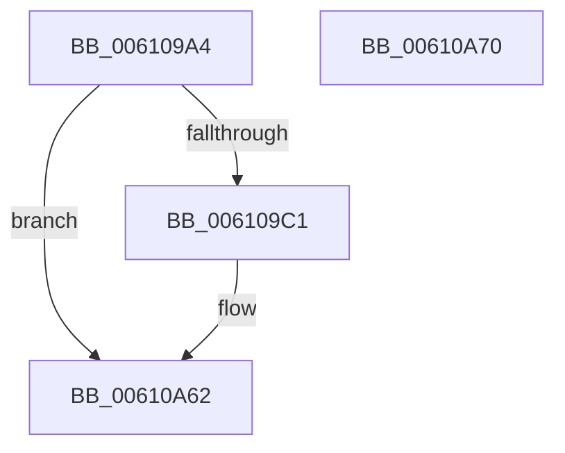

# SMKM_STORE&lt;SM_TRAITS&gt;::SmStEtwFillStoreStatsEvent

- RVA: `0x006109A4`–`0x00610A71` (길이 `205` bytes)
- VA: `0x00000001406109A4`
- 실행 섹션: `.text`
- PDB 이름 있음: `예`; PDB Function 태그: `아니요`
- unwind 정보 RVA: `0x0005CAAC`
- 디코드: `51`개 명령, `205/205` bytes 표시
- 미해석 바이트: `0` (있으면 어셈블리에 `.byte`로 보존)

> 이 문서는 커널 이미지의 기계어와 PDB 기호를 분석해 생성했습니다. 4번과 5번은 함수 원형과 자료형을 바이너리 사용 방식에서 추정한 C 해석이며 원본 소스 복구 결과는 아닙니다.

## 1. Dependencies

- 직접 호출 지점: **2**; 고유 호출 대상: **2**
- 직접 호출자로 확인된 함수: **1**
- RIP 상대 이미지 참조: **0**

### Outgoing calls
- `0x00610A3D` → [ST_STORE<SM_TRAITS>::StCopyIoStats](../60/ST_STORE_SM_TRAITS_StCopyIoStats_function_0060CD5C.md) (function, `0x0060CD5C`)
- `0x00610A57` → [StLcBucketsCopy](../60/StLcBucketsCopy_function_0060F110.md) (function, `0x0060F110`)

### Direct callers
- [SmKmEtwLogStoreStats](../../page/7A/SmKmEtwLogStoreStats_function_007A82AC.md) at `0x007A8342`

### Static image references
- 디코드된 RIP-relative 메모리 참조가 없습니다.

## 2. Other-region calls and transfers

- 다른 실행 섹션으로 향하는 call: **0**
- 별도 외부 분기/꼬리 이동을 확인하지 못했습니다.

## 3. Assembly (complete function range)

```asm
006109A4  48 89 5C 24 08                  mov qword ptr [rsp + 8], rbx
006109A9  57                              push rdi
006109AA  48 83 EC 20                     sub rsp, 0x20
006109AE  45 33 D2                        xor r10d, r10d
006109B1  48 8B F9                        mov rdi, rcx
006109B4  4C 39 91 E0 08 00 00            cmp qword ptr [rcx + 0x8e0], r10
006109BB  0F 84 A1 00 00 00               je 0x140610a62
006109C1  44 8B 4A 18                     mov r9d, dword ptr [rdx + 0x18]
006109C5  41 B8 44 05 00 00               mov r8d, 0x544
006109CB  4C 03 4A 08                     add r9, qword ptr [rdx + 8]
006109CF  49 89 09                        mov qword ptr [r9], rcx
006109D2  8B 42 10                        mov eax, dword ptr [rdx + 0x10]
006109D5  48 C1 E0 04                     shl rax, 4
006109D9  48 03 02                        add rax, qword ptr [rdx]
006109DC  4C 89 08                        mov qword ptr [rax], r9
006109DF  48 C7 40 08 08 00 00 00         mov qword ptr [rax + 8], 8
006109E7  83 42 18 08                     add dword ptr [rdx + 0x18], 8
006109EB  FF 42 10                        inc dword ptr [rdx + 0x10]
006109EE  8B 4A 18                        mov ecx, dword ptr [rdx + 0x18]
006109F1  48 03 4A 08                     add rcx, qword ptr [rdx + 8]
006109F5  44 89 01                        mov dword ptr [rcx], r8d
006109F8  8B 42 10                        mov eax, dword ptr [rdx + 0x10]
006109FB  48 C1 E0 04                     shl rax, 4
006109FF  48 03 02                        add rax, qword ptr [rdx]
00610A02  48 89 08                        mov qword ptr [rax], rcx
00610A05  48 C7 40 08 04 00 00 00         mov qword ptr [rax + 8], 4
00610A0D  FF 42 10                        inc dword ptr [rdx + 0x10]
00610A10  8B 42 10                        mov eax, dword ptr [rdx + 0x10]
00610A13  83 42 18 04                     add dword ptr [rdx + 0x18], 4
00610A17  8B 5A 18                        mov ebx, dword ptr [rdx + 0x18]
00610A1A  48 03 5A 08                     add rbx, qword ptr [rdx + 8]
00610A1E  48 C1 E0 04                     shl rax, 4
00610A22  48 8B CB                        mov rcx, rbx
00610A25  48 03 02                        add rax, qword ptr [rdx]
00610A28  48 89 18                        mov qword ptr [rax], rbx
00610A2B  4C 89 40 08                     mov qword ptr [rax + 8], r8
00610A2F  FF 42 10                        inc dword ptr [rdx + 0x10]
00610A32  44 01 42 18                     add dword ptr [rdx + 0x18], r8d
00610A36  48 8D 97 B0 13 00 00            lea rdx, [rdi + 0x13b0]
00610A3D  E8 1A C3 FF FF                  call 0x14060cd5c
00610A42  44 8B 8F D0 18 00 00            mov r9d, dword ptr [rdi + 0x18d0]
00610A49  48 8D 8B 04 05 00 00            lea rcx, [rbx + 0x504]
00610A50  4C 8B 87 D8 18 00 00            mov r8, qword ptr [rdi + 0x18d8]
00610A57  E8 B4 E6 FF FF                  call 0x14060f110
00610A5C  41 BA 01 00 00 00               mov r10d, 1
00610A62  48 8B 5C 24 30                  mov rbx, qword ptr [rsp + 0x30]
00610A67  41 8B C2                        mov eax, r10d
00610A6A  48 83 C4 20                     add rsp, 0x20
00610A6E  5F                              pop rdi
00610A6F  C3                              ret
00610A70  CC                              int3
```

## 4. C-style interpretation (structured pseudocode)

```c
__int64 __fastcall SMKM_STORE_SM_TRAITS___SmStEtwFillStoreStatsEvent(__int64 a1, __int64 a2)
{
    __int64 result;
    __int64 v_r10;
    __int64 v_rbx;
    __int64 v_rsp;
    unsigned __int64 v_stack_p8;

    v_stack_p8 = v_rbx;
    v_rsp = (v_rsp) - (32);
    v_r10 = 0;
    if ((*(unsigned __int64 *)(a1 + 2272)) != 0) {
        a4 = *(unsigned int *)(a2 + 24);
        a3 = 0x544ULL;
        a4 = (a4) + (*(unsigned __int64 *)(a2 + 8));
        *(unsigned __int64 *)(a4) = a1;
        result = *(unsigned int *)(a2 + 16);
        result = (result) << (4);
        result = (result) + (*(unsigned __int64 *)(a2));
        *(unsigned __int64 *)(result) = a4;
        *(unsigned __int64 *)(result + 8) = 8;
        a1 = *(unsigned int *)(a2 + 24);
        a1 = (a1) + (*(unsigned __int64 *)(a2 + 8));
        *(unsigned int *)(a1) = (unsigned int)(a3);
        result = *(unsigned int *)(a2 + 16);
        result = (result) << (4);
        result = (result) + (*(unsigned __int64 *)(a2));
        *(unsigned __int64 *)(result) = a1;
        *(unsigned __int64 *)(result + 8) = 4;
        result = *(unsigned int *)(a2 + 16);
        v_rbx = *(unsigned int *)(a2 + 24);
        v_rbx = (v_rbx) + (*(unsigned __int64 *)(a2 + 8));
        result = (result) << (4);
        a1 = v_rbx;
        result = (result) + (*(unsigned __int64 *)(a2));
        *(unsigned __int64 *)(result) = v_rbx;
        *(unsigned __int64 *)(result + 8) = a3;
        a2 = a1 + 5040;
        result = ST_STORE_SM_TRAITS___StCopyIoStats(a1, a2, a3, a4);
        a4 = *(unsigned int *)(a1 + 6352);
        a1 = v_rbx + 1284;
        a3 = *(unsigned __int64 *)(a1 + 6360);
        result = StLcBucketsCopy(a1, a2, a3, a4);
        v_r10 = 1;
    }
    v_rsp = (v_rsp) + (32);
    return (unsigned int)((unsigned int)(v_r10));
}
```

## 5. (Beta) C Style

```c
int64_t SMKM_STORE_SM_TRAITS___SmStEtwFillStoreStatsEvent(void *Arg1, void *Arg2)
{
    uint8_t *arg1 = (uint8_t *)Arg1;
    uint8_t *arg2 = (uint8_t *)Arg2;

    int64_t result;
    int64_t local_r10;
    int64_t local_rbx;
    int64_t local_rsp;
    uint64_t v_stack_p8;

    v_stack_p8 = local_rbx;
    local_rsp = (local_rsp) - (32);
    local_r10 = 0;
    if ((*(uint64_t *)(arg1 + 0x8E0)) != 0) {
        a4 = *(uint32_t *)(arg2 + 0x18);
        a3 = 0x544ULL;
        a4 = (a4) + (*(uint64_t *)(arg2 + 0x8));
        *(void **)(a4) = Arg1;
        result = *(uint32_t *)(arg2 + 0x10);
        result = (result) << (4);
        result = (result) + (*(uint64_t *)(arg2));
        *(uint64_t *)(result) = a4;
        *(uint64_t *)(result + 0x8) = 8;
        Arg1 = *(uint32_t *)(arg2 + 0x18);
        Arg1 = (Arg1) + (*(uint64_t *)(arg2 + 0x8));
        *(uint32_t *)(arg1) = (uint32_t)(a3);
        result = *(uint32_t *)(arg2 + 0x10);
        result = (result) << (4);
        result = (result) + (*(uint64_t *)(arg2));
        *(void **)(result) = Arg1;
        *(uint64_t *)(result + 0x8) = 4;
        result = *(uint32_t *)(arg2 + 0x10);
        local_rbx = *(uint32_t *)(arg2 + 0x18);
        local_rbx = (local_rbx) + (*(uint64_t *)(arg2 + 0x8));
        result = (result) << (4);
        Arg1 = local_rbx;
        result = (result) + (*(uint64_t *)(arg2));
        *(uint64_t *)(result) = local_rbx;
        *(uint64_t *)(result + 0x8) = a3;
        Arg2 = Arg1 + 5040;
        result = ST_STORE_SM_TRAITS___StCopyIoStats(Arg1, Arg2, a3, a4);
        a4 = *(uint32_t *)(arg1 + 0x18D0);
        Arg1 = local_rbx + 1284;
        a3 = *(uint64_t *)(arg1 + 0x18D8);
        result = StLcBucketsCopy(Arg1, Arg2, a3, a4);
        local_r10 = 1;
    }
    local_rsp = (local_rsp) + (32);
    return (uint32_t)((uint32_t)(local_r10));
}
```

### 관측된 메모리 오프셋

구조체 형식이 확인되지 않은 접근은 인자 기준의 오프셋으로만 기록했습니다.

| 기준 인자 | 오프셋 표현 | 폭 (bit) | 접근 |
|---|---:|---:|---|
| `Arg1` | `+ 0x8E0` | `64` | `R` |
| `Arg1` | `+ 0x13B0` | `64` | `R` |
| `Arg1` | `+ 0x18D0` | `32` | `R` |
| `Arg1` | `+ 0x18D8` | `64` | `R` |
| `Arg2` | `+ 0x0` | `64` | `R` |
| `Arg2` | `+ 0x8` | `64` | `R` |
| `Arg2` | `+ 0x10` | `32` | `R` |
| `Arg2` | `+ 0x10` | `32` | `R/W` |
| `Arg2` | `+ 0x18` | `32` | `R` |
| `Arg2` | `+ 0x18` | `32` | `R/W` |

## 6. Execution-region graph

[열기: 2D/3D 그래프와 함수 탐색 컨트롤 패널](../../../control-panel.html?section=text&rva=0x006109A4&view=graph)

- 2D 그래프는 위에서 아래로 흐르고, 3D 그래프는 빈 공간을 드래그해 회전합니다. Shift+드래그는 이동, 휠은 확대·축소, 함수 노드 선택은 대상 보고서 이동입니다.

### Static fallback


