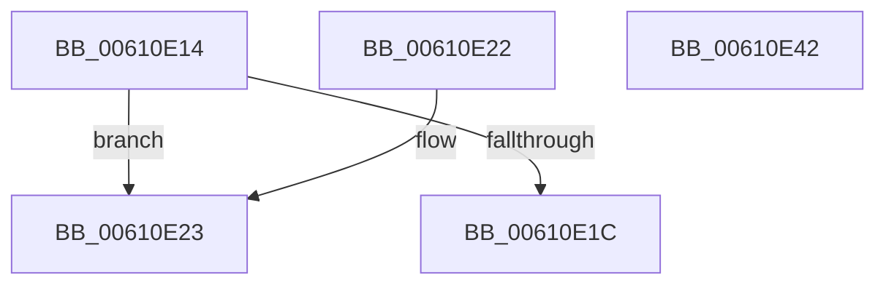

# SmCalcIoWorkItemSize

- RVA: `0x00610E14`–`0x00610E43` (길이 `47` bytes)
- VA: `0x0000000140610E14`
- 실행 섹션: `.text`
- PDB 이름 있음: `예`; PDB Function 태그: `아니요`
- unwind 정보 RVA: `0x000DB714`
- 디코드: `13`개 명령, `47/47` bytes 표시
- 미해석 바이트: `0` (있으면 어셈블리에 `.byte`로 보존)

> 이 문서는 커널 이미지의 기계어와 PDB 기호를 분석해 생성했습니다. 4번과 5번은 함수 원형과 자료형을 바이너리 사용 방식에서 추정한 C 해석이며 원본 소스 복구 결과는 아닙니다.

## 1. Dependencies

- 직접 호출 지점: **0**; 고유 호출 대상: **0**
- 직접 호출자로 확인된 함수: **1**
- RIP 상대 이미지 참조: **0**

### Outgoing calls
- 직접 디코드된 call 명령이 없습니다.

### Direct callers
- [ST_STORE&lt;SM_TRAITS&gt;::StDeviceIoBuild](../60/ST_STORE_SM_TRAITS_StDeviceIoBuild_function_0060CDEC.md) at `0x0060CEF5`

### Static image references
- 디코드된 RIP-relative 메모리 참조가 없습니다.

## 2. Other-region calls and transfers

- 다른 실행 섹션으로 향하는 call: **0**
- 별도 외부 분기/꼬리 이동을 확인하지 못했습니다.

## 3. Assembly (complete function range)

```asm
00610E14  F7 01 00 20 00 00               test dword ptr [rcx], 0x2000
00610E1A  74 07                           je 0x140610e23
00610E1C  B8 30 00 00 00                  mov eax, 0x30
00610E21  C3                              ret
00610E22  CC                              int3
00610E23  41 8B C8                        mov ecx, r8d
00610E26  81 E2 FF 0F 00 00               and edx, 0xfff
00610E2C  48 81 C1 FF 0F 00 00            add rcx, 0xfff
00610E33  48 03 CA                        add rcx, rdx
00610E36  48 C1 E9 0C                     shr rcx, 0xc
00610E3A  8D 04 CD 60 00 00 00            lea eax, [rcx*8 + 0x60]
00610E41  C3                              ret
00610E42  CC                              int3
```

## 4. C-style interpretation (structured pseudocode)

```c
__int64 __fastcall SmCalcIoWorkItemSize(__int64 a1, int a2, int a3)
{
    if (((*(unsigned int *)(a1)) & (0x2000ULL)) == 0) goto loc_00610E23;
    return 48;
loc_00610E23:
    a2 = (unsigned int)((a2) & (0xFFFULL));
    a1 = ((unsigned int)(a3)) + (0xFFFULL);
    a1 = (a1) + (a2);
    a1 = (a1) >> (12);
    return a1 * 8 + 96;
}
```

## 5. (Beta) C Style

```c
int64_t SmCalcIoWorkItemSize(void *Arg1, int32_t Arg2, int32_t Arg3)
{
    uint8_t *arg1 = (uint8_t *)Arg1;

    if (((*(uint32_t *)(arg1)) & (0x2000ULL)) == 0) goto loc_00610E23;
    return 48;
loc_00610E23:
    Arg2 = (uint32_t)((Arg2) & (0xFFFULL));
    Arg1 = ((uint32_t)(Arg3)) + (0xFFFULL);
    Arg1 = (Arg1) + (Arg2);
    Arg1 = (Arg1) >> (12);
    return Arg1 * 8 + 96;
}
```

### 관측된 메모리 오프셋

구조체 형식이 확인되지 않은 접근은 인자 기준의 오프셋으로만 기록했습니다.

| 기준 인자 | 오프셋 표현 | 폭 (bit) | 접근 |
|---|---:|---:|---|
| `Arg1` | `+ 0x0` | `32` | `R` |

## 6. Execution-region graph

[열기: 2D/3D 그래프와 함수 탐색 컨트롤 패널](../../../control-panel.html?section=text&rva=0x00610E14&view=graph)

- 2D 그래프는 위에서 아래로 흐르고, 3D 그래프는 빈 공간을 드래그해 회전합니다. Shift+드래그는 이동, 휠은 확대·축소, 함수 노드 선택은 대상 보고서 이동입니다.

### Static fallback


