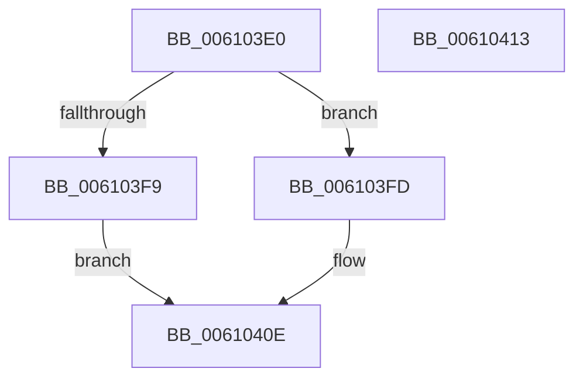

# SmFatalHeapCorruptionDumpCallback

- RVA: `0x006103E0`–`0x00610414` (길이 `52` bytes)
- VA: `0x00000001406103E0`
- 실행 섹션: `.text`
- PDB 이름 있음: `예`; PDB Function 태그: `아니요`
- unwind 정보 RVA: `0x000DB714`
- 디코드: `15`개 명령, `52/52` bytes 표시
- 미해석 바이트: `0` (있으면 어셈블리에 `.byte`로 보존)

> 이 문서는 커널 이미지의 기계어와 PDB 기호를 분석해 생성했습니다. 4번과 5번은 함수 원형과 자료형을 바이너리 사용 방식에서 추정한 C 해석이며 원본 소스 복구 결과는 아닙니다.

## 1. Dependencies

- 직접 호출 지점: **0**; 고유 호출 대상: **0**
- 직접 호출자로 확인된 함수: **0**
- RIP 상대 이미지 참조: **1**

### Outgoing calls
- 직접 디코드된 call 명령이 없습니다.

### Direct callers
- 이 함수 시작 RVA로 연결되는 직접 call은 확인되지 않았습니다. 간접 호출은 완전히 역산할 수 없습니다.

### Static image references
- `0x006103FD` → RVA `0x00038030` (`.rdata`; read)

## 2. Other-region calls and transfers

- 다른 실행 섹션으로 향하는 call: **0**
- 별도 외부 분기/꼬리 이동을 확인하지 못했습니다.

## 3. Assembly (complete function range)

```asm
006103E0  41 8B 40 0C                     mov eax, dword ptr [r8 + 0xc]
006103E4  48 83 C2 37                     add rdx, 0x37
006103E8  48 83 E2 F8                     and rdx, 0xfffffffffffffff8
006103EC  48 8B 4A 10                     mov rcx, qword ptr [rdx + 0x10]
006103F0  48 83 C1 30                     add rcx, 0x30
006103F4  48 3B C8                        cmp rcx, rax
006103F7  76 04                           jbe 0x1406103fd
006103F9  33 C9                           xor ecx, ecx
006103FB  EB 11                           jmp 0x14061040e
006103FD  0F 10 05 2C 7C A2 FF            movups xmm0, xmmword ptr [rip - 0x5d83d4]
00610404  49 89 50 20                     mov qword ptr [r8 + 0x20], rdx
00610408  F3 41 0F 7F 40 10               movdqu xmmword ptr [r8 + 0x10], xmm0
0061040E  41 89 48 28                     mov dword ptr [r8 + 0x28], ecx
00610412  C3                              ret
00610413  CC                              int3
```

## 4. C-style interpretation (structured pseudocode)

```c
__int64 __fastcall SmFatalHeapCorruptionDumpCallback(__int64 a1, __int64 a2, __int64 a3)
{
    a2 = (a2) + (55);
    a2 = (a2) & (-8);
    a1 = (*(unsigned __int64 *)(a2 + 16)) + (48);
    if (a1 <= ((unsigned int)(*(unsigned int *)(a3 + 12)))) goto loc_006103FD;
    a1 = 0;
    goto loc_0061040E;
loc_006103FD:
    *(unsigned __int64 *)(a3 + 32) = a2;
    *(unsigned __int64 *)(a3 + 16) = v_xmm0;
loc_0061040E:
    *(unsigned int *)(a3 + 40) = 0;
    return (unsigned int)(*(unsigned int *)(a3 + 12));
}
```

## 5. (Beta) C Style

```c
int64_t SmFatalHeapCorruptionDumpCallback(int64_t Arg1, void *Arg2, void *Arg3)
{
    uint8_t *arg2 = (uint8_t *)Arg2;
    uint8_t *arg3 = (uint8_t *)Arg3;

    Arg2 = (Arg2) + (55);
    Arg2 = (Arg2) & (-8);
    Arg1 = (*(uint64_t *)(arg2 + 0x10)) + (48);
    if (Arg1 <= ((uint32_t)(*(uint32_t *)(arg3 + 0xC)))) goto loc_006103FD;
    Arg1 = 0;
    goto loc_0061040E;
loc_006103FD:
    *(void **)(arg3 + 0x20) = Arg2;
    *(uint64_t *)(arg3 + 0x10) = v_xmm0;
loc_0061040E:
    *(uint32_t *)(arg3 + 0x28) = 0;
    return (uint32_t)(*(uint32_t *)(arg3 + 0xC));
}
```

### 관측된 메모리 오프셋

구조체 형식이 확인되지 않은 접근은 인자 기준의 오프셋으로만 기록했습니다.

| 기준 인자 | 오프셋 표현 | 폭 (bit) | 접근 |
|---|---:|---:|---|
| `Arg2` | `+ 0x10` | `64` | `R` |
| `Arg3` | `+ 0xC` | `32` | `R` |
| `Arg3` | `+ 0x10` | `128` | `W` |
| `Arg3` | `+ 0x20` | `64` | `W` |
| `Arg3` | `+ 0x28` | `32` | `W` |

## 6. Execution-region graph

[열기: 2D/3D 그래프와 함수 탐색 컨트롤 패널](../../../control-panel.html?section=text&rva=0x006103E0&view=graph)

- 2D 그래프는 위에서 아래로 흐르고, 3D 그래프는 빈 공간을 드래그해 회전합니다. Shift+드래그는 이동, 휠은 확대·축소, 함수 노드 선택은 대상 보고서 이동입니다.

### Static fallback


