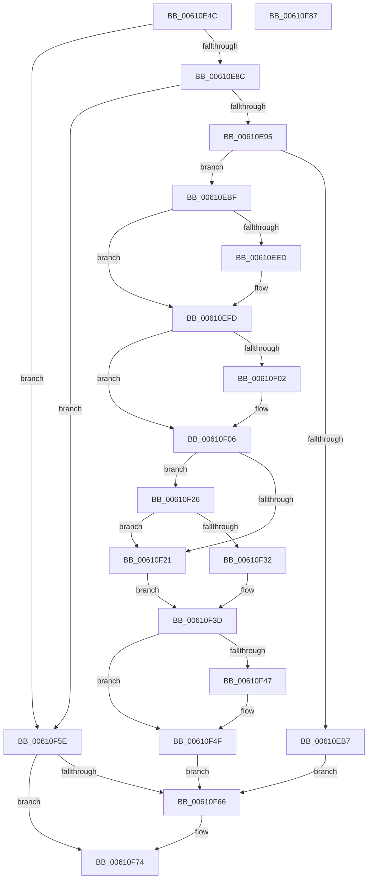

# SmGetStoreOwnerProcessId

- RVA: `0x00610E4C`–`0x00610F88` (길이 `316` bytes)
- VA: `0x0000000140610E4C`
- 실행 섹션: `.text`
- PDB 이름 있음: `예`; PDB Function 태그: `아니요`
- unwind 정보 RVA: `0x00099F10`
- 디코드: `88`개 명령, `316/316` bytes 표시
- 미해석 바이트: `0` (있으면 어셈블리에 `.byte`로 보존)

> 이 문서는 커널 이미지의 기계어와 PDB 기호를 분석해 생성했습니다. 4번과 5번은 함수 원형과 자료형을 바이너리 사용 방식에서 추정한 C 해석이며 원본 소스 복구 결과는 아닙니다.

## 1. Dependencies

- 직접 호출 지점: **9**; 고유 호출 대상: **9**
- 직접 호출자로 확인된 함수: **1**
- RIP 상대 이미지 참조: **0**

### Outgoing calls
- `0x00610E7E` → [SmKmStoreReference](../34/SmKmStoreReference_function_0034BFB0.md) (function, `0x0034BFB0`)
- `0x00610EA4` → [SmKmStoreRefFromStoreIndex](../43/SmKmStoreRefFromStoreIndex_function_004341A0.md) (function, `0x004341A0`)
- `0x00610ED8` → [KeAbPreAcquire](../21/KeAbPreAcquire_function_00210230.md) (function, `0x00210230`)
- `0x00610EF8` → [ExfAcquirePushLockSharedEx](../21/ExfAcquirePushLockSharedEx_function_0021044C.md) (function, `0x0021044C`)
- `0x00610F17` → [SmpKeyedStoreEntryGet](../34/SmpKeyedStoreEntryGet_function_00349FB0.md) (function, `0x00349FB0`)
- `0x00610F4A` → [ExfReleasePushLockShared](../26/ExfReleasePushLockShared_function_00263440.md) (function, `0x00263440`)
- `0x00610F52` → [KeAbPostRelease](../2E/KeAbPostRelease_function_002E1600.md) (function, `0x002E1600`)
- `0x00610F57` → [KeLeaveCriticalRegion](../25/KeLeaveCriticalRegion_function_0025D8B0.md) (function, `0x0025D8B0`)
- `0x00610F6F` → [SmKmStoreDereference](../20/SmKmStoreDereference_function_00206574.md) (function, `0x00206574`)

### Direct callers
- [SMKM_STORE&lt;SM_TRAITS&gt;::SmStEtwFillStoreEvent](SMKM_STORE_SM_TRAITS_SmStEtwFillStoreEvent_function_0061058C.md) at `0x0061092B`

### Static image references
- 디코드된 RIP-relative 메모리 참조가 없습니다.

## 2. Other-region calls and transfers

- 다른 실행 섹션으로 향하는 call: **0**
- 별도 외부 분기/꼬리 이동을 확인하지 못했습니다.

## 3. Assembly (complete function range)

```asm
00610E4C  48 89 5C 24 18                  mov qword ptr [rsp + 0x18], rbx
00610E51  55                              push rbp
00610E52  56                              push rsi
00610E53  57                              push rdi
00610E54  41 56                           push r14
00610E56  41 57                           push r15
00610E58  48 83 EC 20                     sub rsp, 0x20
00610E5C  48 8B A9 90 1D 00 00            mov rbp, qword ptr [rcx + 0x1d90]
00610E63  48 8B F1                        mov rsi, rcx
00610E66  8B 91 90 1A 00 00               mov edx, dword ptr [rcx + 0x1a90]
00610E6C  45 33 F6                        xor r14d, r14d
00610E6F  48 8B CD                        mov rcx, rbp
00610E72  4C 89 74 24 58                  mov qword ptr [rsp + 0x58], r14
00610E77  48 8D BD B8 08 00 00            lea rdi, [rbp + 0x8b8]
00610E7E  E8 2D B1 D3 FF                  call 0x14034bfb0
00610E83  48 85 C0                        test rax, rax
00610E86  0F 84 D2 00 00 00               je 0x140610f5e
00610E8C  48 3B C6                        cmp rax, rsi
00610E8F  0F 85 C9 00 00 00               jne 0x140610f5e
00610E95  8B 96 90 1A 00 00               mov edx, dword ptr [rsi + 0x1a90]
00610E9B  48 8B CD                        mov rcx, rbp
00610E9E  81 E2 FF 03 00 00               and edx, 0x3ff
00610EA4  E8 F7 32 E2 FF                  call 0x1404341a0
00610EA9  48 8B 48 18                     mov rcx, qword ptr [rax + 0x18]
00610EAD  48 89 4C 24 58                  mov qword ptr [rsp + 0x58], rcx
00610EB2  48 85 C9                        test rcx, rcx
00610EB5  75 08                           jne 0x140610ebf
00610EB7  41 8B DE                        mov ebx, r14d
00610EBA  E9 A7 00 00 00                  jmp 0x140610f66
00610EBF  65 48 8B 04 25 88 01 00 00      mov rax, qword ptr gs:[0x188]
00610EC8  45 33 C0                        xor r8d, r8d
00610ECB  33 D2                           xor edx, edx
00610ECD  48 8B CF                        mov rcx, rdi
00610ED0  66 FF 88 E4 01 00 00            dec word ptr [rax + 0x1e4]
00610ED7  90                              nop
00610ED8  E8 53 F3 BF FF                  call 0x140210230
00610EDD  48 8B D8                        mov rbx, rax
00610EE0  33 C0                           xor eax, eax
00610EE2  44 8D 78 11                     lea r15d, [rax + 0x11]
00610EE6  F0 4C 0F B1 3F                  lock cmpxchg qword ptr [rdi], r15
00610EEB  74 10                           je 0x140610efd
00610EED  4C 8B CF                        mov r9, rdi
00610EF0  4C 8B C3                        mov r8, rbx
00610EF3  33 D2                           xor edx, edx
00610EF5  48 8B CF                        mov rcx, rdi
00610EF8  E8 4F F5 BF FF                  call 0x14021044c
00610EFD  48 85 DB                        test rbx, rbx
00610F00  74 04                           je 0x140610f06
00610F02  C6 43 0A 01                     mov byte ptr [rbx + 0xa], 1
00610F06  41 B9 01 00 00 00               mov r9d, 1
00610F0C  48 8D 54 24 58                  lea rdx, [rsp + 0x58]
00610F11  45 33 C0                        xor r8d, r8d
00610F14  48 8B CF                        mov rcx, rdi
00610F17  E8 94 90 D3 FF                  call 0x140349fb0
00610F1C  48 85 C0                        test rax, rax
00610F1F  75 05                           jne 0x140610f26
00610F21  83 CB FF                        or ebx, 0xffffffff
00610F24  EB 17                           jmp 0x140610f3d
00610F26  0F B7 40 10                     movzx eax, word ptr [rax + 0x10]
00610F2A  3B 86 90 1A 00 00               cmp eax, dword ptr [rsi + 0x1a90]
00610F30  75 EF                           jne 0x140610f21
00610F32  48 8B 54 24 58                  mov rdx, qword ptr [rsp + 0x58]
00610F37  8B 9A D0 01 00 00               mov ebx, dword ptr [rdx + 0x1d0]
00610F3D  49 8B C7                        mov rax, r15
00610F40  F0 4C 0F B1 37                  lock cmpxchg qword ptr [rdi], r14
00610F45  74 08                           je 0x140610f4f
00610F47  48 8B CF                        mov rcx, rdi
00610F4A  E8 F1 24 C5 FF                  call 0x140263440
00610F4F  48 8B CF                        mov rcx, rdi
00610F52  E8 A9 06 CD FF                  call 0x1402e1600
00610F57  E8 54 C9 C4 FF                  call 0x14025d8b0
00610F5C  EB 08                           jmp 0x140610f66
00610F5E  83 CB FF                        or ebx, 0xffffffff
00610F61  48 85 C0                        test rax, rax
00610F64  74 0E                           je 0x140610f74
00610F66  8B 96 90 1A 00 00               mov edx, dword ptr [rsi + 0x1a90]
00610F6C  48 8B CD                        mov rcx, rbp
00610F6F  E8 00 56 BF FF                  call 0x140206574
00610F74  8B C3                           mov eax, ebx
00610F76  48 8B 5C 24 60                  mov rbx, qword ptr [rsp + 0x60]
00610F7B  48 83 C4 20                     add rsp, 0x20
00610F7F  41 5F                           pop r15
00610F81  41 5E                           pop r14
00610F83  5F                              pop rdi
00610F84  5E                              pop rsi
00610F85  5D                              pop rbp
00610F86  C3                              ret
00610F87  CC                              int3
```

## 4. C-style interpretation (structured pseudocode)

```c
__int64 __fastcall SmGetStoreOwnerProcessId(__int64 a1, __int64 a2, int a3)
{
    __int64 result;
    __int64 v_r14;
    __int64 v_rbx;
    __int64 v_rsp;
    unsigned __int64 v_stack_p10;
    unsigned __int64 v_stack_p18;

    v_stack_p18 = v_rbx;
    v_rsp = (v_rsp) - (32);
    v_r14 = 0;
    v_stack_p10 = 0;
    result = SmKmStoreReference(*(unsigned __int64 *)(a1 + 7568), (unsigned int)(*(unsigned int *)(a1 + 6800)), a3, a4);
    if (result == 0) goto loc_00610F5E;
    if (result != a1) goto loc_00610F5E;
    a2 = (unsigned int)(((unsigned int)(*(unsigned int *)(a1 + 6800))) & (0x3FFULL));
    result = SmKmStoreRefFromStoreIndex(*(unsigned __int64 *)(a1 + 7568), a2, a3, a4);
    v_stack_p10 = *(unsigned __int64 *)(result + 24);
    if (*(unsigned __int64 *)(result + 24) != 0) goto loc_00610EBF;
    goto loc_00610F66;
loc_00610EBF:
    a3 = 0;
    a2 = 0;
    result = KeAbPreAcquire(*(unsigned __int64 *)(a1 + 7568) + 2232, a2, a3, a4);
    result = 0;
    if (!(condition_is_equal)) {
        a4 = *(unsigned __int64 *)(a1 + 7568) + 2232;
        a3 = 0;
        a2 = 0;
        a1 = *(unsigned __int64 *)(a1 + 7568) + 2232;
        result = ExfAcquirePushLockSharedEx(a1, a2, a3, a4);
    }
    if (result != 0) {
        *(unsigned __int8 *)(result + 10) = 1;
    }
    a3 = 0;
    result = SmpKeyedStoreEntryGet(*(unsigned __int64 *)(a1 + 7568) + 2232, v_stack_p10, a3, 1);
    if (result != 0) goto loc_00610F26;
loc_00610F21:
    v_rbx = (unsigned int)((result) | (0xFFFFFFFFULL));
    goto loc_00610F3D;
loc_00610F26:
    if (((unsigned int)(*(unsigned __int16 *)(result + 16))) != (*(unsigned int *)(a1 + 6800))) goto loc_00610F21;
loc_00610F3D:
    result = result + 17;
    if (((unsigned int)(*(unsigned __int16 *)(result + 16))) != (*(unsigned int *)(a1 + 6800))) {
        a1 = *(unsigned __int64 *)(a1 + 7568) + 2232;
        result = ExfReleasePushLockShared(a1, v_stack_p10, a3, 1);
    }
    result = KeAbPostRelease(*(unsigned __int64 *)(a1 + 7568) + 2232, v_stack_p10, a3, 1);
    result = KeLeaveCriticalRegion(*(unsigned __int64 *)(a1 + 7568) + 2232, v_stack_p10, a3, 1);
    goto loc_00610F66;
loc_00610F5E:
    v_rbx = (unsigned int)(((unsigned int)(*(unsigned int *)(v_stack_p10 + 464))) | (0xFFFFFFFFULL));
    if (result != 0) {
        a2 = *(unsigned int *)(a1 + 6800);
        a1 = *(unsigned __int64 *)(a1 + 7568);
        result = SmKmStoreDereference(a1, a2, a3, 1);
    }
    v_rsp = (v_rsp) + (32);
    return (unsigned int)((unsigned int)(v_rbx));
}
```

## 5. (Beta) C Style

```c
int64_t SmGetStoreOwnerProcessId(void *Arg1, int64_t Arg2, int32_t Arg3)
{
    uint8_t *arg1 = (uint8_t *)Arg1;

    int64_t result;
    int64_t local_r14;
    int64_t local_rbx;
    int64_t local_rsp;
    uint64_t v_stack_p10;
    uint64_t v_stack_p18;

    v_stack_p18 = local_rbx;
    local_rsp = (local_rsp) - (32);
    local_r14 = 0;
    v_stack_p10 = 0;
    result = SmKmStoreReference(*(uint64_t *)(arg1 + 0x1D90), (uint32_t)(*(uint32_t *)(arg1 + 0x1A90)), Arg3, a4);
    if (result == 0) goto loc_00610F5E;
    if (result != Arg1) goto loc_00610F5E;
    Arg2 = (uint32_t)(((uint32_t)(*(uint32_t *)(arg1 + 0x1A90))) & (0x3FFULL));
    result = SmKmStoreRefFromStoreIndex(*(uint64_t *)(arg1 + 0x1D90), Arg2, Arg3, a4);
    v_stack_p10 = *(uint64_t *)(result + 0x18);
    if (*(uint64_t *)(result + 0x18) != 0) goto loc_00610EBF;
    goto loc_00610F66;
loc_00610EBF:
    Arg3 = 0;
    Arg2 = 0;
    result = KeAbPreAcquire(*(uint64_t *)(arg1 + 0x1D90) + 2232, Arg2, Arg3, a4);
    result = 0;
    if (!(condition_is_equal)) {
        a4 = *(uint64_t *)(arg1 + 0x1D90) + 2232;
        Arg3 = 0;
        Arg2 = 0;
        Arg1 = *(uint64_t *)(arg1 + 0x1D90) + 2232;
        result = ExfAcquirePushLockSharedEx(Arg1, Arg2, Arg3, a4);
    }
    if (result != 0) {
        *(uint8_t *)(result + 0xA) = 1;
    }
    Arg3 = 0;
    result = SmpKeyedStoreEntryGet(*(uint64_t *)(arg1 + 0x1D90) + 2232, v_stack_p10, Arg3, 1);
    if (result != 0) goto loc_00610F26;
loc_00610F21:
    local_rbx = (uint32_t)((result) | (0xFFFFFFFFULL));
    goto loc_00610F3D;
loc_00610F26:
    if (((uint32_t)(*(uint16_t *)(result + 0x10))) != (*(uint32_t *)(arg1 + 0x1A90))) goto loc_00610F21;
loc_00610F3D:
    result = result + 17;
    if (((uint32_t)(*(uint16_t *)(result + 0x10))) != (*(uint32_t *)(arg1 + 0x1A90))) {
        Arg1 = *(uint64_t *)(arg1 + 0x1D90) + 2232;
        result = ExfReleasePushLockShared(Arg1, v_stack_p10, Arg3, 1);
    }
    result = KeAbPostRelease(*(uint64_t *)(arg1 + 0x1D90) + 2232, v_stack_p10, Arg3, 1);
    result = KeLeaveCriticalRegion(*(uint64_t *)(arg1 + 0x1D90) + 2232, v_stack_p10, Arg3, 1);
    goto loc_00610F66;
loc_00610F5E:
    local_rbx = (uint32_t)(((uint32_t)(*(uint32_t *)(v_stack_p10 + 0x1D0))) | (0xFFFFFFFFULL));
    if (result != 0) {
        Arg2 = *(uint32_t *)(arg1 + 0x1A90);
        Arg1 = *(uint64_t *)(arg1 + 0x1D90);
        result = SmKmStoreDereference(Arg1, Arg2, Arg3, 1);
    }
    local_rsp = (local_rsp) + (32);
    return (uint32_t)((uint32_t)(local_rbx));
}
```

### 관측된 메모리 오프셋

구조체 형식이 확인되지 않은 접근은 인자 기준의 오프셋으로만 기록했습니다.

| 기준 인자 | 오프셋 표현 | 폭 (bit) | 접근 |
|---|---:|---:|---|
| `Arg1` | `+ 0x1A90` | `32` | `R` |
| `Arg1` | `+ 0x1D90` | `64` | `R` |

## 6. Execution-region graph

[열기: 2D/3D 그래프와 함수 탐색 컨트롤 패널](../../../control-panel.html?section=text&rva=0x00610E4C&view=graph)

- 2D 그래프는 위에서 아래로 흐르고, 3D 그래프는 빈 공간을 드래그해 회전합니다. Shift+드래그는 이동, 휠은 확대·축소, 함수 노드 선택은 대상 보고서 이동입니다.

### Static fallback


