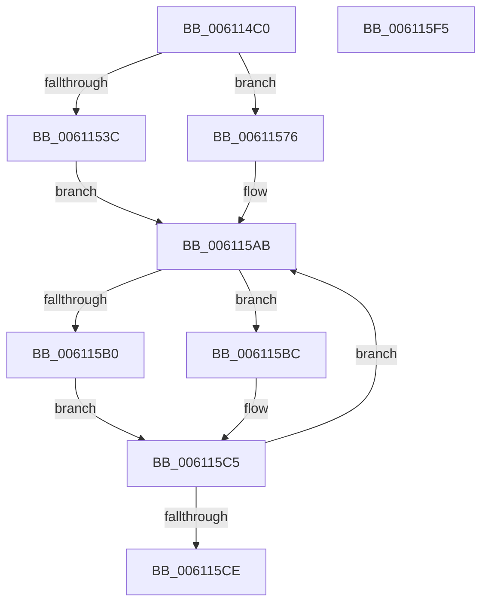

# SmHwAcceleratorIssueRequest

- RVA: `0x006114C0`–`0x006115F6` (길이 `310` bytes)
- VA: `0x00000001406114C0`
- 실행 섹션: `.text`
- PDB 이름 있음: `예`; PDB Function 태그: `아니요`
- unwind 정보 RVA: `0x000D20A0`
- 디코드: `85`개 명령, `310/310` bytes 표시
- 미해석 바이트: `0` (있으면 어셈블리에 `.byte`로 보존)

> 이 문서는 커널 이미지의 기계어와 PDB 기호를 분석해 생성했습니다. 4번과 5번은 함수 원형과 자료형을 바이너리 사용 방식에서 추정한 C 해석이며 원본 소스 복구 결과는 아닙니다.

## 1. Dependencies

- 직접 호출 지점: **4**; 고유 호출 대상: **3**
- 직접 호출자로 확인된 함수: **2**
- RIP 상대 이미지 참조: **0**

### Outgoing calls
- `0x006114F9` → [memset](../6C/memset_function_006C6C40.md) (function, `0x006C6C40`)
- `0x00611508` → [memset](../6C/memset_function_006C6C40.md) (function, `0x006C6C40`)
- `0x006115B5` → [AccelDecompressBuffer](../66/AccelDecompressBuffer_function_006683C8.md) (function, `0x006683C8`)
- `0x006115C0` → [AccelCompressBuffer](../66/AccelCompressBuffer_function_00668258.md) (function, `0x00668258`)

### Direct callers
- [sub_006D904C](../6D/Unknown_function_006D904C.md) at `0x006D9084`
- [sub_006E6668](../6E/Unknown_function_006E6668.md) at `0x006E6859`
- [sub_006E6668](../6E/Unknown_function_006E6668.md) at `0x006E69B2`

### Static image references
- 디코드된 RIP-relative 메모리 참조가 없습니다.

## 2. Other-region calls and transfers

- 다른 실행 섹션으로 향하는 call: **0**
- 별도 외부 분기/꼬리 이동을 확인하지 못했습니다.

## 3. Assembly (complete function range)

```asm
006114C0  48 8B C4                        mov rax, rsp
006114C3  48 89 58 08                     mov qword ptr [rax + 8], rbx
006114C7  48 89 70 10                     mov qword ptr [rax + 0x10], rsi
006114CB  48 89 78 18                     mov qword ptr [rax + 0x18], rdi
006114CF  55                              push rbp
006114D0  41 56                           push r14
006114D2  41 57                           push r15
006114D4  48 8D 68 B9                     lea rbp, [rax - 0x47]
006114D8  48 81 EC E0 00 00 00            sub rsp, 0xe0
006114DF  45 8B F0                        mov r14d, r8d
006114E2  8B DA                           mov ebx, edx
006114E4  48 8B F9                        mov rdi, rcx
006114E7  41 BF 58 00 00 00               mov r15d, 0x58
006114ED  45 8B C7                        mov r8d, r15d
006114F0  48 8D 4D CF                     lea rcx, [rbp - 0x31]
006114F4  33 D2                           xor edx, edx
006114F6  49 8B F1                        mov rsi, r9
006114F9  E8 42 57 0B 00                  call 0x1406c6c40
006114FE  45 8B C7                        mov r8d, r15d
00611501  48 8D 4C 24 20                  lea rcx, [rsp + 0x20]
00611506  33 D2                           xor edx, edx
00611508  E8 33 57 0B 00                  call 0x1406c6c40
0061150D  48 8B 47 08                     mov rax, qword ptr [rdi + 8]
00611511  8B CB                           mov ecx, ebx
00611513  4C 8B 40 20                     mov r8, qword ptr [rax + 0x20]
00611517  48 63 50 3C                     movsxd rdx, dword ptr [rax + 0x3c]
0061151B  41 0F AF 58 28                  imul ebx, dword ptr [r8 + 0x28]
00611520  41 0F AF 4C 90 38               imul ecx, dword ptr [r8 + rdx*4 + 0x38]
00611526  48 8D 57 20                     lea rdx, [rdi + 0x20]
0061152A  8B C3                           mov eax, ebx
0061152C  48 03 4F 10                     add rcx, qword ptr [rdi + 0x10]
00611530  48 03 D0                        add rdx, rax
00611533  41 8D 47 A9                     lea eax, [r15 - 0x57]
00611537  45 85 F6                        test r14d, r14d
0061153A  74 3A                           je 0x140611576
0061153C  89 44 24 30                     mov dword ptr [rsp + 0x30], eax
00611540  89 45 83                        mov dword ptr [rbp - 0x7d], eax
00611543  48 8B 45 77                     mov rax, qword ptr [rbp + 0x77]
00611547  48 89 45 97                     mov qword ptr [rbp - 0x69], rax
0061154B  8B 45 7F                        mov eax, dword ptr [rbp + 0x7f]
0061154E  89 45 9F                        mov dword ptr [rbp - 0x61], eax
00611551  8B 45 6F                        mov eax, dword ptr [rbp + 0x6f]
00611554  89 45 AF                        mov dword ptr [rbp - 0x51], eax
00611557  C7 44 24 20 01 00 58 00         mov dword ptr [rsp + 0x20], 0x580001
0061155F  48 89 54 24 28                  mov qword ptr [rsp + 0x28], rdx
00611564  48 89 4D 87                     mov qword ptr [rbp - 0x79], rcx
00611568  48 C7 45 8F 05 00 00 00         mov qword ptr [rbp - 0x71], 5
00611570  48 89 75 A7                     mov qword ptr [rbp - 0x59], rsi
00611574  EB 35                           jmp 0x1406115ab
00611576  89 45 DF                        mov dword ptr [rbp - 0x21], eax
00611579  89 45 E3                        mov dword ptr [rbp - 0x1d], eax
0061157C  8B 45 6F                        mov eax, dword ptr [rbp + 0x6f]
0061157F  89 45 FF                        mov dword ptr [rbp - 1], eax
00611582  48 8B 45 77                     mov rax, qword ptr [rbp + 0x77]
00611586  48 89 45 07                     mov qword ptr [rbp + 7], rax
0061158A  8B 45 7F                        mov eax, dword ptr [rbp + 0x7f]
0061158D  89 45 0F                        mov dword ptr [rbp + 0xf], eax
00611590  C7 45 CF 01 00 58 00            mov dword ptr [rbp - 0x31], 0x580001
00611597  48 89 55 D7                     mov qword ptr [rbp - 0x29], rdx
0061159B  48 89 4D E7                     mov qword ptr [rbp - 0x19], rcx
0061159F  48 C7 45 EF 04 00 00 00         mov qword ptr [rbp - 0x11], 4
006115A7  48 89 75 F7                     mov qword ptr [rbp - 9], rsi
006115AB  45 85 F6                        test r14d, r14d
006115AE  74 0C                           je 0x1406115bc
006115B0  48 8D 4C 24 20                  lea rcx, [rsp + 0x20]
006115B5  E8 0E 6E 05 00                  call 0x1406683c8
006115BA  EB 09                           jmp 0x1406115c5
006115BC  48 8D 4D CF                     lea rcx, [rbp - 0x31]
006115C0  E8 93 6C 05 00                  call 0x140668258
006115C5  8B C8                           mov ecx, eax
006115C7  3D 01 00 EF C0                  cmp eax, 0xc0ef0001
006115CC  74 DD                           je 0x1406115ab
006115CE  4C 8D 9C 24 E0 00 00 00         lea r11, [rsp + 0xe0]
006115D6  85 C9                           test ecx, ecx
006115D8  49 8B 5B 20                     mov rbx, qword ptr [r11 + 0x20]
006115DC  B8 03 01 00 00                  mov eax, 0x103
006115E1  49 8B 73 28                     mov rsi, qword ptr [r11 + 0x28]
006115E5  0F 48 C1                        cmovs eax, ecx
006115E8  49 8B 7B 30                     mov rdi, qword ptr [r11 + 0x30]
006115EC  49 8B E3                        mov rsp, r11
006115EF  41 5F                           pop r15
006115F1  41 5E                           pop r14
006115F3  5D                              pop rbp
006115F4  C3                              ret
006115F5  CC                              int3
```

## 4. C-style interpretation (structured pseudocode)

```c
__int64 __fastcall SmHwAcceleratorIssueRequest(__int64 a1, int a2, int a3, __int64 a4)
{
    __int64 result;
    __int64 v_rbx;
    __int64 v_rsp;
    unsigned __int64 v_stack_m18;
    unsigned int v_stack_mC8;
    unsigned __int64 v_stack_mD0;
    unsigned __int64 v_stack_mD8;

    *(unsigned __int64 *)(v_rsp + 8) = v_rbx;
    *(unsigned __int64 *)(v_rsp + 16) = v_rsi;
    *(unsigned __int64 *)(v_rsp + 24) = v_rdi;
    v_rsp = (v_rsp) - (224);
    a2 = 0;
    result = memset(v_rsp - 71 - 49, a2, 88, a4);
    a2 = 0;
    result = memset(v_stack_mD8, a2, 88, a4);
    v_rbx = (unsigned int)(((unsigned int)(a2)) * (*(unsigned int *)(*(unsigned __int64 *)(*(unsigned __int64 *)(a1 + 8) + 32) + 40)));
    a1 = (unsigned int)(((unsigned int)((unsigned int)((unsigned int)(a2)))) * (*(unsigned int *)(*(unsigned __int64 *)(*(unsigned __int64 *)(a1 + 8) + 32) + (int)(*(unsigned int *)(*(unsigned __int64 *)(a1 + 8) + 60)) * 4 + 56)));
    a1 = (a1) + (*(unsigned __int64 *)(a1 + 16));
    a2 = (a1 + 32) + ((unsigned int)((unsigned int)(v_rbx)));
    if ((unsigned int)((unsigned int)(a3)) == 0) goto loc_00611576;
    v_stack_mC8 = (unsigned int)(88 - 87);
    *(unsigned int *)(v_rsp - 71 - 125) = (unsigned int)(88 - 87);
    *(unsigned __int64 *)(v_rsp - 71 - 105) = *(unsigned __int64 *)(v_rsp - 71 + 119);
    *(unsigned int *)(v_rsp - 71 - 97) = (unsigned int)((unsigned int)(*(unsigned int *)(v_rsp - 71 + 127)));
    *(unsigned int *)(v_rsp - 71 - 81) = (unsigned int)((unsigned int)(*(unsigned int *)(v_rsp - 71 + 111)));
    v_stack_mD8 = 0x580001ULL;
    v_stack_mD0 = a2;
    *(unsigned __int64 *)(v_rsp - 71 - 121) = a1;
    *(unsigned __int64 *)(v_rsp - 71 - 113) = 5;
    *(unsigned __int64 *)(v_rsp - 71 - 89) = a4;
    goto loc_006115AB;
loc_00611576:
    *(unsigned int *)(v_rsp - 71 - 33) = (unsigned int)((unsigned int)(*(unsigned int *)(v_rsp - 71 + 111)));
    *(unsigned int *)(v_rsp - 71 - 29) = (unsigned int)((unsigned int)(*(unsigned int *)(v_rsp - 71 + 111)));
    *(unsigned int *)(v_rsp - 71 - 1) = (unsigned int)((unsigned int)(*(unsigned int *)(v_rsp - 71 + 111)));
    *(unsigned __int64 *)(v_rsp - 71 + 7) = *(unsigned __int64 *)(v_rsp - 71 + 119);
    *(unsigned int *)(v_rsp - 71 + 15) = (unsigned int)((unsigned int)(*(unsigned int *)(v_rsp - 71 + 127)));
    *(unsigned int *)(v_rsp - 71 - 49) = 0x580001ULL;
    *(unsigned __int64 *)(v_rsp - 71 - 41) = a2;
    *(unsigned __int64 *)(v_rsp - 71 - 25) = a1;
    *(unsigned __int64 *)(v_rsp - 71 - 17) = 4;
    *(unsigned __int64 *)(v_rsp - 71 - 9) = a4;
loc_006115AB:
    if ((unsigned int)((unsigned int)(a3)) == 0) goto loc_006115BC;
    result = AccelDecompressBuffer(v_stack_mD8, a2, *(unsigned __int64 *)(*(unsigned __int64 *)(a1 + 8) + 32), a4);
    goto loc_006115C5;
loc_006115BC:
    result = AccelCompressBuffer(v_rsp - 71 - 49, a2, *(unsigned __int64 *)(*(unsigned __int64 *)(a1 + 8) + 32), a4);
loc_006115C5:
    if (((unsigned int)(result)) == 0xC0EF0001ULL) goto loc_006115AB;
    result = 259;
    if (sign_flag) { result = (unsigned int)((unsigned int)((unsigned int)(result))); }
    return result;
}
```

## 5. (Beta) C Style

```c
int64_t SmHwAcceleratorIssueRequest(void *Arg1, int32_t Arg2, int32_t Arg3, int64_t Arg4)
{
    uint8_t *arg1 = (uint8_t *)Arg1;

    int64_t result;
    int64_t local_rbx;
    int64_t local_rsp;
    uint64_t v_stack_m18;
    uint32_t v_stack_mC8;
    uint64_t v_stack_mD0;
    uint64_t v_stack_mD8;

    *(uint64_t *)(local_rsp + 0x8) = local_rbx;
    *(uint64_t *)(local_rsp + 0x10) = local_rsi;
    *(uint64_t *)(local_rsp + 0x18) = local_rdi;
    local_rsp = (local_rsp) - (224);
    Arg2 = 0;
    result = memset(local_rsp - 71 - 49, Arg2, 88, Arg4);
    Arg2 = 0;
    result = memset(v_stack_mD8, Arg2, 88, Arg4);
    local_rbx = (uint32_t)(((uint32_t)(Arg2)) * (*(uint32_t *)(*(uint64_t *)(*(uint64_t *)(arg1 + 0x8) + 0x20) + 0x28)));
    Arg1 = (uint32_t)(((uint32_t)((uint32_t)((uint32_t)(Arg2)))) * (*(uint32_t *)(*(uint64_t *)(*(uint64_t *)(arg1 + 0x8) + 0x20) + (int32_t)(*(uint32_t *)(*(uint64_t *)(arg1 + 0x8) + 0x3C)) * 4 + 0x38)));
    Arg1 = (Arg1) + (*(uint64_t *)(arg1 + 0x10));
    Arg2 = (Arg1 + 32) + ((uint32_t)((uint32_t)(local_rbx)));
    if ((uint32_t)((uint32_t)(Arg3)) == 0) goto loc_00611576;
    v_stack_mC8 = (uint32_t)(88 - 87);
    *(uint32_t *)(local_rsp - 0x47 - 0x7D) = (uint32_t)(88 - 87);
    *(uint64_t *)(local_rsp - 0x47 - 0x69) = *(uint64_t *)(local_rsp - 0x47 + 0x77);
    *(uint32_t *)(local_rsp - 0x47 - 0x61) = (uint32_t)((uint32_t)(*(uint32_t *)(local_rsp - 0x47 + 0x7F)));
    *(uint32_t *)(local_rsp - 0x47 - 0x51) = (uint32_t)((uint32_t)(*(uint32_t *)(local_rsp - 0x47 + 0x6F)));
    v_stack_mD8 = 0x580001ULL;
    v_stack_mD0 = Arg2;
    *(void **)(local_rsp - 0x47 - 0x79) = Arg1;
    *(uint64_t *)(local_rsp - 0x47 - 0x71) = 5;
    *(uint64_t *)(local_rsp - 0x47 - 0x59) = Arg4;
    goto loc_006115AB;
loc_00611576:
    *(uint32_t *)(local_rsp - 0x47 - 0x21) = (uint32_t)((uint32_t)(*(uint32_t *)(local_rsp - 0x47 + 0x6F)));
    *(uint32_t *)(local_rsp - 0x47 - 0x1D) = (uint32_t)((uint32_t)(*(uint32_t *)(local_rsp - 0x47 + 0x6F)));
    *(uint32_t *)(local_rsp - 0x47 - 0x1) = (uint32_t)((uint32_t)(*(uint32_t *)(local_rsp - 0x47 + 0x6F)));
    *(uint64_t *)(local_rsp - 0x47 + 0x7) = *(uint64_t *)(local_rsp - 0x47 + 0x77);
    *(uint32_t *)(local_rsp - 0x47 + 0xF) = (uint32_t)((uint32_t)(*(uint32_t *)(local_rsp - 0x47 + 0x7F)));
    *(uint32_t *)(local_rsp - 0x47 - 0x31) = 0x580001ULL;
    *(uint64_t *)(local_rsp - 0x47 - 0x29) = Arg2;
    *(void **)(local_rsp - 0x47 - 0x19) = Arg1;
    *(uint64_t *)(local_rsp - 0x47 - 0x11) = 4;
    *(uint64_t *)(local_rsp - 0x47 - 0x9) = Arg4;
loc_006115AB:
    if ((uint32_t)((uint32_t)(Arg3)) == 0) goto loc_006115BC;
    result = AccelDecompressBuffer(v_stack_mD8, Arg2, *(uint64_t *)(*(uint64_t *)(arg1 + 0x8) + 0x20), Arg4);
    goto loc_006115C5;
loc_006115BC:
    result = AccelCompressBuffer(local_rsp - 71 - 49, Arg2, *(uint64_t *)(*(uint64_t *)(arg1 + 0x8) + 0x20), Arg4);
loc_006115C5:
    if (((uint32_t)(result)) == 0xC0EF0001ULL) goto loc_006115AB;
    result = 259;
    if (sign_flag) { result = (uint32_t)((uint32_t)((uint32_t)(result))); }
    return result;
}
```

### 관측된 메모리 오프셋

구조체 형식이 확인되지 않은 접근은 인자 기준의 오프셋으로만 기록했습니다.

| 기준 인자 | 오프셋 표현 | 폭 (bit) | 접근 |
|---|---:|---:|---|
| `Arg1` | `+ 0x8` | `64` | `R` |
| `Arg1` | `+ 0x10` | `64` | `R` |
| `Arg1` | `+ 0x20` | `64` | `R` |

## 6. Execution-region graph

[열기: 2D/3D 그래프와 함수 탐색 컨트롤 패널](../../../control-panel.html?section=text&rva=0x006114C0&view=graph)

- 2D 그래프는 위에서 아래로 흐르고, 3D 그래프는 빈 공간을 드래그해 회전합니다. Shift+드래그는 이동, 휠은 확대·축소, 함수 노드 선택은 대상 보고서 이동입니다.

### Static fallback


