# SmHwAcceleratorMgrHotRemoveAccelerator

- RVA: `0x006115FC`–`0x0061193D` (길이 `833` bytes)
- VA: `0x00000001406115FC`
- 실행 섹션: `.text`
- PDB 이름 있음: `예`; PDB Function 태그: `아니요`
- unwind 정보 RVA: `0x000A7FC8`
- 디코드: `234`개 명령, `833/833` bytes 표시
- 미해석 바이트: `0` (있으면 어셈블리에 `.byte`로 보존)

> 이 문서는 커널 이미지의 기계어와 PDB 기호를 분석해 생성했습니다. 4번과 5번은 함수 원형과 자료형을 바이너리 사용 방식에서 추정한 C 해석이며 원본 소스 복구 결과는 아닙니다.

## 1. Dependencies

- 직접 호출 지점: **19**; 고유 호출 대상: **10**
- 직접 호출자로 확인된 함수: **1**
- RIP 상대 이미지 참조: **2**

### Outgoing calls
- `0x0061164D` → [KeAbPreAcquire](../21/KeAbPreAcquire_function_00210230.md) (function, `0x00210230`)
- `0x00611666` → [ExfAcquirePushLockExclusiveEx](../20/ExfAcquirePushLockExclusiveEx_function_0020FC90.md) (function, `0x0020FC90`)
- `0x006116EC` → [KeAbPreAcquire](../21/KeAbPreAcquire_function_00210230.md) (function, `0x00210230`)
- `0x00611706` → [ExfAcquirePushLockExclusiveEx](../20/ExfAcquirePushLockExclusiveEx_function_0020FC90.md) (function, `0x0020FC90`)
- `0x00611793` → [SmHwAcceleratorPartitionMgrWakeDescriptorWaiters](SmHwAcceleratorPartitionMgrWakeDescriptorWaiters_function_00611A48.md) (function, `0x00611A48`)
- `0x00611839` → `ext-ms-win-accel-api-km-l1-1-0.dll!AccelDestroyOffloadWorkspace` (import, 간접 대상; import `ext-ms-win-accel-api-km-l1-1-0.dll!AccelDestroyOffloadWorkspace`)
- `0x0061186E` → [ExfTryToWakePushLock](../26/ExfTryToWakePushLock_function_00265DD0.md) (function, `0x00265DD0`)
- `0x00611876` → [KeAbPostRelease](../2E/KeAbPostRelease_function_002E1600.md) (function, `0x002E1600`)
- `0x0061187B` → [KeLeaveCriticalRegion](../25/KeLeaveCriticalRegion_function_0025D8B0.md) (function, `0x0025D8B0`)
- `0x00611898` → [ExfTryToWakePushLock](../26/ExfTryToWakePushLock_function_00265DD0.md) (function, `0x00265DD0`)
- `0x006118A0` → [KeAbPostRelease](../2E/KeAbPostRelease_function_002E1600.md) (function, `0x002E1600`)
- `0x006118A5` → [KeLeaveCriticalRegion](../25/KeLeaveCriticalRegion_function_0025D8B0.md) (function, `0x0025D8B0`)
- `0x006118D9` → [SmHwAcceleratorPartitionCtxCleanup](../../page/7A/SmHwAcceleratorPartitionCtxCleanup_function_007AB2D8.md) (function, `0x007AB2D8`)
- `0x006118E3` → [ExFreePoolWithTag](../../poolcode/B8/ExFreePoolWithTag_function_00B82870.md) (function, `0x00B82870`)
- `0x006118ED` → [SmHwAcceleratorCleanup](../../page/7A/SmHwAcceleratorCleanup_function_007AA3BC.md) (function, `0x007AA3BC`)
- `0x006118F7` → [ExFreePoolWithTag](../../poolcode/B8/ExFreePoolWithTag_function_00B82870.md) (function, `0x00B82870`)
- `0x00611915` → [ExfTryToWakePushLock](../26/ExfTryToWakePushLock_function_00265DD0.md) (function, `0x00265DD0`)
- `0x0061191D` → [KeAbPostRelease](../2E/KeAbPostRelease_function_002E1600.md) (function, `0x002E1600`)
- `0x00611922` → [KeLeaveCriticalRegion](../25/KeLeaveCriticalRegion_function_0025D8B0.md) (function, `0x0025D8B0`)

### Direct callers
- [SmHwAcceleratorMgrAccelCallback](../../page/7A/SmHwAcceleratorMgrAccelCallback_function_007AA600.md) at `0x007AA614`

### Static image references
- `0x00611674` → RVA `0x00FC5000` (`ALMOSTRO`; read)
- `0x00611839` → RVA `0x00151180` (`ext-ms-win-accel-api-km-l1-1-0.dll!AccelDestroyOffloadWorkspace (IAT)`; read)

## 2. Other-region calls and transfers

- 다른 실행 섹션으로 향하는 call: **4**
  - `0x006118D9` → [SmHwAcceleratorPartitionCtxCleanup](../../page/7A/SmHwAcceleratorPartitionCtxCleanup_function_007AB2D8.md) (`.text` → `PAGE`)
  - `0x006118E3` → [ExFreePoolWithTag](../../poolcode/B8/ExFreePoolWithTag_function_00B82870.md) (`.text` → `POOLCODE`)
  - `0x006118ED` → [SmHwAcceleratorCleanup](../../page/7A/SmHwAcceleratorCleanup_function_007AA3BC.md) (`.text` → `PAGE`)
  - `0x006118F7` → [ExFreePoolWithTag](../../poolcode/B8/ExFreePoolWithTag_function_00B82870.md) (`.text` → `POOLCODE`)
- 별도 외부 분기/꼬리 이동을 확인하지 못했습니다.

## 3. Assembly (complete function range)

```asm
006115FC  48 89 5C 24 10                  mov qword ptr [rsp + 0x10], rbx
00611601  44 89 44 24 18                  mov dword ptr [rsp + 0x18], r8d
00611606  55                              push rbp
00611607  56                              push rsi
00611608  57                              push rdi
00611609  41 54                           push r12
0061160B  41 55                           push r13
0061160D  41 56                           push r14
0061160F  41 57                           push r15
00611611  48 8B EC                        mov rbp, rsp
00611614  48 83 EC 30                     sub rsp, 0x30
00611618  48 83 65 40 00                  and qword ptr [rbp + 0x40], 0
0061161D  48 8D 45 F0                     lea rax, [rbp - 0x10]
00611621  48 89 45 F8                     mov qword ptr [rbp - 8], rax
00611625  4C 8B F2                        mov r14, rdx
00611628  48 8D 45 F0                     lea rax, [rbp - 0x10]
0061162C  48 83 CB FF                     or rbx, 0xffffffffffffffff
00611630  48 89 45 F0                     mov qword ptr [rbp - 0x10], rax
00611634  45 33 C0                        xor r8d, r8d
00611637  65 48 8B 04 25 88 01 00 00      mov rax, qword ptr gs:[0x188]
00611640  33 D2                           xor edx, edx
00611642  48 8B F9                        mov rdi, rcx
00611645  66 01 98 E4 01 00 00            add word ptr [rax + 0x1e4], bx
0061164C  90                              nop
0061164D  E8 DE EB BF FF                  call 0x140210230
00611652  F0 48 0F BA 2F 00               lock bts qword ptr [rdi], 0
00611658  48 8B F0                        mov rsi, rax
0061165B  73 0E                           jae 0x14061166b
0061165D  4C 8B C7                        mov r8, rdi
00611660  48 8B D0                        mov rdx, rax
00611663  48 8B CF                        mov rcx, rdi
00611666  E8 25 E6 BF FF                  call 0x14020fc90
0061166B  48 85 F6                        test rsi, rsi
0061166E  74 04                           je 0x140611674
00611670  C6 46 0A 01                     mov byte ptr [rsi + 0xa], 1
00611674  44 0F B7 0D 84 39 9B 00         movzx r9d, word ptr [rip + 0x9b3984]
0061167C  33 C9                           xor ecx, ecx
0061167E  41 3B C9                        cmp ecx, r9d
00611681  0F 83 7E 02 00 00               jae 0x140611905
00611687  44 8B C1                        mov r8d, ecx
0061168A  49 C1 E0 04                     shl r8, 4
0061168E  49 83 C0 18                     add r8, 0x18
00611692  4C 03 C7                        add r8, rdi
00611695  49 8B 30                        mov rsi, qword ptr [r8]
00611698  49 3B F0                        cmp rsi, r8
0061169B  74 1D                           je 0x1406116ba
0061169D  33 C0                           xor eax, eax
0061169F  48 8D 56 10                     lea rdx, [rsi + 0x10]
006116A3  83 F8 02                        cmp eax, 2
006116A6  73 0D                           jae 0x1406116b5
006116A8  4C 39 32                        cmp qword ptr [rdx], r14
006116AB  74 11                           je 0x1406116be
006116AD  FF C0                           inc eax
006116AF  48 83 C2 08                     add rdx, 8
006116B3  EB EE                           jmp 0x1406116a3
006116B5  48 8B 36                        mov rsi, qword ptr [rsi]
006116B8  EB DE                           jmp 0x140611698
006116BA  FF C1                           inc ecx
006116BC  EB C0                           jmp 0x14061167e
006116BE  4C 8D 7F 08                     lea r15, [rdi + 8]
006116C2  4D 8B 27                        mov r12, qword ptr [r15]
006116C5  4D 3B E7                        cmp r12, r15
006116C8  0F 84 1F 01 00 00               je 0x1406117ed
006116CE  65 48 8B 04 25 88 01 00 00      mov rax, qword ptr gs:[0x188]
006116D7  4D 8D 6C 24 18                  lea r13, [r12 + 0x18]
006116DC  45 33 C0                        xor r8d, r8d
006116DF  33 D2                           xor edx, edx
006116E1  49 8B CD                        mov rcx, r13
006116E4  66 01 98 E4 01 00 00            add word ptr [rax + 0x1e4], bx
006116EB  90                              nop
006116EC  E8 3F EB BF FF                  call 0x140210230
006116F1  F0 49 0F BA 6D 00 00            lock bts qword ptr [r13], 0
006116F8  4C 8B F0                        mov r14, rax
006116FB  73 0E                           jae 0x14061170b
006116FD  4D 8B C5                        mov r8, r13
00611700  48 8B D0                        mov rdx, rax
00611703  49 8B CD                        mov rcx, r13
00611706  E8 85 E5 BF FF                  call 0x14020fc90
0061170B  4D 85 F6                        test r14, r14
0061170E  74 05                           je 0x140611715
00611710  41 C6 46 0A 01                  mov byte ptr [r14 + 0xa], 1
00611715  33 D2                           xor edx, edx
00611717  4D 8D 44 24 30                  lea r8, [r12 + 0x30]
0061171C  89 55 50                        mov dword ptr [rbp + 0x50], edx
0061171F  4D 8D 6C 24 38                  lea r13, [r12 + 0x38]
00611724  4C 89 45 58                     mov qword ptr [rbp + 0x58], r8
00611728  8B 46 2C                        mov eax, dword ptr [rsi + 0x2c]
0061172B  48 C1 E0 04                     shl rax, 4
0061172F  49 03 45 E8                     add rax, qword ptr [r13 - 0x18]
00611733  4C 8B 30                        mov r14, qword ptr [rax]
00611736  4C 3B F0                        cmp r14, rax
00611739  0F 84 83 00 00 00               je 0x1406117c2
0061173F  49 39 76 20                     cmp qword ptr [r14 + 0x20], rsi
00611743  74 05                           je 0x14061174a
00611745  4D 8B 36                        mov r14, qword ptr [r14]
00611748  EB EC                           jmp 0x140611736
0061174A  41 83 4E 40 01                  or dword ptr [r14 + 0x40], 1
0061174F  49 8B 0E                        mov rcx, qword ptr [r14]
00611752  4C 39 71 08                     cmp qword ptr [rcx + 8], r14
00611756  0F 85 A2 01 00 00               jne 0x1406118fe
0061175C  49 8B 46 08                     mov rax, qword ptr [r14 + 8]
00611760  4C 39 30                        cmp qword ptr [rax], r14
00611763  0F 85 95 01 00 00               jne 0x1406118fe
00611769  48 89 08                        mov qword ptr [rax], rcx
0061176C  48 89 41 08                     mov qword ptr [rcx + 8], rax
00611770  41 8B 08                        mov ecx, dword ptr [r8]
00611773  48 63 C2                        movsxd rax, edx
00611776  FF C9                           dec ecx
00611778  41 89 4C 84 30                  mov dword ptr [r12 + rax*4 + 0x30], ecx
0061177D  49 8B 45 00                     mov rax, qword ptr [r13]
00611781  48 85 C0                        test rax, rax
00611784  74 19                           je 0x14061179f
00611786  49 83 65 00 00                  and qword ptr [r13], 0
0061178B  48 8D 4D 40                     lea rcx, [rbp + 0x40]
0061178F  48 89 45 40                     mov qword ptr [rbp + 0x40], rax
00611793  E8 B0 02 00 00                  call 0x140611a48
00611798  8B 55 50                        mov edx, dword ptr [rbp + 0x50]
0061179B  4C 8B 45 58                     mov r8, qword ptr [rbp + 0x58]
0061179F  48 8B 45 F8                     mov rax, qword ptr [rbp - 8]
006117A3  48 8D 4D F0                     lea rcx, [rbp - 0x10]
006117A7  48 39 08                        cmp qword ptr [rax], rcx
006117AA  0F 85 4E 01 00 00               jne 0x1406118fe
006117B0  49 89 46 08                     mov qword ptr [r14 + 8], rax
006117B4  48 8D 4D F0                     lea rcx, [rbp - 0x10]
006117B8  49 89 0E                        mov qword ptr [r14], rcx
006117BB  4C 89 30                        mov qword ptr [rax], r14
006117BE  4C 89 75 F8                     mov qword ptr [rbp - 8], r14
006117C2  FF C2                           inc edx
006117C4  49 83 C0 04                     add r8, 4
006117C8  49 83 C5 08                     add r13, 8
006117CC  89 55 50                        mov dword ptr [rbp + 0x50], edx
006117CF  4C 89 45 58                     mov qword ptr [rbp + 0x58], r8
006117D3  83 FA 02                        cmp edx, 2
006117D6  0F 8C 4C FF FF FF               jl 0x140611728
006117DC  4D 8B 24 24                     mov r12, qword ptr [r12]
006117E0  4D 3B E7                        cmp r12, r15
006117E3  0F 85 E5 FE FF FF               jne 0x1406116ce
006117E9  4C 8D 7F 08                     lea r15, [rdi + 8]
006117ED  48 8B 0E                        mov rcx, qword ptr [rsi]
006117F0  48 39 71 08                     cmp qword ptr [rcx + 8], rsi
006117F4  0F 85 04 01 00 00               jne 0x1406118fe
006117FA  48 8B 46 08                     mov rax, qword ptr [rsi + 8]
006117FE  48 39 30                        cmp qword ptr [rax], rsi
00611801  0F 85 F7 00 00 00               jne 0x1406118fe
00611807  48 89 08                        mov qword ptr [rax], rcx
0061180A  4D 8B F7                        mov r14, r15
0061180D  48 89 41 08                     mov qword ptr [rcx + 8], rax
00611811  48 3B C1                        cmp rax, rcx
00611814  74 04                           je 0x14061181a
00611816  4C 8D 77 08                     lea r14, [rdi + 8]
0061181A  8B 46 2C                        mov eax, dword ptr [rsi + 0x2c]
0061181D  83 C9 FF                        or ecx, 0xffffffff
00611820  4D 8B E7                        mov r12, r15
00611823  01 8C 87 18 04 00 00            add dword ptr [rdi + rax*4 + 0x418], ecx
0061182A  01 8F 18 05 00 00               add dword ptr [rdi + 0x518], ecx
00611830  75 1E                           jne 0x140611850
00611832  48 8B 8F 28 05 00 00            mov rcx, qword ptr [rdi + 0x528]
00611839  48 FF 15 40 F9 B3 FF            call qword ptr [rip - 0x4c06c0]
00611840  0F 1F 44 00 00                  nop dword ptr [rax + rax]
00611845  48 83 A7 28 05 00 00 00         and qword ptr [rdi + 0x528], 0
0061184D  4D 8B E6                        mov r12, r14
00611850  4C 8B 77 08                     mov r14, qword ptr [rdi + 8]
00611854  4D 3B F7                        cmp r14, r15
00611857  74 2F                           je 0x140611888
00611859  4D 8D 7E 18                     lea r15, [r14 + 0x18]
0061185D  48 8B C3                        mov rax, rbx
00611860  F0 49 0F C1 07                  lock xadd qword ptr [r15], rax
00611865  24 06                           and al, 6
00611867  3C 02                           cmp al, 2
00611869  75 08                           jne 0x140611873
0061186B  49 8B CF                        mov rcx, r15
0061186E  E8 5D 45 C5 FF                  call 0x140265dd0
00611873  49 8B CF                        mov rcx, r15
00611876  E8 85 FD CC FF                  call 0x1402e1600
0061187B  E8 30 C0 C4 FF                  call 0x14025d8b0
00611880  4D 8B 36                        mov r14, qword ptr [r14]
00611883  4D 3B F4                        cmp r14, r12
00611886  75 D1                           jne 0x140611859
00611888  F0 48 0F C1 1F                  lock xadd qword ptr [rdi], rbx
0061188D  80 E3 06                        and bl, 6
00611890  80 FB 02                        cmp bl, 2
00611893  75 08                           jne 0x14061189d
00611895  48 8B CF                        mov rcx, rdi
00611898  E8 33 45 C5 FF                  call 0x140265dd0
0061189D  48 8B CF                        mov rcx, rdi
006118A0  E8 5B FD CC FF                  call 0x1402e1600
006118A5  E8 06 C0 C4 FF                  call 0x14025d8b0
006118AA  48 8B 5D F0                     mov rbx, qword ptr [rbp - 0x10]
006118AE  48 8D 45 F0                     lea rax, [rbp - 0x10]
006118B2  48 3B D8                        cmp rbx, rax
006118B5  74 33                           je 0x1406118ea
006118B7  48 8D 45 F0                     lea rax, [rbp - 0x10]
006118BB  48 39 43 08                     cmp qword ptr [rbx + 8], rax
006118BF  75 3D                           jne 0x1406118fe
006118C1  48 8B 03                        mov rax, qword ptr [rbx]
006118C4  48 39 58 08                     cmp qword ptr [rax + 8], rbx
006118C8  75 34                           jne 0x1406118fe
006118CA  48 8D 4D F0                     lea rcx, [rbp - 0x10]
006118CE  48 89 45 F0                     mov qword ptr [rbp - 0x10], rax
006118D2  48 89 48 08                     mov qword ptr [rax + 8], rcx
006118D6  48 8B CB                        mov rcx, rbx
006118D9  E8 FA 99 19 00                  call 0x1407ab2d8
006118DE  33 D2                           xor edx, edx
006118E0  48 8B CB                        mov rcx, rbx
006118E3  E8 88 0F 57 00                  call 0x140b82870
006118E8  EB C0                           jmp 0x1406118aa
006118EA  48 8B CE                        mov rcx, rsi
006118ED  E8 CA 8A 19 00                  call 0x1407aa3bc
006118F2  33 D2                           xor edx, edx
006118F4  48 8B CE                        mov rcx, rsi
006118F7  E8 74 0F 57 00                  call 0x140b82870
006118FC  EB 29                           jmp 0x140611927
006118FE  B9 03 00 00 00                  mov ecx, 3
00611903  CD 29                           int 0x29
00611905  F0 48 0F C1 1F                  lock xadd qword ptr [rdi], rbx
0061190A  80 E3 06                        and bl, 6
0061190D  80 FB 02                        cmp bl, 2
00611910  75 08                           jne 0x14061191a
00611912  48 8B CF                        mov rcx, rdi
00611915  E8 B6 44 C5 FF                  call 0x140265dd0
0061191A  48 8B CF                        mov rcx, rdi
0061191D  E8 DE FC CC FF                  call 0x1402e1600
00611922  E8 89 BF C4 FF                  call 0x14025d8b0
00611927  48 8B 5C 24 78                  mov rbx, qword ptr [rsp + 0x78]
0061192C  48 83 C4 30                     add rsp, 0x30
00611930  41 5F                           pop r15
00611932  41 5E                           pop r14
00611934  41 5D                           pop r13
00611936  41 5C                           pop r12
00611938  5F                              pop rdi
00611939  5E                              pop rsi
0061193A  5D                              pop rbp
0061193B  C3                              ret
0061193C  CC                              int3
```

## 4. C-style interpretation (structured pseudocode)

```c
__int64 __fastcall SmHwAcceleratorMgrHotRemoveAccelerator(__int64 a1, __int64 a2, int a3)
{
    __int64 result;
    __int64 v_r12;
    __int64 v_r13;
    __int64 v_r14;
    __int64 v_rbx;
    __int64 v_rsp;
    unsigned __int64 v_stack_m40;
    unsigned __int64 v_stack_m48;
    unsigned __int64 v_stack_p10;
    unsigned int v_stack_p18;
    unsigned __int64 v_stack_p20;
    unsigned __int64 v_stack_p8;

    v_stack_p10 = v_rbx;
    v_stack_p18 = a3;
    v_rsp = (v_rsp) - (48);
    v_stack_m40 = v_stack_m48;
    v_rbx = (v_rbx) | (-1);
    v_stack_m48 = v_stack_m48;
    a3 = 0;
    a2 = 0;
    result = KeAbPreAcquire(a1, a2, a3, a4);
    if (!(condition_is_above_or_equal)) {
        a3 = a1;
        a2 = result;
        a1 = a1;
        result = ExfAcquirePushLockExclusiveEx(a1, a2, a3, a4);
    }
    if (result != 0) {
        *(unsigned __int8 *)(result + 10) = 1;
    }
    a1 = 0;
loc_0061167E:
    if (0 >= ((unsigned int)(*(unsigned __int16 *)(v_rip + 10172804)))) goto loc_00611905;
    a3 = (0) << (4);
    a3 = (a3) + (24);
    a3 = (a3) + (0);
loc_00611698:
    if ((*(unsigned __int64 *)(a3)) == a3) goto loc_006116BA;
    result = 0;
loc_006116A3:
    if (0 >= 2) goto loc_006116B5;
    if ((*(unsigned __int64 *)(*(unsigned __int64 *)(a3) + 16)) == a2) goto loc_006116BE;
    result = (unsigned int)((result) + 1);
    a2 = (*(unsigned __int64 *)(a3) + 16) + (8);
    goto loc_006116A3;
loc_006116B5:
    goto loc_00611698;
loc_006116BA:
    a1 = (unsigned int)((a1) + 1);
    goto loc_0061167E;
loc_006116BE:
    if ((*(unsigned __int64 *)(a1 + 8)) == (a1 + 8)) goto loc_006117ED;
loc_006116CE:
    a3 = 0;
    a2 = 0;
    result = KeAbPreAcquire(*(unsigned __int64 *)(a1 + 8) + 24, a2, a3, *(unsigned __int16 *)(v_rip + 10172804));
    if (!(condition_is_above_or_equal)) {
        a3 = *(unsigned __int64 *)(a1 + 8) + 24;
        a2 = result;
        a1 = *(unsigned __int64 *)(a1 + 8) + 24;
        result = ExfAcquirePushLockExclusiveEx(a1, a2, a3, *(unsigned __int16 *)(v_rip + 10172804));
    }
    if (result != 0) {
        *(unsigned __int8 *)(result + 10) = 1;
    }
    a2 = 0;
    v_stack_p18 = 0;
    v_stack_p20 = *(unsigned __int64 *)(a1 + 8) + 48;
loc_00611728:
    result = ((unsigned int)(*(unsigned int *)(*(unsigned __int64 *)(*(unsigned __int64 *)(a3)) + 44))) << (4);
    result = (result) + (*(unsigned __int64 *)(*(unsigned __int64 *)(a1 + 8) + 56 - 24));
loc_00611736:
    if ((*(unsigned __int64 *)(result)) == result) goto loc_006117C2;
    if ((*(unsigned __int64 *)(*(unsigned __int64 *)(result) + 32)) == (*(unsigned __int64 *)(*(unsigned __int64 *)(a3)))) goto loc_0061174A;
    goto loc_00611736;
loc_0061174A:
    if ((*(unsigned __int64 *)(*(unsigned __int64 *)(*(unsigned __int64 *)(*(unsigned __int64 *)(result))) + 8)) != (*(unsigned __int64 *)(*(unsigned __int64 *)(result)))) goto loc_006118FE;
    if ((*(unsigned __int64 *)(*(unsigned __int64 *)(*(unsigned __int64 *)(*(unsigned __int64 *)(result)) + 8))) != (*(unsigned __int64 *)(*(unsigned __int64 *)(result)))) goto loc_006118FE;
    *(unsigned __int64 *)(*(unsigned __int64 *)(*(unsigned __int64 *)(*(unsigned __int64 *)(result)) + 8)) = *(unsigned __int64 *)(*(unsigned __int64 *)(*(unsigned __int64 *)(result)));
    *(unsigned __int64 *)(*(unsigned __int64 *)(*(unsigned __int64 *)(*(unsigned __int64 *)(result))) + 8) = *(unsigned __int64 *)(*(unsigned __int64 *)(*(unsigned __int64 *)(result)) + 8);
    a1 = (unsigned int)(((unsigned int)(*(unsigned int *)(*(unsigned __int64 *)(a1 + 8) + 48))) - 1);
    *(unsigned int *)(*(unsigned __int64 *)(a1 + 8) + (int)(0) * 4 + 48) = (unsigned int)(a1);
    result = *(unsigned __int64 *)(*(unsigned __int64 *)(a1 + 8) + 56);
    if (*(unsigned __int64 *)(*(unsigned __int64 *)(a1 + 8) + 56) != 0) {
        a1 = v_stack_p8;
        v_stack_p8 = *(unsigned __int64 *)(*(unsigned __int64 *)(a1 + 8) + 56);
        result = SmHwAcceleratorPartitionMgrWakeDescriptorWaiters(a1, a2, *(unsigned __int64 *)(a1 + 8) + 48, *(unsigned __int16 *)(v_rip + 10172804));
        a2 = v_stack_p18;
        a3 = v_stack_p20;
    }
    if ((*(unsigned __int64 *)(v_stack_m40)) != v_stack_m48) goto loc_006118FE;
    *(unsigned __int64 *)(*(unsigned __int64 *)(*(unsigned __int64 *)(result)) + 8) = v_stack_m40;
    *(unsigned __int64 *)(*(unsigned __int64 *)(*(unsigned __int64 *)(result))) = v_stack_m48;
    *(unsigned __int64 *)(v_stack_m40) = *(unsigned __int64 *)(*(unsigned __int64 *)(result));
    v_stack_m40 = *(unsigned __int64 *)(*(unsigned __int64 *)(result));
loc_006117C2:
    a2 = (unsigned int)((a2) + 1);
    a3 = (a3) + (4);
    v_r13 = (*(unsigned __int64 *)(a1 + 8) + 56) + (8);
    v_stack_p18 = (unsigned int)(a2);
    v_stack_p20 = a3;
    if (((unsigned int)(a2)) < 2) goto loc_00611728;
    if ((*(unsigned __int64 *)(*(unsigned __int64 *)(a1 + 8))) != (a1 + 8)) goto loc_006116CE;
loc_006117ED:
    if ((*(unsigned __int64 *)(*(unsigned __int64 *)(*(unsigned __int64 *)(*(unsigned __int64 *)(a3))) + 8)) != (*(unsigned __int64 *)(*(unsigned __int64 *)(a3)))) goto loc_006118FE;
    if ((*(unsigned __int64 *)(*(unsigned __int64 *)(*(unsigned __int64 *)(*(unsigned __int64 *)(a3)) + 8))) != (*(unsigned __int64 *)(*(unsigned __int64 *)(a3)))) goto loc_006118FE;
    *(unsigned __int64 *)(*(unsigned __int64 *)(*(unsigned __int64 *)(*(unsigned __int64 *)(a3)) + 8)) = *(unsigned __int64 *)(*(unsigned __int64 *)(*(unsigned __int64 *)(a3)));
    *(unsigned __int64 *)(*(unsigned __int64 *)(*(unsigned __int64 *)(*(unsigned __int64 *)(a3))) + 8) = *(unsigned __int64 *)(*(unsigned __int64 *)(*(unsigned __int64 *)(a3)) + 8);
    v_r14 = a1 + 8;
    if ((*(unsigned __int64 *)(*(unsigned __int64 *)(*(unsigned __int64 *)(a3)) + 8)) != (*(unsigned __int64 *)(*(unsigned __int64 *)(*(unsigned __int64 *)(a3))))) {
        v_r14 = a1 + 8;
    }
    a1 = (unsigned int)((*(unsigned __int64 *)(*(unsigned __int64 *)(*(unsigned __int64 *)(a3)))) | (0xFFFFFFFFULL));
    result = (unsigned int)(*(unsigned int *)(*(unsigned __int64 *)(*(unsigned __int64 *)(a3)) + 44));
    v_r12 = a1 + 8;
    if (!(condition_is_not_equal)) {
        a1 = *(unsigned __int64 *)(a1 + 1320);
        result = ext_ms_win_accel_api_km_l1_1_0_dll_AccelDestroyOffloadWorkspace(a1, a2, a3, *(unsigned __int16 *)(v_rip + 10172804));
        v_r12 = v_r14;
    }
    if ((*(unsigned __int64 *)(a1 + 8)) == (a1 + 8)) goto loc_00611888;
loc_00611859:
    result = (unsigned __int8)((v_rbx) & (6));
    if (((unsigned __int8)(result)) == 2) {
        a1 = *(unsigned __int64 *)(a1 + 8) + 24;
        result = ExfTryToWakePushLock(a1, a2, a3, *(unsigned __int16 *)(v_rip + 10172804));
    }
    result = KeAbPostRelease(*(unsigned __int64 *)(a1 + 8) + 24, a2, a3, *(unsigned __int16 *)(v_rip + 10172804));
    result = KeLeaveCriticalRegion(*(unsigned __int64 *)(a1 + 8) + 24, a2, a3, *(unsigned __int16 *)(v_rip + 10172804));
    if ((*(unsigned __int64 *)(*(unsigned __int64 *)(a1 + 8))) != v_r12) goto loc_00611859;
loc_00611888:
    v_rbx = (unsigned __int8)((v_rbx) & (6));
    if (((unsigned __int8)(v_rbx)) == 2) {
        a1 = a1;
        result = ExfTryToWakePushLock(a1, a2, a3, *(unsigned __int16 *)(v_rip + 10172804));
    }
    result = KeAbPostRelease(a1, a2, a3, *(unsigned __int16 *)(v_rip + 10172804));
    result = KeLeaveCriticalRegion(a1, a2, a3, *(unsigned __int16 *)(v_rip + 10172804));
loc_006118AA:
    if (v_stack_m48 == v_stack_m48) goto loc_006118EA;
    if ((*(unsigned __int64 *)(v_stack_m48 + 8)) != v_stack_m48) goto loc_006118FE;
    if ((*(unsigned __int64 *)(*(unsigned __int64 *)(v_stack_m48) + 8)) != v_stack_m48) goto loc_006118FE;
    v_stack_m48 = *(unsigned __int64 *)(v_stack_m48);
    *(unsigned __int64 *)(*(unsigned __int64 *)(v_stack_m48) + 8) = v_stack_m48;
    result = SmHwAcceleratorPartitionCtxCleanup(v_stack_m48, a2, a3, *(unsigned __int16 *)(v_rip + 10172804));
    a2 = 0;
    result = ExFreePoolWithTag(v_stack_m48, a2, a3, *(unsigned __int16 *)(v_rip + 10172804));
    goto loc_006118AA;
loc_006118EA:
    result = SmHwAcceleratorCleanup(*(unsigned __int64 *)(*(unsigned __int64 *)(a3)), a2, a3, *(unsigned __int16 *)(v_rip + 10172804));
    a2 = 0;
    result = ExFreePoolWithTag(*(unsigned __int64 *)(*(unsigned __int64 *)(a3)), a2, a3, *(unsigned __int16 *)(v_rip + 10172804));
    goto loc_00611927;
loc_006118FE:
loc_00611905:
    v_rbx = (unsigned __int8)((v_stack_m48) & (6));
    if (((unsigned __int8)(v_rbx)) == 2) {
        a1 = a1;
        result = ExfTryToWakePushLock(a1, a2, a3, *(unsigned __int16 *)(v_rip + 10172804));
    }
    result = KeAbPostRelease(a1, a2, a3, *(unsigned __int16 *)(v_rip + 10172804));
    result = KeLeaveCriticalRegion(a1, a2, a3, *(unsigned __int16 *)(v_rip + 10172804));
loc_00611927:
    v_rsp = (v_rsp) + (48);
    return result;
}
```

## 5. (Beta) C Style

```c
int64_t SmHwAcceleratorMgrHotRemoveAccelerator(void *Arg1, int64_t Arg2, int32_t Arg3)
{
    uint8_t *arg1 = (uint8_t *)Arg1;

    int64_t result;
    int64_t local_r12;
    int64_t local_r13;
    int64_t local_r14;
    int64_t local_rbx;
    int64_t local_rsp;
    uint64_t v_stack_m40;
    uint64_t v_stack_m48;
    uint64_t v_stack_p10;
    uint32_t v_stack_p18;
    uint64_t v_stack_p20;
    uint64_t v_stack_p8;

    v_stack_p10 = local_rbx;
    v_stack_p18 = Arg3;
    local_rsp = (local_rsp) - (48);
    v_stack_m40 = v_stack_m48;
    local_rbx = (local_rbx) | (-1);
    v_stack_m48 = v_stack_m48;
    Arg3 = 0;
    Arg2 = 0;
    result = KeAbPreAcquire(Arg1, Arg2, Arg3, a4);
    if (!(condition_is_above_or_equal)) {
        Arg3 = Arg1;
        Arg2 = result;
        Arg1 = Arg1;
        result = ExfAcquirePushLockExclusiveEx(Arg1, Arg2, Arg3, a4);
    }
    if (result != 0) {
        *(uint8_t *)(result + 0xA) = 1;
    }
    Arg1 = 0;
loc_0061167E:
    if (0 >= ((uint32_t)(*(uint16_t *)(v_rip + 0x9B3984)))) goto loc_00611905;
    Arg3 = (0) << (4);
    Arg3 = (Arg3) + (24);
    Arg3 = (Arg3) + (0);
loc_00611698:
    if ((*(uint64_t *)(Arg3)) == Arg3) goto loc_006116BA;
    result = 0;
loc_006116A3:
    if (0 >= 2) goto loc_006116B5;
    if ((*(uint64_t *)(*(uint64_t *)(Arg3) + 0x10)) == Arg2) goto loc_006116BE;
    result = (uint32_t)((result) + 1);
    Arg2 = (*(uint64_t *)(Arg3) + 16) + (8);
    goto loc_006116A3;
loc_006116B5:
    goto loc_00611698;
loc_006116BA:
    Arg1 = (uint32_t)((Arg1) + 1);
    goto loc_0061167E;
loc_006116BE:
    if ((*(uint64_t *)(arg1 + 0x8)) == (Arg1 + 8)) goto loc_006117ED;
loc_006116CE:
    Arg3 = 0;
    Arg2 = 0;
    result = KeAbPreAcquire(*(uint64_t *)(arg1 + 0x8) + 24, Arg2, Arg3, *(uint16_t *)(v_rip + 0x9B3984));
    if (!(condition_is_above_or_equal)) {
        Arg3 = *(uint64_t *)(arg1 + 0x8) + 24;
        Arg2 = result;
        Arg1 = *(uint64_t *)(arg1 + 0x8) + 24;
        result = ExfAcquirePushLockExclusiveEx(Arg1, Arg2, Arg3, *(uint16_t *)(v_rip + 0x9B3984));
    }
    if (result != 0) {
        *(uint8_t *)(result + 0xA) = 1;
    }
    Arg2 = 0;
    v_stack_p18 = 0;
    v_stack_p20 = *(uint64_t *)(arg1 + 0x8) + 48;
loc_00611728:
    result = ((uint32_t)(*(uint32_t *)(*(uint64_t *)(*(uint64_t *)(Arg3)) + 0x2C))) << (4);
    result = (result) + (*(uint64_t *)(*(uint64_t *)(arg1 + 0x8) + 0x38 - 0x18));
loc_00611736:
    if ((*(uint64_t *)(result)) == result) goto loc_006117C2;
    if ((*(uint64_t *)(*(uint64_t *)(result) + 0x20)) == (*(uint64_t *)(*(uint64_t *)(Arg3)))) goto loc_0061174A;
    goto loc_00611736;
loc_0061174A:
    if ((*(uint64_t *)(*(uint64_t *)(*(uint64_t *)(*(uint64_t *)(result))) + 0x8)) != (*(uint64_t *)(*(uint64_t *)(result)))) goto loc_006118FE;
    if ((*(uint64_t *)(*(uint64_t *)(*(uint64_t *)(*(uint64_t *)(result)) + 0x8))) != (*(uint64_t *)(*(uint64_t *)(result)))) goto loc_006118FE;
    *(uint64_t *)(*(uint64_t *)(*(uint64_t *)(*(uint64_t *)(result)) + 0x8)) = *(uint64_t *)(*(uint64_t *)(*(uint64_t *)(result)));
    *(uint64_t *)(*(uint64_t *)(*(uint64_t *)(*(uint64_t *)(result))) + 0x8) = *(uint64_t *)(*(uint64_t *)(*(uint64_t *)(result)) + 0x8);
    Arg1 = (uint32_t)(((uint32_t)(*(uint32_t *)(*(uint64_t *)(arg1 + 0x8) + 0x30))) - 1);
    *(uint32_t *)(*(uint64_t *)(arg1 + 0x8) + (int32_t)(0) * 4 + 0x30) = (uint32_t)(Arg1);
    result = *(uint64_t *)(*(uint64_t *)(arg1 + 0x8) + 0x38);
    if (*(uint64_t *)(*(uint64_t *)(arg1 + 0x8) + 0x38) != 0) {
        Arg1 = v_stack_p8;
        v_stack_p8 = *(uint64_t *)(*(uint64_t *)(arg1 + 0x8) + 0x38);
        result = SmHwAcceleratorPartitionMgrWakeDescriptorWaiters(Arg1, Arg2, *(uint64_t *)(arg1 + 0x8) + 48, *(uint16_t *)(v_rip + 0x9B3984));
        Arg2 = v_stack_p18;
        Arg3 = v_stack_p20;
    }
    if ((*(uint64_t *)(v_stack_m40)) != v_stack_m48) goto loc_006118FE;
    *(uint64_t *)(*(uint64_t *)(*(uint64_t *)(result)) + 0x8) = v_stack_m40;
    *(uint64_t *)(*(uint64_t *)(*(uint64_t *)(result))) = v_stack_m48;
    *(uint64_t *)(v_stack_m40) = *(uint64_t *)(*(uint64_t *)(result));
    v_stack_m40 = *(uint64_t *)(*(uint64_t *)(result));
loc_006117C2:
    Arg2 = (uint32_t)((Arg2) + 1);
    Arg3 = (Arg3) + (4);
    local_r13 = (*(uint64_t *)(arg1 + 0x8) + 56) + (8);
    v_stack_p18 = (uint32_t)(Arg2);
    v_stack_p20 = Arg3;
    if (((uint32_t)(Arg2)) < 2) goto loc_00611728;
    if ((*(uint64_t *)(*(uint64_t *)(arg1 + 0x8))) != (Arg1 + 8)) goto loc_006116CE;
loc_006117ED:
    if ((*(uint64_t *)(*(uint64_t *)(*(uint64_t *)(*(uint64_t *)(Arg3))) + 0x8)) != (*(uint64_t *)(*(uint64_t *)(Arg3)))) goto loc_006118FE;
    if ((*(uint64_t *)(*(uint64_t *)(*(uint64_t *)(*(uint64_t *)(Arg3)) + 0x8))) != (*(uint64_t *)(*(uint64_t *)(Arg3)))) goto loc_006118FE;
    *(uint64_t *)(*(uint64_t *)(*(uint64_t *)(*(uint64_t *)(Arg3)) + 0x8)) = *(uint64_t *)(*(uint64_t *)(*(uint64_t *)(Arg3)));
    *(uint64_t *)(*(uint64_t *)(*(uint64_t *)(*(uint64_t *)(Arg3))) + 0x8) = *(uint64_t *)(*(uint64_t *)(*(uint64_t *)(Arg3)) + 0x8);
    local_r14 = Arg1 + 8;
    if ((*(uint64_t *)(*(uint64_t *)(*(uint64_t *)(Arg3)) + 0x8)) != (*(uint64_t *)(*(uint64_t *)(*(uint64_t *)(Arg3))))) {
        local_r14 = Arg1 + 8;
    }
    Arg1 = (uint32_t)((*(uint64_t *)(*(uint64_t *)(*(uint64_t *)(Arg3)))) | (0xFFFFFFFFULL));
    result = (uint32_t)(*(uint32_t *)(*(uint64_t *)(*(uint64_t *)(Arg3)) + 0x2C));
    local_r12 = Arg1 + 8;
    if (!(condition_is_not_equal)) {
        Arg1 = *(uint64_t *)(arg1 + 0x528);
        result = kernel_indirect_call(Arg1, Arg2, Arg3, *(uint16_t *)(v_rip + 0x9B3984));
        local_r12 = local_r14;
    }
    if ((*(uint64_t *)(arg1 + 0x8)) == (Arg1 + 8)) goto loc_00611888;
loc_00611859:
    result = (uint8_t)((local_rbx) & (6));
    if (((uint8_t)(result)) == 2) {
        Arg1 = *(uint64_t *)(arg1 + 0x8) + 24;
        result = ExfTryToWakePushLock(Arg1, Arg2, Arg3, *(uint16_t *)(v_rip + 0x9B3984));
    }
    result = KeAbPostRelease(*(uint64_t *)(arg1 + 0x8) + 24, Arg2, Arg3, *(uint16_t *)(v_rip + 0x9B3984));
    result = KeLeaveCriticalRegion(*(uint64_t *)(arg1 + 0x8) + 24, Arg2, Arg3, *(uint16_t *)(v_rip + 0x9B3984));
    if ((*(uint64_t *)(*(uint64_t *)(arg1 + 0x8))) != local_r12) goto loc_00611859;
loc_00611888:
    local_rbx = (uint8_t)((local_rbx) & (6));
    if (((uint8_t)(local_rbx)) == 2) {
        Arg1 = Arg1;
        result = ExfTryToWakePushLock(Arg1, Arg2, Arg3, *(uint16_t *)(v_rip + 0x9B3984));
    }
    result = KeAbPostRelease(Arg1, Arg2, Arg3, *(uint16_t *)(v_rip + 0x9B3984));
    result = KeLeaveCriticalRegion(Arg1, Arg2, Arg3, *(uint16_t *)(v_rip + 0x9B3984));
loc_006118AA:
    if (v_stack_m48 == v_stack_m48) goto loc_006118EA;
    if ((*(uint64_t *)(v_stack_m48 + 0x8)) != v_stack_m48) goto loc_006118FE;
    if ((*(uint64_t *)(*(uint64_t *)(v_stack_m48) + 0x8)) != v_stack_m48) goto loc_006118FE;
    v_stack_m48 = *(uint64_t *)(v_stack_m48);
    *(uint64_t *)(*(uint64_t *)(v_stack_m48) + 0x8) = v_stack_m48;
    result = SmHwAcceleratorPartitionCtxCleanup(v_stack_m48, Arg2, Arg3, *(uint16_t *)(v_rip + 0x9B3984));
    Arg2 = 0;
    result = ExFreePoolWithTag(v_stack_m48, Arg2, Arg3, *(uint16_t *)(v_rip + 0x9B3984));
    goto loc_006118AA;
loc_006118EA:
    result = SmHwAcceleratorCleanup(*(uint64_t *)(*(uint64_t *)(Arg3)), Arg2, Arg3, *(uint16_t *)(v_rip + 0x9B3984));
    Arg2 = 0;
    result = ExFreePoolWithTag(*(uint64_t *)(*(uint64_t *)(Arg3)), Arg2, Arg3, *(uint16_t *)(v_rip + 0x9B3984));
    goto loc_00611927;
loc_006118FE:
loc_00611905:
    local_rbx = (uint8_t)((v_stack_m48) & (6));
    if (((uint8_t)(local_rbx)) == 2) {
        Arg1 = Arg1;
        result = ExfTryToWakePushLock(Arg1, Arg2, Arg3, *(uint16_t *)(v_rip + 0x9B3984));
    }
    result = KeAbPostRelease(Arg1, Arg2, Arg3, *(uint16_t *)(v_rip + 0x9B3984));
    result = KeLeaveCriticalRegion(Arg1, Arg2, Arg3, *(uint16_t *)(v_rip + 0x9B3984));
loc_00611927:
    local_rsp = (local_rsp) + (48);
    return result;
}
```

### 관측된 메모리 오프셋

구조체 형식이 확인되지 않은 접근은 인자 기준의 오프셋으로만 기록했습니다.

| 기준 인자 | 오프셋 표현 | 폭 (bit) | 접근 |
|---|---:|---:|---|
| `Arg1` | `+ 0x0` | `64` | `R` |
| `Arg1` | `+ 0x0` | `64` | `R/W` |
| `Arg1` | `+ 0x8` | `64` | `R` |
| `Arg1` | `+ 0x418 + rax*4` | `32` | `R/W` |
| `Arg1` | `+ 0x518` | `32` | `R/W` |
| `Arg1` | `+ 0x528` | `64` | `R` |
| `Arg1` | `+ 0x528` | `64` | `R/W` |

## 6. Execution-region graph

[열기: 2D/3D 그래프와 함수 탐색 컨트롤 패널](../../../control-panel.html?section=text&rva=0x006115FC&view=graph)

- 2D 그래프는 위에서 아래로 흐르고, 3D 그래프는 빈 공간을 드래그해 회전합니다. Shift+드래그는 이동, 휠은 확대·축소, 함수 노드 선택은 대상 보고서 이동입니다.

### Static fallback

```mermaid
flowchart TD
  bb_006115FC[BB_006115FC]
  bb_0061165D[BB_0061165D]
  bb_0061166B[BB_0061166B]
  bb_00611670[BB_00611670]
  bb_00611674[BB_00611674]
  bb_0061167E[BB_0061167E]
  bb_00611687[BB_00611687]
  bb_00611698[BB_00611698]
  bb_0061169D[BB_0061169D]
  bb_006116A3[BB_006116A3]
  bb_006116A8[BB_006116A8]
  bb_006116AD[BB_006116AD]
  bb_006116B5[BB_006116B5]
  bb_006116BA[BB_006116BA]
  bb_006116BE[BB_006116BE]
  bb_006116CE[BB_006116CE]
  bb_006116FD[BB_006116FD]
  bb_0061170B[BB_0061170B]
  bb_00611710[BB_00611710]
  bb_00611715[BB_00611715]
  bb_00611728[BB_00611728]
  bb_00611736[BB_00611736]
  bb_0061173F[BB_0061173F]
  bb_00611745[BB_00611745]
  bb_0061174A[BB_0061174A]
  bb_0061175C[BB_0061175C]
  bb_00611769[BB_00611769]
  bb_00611786[BB_00611786]
  bb_0061179F[BB_0061179F]
  bb_006117B0[BB_006117B0]
  bb_006117C2[BB_006117C2]
  bb_006117DC[BB_006117DC]
  bb_006117E9[BB_006117E9]
  bb_006117ED[BB_006117ED]
  bb_006117FA[BB_006117FA]
  bb_00611807[BB_00611807]
  bb_00611816[BB_00611816]
  bb_0061181A[BB_0061181A]
  bb_00611832[BB_00611832]
  bb_00611850[BB_00611850]
  bb_00611859[BB_00611859]
  bb_0061186B[BB_0061186B]
  bb_00611873[BB_00611873]
  bb_00611888[BB_00611888]
  bb_00611895[BB_00611895]
  bb_0061189D[BB_0061189D]
  bb_006118AA[BB_006118AA]
  bb_006118B7[BB_006118B7]
  bb_006118C1[BB_006118C1]
  bb_006118CA[BB_006118CA]
  bb_006118EA[BB_006118EA]
  bb_006118FE[BB_006118FE]
  bb_00611905[BB_00611905]
  bb_00611912[BB_00611912]
  bb_0061191A[BB_0061191A]
  bb_00611927[BB_00611927]
  bb_0061193C[BB_0061193C]
  bb_006115FC -->|branch| bb_0061166B
  bb_006115FC -->|fallthrough| bb_0061165D
  bb_0061165D -->|flow| bb_0061166B
  bb_0061166B -->|branch| bb_00611674
  bb_0061166B -->|fallthrough| bb_00611670
  bb_00611670 -->|flow| bb_00611674
  bb_00611674 -->|flow| bb_0061167E
  bb_0061167E -->|branch| bb_00611905
  bb_0061167E -->|fallthrough| bb_00611687
  bb_00611687 -->|flow| bb_00611698
  bb_00611698 -->|branch| bb_006116BA
  bb_00611698 -->|fallthrough| bb_0061169D
  bb_0061169D -->|flow| bb_006116A3
  bb_006116A3 -->|branch| bb_006116B5
  bb_006116A3 -->|fallthrough| bb_006116A8
  bb_006116A8 -->|branch| bb_006116BE
  bb_006116A8 -->|fallthrough| bb_006116AD
  bb_006116AD -->|branch| bb_006116A3
  bb_006116B5 -->|branch| bb_00611698
  bb_006116BA -->|branch| bb_0061167E
  bb_006116BE -->|branch| bb_006117ED
  bb_006116BE -->|fallthrough| bb_006116CE
  bb_006116CE -->|branch| bb_0061170B
  bb_006116CE -->|fallthrough| bb_006116FD
  bb_006116FD -->|flow| bb_0061170B
  bb_0061170B -->|branch| bb_00611715
  bb_0061170B -->|fallthrough| bb_00611710
  bb_00611710 -->|flow| bb_00611715
  bb_00611715 -->|flow| bb_00611728
  bb_00611728 -->|flow| bb_00611736
  bb_00611736 -->|branch| bb_006117C2
  bb_00611736 -->|fallthrough| bb_0061173F
  bb_0061173F -->|branch| bb_0061174A
  bb_0061173F -->|fallthrough| bb_00611745
  bb_00611745 -->|branch| bb_00611736
  bb_0061174A -->|branch| bb_006118FE
  bb_0061174A -->|fallthrough| bb_0061175C
  bb_0061175C -->|branch| bb_006118FE
  bb_0061175C -->|fallthrough| bb_00611769
  bb_00611769 -->|branch| bb_0061179F
  bb_00611769 -->|fallthrough| bb_00611786
  bb_00611786 -->|flow| bb_0061179F
  bb_0061179F -->|branch| bb_006118FE
  bb_0061179F -->|fallthrough| bb_006117B0
  bb_006117B0 -->|flow| bb_006117C2
  bb_006117C2 -->|branch| bb_00611728
  bb_006117C2 -->|fallthrough| bb_006117DC
  bb_006117DC -->|branch| bb_006116CE
  bb_006117DC -->|fallthrough| bb_006117E9
  bb_006117E9 -->|flow| bb_006117ED
  bb_006117ED -->|branch| bb_006118FE
  bb_006117ED -->|fallthrough| bb_006117FA
  bb_006117FA -->|branch| bb_006118FE
  bb_006117FA -->|fallthrough| bb_00611807
  bb_00611807 -->|branch| bb_0061181A
  bb_00611807 -->|fallthrough| bb_00611816
  bb_00611816 -->|flow| bb_0061181A
  bb_0061181A -->|branch| bb_00611850
  bb_0061181A -->|fallthrough| bb_00611832
  bb_00611832 -->|flow| bb_00611850
  bb_00611850 -->|branch| bb_00611888
  bb_00611850 -->|fallthrough| bb_00611859
  bb_00611859 -->|branch| bb_00611873
  bb_00611859 -->|fallthrough| bb_0061186B
  bb_0061186B -->|flow| bb_00611873
  bb_00611873 -->|branch| bb_00611859
  bb_00611873 -->|fallthrough| bb_00611888
  bb_00611888 -->|branch| bb_0061189D
  bb_00611888 -->|fallthrough| bb_00611895
  bb_00611895 -->|flow| bb_0061189D
  bb_0061189D -->|flow| bb_006118AA
  bb_006118AA -->|branch| bb_006118EA
  bb_006118AA -->|fallthrough| bb_006118B7
  bb_006118B7 -->|branch| bb_006118FE
  bb_006118B7 -->|fallthrough| bb_006118C1
  bb_006118C1 -->|branch| bb_006118FE
  bb_006118C1 -->|fallthrough| bb_006118CA
  bb_006118CA -->|branch| bb_006118AA
  bb_006118EA -->|branch| bb_00611927
  bb_006118FE -->|flow| bb_00611905
  bb_00611905 -->|branch| bb_0061191A
  bb_00611905 -->|fallthrough| bb_00611912
  bb_00611912 -->|flow| bb_0061191A
  bb_0061191A -->|flow| bb_00611927
```


