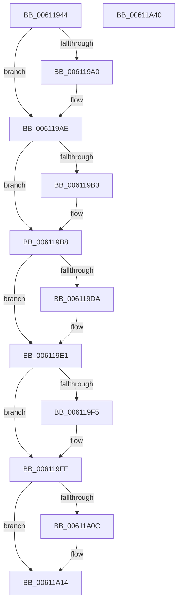

# SmHwAcceleratorPartitionMgrInsertAccelerator

- RVA: `0x00611944`–`0x00611A41` (길이 `253` bytes)
- VA: `0x0000000140611944`
- 실행 섹션: `.text`
- PDB 이름 있음: `예`; PDB Function 태그: `아니요`
- unwind 정보 RVA: `0x0005FEF8`
- 디코드: `71`개 명령, `253/253` bytes 표시
- 미해석 바이트: `0` (있으면 어셈블리에 `.byte`로 보존)

> 이 문서는 커널 이미지의 기계어와 PDB 기호를 분석해 생성했습니다. 4번과 5번은 함수 원형과 자료형을 바이너리 사용 방식에서 추정한 C 해석이며 원본 소스 복구 결과는 아닙니다.

## 1. Dependencies

- 직접 호출 지점: **5**; 고유 호출 대상: **5**
- 직접 호출자로 확인된 함수: **1**
- RIP 상대 이미지 참조: **0**

### Outgoing calls
- `0x00611990` → [KeAbPreAcquire](../21/KeAbPreAcquire_function_00210230.md) (function, `0x00210230`)
- `0x006119A9` → [ExfAcquirePushLockExclusiveEx](../20/ExfAcquirePushLockExclusiveEx_function_0020FC90.md) (function, `0x0020FC90`)
- `0x00611A0F` → [ExfTryToWakePushLock](../26/ExfTryToWakePushLock_function_00265DD0.md) (function, `0x00265DD0`)
- `0x00611A17` → [KeAbPostRelease](../2E/KeAbPostRelease_function_002E1600.md) (function, `0x002E1600`)
- `0x00611A1C` → [KeLeaveCriticalRegion](../25/KeLeaveCriticalRegion_function_0025D8B0.md) (function, `0x0025D8B0`)

### Direct callers
- [SmHwAcceleratorMgrCreatePartitionAccelerators](../../page/7A/SmHwAcceleratorMgrCreatePartitionAccelerators_function_007AAC5C.md) at `0x007AAD69`

### Static image references
- 디코드된 RIP-relative 메모리 참조가 없습니다.

## 2. Other-region calls and transfers

- 다른 실행 섹션으로 향하는 call: **0**
- 별도 외부 분기/꼬리 이동을 확인하지 못했습니다.

## 3. Assembly (complete function range)

```asm
00611944  48 8B C4                        mov rax, rsp
00611947  48 89 58 08                     mov qword ptr [rax + 8], rbx
0061194B  48 89 68 10                     mov qword ptr [rax + 0x10], rbp
0061194F  48 89 70 18                     mov qword ptr [rax + 0x18], rsi
00611953  48 89 78 20                     mov qword ptr [rax + 0x20], rdi
00611957  41 54                           push r12
00611959  41 56                           push r14
0061195B  41 57                           push r15
0061195D  48 83 EC 20                     sub rsp, 0x20
00611961  4C 8B 7A 20                     mov r15, qword ptr [rdx + 0x20]
00611965  48 8D 79 18                     lea rdi, [rcx + 0x18]
00611969  4C 63 62 3C                     movsxd r12, dword ptr [rdx + 0x3c]
0061196D  48 8B F2                        mov rsi, rdx
00611970  65 48 8B 04 25 88 01 00 00      mov rax, qword ptr gs:[0x188]
00611979  48 8B E9                        mov rbp, rcx
0061197C  48 83 CB FF                     or rbx, 0xffffffffffffffff
00611980  45 33 C0                        xor r8d, r8d
00611983  33 D2                           xor edx, edx
00611985  48 8B CF                        mov rcx, rdi
00611988  66 01 98 E4 01 00 00            add word ptr [rax + 0x1e4], bx
0061198F  90                              nop
00611990  E8 9B E8 BF FF                  call 0x140210230
00611995  F0 48 0F BA 2F 00               lock bts qword ptr [rdi], 0
0061199B  4C 8B F0                        mov r14, rax
0061199E  73 0E                           jae 0x1406119ae
006119A0  4C 8B C7                        mov r8, rdi
006119A3  48 8B D0                        mov rdx, rax
006119A6  48 8B CF                        mov rcx, rdi
006119A9  E8 E2 E2 BF FF                  call 0x14020fc90
006119AE  4D 85 F6                        test r14, r14
006119B1  74 05                           je 0x1406119b8
006119B3  41 C6 46 0A 01                  mov byte ptr [r14 + 0xa], 1
006119B8  42 8B 44 A5 30                  mov eax, dword ptr [rbp + r12*4 + 0x30]
006119BD  FF C0                           inc eax
006119BF  42 89 44 A5 30                  mov dword ptr [rbp + r12*4 + 0x30], eax
006119C4  41 8B 47 2C                     mov eax, dword ptr [r15 + 0x2c]
006119C8  48 C1 E0 04                     shl rax, 4
006119CC  4A 03 44 E5 20                  add rax, qword ptr [rbp + r12*8 + 0x20]
006119D1  48 8B 48 08                     mov rcx, qword ptr [rax + 8]
006119D5  48 39 01                        cmp qword ptr [rcx], rax
006119D8  74 07                           je 0x1406119e1
006119DA  B9 03 00 00 00                  mov ecx, 3
006119DF  CD 29                           int 0x29
006119E1  48 89 06                        mov qword ptr [rsi], rax
006119E4  48 89 4E 08                     mov qword ptr [rsi + 8], rcx
006119E8  48 89 31                        mov qword ptr [rcx], rsi
006119EB  48 89 70 08                     mov qword ptr [rax + 8], rsi
006119EF  83 7D 48 00                     cmp dword ptr [rbp + 0x48], 0
006119F3  75 0A                           jne 0x1406119ff
006119F5  48 8B 46 20                     mov rax, qword ptr [rsi + 0x20]
006119F9  8B 48 40                        mov ecx, dword ptr [rax + 0x40]
006119FC  89 4D 48                        mov dword ptr [rbp + 0x48], ecx
006119FF  F0 48 0F C1 1F                  lock xadd qword ptr [rdi], rbx
00611A04  80 E3 06                        and bl, 6
00611A07  80 FB 02                        cmp bl, 2
00611A0A  75 08                           jne 0x140611a14
00611A0C  48 8B CF                        mov rcx, rdi
00611A0F  E8 BC 43 C5 FF                  call 0x140265dd0
00611A14  48 8B CF                        mov rcx, rdi
00611A17  E8 E4 FB CC FF                  call 0x1402e1600
00611A1C  E8 8F BE C4 FF                  call 0x14025d8b0
00611A21  48 8B 5C 24 40                  mov rbx, qword ptr [rsp + 0x40]
00611A26  48 8B 6C 24 48                  mov rbp, qword ptr [rsp + 0x48]
00611A2B  48 8B 74 24 50                  mov rsi, qword ptr [rsp + 0x50]
00611A30  48 8B 7C 24 58                  mov rdi, qword ptr [rsp + 0x58]
00611A35  48 83 C4 20                     add rsp, 0x20
00611A39  41 5F                           pop r15
00611A3B  41 5E                           pop r14
00611A3D  41 5C                           pop r12
00611A3F  C3                              ret
00611A40  CC                              int3
```

## 4. C-style interpretation (structured pseudocode)

```c
__int64 __fastcall SmHwAcceleratorPartitionMgrInsertAccelerator(__int64 a1, __int64 a2, int a3)
{
    __int64 result;
    __int64 v_rbx;
    __int64 v_rsp;
    unsigned __int64 v_stack_p10;
    unsigned __int64 v_stack_p18;
    unsigned __int64 v_stack_p20;
    unsigned __int64 v_stack_p8;

    *(unsigned __int64 *)(v_rsp + 8) = v_rbx;
    *(unsigned __int64 *)(v_rsp + 16) = v_rbp;
    *(unsigned __int64 *)(v_rsp + 24) = v_rsi;
    *(unsigned __int64 *)(v_rsp + 32) = v_rdi;
    v_rsp = (v_rsp) - (32);
    v_rbx = (v_rbx) | (-1);
    a3 = 0;
    a2 = 0;
    result = KeAbPreAcquire(a1 + 24, a2, a3, a4);
    if (!(condition_is_above_or_equal)) {
        a3 = a1 + 24;
        a2 = result;
        a1 = a1 + 24;
        result = ExfAcquirePushLockExclusiveEx(a1, a2, a3, a4);
    }
    if (result != 0) {
        *(unsigned __int8 *)(result + 10) = 1;
    }
    result = (unsigned int)(((unsigned int)(*(unsigned int *)(a1 + (int)(*(unsigned int *)(a2 + 60)) * 4 + 48))) + 1);
    *(unsigned int *)(a1 + (int)(*(unsigned int *)(a2 + 60)) * 4 + 48) = (unsigned int)(result);
    result = ((unsigned int)(*(unsigned int *)(*(unsigned __int64 *)(a2 + 32) + 44))) << (4);
    result = (result) + (*(unsigned __int64 *)(a1 + (int)(*(unsigned int *)(a2 + 60)) * 8 + 32));
    if ((*(unsigned __int64 *)(*(unsigned __int64 *)(result + 8))) != result) {
        a1 = 3;
    }
    *(unsigned __int64 *)(a2) = result;
    *(unsigned __int64 *)(a2 + 8) = a1;
    *(unsigned __int64 *)(a1) = a2;
    *(unsigned __int64 *)(result + 8) = a2;
    if ((*(unsigned int *)(a1 + 72)) == 0) {
        result = *(unsigned __int64 *)(a2 + 32);
        a1 = *(unsigned int *)(result + 64);
        *(unsigned int *)(a1 + 72) = (unsigned int)(a1);
    }
    v_rbx = (unsigned __int8)((v_rbx) & (6));
    if (((unsigned __int8)(v_rbx)) == 2) {
        a1 = a1 + 24;
        result = ExfTryToWakePushLock(a1, a2, a3, a4);
    }
    result = KeAbPostRelease(a1 + 24, a2, a3, a4);
    result = KeLeaveCriticalRegion(a1 + 24, a2, a3, a4);
    v_rsp = (v_rsp) + (32);
    return result;
}
```

## 5. (Beta) C Style

```c
int64_t SmHwAcceleratorPartitionMgrInsertAccelerator(void *Arg1, void *Arg2, int32_t Arg3)
{
    uint8_t *arg1 = (uint8_t *)Arg1;
    uint8_t *arg2 = (uint8_t *)Arg2;

    int64_t result;
    int64_t local_rbx;
    int64_t local_rsp;
    uint64_t v_stack_p10;
    uint64_t v_stack_p18;
    uint64_t v_stack_p20;
    uint64_t v_stack_p8;

    *(uint64_t *)(local_rsp + 0x8) = local_rbx;
    *(uint64_t *)(local_rsp + 0x10) = local_rbp;
    *(uint64_t *)(local_rsp + 0x18) = local_rsi;
    *(uint64_t *)(local_rsp + 0x20) = local_rdi;
    local_rsp = (local_rsp) - (32);
    local_rbx = (local_rbx) | (-1);
    Arg3 = 0;
    Arg2 = 0;
    result = KeAbPreAcquire(Arg1 + 24, Arg2, Arg3, a4);
    if (!(condition_is_above_or_equal)) {
        Arg3 = Arg1 + 24;
        Arg2 = result;
        Arg1 = Arg1 + 24;
        result = ExfAcquirePushLockExclusiveEx(Arg1, Arg2, Arg3, a4);
    }
    if (result != 0) {
        *(uint8_t *)(result + 0xA) = 1;
    }
    result = (uint32_t)(((uint32_t)(*(uint32_t *)(arg1 + (int32_t)(*(uint32_t *)(arg2 + 0x3C)) * 4 + 0x30))) + 1);
    *(uint32_t *)(arg1 + (int32_t)(*(uint32_t *)(arg2 + 0x3C)) * 4 + 0x30) = (uint32_t)(result);
    result = ((uint32_t)(*(uint32_t *)(*(uint64_t *)(arg2 + 0x20) + 0x2C))) << (4);
    result = (result) + (*(uint64_t *)(arg1 + (int32_t)(*(uint32_t *)(arg2 + 0x3C)) * 8 + 0x20));
    if ((*(uint64_t *)(*(uint64_t *)(result + 0x8))) != result) {
        Arg1 = 3;
    }
    *(uint64_t *)(arg2) = result;
    *(void **)(arg2 + 0x8) = Arg1;
    *(void **)(arg1) = Arg2;
    *(void **)(result + 0x8) = Arg2;
    if ((*(uint32_t *)(arg1 + 0x48)) == 0) {
        result = *(uint64_t *)(arg2 + 0x20);
        Arg1 = *(uint32_t *)(result + 0x40);
        *(uint32_t *)(arg1 + 0x48) = (uint32_t)(Arg1);
    }
    local_rbx = (uint8_t)((local_rbx) & (6));
    if (((uint8_t)(local_rbx)) == 2) {
        Arg1 = Arg1 + 24;
        result = ExfTryToWakePushLock(Arg1, Arg2, Arg3, a4);
    }
    result = KeAbPostRelease(Arg1 + 24, Arg2, Arg3, a4);
    result = KeLeaveCriticalRegion(Arg1 + 24, Arg2, Arg3, a4);
    local_rsp = (local_rsp) + (32);
    return result;
}
```

### 관측된 메모리 오프셋

구조체 형식이 확인되지 않은 접근은 인자 기준의 오프셋으로만 기록했습니다.

| 기준 인자 | 오프셋 표현 | 폭 (bit) | 접근 |
|---|---:|---:|---|
| `Arg1` | `+ 0x0` | `64` | `R/W` |
| `Arg1` | `+ 0x18` | `64` | `R` |
| `Arg1` | `+ 0x20 + r12*8` | `64` | `R` |
| `Arg1` | `+ 0x30 + r12*4` | `32` | `R` |
| `Arg1` | `+ 0x30 + r12*4` | `32` | `W` |
| `Arg1` | `+ 0x48` | `32` | `R` |
| `Arg1` | `+ 0x48` | `32` | `W` |
| `Arg2` | `+ 0x0` | `64` | `W` |
| `Arg2` | `+ 0x8` | `64` | `W` |
| `Arg2` | `+ 0x20` | `64` | `R` |
| `Arg2` | `+ 0x3C` | `32` | `R` |

## 6. Execution-region graph

[열기: 2D/3D 그래프와 함수 탐색 컨트롤 패널](../../../control-panel.html?section=text&rva=0x00611944&view=graph)

- 2D 그래프는 위에서 아래로 흐르고, 3D 그래프는 빈 공간을 드래그해 회전합니다. Shift+드래그는 이동, 휠은 확대·축소, 함수 노드 선택은 대상 보고서 이동입니다.

### Static fallback


