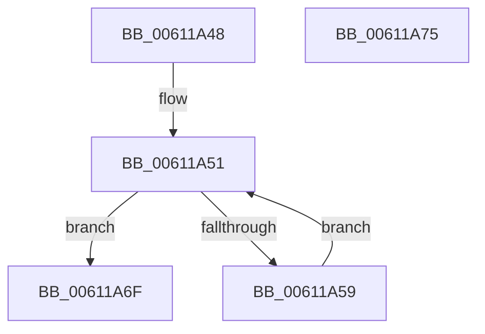

# SmHwAcceleratorPartitionMgrWakeDescriptorWaiters

- RVA: `0x00611A48`–`0x00611A76` (길이 `46` bytes)
- VA: `0x0000000140611A48`
- 실행 섹션: `.text`
- PDB 이름 있음: `예`; PDB Function 태그: `아니요`
- unwind 정보 RVA: `0x0005CF00`
- 디코드: `17`개 명령, `46/46` bytes 표시
- 미해석 바이트: `0` (있으면 어셈블리에 `.byte`로 보존)

> 이 문서는 커널 이미지의 기계어와 PDB 기호를 분석해 생성했습니다. 4번과 5번은 함수 원형과 자료형을 바이너리 사용 방식에서 추정한 C 해석이며 원본 소스 복구 결과는 아닙니다.

## 1. Dependencies

- 직접 호출 지점: **1**; 고유 호출 대상: **1**
- 직접 호출자로 확인된 함수: **2**
- RIP 상대 이미지 참조: **0**

### Outgoing calls
- `0x00611A68` → [KeSetEvent](../33/KeSetEvent_function_0033F310.md) (function, `0x0033F310`)

### Direct callers
- [SmHwAcceleratorPartitionMgrFreeDescriptor](../4D/SmHwAcceleratorPartitionMgrFreeDescriptor_function_004D7918.md) at `0x004D79F8`
- [SmHwAcceleratorMgrHotRemoveAccelerator](SmHwAcceleratorMgrHotRemoveAccelerator_function_006115FC.md) at `0x00611793`

### Static image references
- 디코드된 RIP-relative 메모리 참조가 없습니다.

## 2. Other-region calls and transfers

- 다른 실행 섹션으로 향하는 call: **0**
- 별도 외부 분기/꼬리 이동을 확인하지 못했습니다.

## 3. Assembly (complete function range)

```asm
00611A48  40 53                           push rbx
00611A4A  48 83 EC 20                     sub rsp, 0x20
00611A4E  48 8B D9                        mov rbx, rcx
00611A51  48 8B 0B                        mov rcx, qword ptr [rbx]
00611A54  48 85 C9                        test rcx, rcx
00611A57  74 16                           je 0x140611a6f
00611A59  48 8B 01                        mov rax, qword ptr [rcx]
00611A5C  45 33 C0                        xor r8d, r8d
00611A5F  48 83 C1 08                     add rcx, 8
00611A63  48 89 03                        mov qword ptr [rbx], rax
00611A66  33 D2                           xor edx, edx
00611A68  E8 A3 D8 D2 FF                  call 0x14033f310
00611A6D  EB E2                           jmp 0x140611a51
00611A6F  48 83 C4 20                     add rsp, 0x20
00611A73  5B                              pop rbx
00611A74  C3                              ret
00611A75  CC                              int3
```

## 4. C-style interpretation (structured pseudocode)

```c
__int64 __fastcall SmHwAcceleratorPartitionMgrWakeDescriptorWaiters(__int64 a1, int a2, int a3)
{
    __int64 result;
    __int64 v_rsp;

    v_rsp = (v_rsp) - (32);
loc_00611A51:
    if (*(unsigned __int64 *)(a1) == 0) goto loc_00611A6F;
    a3 = 0;
    a1 = (*(unsigned __int64 *)(a1)) + (8);
    *(unsigned __int64 *)(a1) = *(unsigned __int64 *)(*(unsigned __int64 *)(a1));
    a2 = 0;
    result = KeSetEvent(a1, a2, a3, a4);
    goto loc_00611A51;
loc_00611A6F:
    v_rsp = (v_rsp) + (32);
    return result;
}
```

## 5. (Beta) C Style

```c
int64_t SmHwAcceleratorPartitionMgrWakeDescriptorWaiters(void *Arg1, int32_t Arg2, int32_t Arg3)
{
    uint8_t *arg1 = (uint8_t *)Arg1;

    int64_t result;
    int64_t local_rsp;

    local_rsp = (local_rsp) - (32);
loc_00611A51:
    if (*(uint64_t *)(arg1) == 0) goto loc_00611A6F;
    Arg3 = 0;
    Arg1 = (*(uint64_t *)(arg1)) + (8);
    *(uint64_t *)(arg1) = *(uint64_t *)(*(uint64_t *)(arg1));
    Arg2 = 0;
    result = KeSetEvent(Arg1, Arg2, Arg3, a4);
    goto loc_00611A51;
loc_00611A6F:
    local_rsp = (local_rsp) + (32);
    return result;
}
```

### 관측된 메모리 오프셋

구조체 형식이 확인되지 않은 접근은 인자 기준의 오프셋으로만 기록했습니다.

| 기준 인자 | 오프셋 표현 | 폭 (bit) | 접근 |
|---|---:|---:|---|
| `Arg1` | `+ 0x0` | `64` | `R` |
| `Arg1` | `+ 0x0` | `64` | `W` |

## 6. Execution-region graph

[열기: 2D/3D 그래프와 함수 탐색 컨트롤 패널](../../../control-panel.html?section=text&rva=0x00611A48&view=graph)

- 2D 그래프는 위에서 아래로 흐르고, 3D 그래프는 빈 공간을 드래그해 회전합니다. Shift+드래그는 이동, 휠은 확대·축소, 함수 노드 선택은 대상 보고서 이동입니다.

### Static fallback


