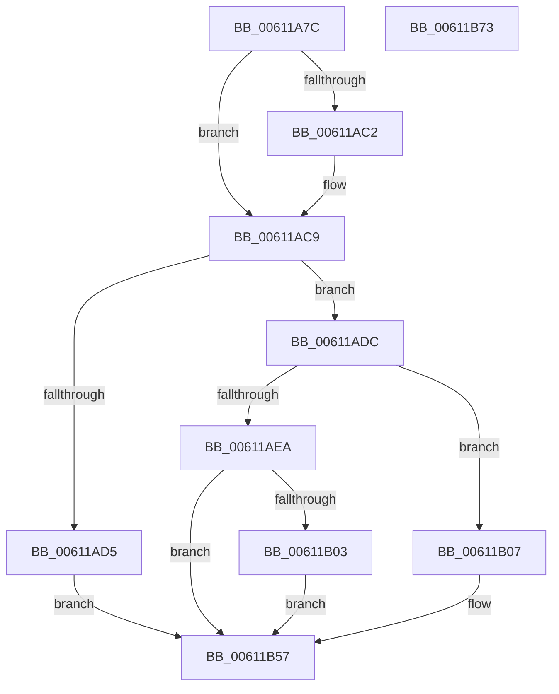

# SmHwAcceleratorWaitForRequest

- RVA: `0x00611A7C`–`0x00611B74` (길이 `248` bytes)
- VA: `0x0000000140611A7C`
- 실행 섹션: `.text`
- PDB 이름 있음: `예`; PDB Function 태그: `아니요`
- unwind 정보 RVA: `0x00083BEC`
- 디코드: `73`개 명령, `248/248` bytes 표시
- 미해석 바이트: `0` (있으면 어셈블리에 `.byte`로 보존)

> 이 문서는 커널 이미지의 기계어와 PDB 기호를 분석해 생성했습니다. 4번과 5번은 함수 원형과 자료형을 바이너리 사용 방식에서 추정한 C 해석이며 원본 소스 복구 결과는 아닙니다.

## 1. Dependencies

- 직접 호출 지점: **4**; 고유 호출 대상: **3**
- 직접 호출자로 확인된 함수: **5**
- RIP 상대 이미지 참조: **0**

### Outgoing calls
- `0x00611ACC` → [AccelWaitForWorkCompletion](../2C/AccelWaitForWorkCompletion_function_002C8270.md) (function, `0x002C8270`)
- `0x00611ADF` → [AccelGetStatusFromCompletionRecord](../2C/AccelGetStatusFromCompletionRecord_function_002C7B50.md) (function, `0x002C7B50`)
- `0x00611B32` → [AccelQueryCompletionInformation](../66/AccelQueryCompletionInformation_function_006686A4.md) (function, `0x006686A4`)
- `0x00611B47` → [AccelQueryCompletionInformation](../66/AccelQueryCompletionInformation_function_006686A4.md) (function, `0x006686A4`)

### Direct callers
- [SmStoreCompletePendingDecompress](../4D/SmStoreCompletePendingDecompress_function_004D7824.md) at `0x004D789E`
- [SmStoreCompletePendingCompress](SmStoreCompletePendingCompress_function_006113BC.md) at `0x0061140F`
- [sub_006D904C](../6D/Unknown_function_006D904C.md) at `0x006D913F`
- [sub_006E6668](../6E/Unknown_function_006E6668.md) at `0x006E6AE0`
- [sub_006F54E6](../6F/Unknown_function_006F54E6.md) at `0x006F54FE`

### Static image references
- 디코드된 RIP-relative 메모리 참조가 없습니다.

## 2. Other-region calls and transfers

- 다른 실행 섹션으로 향하는 call: **0**
- 별도 외부 분기/꼬리 이동을 확인하지 못했습니다.

## 3. Assembly (complete function range)

```asm
00611A7C  48 8B C4                        mov rax, rsp
00611A7F  48 89 58 08                     mov qword ptr [rax + 8], rbx
00611A83  48 89 70 10                     mov qword ptr [rax + 0x10], rsi
00611A87  48 89 78 18                     mov qword ptr [rax + 0x18], rdi
00611A8B  4C 89 70 20                     mov qword ptr [rax + 0x20], r14
00611A8F  55                              push rbp
00611A90  48 8B EC                        mov rbp, rsp
00611A93  48 83 EC 60                     sub rsp, 0x60
00611A97  48 8B 41 08                     mov rax, qword ptr [rcx + 8]
00611A9B  48 8D 59 20                     lea rbx, [rcx + 0x20]
00611A9F  4D 8B D8                        mov r11, r8
00611AA2  49 8B F1                        mov rsi, r9
00611AA5  45 33 C0                        xor r8d, r8d
00611AA8  48 8B F9                        mov rdi, rcx
00611AAB  4C 8B 50 20                     mov r10, qword ptr [rax + 0x20]
00611AAF  45 8D 70 01                     lea r14d, [r8 + 1]
00611AB3  41 0F AF 52 28                  imul edx, dword ptr [r10 + 0x28]
00611AB8  8B C2                           mov eax, edx
00611ABA  48 03 D8                        add rbx, rax
00611ABD  4D 85 DB                        test r11, r11
00611AC0  74 07                           je 0x140611ac9
00611AC2  4D 39 03                        cmp qword ptr [r11], r8
00611AC5  45 0F 44 C6                     cmove r8d, r14d
00611AC9  48 8B CB                        mov rcx, rbx
00611ACC  E8 9F 67 CB FF                  call 0x1402c8270
00611AD1  85 C0                           test eax, eax
00611AD3  79 07                           jns 0x140611adc
00611AD5  B9 02 01 00 00                  mov ecx, 0x102
00611ADA  EB 7B                           jmp 0x140611b57
00611ADC  48 8B CB                        mov rcx, rbx
00611ADF  E8 6C 60 CB FF                  call 0x1402c7b50
00611AE4  8B C8                           mov ecx, eax
00611AE6  85 C0                           test eax, eax
00611AE8  79 1D                           jns 0x140611b07
00611AEA  B8 01 00 00 C0                  mov eax, 0xc0000001
00611AEF  BA 40 02 00 C0                  mov edx, 0xc0000240
00611AF4  3B CA                           cmp ecx, edx
00611AF6  0F 44 C8                        cmove ecx, eax
00611AF9  48 8B 47 08                     mov rax, qword ptr [rdi + 8]
00611AFD  83 78 3C 00                     cmp dword ptr [rax + 0x3c], 0
00611B01  75 54                           jne 0x140611b57
00611B03  8B CA                           mov ecx, edx
00611B05  EB 50                           jmp 0x140611b57
00611B07  0F 57 C0                        xorps xmm0, xmm0
00611B0A  48 8D 4D C0                     lea rcx, [rbp - 0x40]
00611B0E  0F 11 45 C0                     movups xmmword ptr [rbp - 0x40], xmm0
00611B12  33 C0                           xor eax, eax
00611B14  C7 45 C0 01 00 38 00            mov dword ptr [rbp - 0x40], 0x380001
00611B1B  0F 11 45 D0                     movups xmmword ptr [rbp - 0x30], xmm0
00611B1F  C7 45 D0 06 00 00 00            mov dword ptr [rbp - 0x30], 6
00611B26  48 89 5D C8                     mov qword ptr [rbp - 0x38], rbx
00611B2A  0F 11 45 E0                     movups xmmword ptr [rbp - 0x20], xmm0
00611B2E  48 89 45 F0                     mov qword ptr [rbp - 0x10], rax
00611B32  E8 6D 6B 05 00                  call 0x1406686a4
00611B37  8B 45 E4                        mov eax, dword ptr [rbp - 0x1c]
00611B3A  48 8D 4D C0                     lea rcx, [rbp - 0x40]
00611B3E  89 06                           mov dword ptr [rsi], eax
00611B40  C7 45 D0 04 00 00 00            mov dword ptr [rbp - 0x30], 4
00611B47  E8 58 6B 05 00                  call 0x1406686a4
00611B4C  48 8B 4D 30                     mov rcx, qword ptr [rbp + 0x30]
00611B50  8B 45 DC                        mov eax, dword ptr [rbp - 0x24]
00611B53  89 01                           mov dword ptr [rcx], eax
00611B55  33 C9                           xor ecx, ecx
00611B57  4C 8D 5C 24 60                  lea r11, [rsp + 0x60]
00611B5C  8B C1                           mov eax, ecx
00611B5E  49 8B 5B 10                     mov rbx, qword ptr [r11 + 0x10]
00611B62  49 8B 73 18                     mov rsi, qword ptr [r11 + 0x18]
00611B66  49 8B 7B 20                     mov rdi, qword ptr [r11 + 0x20]
00611B6A  4D 8B 73 28                     mov r14, qword ptr [r11 + 0x28]
00611B6E  49 8B E3                        mov rsp, r11
00611B71  5D                              pop rbp
00611B72  C3                              ret
00611B73  CC                              int3
```

## 4. C-style interpretation (structured pseudocode)

```c
__int64 __fastcall SmHwAcceleratorWaitForRequest(__int64 a1, int a2, __int64 a3, __int64 a4, __int64 a5)
{
    __int64 result;
    __int64 v_rbx;
    __int64 v_rsp;
    unsigned __int64 v_stack_m18;
    unsigned int v_stack_m24;
    unsigned __int64 v_stack_m28;
    unsigned int v_stack_m2C;
    unsigned __int64 v_stack_m38;
    unsigned __int64 v_stack_m40;
    unsigned __int64 v_stack_m48;
    unsigned __int64 v_stack_m8;

    *(unsigned __int64 *)(v_rsp + 8) = v_rbx;
    *(unsigned __int64 *)(v_rsp + 16) = v_rsi;
    *(unsigned __int64 *)(v_rsp + 24) = v_rdi;
    *(unsigned __int64 *)(v_rsp + 32) = v_r14;
    v_rsp = (v_rsp) - (96);
    a3 = 0;
    a2 = (unsigned int)((a2) * (*(unsigned int *)(*(unsigned __int64 *)(*(unsigned __int64 *)(a1 + 8) + 32) + 40)));
    v_rbx = (a1 + 32) + ((unsigned int)(a2));
    if (0 != 0) {
        if ((*(unsigned __int64 *)(a3)) == 0) { a3 = (unsigned int)(a3 + 1); }
    }
    result = AccelWaitForWorkCompletion(v_rbx, a2, a3, a4);
    if (!sign_flag) goto loc_00611ADC;
    goto loc_00611B57;
loc_00611ADC:
    result = AccelGetStatusFromCompletionRecord(v_rbx, a2, a3, a4);
    if (!sign_flag) goto loc_00611B07;
    a1 = (unsigned int)((unsigned int)(result));
    if (((unsigned int)((unsigned int)((unsigned int)(result)))) == ((unsigned int)((unsigned int)(0xC0000240ULL)))) { a1 = (unsigned int)((unsigned int)(0xC0000001ULL)); }
    if ((*(unsigned int *)(*(unsigned __int64 *)(a1 + 8) + 60)) != 0) goto loc_00611B57;
    goto loc_00611B57;
loc_00611B07:
    v_stack_m48 = v_xmm0;
    result = 0;
    v_stack_m48 = 0x380001ULL;
    v_stack_m38 = v_xmm0;
    v_stack_m38 = 6;
    v_stack_m40 = v_rbx;
    v_stack_m28 = v_xmm0;
    v_stack_m18 = 0;
    result = AccelQueryCompletionInformation(v_stack_m48, (unsigned int)(0xC0000240ULL), a3, a4);
    *(unsigned int *)(a4) = (unsigned int)((unsigned int)(v_stack_m24));
    v_stack_m38 = 4;
    result = AccelQueryCompletionInformation(v_stack_m48, (unsigned int)(0xC0000240ULL), a3, a4);
    *(unsigned int *)(a5) = (unsigned int)((unsigned int)(v_stack_m2C));
    a1 = 0;
loc_00611B57:
    return 0;
}
```

## 5. (Beta) C Style

```c
int64_t SmHwAcceleratorWaitForRequest(void *Arg1, int32_t Arg2, int64_t Arg3, void *Arg4, void *Arg5)
{
    uint8_t *arg1 = (uint8_t *)Arg1;
    uint8_t *arg4 = (uint8_t *)Arg4;
    uint8_t *arg5 = (uint8_t *)Arg5;

    int64_t result;
    int64_t local_rbx;
    int64_t local_rsp;
    uint64_t v_stack_m18;
    uint32_t v_stack_m24;
    uint64_t v_stack_m28;
    uint32_t v_stack_m2C;
    uint64_t v_stack_m38;
    uint64_t v_stack_m40;
    uint64_t v_stack_m48;
    uint64_t v_stack_m8;

    *(uint64_t *)(local_rsp + 0x8) = local_rbx;
    *(uint64_t *)(local_rsp + 0x10) = local_rsi;
    *(uint64_t *)(local_rsp + 0x18) = local_rdi;
    *(uint64_t *)(local_rsp + 0x20) = local_r14;
    local_rsp = (local_rsp) - (96);
    Arg3 = 0;
    Arg2 = (uint32_t)((Arg2) * (*(uint32_t *)(*(uint64_t *)(*(uint64_t *)(arg1 + 0x8) + 0x20) + 0x28)));
    local_rbx = (Arg1 + 32) + ((uint32_t)(Arg2));
    if (0 != 0) {
        if ((*(uint64_t *)(Arg3)) == 0) { Arg3 = (uint32_t)(Arg3 + 1); }
    }
    result = AccelWaitForWorkCompletion(local_rbx, Arg2, Arg3, Arg4);
    if (!sign_flag) goto loc_00611ADC;
    goto loc_00611B57;
loc_00611ADC:
    result = AccelGetStatusFromCompletionRecord(local_rbx, Arg2, Arg3, Arg4);
    if (!sign_flag) goto loc_00611B07;
    Arg1 = (uint32_t)((uint32_t)(result));
    if (((uint32_t)((uint32_t)((uint32_t)(result)))) == ((uint32_t)((uint32_t)(0xC0000240ULL)))) { Arg1 = (uint32_t)((uint32_t)(0xC0000001ULL)); }
    if ((*(uint32_t *)(*(uint64_t *)(arg1 + 0x8) + 0x3C)) != 0) goto loc_00611B57;
    goto loc_00611B57;
loc_00611B07:
    v_stack_m48 = v_xmm0;
    result = 0;
    v_stack_m48 = 0x380001ULL;
    v_stack_m38 = v_xmm0;
    v_stack_m38 = 6;
    v_stack_m40 = local_rbx;
    v_stack_m28 = v_xmm0;
    v_stack_m18 = 0;
    result = AccelQueryCompletionInformation(v_stack_m48, (uint32_t)(0xC0000240ULL), Arg3, Arg4);
    *(uint32_t *)(arg4) = (uint32_t)((uint32_t)(v_stack_m24));
    v_stack_m38 = 4;
    result = AccelQueryCompletionInformation(v_stack_m48, (uint32_t)(0xC0000240ULL), Arg3, Arg4);
    *(uint32_t *)(arg5) = (uint32_t)((uint32_t)(v_stack_m2C));
    Arg1 = 0;
loc_00611B57:
    return 0;
}
```

### 관측된 메모리 오프셋

구조체 형식이 확인되지 않은 접근은 인자 기준의 오프셋으로만 기록했습니다.

| 기준 인자 | 오프셋 표현 | 폭 (bit) | 접근 |
|---|---:|---:|---|
| `Arg1` | `+ 0x8` | `64` | `R` |
| `Arg1` | `+ 0x20` | `64` | `R` |
| `Arg4` | `+ 0x0` | `32` | `W` |
| `Arg5` | `+ 0x0` | `32` | `W` |

## 6. Execution-region graph

[열기: 2D/3D 그래프와 함수 탐색 컨트롤 패널](../../../control-panel.html?section=text&rva=0x00611A7C&view=graph)

- 2D 그래프는 위에서 아래로 흐르고, 3D 그래프는 빈 공간을 드래그해 회전합니다. Shift+드래그는 이동, 휠은 확대·축소, 함수 노드 선택은 대상 보고서 이동입니다.

### Static fallback


