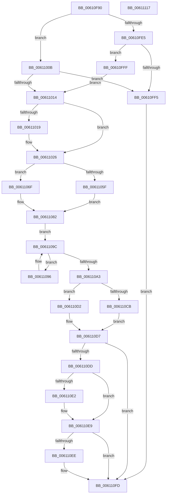

# SmIssueIo

- RVA: `0x00610F90`–`0x00611118` (길이 `392` bytes)
- VA: `0x0000000140610F90`
- 실행 섹션: `.text`
- PDB 이름 있음: `예`; PDB Function 태그: `아니요`
- unwind 정보 RVA: `0x000A3904`
- 디코드: `113`개 명령, `392/392` bytes 표시
- 미해석 바이트: `0` (있으면 어셈블리에 `.byte`로 보존)

> 이 문서는 커널 이미지의 기계어와 PDB 기호를 분석해 생성했습니다. 4번과 5번은 함수 원형과 자료형을 바이너리 사용 방식에서 추정한 C 해석이며 원본 소스 복구 결과는 아닙니다.

## 1. Dependencies

- 직접 호출 지점: **4**; 고유 호출 대상: **4**
- 직접 호출자로 확인된 함수: **1**
- RIP 상대 이미지 참조: **2**

### Outgoing calls
- `0x00610FEB` → [SmKmStoreReference](../34/SmKmStoreReference_function_0034BFB0.md) (function, `0x0034BFB0`)
- `0x006110CB` → [SmKmIssueFileIo](../60/SmKmIssueFileIo_function_0060F2F4.md) (function, `0x0060F2F4`)
- `0x006110D2` → [SmKmIssueVolumeIo](../60/SmKmIssueVolumeIo_function_0060F9BC.md) (function, `0x0060F9BC`)
- `0x006110F8` → [SmKmStoreDereference](../20/SmKmStoreDereference_function_00206574.md) (function, `0x00206574`)

### Direct callers
- [ST_STORE&lt;SM_TRAITS&gt;::StDeviceIoIssue](../60/ST_STORE_SM_TRAITS_StDeviceIoIssue_function_0060CFD0.md) at `0x0060D0FA`

### Static image references
- `0x00611066` → RVA `0x00610D90` (`SmpIoCompletionApc`; read)
- `0x0061107B` → RVA `0x00610CC0` (`SmpDeviceIoCompletion`; read)

## 2. Other-region calls and transfers

- 다른 실행 섹션으로 향하는 call: **0**
- 별도 외부 분기/꼬리 이동을 확인하지 못했습니다.

## 3. Assembly (complete function range)

```asm
00610F90  48 89 5C 24 10                  mov qword ptr [rsp + 0x10], rbx
00610F95  44 89 44 24 18                  mov dword ptr [rsp + 0x18], r8d
00610F9A  55                              push rbp
00610F9B  56                              push rsi
00610F9C  57                              push rdi
00610F9D  41 54                           push r12
00610F9F  41 55                           push r13
00610FA1  41 56                           push r14
00610FA3  41 57                           push r15
00610FA5  48 8B EC                        mov rbp, rsp
00610FA8  48 83 EC 60                     sub rsp, 0x60
00610FAC  48 8B 45 68                     mov rax, qword ptr [rbp + 0x68]
00610FB0  45 33 F6                        xor r14d, r14d
00610FB3  4C 8B F8                        mov r15, rax
00610FB6  48 8B D8                        mov rbx, rax
00610FB9  48 83 E3 FE                     and rbx, 0xfffffffffffffffe
00610FBD  41 83 E7 01                     and r15d, 1
00610FC1  45 33 ED                        xor r13d, r13d
00610FC4  48 8B F9                        mov rdi, rcx
00610FC7  48 8B 89 90 1D 00 00            mov rcx, qword ptr [rcx + 0x1d90]
00610FCE  4D 85 FF                        test r15, r15
00610FD1  45 8B E1                        mov r12d, r9d
00610FD4  48 89 4D 40                     mov qword ptr [rbp + 0x40], rcx
00610FD8  48 0F 44 D8                     cmove rbx, rax
00610FDC  8B F2                           mov esi, edx
00610FDE  8B 43 1C                        mov eax, dword ptr [rbx + 0x1c]
00610FE1  A8 04                           test al, 4
00610FE3  75 26                           jne 0x14061100b
00610FE5  8B 97 90 1A 00 00               mov edx, dword ptr [rdi + 0x1a90]
00610FEB  E8 C0 AF D3 FF                  call 0x14034bfb0
00610FF0  48 85 C0                        test rax, rax
00610FF3  75 0A                           jne 0x140610fff
00610FF5  BB FE 02 00 C0                  mov ebx, 0xc00002fe
00610FFA  E9 FE 00 00 00                  jmp 0x1406110fd
00610FFF  44 8B 45 50                     mov r8d, dword ptr [rbp + 0x50]
00611003  41 BE 01 00 00 00               mov r14d, 1
00611009  EB 09                           jmp 0x140611014
0061100B  F6 87 95 1A 00 00 01            test byte ptr [rdi + 0x1a95], 1
00611012  75 E1                           jne 0x140610ff5
00611014  45 85 FF                        test r15d, r15d
00611017  74 0D                           je 0x140611026
00611019  F0 FF 87 08 1B 00 00            lock inc dword ptr [rdi + 0x1b08]
00611020  41 BD 01 00 00 00               mov r13d, 1
00611026  48 83 65 EC 00                  and qword ptr [rbp - 0x14], 0
0061102B  48 8B 45 60                     mov rax, qword ptr [rbp + 0x60]
0061102F  83 65 F4 00                     and dword ptr [rbp - 0xc], 0
00611033  44 8B 97 60 1B 00 00            mov r10d, dword ptr [rdi + 0x1b60]
0061103A  48 89 45 D8                     mov qword ptr [rbp - 0x28], rax
0061103E  8B 45 F0                        mov eax, dword ptr [rbp - 0x10]
00611041  83 E0 FE                        and eax, 0xfffffffe
00611044  89 75 E8                        mov dword ptr [rbp - 0x18], esi
00611047  41 0B C7                        or eax, r15d
0061104A  44 89 45 E4                     mov dword ptr [rbp - 0x1c], r8d
0061104E  0F BA 27 0D                     bt dword ptr [rdi], 0xd
00611052  44 89 55 EC                     mov dword ptr [rbp - 0x14], r10d
00611056  44 89 65 E0                     mov dword ptr [rbp - 0x20], r12d
0061105A  89 45 F0                        mov dword ptr [rbp - 0x10], eax
0061105D  73 10                           jae 0x14061106f
0061105F  48 8D 43 20                     lea rax, [rbx + 0x20]
00611063  48 8B DF                        mov rbx, rdi
00611066  4C 8D 0D 23 FD FF FF            lea r9, [rip - 0x2dd]
0061106D  EB 13                           jmp 0x140611082
0061106F  48 8D 43 30                     lea rax, [rbx + 0x30]
00611073  48 89 7B 28                     mov qword ptr [rbx + 0x28], rdi
00611077  44 89 63 20                     mov dword ptr [rbx + 0x20], r12d
0061107B  4C 8D 0D 3E FC FF FF            lea r9, [rip - 0x3c2]
00611082  44 8B 1F                        mov r11d, dword ptr [rdi]
00611085  48 8D 8F 68 1B 00 00            lea rcx, [rdi + 0x1b68]
0061108C  4C 8B 41 30                     mov r8, qword ptr [rcx + 0x30]
00611090  48 89 45 D0                     mov qword ptr [rbp - 0x30], rax
00611094  EB 06                           jmp 0x14061109c
00611096  2B F0                           sub esi, eax
00611098  49 83 C0 10                     add r8, 0x10
0061109C  41 8B 00                        mov eax, dword ptr [r8]
0061109F  3B F0                           cmp esi, eax
006110A1  73 F3                           jae 0x140611096
006110A3  8B 45 50                        mov eax, dword ptr [rbp + 0x50]
006110A6  8B D6                           mov edx, esi
006110A8  49 0F AF D2                     imul rdx, r10
006110AC  48 89 5C 24 20                  mov qword ptr [rsp + 0x20], rbx
006110B1  49 03 50 08                     add rdx, qword ptr [r8 + 8]
006110B5  4C 8D 45 68                     lea r8, [rbp + 0x68]
006110B9  48 03 D0                        add rdx, rax
006110BC  41 0F BA E3 0D                  bt r11d, 0xd
006110C1  48 89 55 68                     mov qword ptr [rbp + 0x68], rdx
006110C5  48 8D 55 D0                     lea rdx, [rbp - 0x30]
006110C9  73 07                           jae 0x1406110d2
006110CB  E8 24 E2 FF FF                  call 0x14060f2f4
006110D0  EB 05                           jmp 0x1406110d7
006110D2  E8 E5 E8 FF FF                  call 0x14060f9bc
006110D7  8B D8                           mov ebx, eax
006110D9  85 C0                           test eax, eax
006110DB  79 20                           jns 0x1406110fd
006110DD  45 85 ED                        test r13d, r13d
006110E0  74 07                           je 0x1406110e9
006110E2  F0 FF 8F 08 1B 00 00            lock dec dword ptr [rdi + 0x1b08]
006110E9  45 85 F6                        test r14d, r14d
006110EC  74 0F                           je 0x1406110fd
006110EE  8B 97 90 1A 00 00               mov edx, dword ptr [rdi + 0x1a90]
006110F4  48 8B 4D 40                     mov rcx, qword ptr [rbp + 0x40]
006110F8  E8 77 54 BF FF                  call 0x140206574
006110FD  8B C3                           mov eax, ebx
006110FF  48 8B 9C 24 A8 00 00 00         mov rbx, qword ptr [rsp + 0xa8]
00611107  48 83 C4 60                     add rsp, 0x60
0061110B  41 5F                           pop r15
0061110D  41 5E                           pop r14
0061110F  41 5D                           pop r13
00611111  41 5C                           pop r12
00611113  5F                              pop rdi
00611114  5E                              pop rsi
00611115  5D                              pop rbp
00611116  C3                              ret
00611117  CC                              int3
```

## 4. C-style interpretation (structured pseudocode)

```c
__int64 __fastcall SmIssueIo(__int64 a1, int a2, int a3, int a4, __int64 a5, __int64 a6)
{
    __int64 result;
    __int64 v_r13;
    __int64 v_r14;
    __int64 v_r15;
    __int64 v_rbx;
    __int64 v_rsi;
    __int64 v_rsp;
    unsigned int v_stack_m44;
    unsigned int v_stack_m48;
    unsigned __int64 v_stack_m4C;
    unsigned int v_stack_m50;
    unsigned int v_stack_m54;
    unsigned int v_stack_m58;
    unsigned __int64 v_stack_m60;
    unsigned __int64 v_stack_m68;
    unsigned __int64 v_stack_m78;
    unsigned __int64 v_stack_p10;
    unsigned int v_stack_p18;
    unsigned __int64 v_stack_p30;
    unsigned __int64 v_stack_p8;

    v_stack_p10 = v_rbx;
    v_stack_p18 = a3;
    v_rsp = (v_rsp) - (96);
    v_r14 = 0;
    v_rbx = (a6) & (-2);
    v_r15 = (unsigned int)((a6) & (1));
    v_r13 = 0;
    v_stack_p8 = *(unsigned __int64 *)(a1 + 7568);
    if (v_r15 == 0) { v_rbx = a6; }
    if ((((unsigned __int8)((unsigned int)(*(unsigned int *)(v_rbx + 28)))) & (4)) != 0) goto loc_0061100B;
    result = SmKmStoreReference(*(unsigned __int64 *)(a1 + 7568), (unsigned int)(*(unsigned int *)(a1 + 6800)), a3, a4);
    if (result != 0) goto loc_00610FFF;
loc_00610FF5:
    goto loc_006110FD;
loc_00610FFF:
    goto loc_00611014;
loc_0061100B:
    if (((*(unsigned __int8 *)(a1 + 6805)) & (1)) != 0) goto loc_00610FF5;
loc_00611014:
    if ((unsigned int)(v_r15) != 0) {
        v_r13 = 1;
    }
    v_stack_m60 = a5;
    result = (unsigned int)(((unsigned int)(v_stack_m48)) & (0xFFFFFFFEULL));
    v_stack_m50 = (unsigned int)((unsigned int)(a2));
    result = (unsigned int)((result) | ((unsigned int)(v_r15)));
    v_stack_m54 = (unsigned int)((unsigned int)(v_stack_p18));
    v_stack_m4C = (unsigned int)((unsigned int)(*(unsigned int *)(a1 + 7008)));
    v_stack_m58 = (unsigned int)((unsigned int)(a4));
    v_stack_m48 = (unsigned int)(result);
    if (condition_is_above_or_equal) goto loc_0061106F;
    goto loc_00611082;
loc_0061106F:
    *(unsigned __int64 *)(a1 + 40) = a1;
    *(unsigned int *)(a1 + 32) = (unsigned int)((unsigned int)(a4));
loc_00611082:
    v_stack_m68 = a1 + 48;
    goto loc_0061109C;
loc_00611096:
    v_rsi = (unsigned int)(((unsigned int)(a2)) - ((unsigned int)(a1 + 48)));
    a3 = (*(unsigned __int64 *)(a1 + 7016 + 48)) + (16);
loc_0061109C:
    if (((unsigned int)(v_rsi)) >= ((unsigned int)((unsigned int)(*(unsigned int *)(a3))))) goto loc_00611096;
    a2 = ((unsigned int)((unsigned int)(v_rsi))) * ((unsigned int)(*(unsigned int *)(a1 + 7008)));
    v_stack_m78 = a1;
    a2 = (a2) + (*(unsigned __int64 *)(a3 + 8));
    a2 = (a2) + ((unsigned int)(v_stack_p18));
    v_stack_p30 = a2;
    if (condition_is_above_or_equal) goto loc_006110D2;
    result = SmKmIssueFileIo(a1 + 7016, v_stack_m68, a6, v_rip - 962);
    goto loc_006110D7;
loc_006110D2:
    result = SmKmIssueVolumeIo(a1 + 7016, v_stack_m68, a6, v_rip - 962);
loc_006110D7:
    if (!sign_flag) goto loc_006110FD;
    if ((unsigned int)(v_r13) != 0) {
    }
    if (1 != 0) {
        a2 = *(unsigned int *)(a1 + 6800);
        a1 = v_stack_p8;
        result = SmKmStoreDereference(a1, a2, a6, v_rip - 962);
    }
    v_rsp = (v_rsp) + (96);
    return (unsigned int)((unsigned int)((unsigned int)((unsigned int)(result))));
}
```

## 5. (Beta) C Style

```c
int64_t SmIssueIo(void *Arg1, int32_t Arg2, int32_t Arg3, int32_t Arg4, int64_t Arg5, int64_t Arg6)
{
    uint8_t *arg1 = (uint8_t *)Arg1;

    int64_t result;
    int64_t local_r13;
    int64_t local_r14;
    int64_t local_r15;
    int64_t local_rbx;
    int64_t local_rsi;
    int64_t local_rsp;
    uint32_t v_stack_m44;
    uint32_t v_stack_m48;
    uint64_t v_stack_m4C;
    uint32_t v_stack_m50;
    uint32_t v_stack_m54;
    uint32_t v_stack_m58;
    uint64_t v_stack_m60;
    uint64_t v_stack_m68;
    uint64_t v_stack_m78;
    uint64_t v_stack_p10;
    uint32_t v_stack_p18;
    uint64_t v_stack_p30;
    uint64_t v_stack_p8;

    v_stack_p10 = local_rbx;
    v_stack_p18 = Arg3;
    local_rsp = (local_rsp) - (96);
    local_r14 = 0;
    local_rbx = (Arg6) & (-2);
    local_r15 = (uint32_t)((Arg6) & (1));
    local_r13 = 0;
    v_stack_p8 = *(uint64_t *)(arg1 + 0x1D90);
    if (local_r15 == 0) { local_rbx = Arg6; }
    if ((((uint8_t)((uint32_t)(*(uint32_t *)(local_rbx + 0x1C)))) & (4)) != 0) goto loc_0061100B;
    result = SmKmStoreReference(*(uint64_t *)(arg1 + 0x1D90), (uint32_t)(*(uint32_t *)(arg1 + 0x1A90)), Arg3, Arg4);
    if (result != 0) goto loc_00610FFF;
loc_00610FF5:
    goto loc_006110FD;
loc_00610FFF:
    goto loc_00611014;
loc_0061100B:
    if (((*(uint8_t *)(arg1 + 0x1A95)) & (1)) != 0) goto loc_00610FF5;
loc_00611014:
    if ((uint32_t)(local_r15) != 0) {
        local_r13 = 1;
    }
    v_stack_m60 = Arg5;
    result = (uint32_t)(((uint32_t)(v_stack_m48)) & (0xFFFFFFFEULL));
    v_stack_m50 = (uint32_t)((uint32_t)(Arg2));
    result = (uint32_t)((result) | ((uint32_t)(local_r15)));
    v_stack_m54 = (uint32_t)((uint32_t)(v_stack_p18));
    v_stack_m4C = (uint32_t)((uint32_t)(*(uint32_t *)(arg1 + 0x1B60)));
    v_stack_m58 = (uint32_t)((uint32_t)(Arg4));
    v_stack_m48 = (uint32_t)(result);
    if (condition_is_above_or_equal) goto loc_0061106F;
    goto loc_00611082;
loc_0061106F:
    *(void **)(arg1 + 0x28) = Arg1;
    *(uint32_t *)(arg1 + 0x20) = (uint32_t)((uint32_t)(Arg4));
loc_00611082:
    v_stack_m68 = Arg1 + 48;
    goto loc_0061109C;
loc_00611096:
    local_rsi = (uint32_t)(((uint32_t)(Arg2)) - ((uint32_t)(Arg1 + 48)));
    Arg3 = (*(uint64_t *)(arg1 + 0x1B68 + 0x30)) + (16);
loc_0061109C:
    if (((uint32_t)(local_rsi)) >= ((uint32_t)((uint32_t)(*(uint32_t *)(Arg3))))) goto loc_00611096;
    Arg2 = ((uint32_t)((uint32_t)(local_rsi))) * ((uint32_t)(*(uint32_t *)(arg1 + 0x1B60)));
    v_stack_m78 = Arg1;
    Arg2 = (Arg2) + (*(uint64_t *)(Arg3 + 0x8));
    Arg2 = (Arg2) + ((uint32_t)(v_stack_p18));
    v_stack_p30 = Arg2;
    if (condition_is_above_or_equal) goto loc_006110D2;
    result = SmKmIssueFileIo(Arg1 + 7016, v_stack_m68, Arg6, v_rip - 962);
    goto loc_006110D7;
loc_006110D2:
    result = SmKmIssueVolumeIo(Arg1 + 7016, v_stack_m68, Arg6, v_rip - 962);
loc_006110D7:
    if (!sign_flag) goto loc_006110FD;
    if ((uint32_t)(local_r13) != 0) {
    }
    if (1 != 0) {
        Arg2 = *(uint32_t *)(arg1 + 0x1A90);
        Arg1 = v_stack_p8;
        result = SmKmStoreDereference(Arg1, Arg2, Arg6, v_rip - 962);
    }
    local_rsp = (local_rsp) + (96);
    return (uint32_t)((uint32_t)((uint32_t)((uint32_t)(result))));
}
```

### 관측된 메모리 오프셋

구조체 형식이 확인되지 않은 접근은 인자 기준의 오프셋으로만 기록했습니다.

| 기준 인자 | 오프셋 표현 | 폭 (bit) | 접근 |
|---|---:|---:|---|
| `Arg1` | `+ 0x0` | `32` | `R` |
| `Arg1` | `+ 0x30` | `64` | `R` |
| `Arg1` | `+ 0x1A90` | `32` | `R` |
| `Arg1` | `+ 0x1A95` | `8` | `R` |
| `Arg1` | `+ 0x1B08` | `32` | `R/W` |
| `Arg1` | `+ 0x1B60` | `32` | `R` |
| `Arg1` | `+ 0x1B68` | `64` | `R` |
| `Arg1` | `+ 0x1D90` | `64` | `R` |

## 6. Execution-region graph

[열기: 2D/3D 그래프와 함수 탐색 컨트롤 패널](../../../control-panel.html?section=text&rva=0x00610F90&view=graph)

- 2D 그래프는 위에서 아래로 흐르고, 3D 그래프는 빈 공간을 드래그해 회전합니다. Shift+드래그는 이동, 휠은 확대·축소, 함수 노드 선택은 대상 보고서 이동입니다.

### Static fallback


