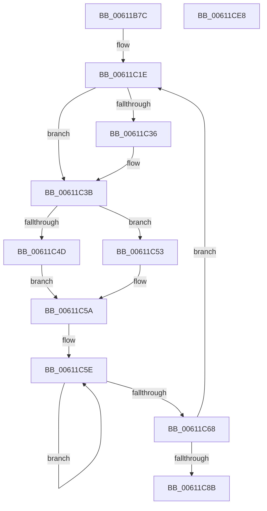

# SmKmSqmAddToStream

- RVA: `0x00611B7C`–`0x00611CE9` (길이 `365` bytes)
- VA: `0x0000000140611B7C`
- 실행 섹션: `.text`
- PDB 이름 있음: `예`; PDB Function 태그: `아니요`
- unwind 정보 RVA: `0x000D2174`
- 디코드: `79`개 명령, `365/365` bytes 표시
- 미해석 바이트: `0` (있으면 어셈블리에 `.byte`로 보존)

> 이 문서는 커널 이미지의 기계어와 PDB 기호를 분석해 생성했습니다. 4번과 5번은 함수 원형과 자료형을 바이너리 사용 방식에서 추정한 C 해석이며 원본 소스 복구 결과는 아닙니다.

## 1. Dependencies

- 직접 호출 지점: **2**; 고유 호출 대상: **2**
- 직접 호출자로 확인된 함수: **1**
- RIP 상대 이미지 참조: **4**

### Outgoing calls
- `0x00611CBF` → [EtwWriteEx](../25/EtwWriteEx_function_0025F0D0.md) (function, `0x0025F0D0`)
- `0x00611CCE` → [_security_check_cookie](../6A/_security_check_cookie_function_006AC640.md) (function, `0x006AC640`)

### Direct callers
- [SmKmStoreTerminateWorker](../60/SmKmStoreTerminateWorker_function_0060FB30.md) at `0x0060FE40`

### Static image references
- `0x00611B96` → RVA `0x00E0A740` (`.data`; read)
- `0x00611BBD` → RVA `0x00E0E920` (`.data`; read)
- `0x00611C53` → RVA `0x006CD980` (` ?? ::FNODOBFM::`string'`; read)
- `0x00611CAE` → RVA `0x000218F0` (`.rdata`; read)

## 2. Other-region calls and transfers

- 다른 실행 섹션으로 향하는 call: **0**
- 별도 외부 분기/꼬리 이동을 확인하지 못했습니다.

## 3. Assembly (complete function range)

```asm
00611B7C  48 89 5C 24 10                  mov qword ptr [rsp + 0x10], rbx
00611B81  48 89 7C 24 18                  mov qword ptr [rsp + 0x18], rdi
00611B86  55                              push rbp
00611B87  48 8D AC 24 A0 FE FF FF         lea rbp, [rsp - 0x160]
00611B8F  48 81 EC 60 02 00 00            sub rsp, 0x260
00611B96  48 8B 05 A3 8B 7F 00            mov rax, qword ptr [rip + 0x7f8ba3]
00611B9D  48 33 C4                        xor rax, rsp
00611BA0  48 89 85 50 01 00 00            mov qword ptr [rbp + 0x150], rax
00611BA7  48 8D 44 24 40                  lea rax, [rsp + 0x40]
00611BAC  C7 44 24 50 02 00 00 00         mov dword ptr [rsp + 0x50], 2
00611BB4  48 89 44 24 60                  mov qword ptr [rsp + 0x60], rax
00611BB9  48 8D 55 A0                     lea rdx, [rbp - 0x60]
00611BBD  48 8D 05 5C CD 7F 00            lea rax, [rip + 0x7fcd5c]
00611BC4  C7 44 24 48 B7 1A 00 00         mov dword ptr [rsp + 0x48], 0x1ab7
00611BCC  48 89 44 24 70                  mov qword ptr [rsp + 0x70], rax
00611BD1  33 DB                           xor ebx, ebx
00611BD3  48 8D 44 24 48                  lea rax, [rsp + 0x48]
00611BD8  C7 44 24 40 0B 00 00 00         mov dword ptr [rsp + 0x40], 0xb
00611BE0  48 89 45 80                     mov qword ptr [rbp - 0x80], rax
00611BE4  4C 8B D9                        mov r11, rcx
00611BE7  48 8D 44 24 50                  lea rax, [rsp + 0x50]
00611BEC  89 5C 24 58                     mov dword ptr [rsp + 0x58], ebx
00611BF0  48 89 45 90                     mov qword ptr [rbp - 0x70], rax
00611BF4  48 8D 4D BC                     lea rcx, [rbp - 0x44]
00611BF8  48 C7 44 24 68 04 00 00 00      mov qword ptr [rsp + 0x68], 4
00611C01  44 8D 53 02                     lea r10d, [rbx + 2]
00611C05  48 C7 44 24 78 10 00 00 00      mov qword ptr [rsp + 0x78], 0x10
00611C0E  48 C7 45 88 04 00 00 00         mov qword ptr [rbp - 0x78], 4
00611C16  48 C7 45 98 04 00 00 00         mov qword ptr [rbp - 0x68], 4
00611C1E  45 8B 01                        mov r8d, dword ptr [r9]
00611C21  49 8D 41 08                     lea rax, [r9 + 8]
00611C25  4C 89 0A                        mov qword ptr [rdx], r9
00611C28  48 C7 41 EC 04 00 00 00         mov qword ptr [rcx - 0x14], 4
00611C30  41 83 F8 01                     cmp r8d, 1
00611C34  74 05                           je 0x140611c3b
00611C36  48 8D 44 24 58                  lea rax, [rsp + 0x58]
00611C3B  48 89 41 F4                     mov qword ptr [rcx - 0xc], rax
00611C3F  48 C7 41 FC 04 00 00 00         mov qword ptr [rcx - 4], 4
00611C47  41 83 F8 02                     cmp r8d, 2
00611C4B  75 06                           jne 0x140611c53
00611C4D  4D 8B 41 08                     mov r8, qword ptr [r9 + 8]
00611C51  EB 07                           jmp 0x140611c5a
00611C53  4C 8D 05 26 BD 0B 00            lea r8, [rip + 0xbbd26]
00611C5A  48 83 C8 FF                     or rax, 0xffffffffffffffff
00611C5E  48 FF C0                        inc rax
00611C61  66 41 39 1C 40                  cmp word ptr [r8 + rax*2], bx
00611C66  75 F6                           jne 0x140611c5e
00611C68  8D 04 45 02 00 00 00            lea eax, [rax*2 + 2]
00611C6F  4C 89 41 04                     mov qword ptr [rcx + 4], r8
00611C73  89 41 0C                        mov dword ptr [rcx + 0xc], eax
00611C76  49 83 C1 10                     add r9, 0x10
00611C7A  89 59 10                        mov dword ptr [rcx + 0x10], ebx
00611C7D  48 83 C2 30                     add rdx, 0x30
00611C81  48 83 C1 30                     add rcx, 0x30
00611C85  49 83 EA 01                     sub r10, 1
00611C89  75 93                           jne 0x140611c1e
00611C8B  48 8D 44 24 60                  lea rax, [rsp + 0x60]
00611C90  45 33 C9                        xor r9d, r9d
00611C93  48 2B D0                        sub rdx, rax
00611C96  45 33 C0                        xor r8d, r8d
00611C99  48 C1 FA 04                     sar rdx, 4
00611C9D  48 8D 44 24 60                  lea rax, [rsp + 0x60]
00611CA2  48 89 44 24 38                  mov qword ptr [rsp + 0x38], rax
00611CA7  49 8B CB                        mov rcx, r11
00611CAA  89 54 24 30                     mov dword ptr [rsp + 0x30], edx
00611CAE  48 8D 15 3B FC A0 FF            lea rdx, [rip - 0x5f03c5]
00611CB5  48 89 5C 24 28                  mov qword ptr [rsp + 0x28], rbx
00611CBA  48 89 5C 24 20                  mov qword ptr [rsp + 0x20], rbx
00611CBF  E8 0C D4 C4 FF                  call 0x14025f0d0
00611CC4  48 8B 8D 50 01 00 00            mov rcx, qword ptr [rbp + 0x150]
00611CCB  48 33 CC                        xor rcx, rsp
00611CCE  E8 6D A9 09 00                  call 0x1406ac640
00611CD3  4C 8D 9C 24 60 02 00 00         lea r11, [rsp + 0x260]
00611CDB  49 8B 5B 18                     mov rbx, qword ptr [r11 + 0x18]
00611CDF  49 8B 7B 20                     mov rdi, qword ptr [r11 + 0x20]
00611CE3  49 8B E3                        mov rsp, r11
00611CE6  5D                              pop rbp
00611CE7  C3                              ret
00611CE8  CC                              int3
```

## 4. C-style interpretation (structured pseudocode)

```c
__int64 __fastcall SmKmSqmAddToStream(__int64 a1, __int64 a2, __int64 a3, __int64 a4)
{
    __int64 result;
    __int64 v_r10;
    __int64 v_rbx;
    __int64 v_rsp;
    unsigned __int64 v_stack_m168;
    unsigned __int64 v_stack_m18;
    unsigned __int64 v_stack_m1AC;
    unsigned __int64 v_stack_m1C8;
    unsigned __int64 v_stack_m1D0;
    unsigned __int64 v_stack_m1D8;
    unsigned __int64 v_stack_m1E0;
    unsigned __int64 v_stack_m1E8;
    unsigned __int64 v_stack_m1F0;
    unsigned __int64 v_stack_m1F8;
    unsigned __int64 v_stack_m200;
    unsigned __int64 v_stack_m208;
    unsigned int v_stack_m210;
    unsigned int v_stack_m218;
    unsigned int v_stack_m220;
    unsigned __int64 v_stack_m228;
    unsigned __int64 v_stack_m230;
    unsigned int v_stack_m238;
    unsigned __int64 v_stack_m240;
    unsigned __int64 v_stack_m248;
    unsigned __int64 v_stack_m8;
    unsigned __int64 v_stack_p10;
    unsigned __int64 v_stack_p18;

    v_stack_p10 = v_rbx;
    v_stack_p18 = v_rdi;
    v_rsp = (v_rsp) - (608);
    result = (*(unsigned __int64 *)(v_rip + 8358819)) ^ (v_rsp);
    v_stack_m18 = result;
    v_stack_m218 = 2;
    v_stack_m208 = v_stack_m228;
    v_stack_m220 = 0x1AB7ULL;
    v_stack_m1F8 = v_rip + 8375644;
    v_rbx = 0;
    v_stack_m228 = 11;
    v_stack_m1E8 = v_stack_m220;
    v_stack_m210 = 0;
    v_stack_m1D8 = v_stack_m218;
    v_stack_m200 = 4;
    v_stack_m1F0 = 16;
    v_stack_m1E0 = 4;
    v_stack_m1D0 = 4;
loc_00611C1E:
    *(unsigned __int64 *)(v_stack_m1C8) = a4;
    *(unsigned __int64 *)(v_stack_m1AC - 20) = 4;
    result = a4 + 8;
    if (((unsigned int)((unsigned int)(*(unsigned int *)(a4)))) != 1) {
        result = v_stack_m210;
    }
    *(unsigned __int64 *)(v_stack_m1AC - 12) = result;
    *(unsigned __int64 *)(v_stack_m1AC - 4) = 4;
    if (((unsigned int)((unsigned int)(*(unsigned int *)(a4)))) != 2) goto loc_00611C53;
    goto loc_00611C5A;
loc_00611C53:
loc_00611C5A:
    result = (result) | (-1);
loc_00611C5E:
    result = (result) + 1;
    if ((*(unsigned __int16 *)(v_rip + 769318 + result * 2)) != 0) goto loc_00611C5E;
    *(unsigned __int64 *)(v_stack_m1AC + 4) = v_rip + 769318;
    *(unsigned int *)(v_stack_m1AC + 12) = (unsigned int)(result * 2 + 2);
    a4 = (a4) + (16);
    *(unsigned int *)(v_stack_m1AC + 16) = 0;
    a2 = (v_stack_m1C8) + (48);
    a1 = (v_stack_m1AC) + (48);
    v_r10 = (v_rbx + 2) - (1);
    if (condition_is_not_equal) goto loc_00611C1E;
    a4 = 0;
    a2 = (a2) - (v_stack_m208);
    a3 = 0;
    a2 = (a2) >> (4);
    v_stack_m230 = v_stack_m208;
    v_stack_m238 = (unsigned int)(a2);
    v_stack_m240 = 0;
    v_stack_m248 = 0;
    result = EtwWriteEx(a1, v_rip - 6226885, a3, a4);
    a1 = (v_stack_m18) ^ (v_rsp);
    result = _security_check_cookie(a1, v_rip - 6226885, a3, a4);
    return result;
}
```

## 5. (Beta) C Style

```c
int64_t SmKmSqmAddToStream(int64_t Arg1, int64_t Arg2, int64_t Arg3, void *Arg4)
{
    uint8_t *arg4 = (uint8_t *)Arg4;

    int64_t result;
    int64_t local_r10;
    int64_t local_rbx;
    int64_t local_rsp;
    uint64_t v_stack_m168;
    uint64_t v_stack_m18;
    uint64_t v_stack_m1AC;
    uint64_t v_stack_m1C8;
    uint64_t v_stack_m1D0;
    uint64_t v_stack_m1D8;
    uint64_t v_stack_m1E0;
    uint64_t v_stack_m1E8;
    uint64_t v_stack_m1F0;
    uint64_t v_stack_m1F8;
    uint64_t v_stack_m200;
    uint64_t v_stack_m208;
    uint32_t v_stack_m210;
    uint32_t v_stack_m218;
    uint32_t v_stack_m220;
    uint64_t v_stack_m228;
    uint64_t v_stack_m230;
    uint32_t v_stack_m238;
    uint64_t v_stack_m240;
    uint64_t v_stack_m248;
    uint64_t v_stack_m8;
    uint64_t v_stack_p10;
    uint64_t v_stack_p18;

    v_stack_p10 = local_rbx;
    v_stack_p18 = local_rdi;
    local_rsp = (local_rsp) - (608);
    result = (*(uint64_t *)(v_rip + 0x7F8BA3)) ^ (local_rsp);
    v_stack_m18 = result;
    v_stack_m218 = 2;
    v_stack_m208 = v_stack_m228;
    v_stack_m220 = 0x1AB7ULL;
    v_stack_m1F8 = v_rip + 8375644;
    local_rbx = 0;
    v_stack_m228 = 11;
    v_stack_m1E8 = v_stack_m220;
    v_stack_m210 = 0;
    v_stack_m1D8 = v_stack_m218;
    v_stack_m200 = 4;
    v_stack_m1F0 = 16;
    v_stack_m1E0 = 4;
    v_stack_m1D0 = 4;
loc_00611C1E:
    *(void **)(v_stack_m1C8) = Arg4;
    *(uint64_t *)(v_stack_m1AC - 0x14) = 4;
    result = Arg4 + 8;
    if (((uint32_t)((uint32_t)(*(uint32_t *)(arg4)))) != 1) {
        result = v_stack_m210;
    }
    *(uint64_t *)(v_stack_m1AC - 0xC) = result;
    *(uint64_t *)(v_stack_m1AC - 0x4) = 4;
    if (((uint32_t)((uint32_t)(*(uint32_t *)(arg4)))) != 2) goto loc_00611C53;
    goto loc_00611C5A;
loc_00611C53:
loc_00611C5A:
    result = (result) | (-1);
loc_00611C5E:
    result = (result) + 1;
    if ((*(uint16_t *)(v_rip + 0xBBD26 + result * 2)) != 0) goto loc_00611C5E;
    *(uint64_t *)(v_stack_m1AC + 0x4) = v_rip + 769318;
    *(uint32_t *)(v_stack_m1AC + 0xC) = (uint32_t)(result * 2 + 2);
    Arg4 = (Arg4) + (16);
    *(uint32_t *)(v_stack_m1AC + 0x10) = 0;
    Arg2 = (v_stack_m1C8) + (48);
    Arg1 = (v_stack_m1AC) + (48);
    local_r10 = (local_rbx + 2) - (1);
    if (condition_is_not_equal) goto loc_00611C1E;
    Arg4 = 0;
    Arg2 = (Arg2) - (v_stack_m208);
    Arg3 = 0;
    Arg2 = (Arg2) >> (4);
    v_stack_m230 = v_stack_m208;
    v_stack_m238 = (uint32_t)(Arg2);
    v_stack_m240 = 0;
    v_stack_m248 = 0;
    result = EtwWriteEx(Arg1, v_rip - 6226885, Arg3, Arg4);
    Arg1 = (v_stack_m18) ^ (local_rsp);
    result = _security_check_cookie(Arg1, v_rip - 6226885, Arg3, Arg4);
    return result;
}
```

### 관측된 메모리 오프셋

구조체 형식이 확인되지 않은 접근은 인자 기준의 오프셋으로만 기록했습니다.

| 기준 인자 | 오프셋 표현 | 폭 (bit) | 접근 |
|---|---:|---:|---|
| `Arg4` | `+ 0x0` | `32` | `R` |
| `Arg4` | `+ 0x8` | `64` | `R` |

## 6. Execution-region graph

[열기: 2D/3D 그래프와 함수 탐색 컨트롤 패널](../../../control-panel.html?section=text&rva=0x00611B7C&view=graph)

- 2D 그래프는 위에서 아래로 흐르고, 3D 그래프는 빈 공간을 드래그해 회전합니다. Shift+드래그는 이동, 휠은 확대·축소, 함수 노드 선택은 대상 보고서 이동입니다.

### Static fallback


