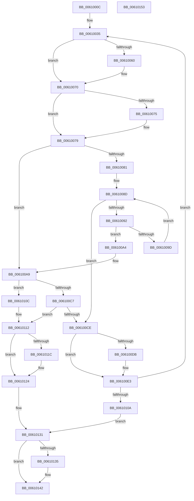

# SmKmVirtualLockCtxLockMemory

- RVA: `0x0061000C`–`0x00610154` (길이 `328` bytes)
- VA: `0x000000014061000C`
- 실행 섹션: `.text`
- PDB 이름 있음: `예`; PDB Function 태그: `아니요`
- unwind 정보 RVA: `0x000D1EAC`
- 디코드: `101`개 명령, `328/328` bytes 표시
- 미해석 바이트: `0` (있으면 어셈블리에 `.byte`로 보존)

> 이 문서는 커널 이미지의 기계어와 PDB 기호를 분석해 생성했습니다. 4번과 5번은 함수 원형과 자료형을 바이너리 사용 방식에서 추정한 C 해석이며 원본 소스 복구 결과는 아닙니다.

## 1. Dependencies

- 직접 호출 지점: **11**; 고유 호출 대상: **8**
- 직접 호출자로 확인된 함수: **1**
- RIP 상대 이미지 참조: **0**

### Outgoing calls
- `0x0061004F` → [KeAbPreAcquire](../21/KeAbPreAcquire_function_00210230.md) (function, `0x00210230`)
- `0x0061006B` → [ExfAcquirePushLockSharedEx](../21/ExfAcquirePushLockSharedEx_function_0021044C.md) (function, `0x0021044C`)
- `0x006100BC` → [ZwLockVirtualMemory](../6A/ZwLockVirtualMemory_function_006AF3B0.md) (function, `0x006AF3B0`)
- `0x006100DE` → [ExfReleasePushLockShared](../26/ExfReleasePushLockShared_function_00263440.md) (function, `0x00263440`)
- `0x006100E6` → [KeAbPostRelease](../2E/KeAbPostRelease_function_002E1600.md) (function, `0x002E1600`)
- `0x006100EB` → [KeLeaveCriticalRegion](../25/KeLeaveCriticalRegion_function_0025D8B0.md) (function, `0x0025D8B0`)
- `0x006100FB` → [SmKmVirtualLockContextIncreaseWsMin](../60/SmKmVirtualLockContextIncreaseWsMin_function_0060FE94.md) (function, `0x0060FE94`)
- `0x0061011F` → [ExfReleasePushLockShared](../26/ExfReleasePushLockShared_function_00263440.md) (function, `0x00263440`)
- `0x00610127` → [KeAbPostRelease](../2E/KeAbPostRelease_function_002E1600.md) (function, `0x002E1600`)
- `0x0061012C` → [KeLeaveCriticalRegion](../25/KeLeaveCriticalRegion_function_0025D8B0.md) (function, `0x0025D8B0`)
- `0x0061013D` → [SmKmVirtualLockCtxMemoryUnlocked](SmKmVirtualLockCtxMemoryUnlocked_function_0061015C.md) (function, `0x0061015C`)

### Direct callers
- [sub_006E8004](../6E/Unknown_function_006E8004.md) at `0x006E809F`

### Static image references
- 디코드된 RIP-relative 메모리 참조가 없습니다.

## 2. Other-region calls and transfers

- 다른 실행 섹션으로 향하는 call: **0**
- 별도 외부 분기/꼬리 이동을 확인하지 못했습니다.

## 3. Assembly (complete function range)

```asm
0061000C  4C 89 44 24 18                  mov qword ptr [rsp + 0x18], r8
00610011  48 89 54 24 10                  mov qword ptr [rsp + 0x10], rdx
00610016  53                              push rbx
00610017  55                              push rbp
00610018  56                              push rsi
00610019  57                              push rdi
0061001A  41 54                           push r12
0061001C  41 55                           push r13
0061001E  41 56                           push r14
00610020  48 83 EC 20                     sub rsp, 0x20
00610024  45 33 F6                        xor r14d, r14d
00610027  48 8B D9                        mov rbx, rcx
0061002A  41 8B EE                        mov ebp, r14d
0061002D  49 83 CD FF                     or r13, 0xffffffffffffffff
00610031  45 8D 66 11                     lea r12d, [r14 + 0x11]
00610035  65 48 8B 04 25 88 01 00 00      mov rax, qword ptr gs:[0x188]
0061003E  45 33 C0                        xor r8d, r8d
00610041  33 D2                           xor edx, edx
00610043  48 8B CB                        mov rcx, rbx
00610046  66 44 01 A8 E4 01 00 00         add word ptr [rax + 0x1e4], r13w
0061004E  90                              nop
0061004F  E8 DC 01 C0 FF                  call 0x140210230
00610054  48 8B F8                        mov rdi, rax
00610057  33 C0                           xor eax, eax
00610059  F0 4C 0F B1 23                  lock cmpxchg qword ptr [rbx], r12
0061005E  74 10                           je 0x140610070
00610060  4C 8B CB                        mov r9, rbx
00610063  4C 8B C7                        mov r8, rdi
00610066  33 D2                           xor edx, edx
00610068  48 8B CB                        mov rcx, rbx
0061006B  E8 DC 03 C0 FF                  call 0x14021044c
00610070  48 85 FF                        test rdi, rdi
00610073  74 04                           je 0x140610079
00610075  C6 47 0A 01                     mov byte ptr [rdi + 0xa], 1
00610079  48 8D 73 10                     lea rsi, [rbx + 0x10]
0061007D  85 ED                           test ebp, ebp
0061007F  75 28                           jne 0x1406100a9
00610081  48 8B 43 08                     mov rax, qword ptr [rbx + 8]
00610085  48 8B 54 24 70                  mov rdx, qword ptr [rsp + 0x70]
0061008A  48 03 D0                        add rdx, rax
0061008D  48 3B 16                        cmp rdx, qword ptr [rsi]
00610090  77 3C                           ja 0x1406100ce
00610092  F0 48 0F B1 53 08               lock cmpxchg qword ptr [rbx + 8], rdx
00610098  48 8B D0                        mov rdx, rax
0061009B  74 07                           je 0x1406100a4
0061009D  48 03 54 24 70                  add rdx, qword ptr [rsp + 0x70]
006100A2  EB E9                           jmp 0x14061008d
006100A4  BD 01 00 00 00                  mov ebp, 1
006100A9  41 B9 01 00 00 00               mov r9d, 1
006100AF  4C 8D 44 24 70                  lea r8, [rsp + 0x70]
006100B4  48 8D 54 24 68                  lea rdx, [rsp + 0x68]
006100B9  49 8B CD                        mov rcx, r13
006100BC  E8 EF F2 09 00                  call 0x1406af3b0
006100C1  8B F8                           mov edi, eax
006100C3  85 C0                           test eax, eax
006100C5  79 45                           jns 0x14061010c
006100C7  3D A1 00 00 C0                  cmp eax, 0xc00000a1
006100CC  75 44                           jne 0x140610112
006100CE  48 8B 3E                        mov rdi, qword ptr [rsi]
006100D1  49 8B C4                        mov rax, r12
006100D4  F0 4C 0F B1 33                  lock cmpxchg qword ptr [rbx], r14
006100D9  74 08                           je 0x1406100e3
006100DB  48 8B CB                        mov rcx, rbx
006100DE  E8 5D 33 C5 FF                  call 0x140263440
006100E3  48 8B CB                        mov rcx, rbx
006100E6  E8 15 15 CD FF                  call 0x1402e1600
006100EB  E8 C0 D7 C4 FF                  call 0x14025d8b0
006100F0  48 8B 54 24 70                  mov rdx, qword ptr [rsp + 0x70]
006100F5  4C 8B C7                        mov r8, rdi
006100F8  48 8B CB                        mov rcx, rbx
006100FB  E8 94 FD FF FF                  call 0x14060fe94
00610100  8B F8                           mov edi, eax
00610102  85 C0                           test eax, eax
00610104  0F 89 2B FF FF FF               jns 0x140610035
0061010A  EB 25                           jmp 0x140610131
0061010C  41 8B EE                        mov ebp, r14d
0061010F  41 8B FE                        mov edi, r14d
00610112  49 8B C4                        mov rax, r12
00610115  F0 4C 0F B1 33                  lock cmpxchg qword ptr [rbx], r14
0061011A  74 08                           je 0x140610124
0061011C  48 8B CB                        mov rcx, rbx
0061011F  E8 1C 33 C5 FF                  call 0x140263440
00610124  48 8B CB                        mov rcx, rbx
00610127  E8 D4 14 CD FF                  call 0x1402e1600
0061012C  E8 7F D7 C4 FF                  call 0x14025d8b0
00610131  85 ED                           test ebp, ebp
00610133  74 0D                           je 0x140610142
00610135  48 8B 54 24 70                  mov rdx, qword ptr [rsp + 0x70]
0061013A  48 8B CB                        mov rcx, rbx
0061013D  E8 1A 00 00 00                  call 0x14061015c
00610142  8B C7                           mov eax, edi
00610144  48 83 C4 20                     add rsp, 0x20
00610148  41 5E                           pop r14
0061014A  41 5D                           pop r13
0061014C  41 5C                           pop r12
0061014E  5F                              pop rdi
0061014F  5E                              pop rsi
00610150  5D                              pop rbp
00610151  5B                              pop rbx
00610152  C3                              ret
00610153  CC                              int3
```

## 4. C-style interpretation (structured pseudocode)

```c
__int64 __fastcall SmKmVirtualLockCtxLockMemory(__int64 a1, __int64 a2, __int64 a3)
{
    __int64 result;
    __int64 v_r13;
    __int64 v_r14;
    __int64 v_rsp;
    unsigned __int64 v_stack_p10;
    unsigned __int64 v_stack_p18;

    v_stack_p18 = a3;
    v_stack_p10 = a2;
    v_rsp = (v_rsp) - (32);
    v_r14 = 0;
    v_r13 = (v_r13) | (-1);
loc_00610035:
    a3 = 0;
    a2 = 0;
    result = KeAbPreAcquire(a1, a2, a3, a4);
    result = 0;
    if (!(condition_is_equal)) {
        a4 = a1;
        a3 = 0;
        a2 = 0;
        a1 = a1;
        result = ExfAcquirePushLockSharedEx(a1, a2, a3, a4);
    }
    if (result != 0) {
        *(unsigned __int8 *)(result + 10) = 1;
    }
    if (0 != 0) goto loc_006100A9;
    a2 = (v_stack_p18) + (*(unsigned __int64 *)(a1 + 8));
loc_0061008D:
    if (a2 > (*(unsigned __int64 *)(a1 + 16))) goto loc_006100CE;
    if (a2 == (*(unsigned __int64 *)(a1 + 16))) goto loc_006100A4;
    a2 = (*(unsigned __int64 *)(a1 + 8)) + (v_stack_p18);
    goto loc_0061008D;
loc_006100A4:
loc_006100A9:
    result = ZwLockVirtualMemory(v_r13, v_stack_p10, v_stack_p18, 1);
    if (!sign_flag) goto loc_0061010C;
    if (((unsigned int)(result)) != 0xC00000A1ULL) goto loc_00610112;
loc_006100CE:
    result = v_r14 + 17;
    if (((unsigned int)(result)) != 0xC00000A1ULL) {
        a1 = a1;
        result = ExfReleasePushLockShared(a1, v_stack_p10, v_stack_p18, 1);
    }
    result = KeAbPostRelease(a1, v_stack_p10, v_stack_p18, 1);
    result = KeLeaveCriticalRegion(a1, v_stack_p10, v_stack_p18, 1);
    result = SmKmVirtualLockContextIncreaseWsMin(a1, v_stack_p18, *(unsigned __int64 *)(a1 + 16), 1);
    if (!sign_flag) goto loc_00610035;
    goto loc_00610131;
loc_0061010C:
loc_00610112:
    result = v_r14 + 17;
    if ((unsigned int)(result) != 0) {
        a1 = a1;
        result = ExfReleasePushLockShared(a1, v_stack_p18, *(unsigned __int64 *)(a1 + 16), 1);
    }
    result = KeAbPostRelease(a1, v_stack_p18, *(unsigned __int64 *)(a1 + 16), 1);
    result = KeLeaveCriticalRegion(a1, v_stack_p18, *(unsigned __int64 *)(a1 + 16), 1);
loc_00610131:
    if (0 != 0) {
        a2 = v_stack_p18;
        a1 = a1;
        result = SmKmVirtualLockCtxMemoryUnlocked(a1, a2, *(unsigned __int64 *)(a1 + 16), 1);
    }
    v_rsp = (v_rsp) + (32);
    return 0;
}
```

## 5. (Beta) C Style

```c
int64_t SmKmVirtualLockCtxLockMemory(void *Arg1, int64_t Arg2, int64_t Arg3)
{
    uint8_t *arg1 = (uint8_t *)Arg1;

    int64_t result;
    int64_t local_r13;
    int64_t local_r14;
    int64_t local_rsp;
    uint64_t v_stack_p10;
    uint64_t v_stack_p18;

    v_stack_p18 = Arg3;
    v_stack_p10 = Arg2;
    local_rsp = (local_rsp) - (32);
    local_r14 = 0;
    local_r13 = (local_r13) | (-1);
loc_00610035:
    Arg3 = 0;
    Arg2 = 0;
    result = KeAbPreAcquire(Arg1, Arg2, Arg3, a4);
    result = 0;
    if (!(condition_is_equal)) {
        a4 = Arg1;
        Arg3 = 0;
        Arg2 = 0;
        Arg1 = Arg1;
        result = ExfAcquirePushLockSharedEx(Arg1, Arg2, Arg3, a4);
    }
    if (result != 0) {
        *(uint8_t *)(result + 0xA) = 1;
    }
    if (0 != 0) goto loc_006100A9;
    Arg2 = (v_stack_p18) + (*(uint64_t *)(arg1 + 0x8));
loc_0061008D:
    if (Arg2 > (*(uint64_t *)(arg1 + 0x10))) goto loc_006100CE;
    if (Arg2 == (*(uint64_t *)(arg1 + 0x10))) goto loc_006100A4;
    Arg2 = (*(uint64_t *)(arg1 + 0x8)) + (v_stack_p18);
    goto loc_0061008D;
loc_006100A4:
loc_006100A9:
    result = ZwLockVirtualMemory(local_r13, v_stack_p10, v_stack_p18, 1);
    if (!sign_flag) goto loc_0061010C;
    if (((uint32_t)(result)) != 0xC00000A1ULL) goto loc_00610112;
loc_006100CE:
    result = local_r14 + 17;
    if (((uint32_t)(result)) != 0xC00000A1ULL) {
        Arg1 = Arg1;
        result = ExfReleasePushLockShared(Arg1, v_stack_p10, v_stack_p18, 1);
    }
    result = KeAbPostRelease(Arg1, v_stack_p10, v_stack_p18, 1);
    result = KeLeaveCriticalRegion(Arg1, v_stack_p10, v_stack_p18, 1);
    result = SmKmVirtualLockContextIncreaseWsMin(Arg1, v_stack_p18, *(uint64_t *)(arg1 + 0x10), 1);
    if (!sign_flag) goto loc_00610035;
    goto loc_00610131;
loc_0061010C:
loc_00610112:
    result = local_r14 + 17;
    if ((uint32_t)(result) != 0) {
        Arg1 = Arg1;
        result = ExfReleasePushLockShared(Arg1, v_stack_p18, *(uint64_t *)(arg1 + 0x10), 1);
    }
    result = KeAbPostRelease(Arg1, v_stack_p18, *(uint64_t *)(arg1 + 0x10), 1);
    result = KeLeaveCriticalRegion(Arg1, v_stack_p18, *(uint64_t *)(arg1 + 0x10), 1);
loc_00610131:
    if (0 != 0) {
        Arg2 = v_stack_p18;
        Arg1 = Arg1;
        result = SmKmVirtualLockCtxMemoryUnlocked(Arg1, Arg2, *(uint64_t *)(arg1 + 0x10), 1);
    }
    local_rsp = (local_rsp) + (32);
    return 0;
}
```

### 관측된 메모리 오프셋

구조체 형식이 확인되지 않은 접근은 인자 기준의 오프셋으로만 기록했습니다.

| 기준 인자 | 오프셋 표현 | 폭 (bit) | 접근 |
|---|---:|---:|---|
| `Arg1` | `+ 0x0` | `64` | `R` |
| `Arg1` | `+ 0x8` | `64` | `R` |
| `Arg1` | `+ 0x10` | `64` | `R` |

## 6. Execution-region graph

[열기: 2D/3D 그래프와 함수 탐색 컨트롤 패널](../../../control-panel.html?section=text&rva=0x0061000C&view=graph)

- 2D 그래프는 위에서 아래로 흐르고, 3D 그래프는 빈 공간을 드래그해 회전합니다. Shift+드래그는 이동, 휠은 확대·축소, 함수 노드 선택은 대상 보고서 이동입니다.

### Static fallback


