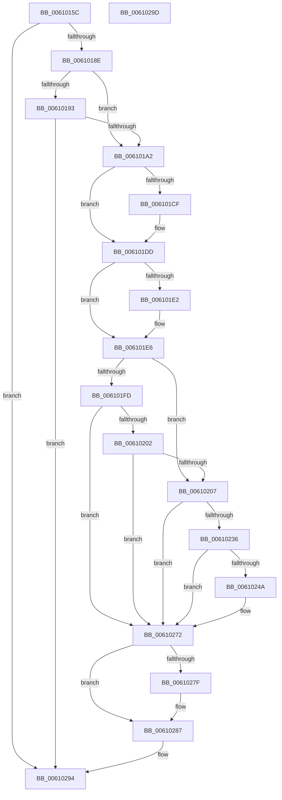

# SmKmVirtualLockCtxMemoryUnlocked

- RVA: `0x0061015C`–`0x0061029E` (길이 `322` bytes)
- VA: `0x000000014061015C`
- 실행 섹션: `.text`
- PDB 이름 있음: `예`; PDB Function 태그: `아니요`
- unwind 정보 RVA: `0x000C4B2C`
- 디코드: `91`개 명령, `322/322` bytes 표시
- 미해석 바이트: `0` (있으면 어셈블리에 `.byte`로 보존)

> 이 문서는 커널 이미지의 기계어와 PDB 기호를 분석해 생성했습니다. 4번과 5번은 함수 원형과 자료형을 바이너리 사용 방식에서 추정한 C 해석이며 원본 소스 복구 결과는 아닙니다.

## 1. Dependencies

- 직접 호출 지점: **7**; 고유 호출 대상: **7**
- 직접 호출자로 확인된 함수: **2**
- RIP 상대 이미지 참조: **0**

### Outgoing calls
- `0x006101BF` → [KeAbPreAcquire](../21/KeAbPreAcquire_function_00210230.md) (function, `0x00210230`)
- `0x006101D8` → [ExfAcquirePushLockExclusiveEx](../20/ExfAcquirePushLockExclusiveEx_function_0020FC90.md) (function, `0x0020FC90`)
- `0x0061022D` → [MmQueryWorkingSetInformation](../41/MmQueryWorkingSetInformation_function_0041CB20.md) (function, `0x0041CB20`)
- `0x0061026D` → [MmAdjustWorkingSetSizeEx](../47/MmAdjustWorkingSetSizeEx_function_0047D8D4.md) (function, `0x0047D8D4`)
- `0x00610282` → [ExfTryToWakePushLock](../26/ExfTryToWakePushLock_function_00265DD0.md) (function, `0x00265DD0`)
- `0x0061028A` → [KeAbPostRelease](../2E/KeAbPostRelease_function_002E1600.md) (function, `0x002E1600`)
- `0x0061028F` → [KeLeaveCriticalRegion](../25/KeLeaveCriticalRegion_function_0025D8B0.md) (function, `0x0025D8B0`)

### Direct callers
- [SmKmStoreHelperCommandProcess](../3C/SmKmStoreHelperCommandProcess_function_003C3AA4.md) at `0x003C3C58`
- [SmKmVirtualLockCtxLockMemory](SmKmVirtualLockCtxLockMemory_function_0061000C.md) at `0x0061013D`

### Static image references
- 디코드된 RIP-relative 메모리 참조가 없습니다.

## 2. Other-region calls and transfers

- 다른 실행 섹션으로 향하는 call: **0**
- 별도 외부 분기/꼬리 이동을 확인하지 못했습니다.

## 3. Assembly (complete function range)

```asm
0061015C  40 55                           push rbp
0061015E  53                              push rbx
0061015F  56                              push rsi
00610160  57                              push rdi
00610161  48 8B EC                        mov rbp, rsp
00610164  48 83 EC 58                     sub rsp, 0x58
00610168  48 83 65 38 00                  and qword ptr [rbp + 0x38], 0
0061016D  48 8B F9                        mov rdi, rcx
00610170  48 83 65 40 00                  and qword ptr [rbp + 0x40], 0
00610175  48 F7 DA                        neg rdx
00610178  F0 48 01 51 08                  lock add qword ptr [rcx + 8], rdx
0061017D  48 8B 49 08                     mov rcx, qword ptr [rcx + 8]
00610181  48 8B 47 10                     mov rax, qword ptr [rdi + 0x10]
00610185  48 3B C8                        cmp rcx, rax
00610188  0F 83 06 01 00 00               jae 0x140610294
0061018E  48 85 C9                        test rcx, rcx
00610191  74 0F                           je 0x1406101a2
00610193  48 2B C1                        sub rax, rcx
00610196  48 3D 00 00 80 00               cmp rax, 0x800000
0061019C  0F 82 F2 00 00 00               jb 0x140610294
006101A2  65 48 8B 04 25 88 01 00 00      mov rax, qword ptr gs:[0x188]
006101AB  48 83 CB FF                     or rbx, 0xffffffffffffffff
006101AF  45 33 C0                        xor r8d, r8d
006101B2  33 D2                           xor edx, edx
006101B4  48 8B CF                        mov rcx, rdi
006101B7  66 01 98 E4 01 00 00            add word ptr [rax + 0x1e4], bx
006101BE  90                              nop
006101BF  E8 6C 00 C0 FF                  call 0x140210230
006101C4  F0 48 0F BA 2F 00               lock bts qword ptr [rdi], 0
006101CA  48 8B F0                        mov rsi, rax
006101CD  73 0E                           jae 0x1406101dd
006101CF  4C 8B C7                        mov r8, rdi
006101D2  48 8B D0                        mov rdx, rax
006101D5  48 8B CF                        mov rcx, rdi
006101D8  E8 B3 FA BF FF                  call 0x14020fc90
006101DD  48 85 F6                        test rsi, rsi
006101E0  74 04                           je 0x1406101e6
006101E2  C6 46 0A 01                     mov byte ptr [rsi + 0xa], 1
006101E6  48 8B 4F 08                     mov rcx, qword ptr [rdi + 8]
006101EA  48 8B 47 10                     mov rax, qword ptr [rdi + 0x10]
006101EE  48 8B F0                        mov rsi, rax
006101F1  48 2B F1                        sub rsi, rcx
006101F4  48 81 FE 00 00 80 00            cmp rsi, 0x800000
006101FB  73 0A                           jae 0x140610207
006101FD  48 85 C9                        test rcx, rcx
00610200  75 70                           jne 0x140610272
00610202  48 85 C0                        test rax, rax
00610205  74 6B                           je 0x140610272
00610207  83 65 30 00                     and dword ptr [rbp + 0x30], 0
0061020B  48 8D 45 30                     lea rax, [rbp + 0x30]
0061020F  48 89 44 24 28                  mov qword ptr [rsp + 0x28], rax
00610214  4C 8D 4D 38                     lea r9, [rbp + 0x38]
00610218  48 8D 45 40                     lea rax, [rbp + 0x40]
0061021C  4C 8D 45 D8                     lea r8, [rbp - 0x28]
00610220  48 89 44 24 20                  mov qword ptr [rsp + 0x20], rax
00610225  48 8D 55 E0                     lea rdx, [rbp - 0x20]
00610229  48 8D 4D E8                     lea rcx, [rbp - 0x18]
0061022D  E8 EE C8 E0 FF                  call 0x14041cb20
00610232  85 C0                           test eax, eax
00610234  78 3C                           js 0x140610272
00610236  48 8B 4D 38                     mov rcx, qword ptr [rbp + 0x38]
0061023A  48 81 E6 00 00 C0 FF            and rsi, 0xffffffffffc00000
00610241  48 29 77 10                     sub qword ptr [rdi + 0x10], rsi
00610245  48 3B CE                        cmp rcx, rsi
00610248  72 28                           jb 0x140610272
0061024A  48 8B 55 40                     mov rdx, qword ptr [rbp + 0x40]
0061024E  48 8D 45 28                     lea rax, [rbp + 0x28]
00610252  48 89 44 24 28                  mov qword ptr [rsp + 0x28], rax
00610257  48 2B CE                        sub rcx, rsi
0061025A  83 64 24 20 00                  and dword ptr [rsp + 0x20], 0
0061025F  45 33 C9                        xor r9d, r9d
00610262  45 33 C0                        xor r8d, r8d
00610265  48 89 4D 38                     mov qword ptr [rbp + 0x38], rcx
00610269  C6 45 28 00                     mov byte ptr [rbp + 0x28], 0
0061026D  E8 62 D6 E6 FF                  call 0x14047d8d4
00610272  F0 48 0F C1 1F                  lock xadd qword ptr [rdi], rbx
00610277  80 E3 06                        and bl, 6
0061027A  80 FB 02                        cmp bl, 2
0061027D  75 08                           jne 0x140610287
0061027F  48 8B CF                        mov rcx, rdi
00610282  E8 49 5B C5 FF                  call 0x140265dd0
00610287  48 8B CF                        mov rcx, rdi
0061028A  E8 71 13 CD FF                  call 0x1402e1600
0061028F  E8 1C D6 C4 FF                  call 0x14025d8b0
00610294  48 83 C4 58                     add rsp, 0x58
00610298  5F                              pop rdi
00610299  5E                              pop rsi
0061029A  5B                              pop rbx
0061029B  5D                              pop rbp
0061029C  C3                              ret
0061029D  CC                              int3
```

## 4. C-style interpretation (structured pseudocode)

```c
__int64 __fastcall SmKmVirtualLockCtxMemoryUnlocked(__int64 a1, __int64 a2, int a3)
{
    __int64 result;
    __int64 v_rbx;
    __int64 v_rsi;
    __int64 v_rsp;
    unsigned __int64 v_stack_m38;
    unsigned __int64 v_stack_m40;
    unsigned __int64 v_stack_m48;
    unsigned __int64 v_stack_m50;
    unsigned __int64 v_stack_m58;
    unsigned int v_stack_p10;
    unsigned __int64 v_stack_p18;
    unsigned __int64 v_stack_p20;
    unsigned __int64 v_stack_p8;

    v_rsp = (v_rsp) - (88);
    a2 = -(a2);
    if ((*(unsigned __int64 *)(a1 + 8)) >= (*(unsigned __int64 *)(a1 + 16))) goto loc_00610294;
    if (*(unsigned __int64 *)(a1 + 8) == 0) goto loc_006101A2;
    result = (*(unsigned __int64 *)(a1 + 16)) - (*(unsigned __int64 *)(a1 + 8));
    if (result < 0x800000ULL) goto loc_00610294;
loc_006101A2:
    v_rbx = (v_rbx) | (-1);
    a3 = 0;
    a2 = 0;
    result = KeAbPreAcquire(a1, a2, a3, a4);
    if (!(condition_is_above_or_equal)) {
        a3 = a1;
        a2 = result;
        a1 = a1;
        result = ExfAcquirePushLockExclusiveEx(a1, a2, a3, a4);
    }
    if (result != 0) {
        *(unsigned __int8 *)(result + 10) = 1;
    }
    v_rsi = (*(unsigned __int64 *)(a1 + 16)) - (*(unsigned __int64 *)(a1 + 8));
    if (v_rsi >= 0x800000ULL) goto loc_00610207;
    if (*(unsigned __int64 *)(a1 + 8) != 0) goto loc_00610272;
    if (*(unsigned __int64 *)(a1 + 16) == 0) goto loc_00610272;
loc_00610207:
    v_stack_m50 = v_stack_p10;
    v_stack_m58 = v_stack_p20;
    result = MmQueryWorkingSetInformation(v_stack_m38, v_stack_m40, v_stack_m48, v_stack_p18);
    if (sign_flag) goto loc_00610272;
    v_rsi = (v_rsi) & (0xFFFFFFFFFFC00000ULL);
    if (v_stack_p18 >= v_rsi) {
        a2 = v_stack_p20;
        result = v_stack_p8;
        v_stack_m50 = result;
        a1 = (v_stack_p18) - (v_rsi);
        a4 = 0;
        a3 = 0;
        v_stack_p18 = a1;
        v_stack_p8 = 0;
        result = MmAdjustWorkingSetSizeEx(a1, a2, a3, a4);
    }
    v_rbx = (unsigned __int8)((v_rbx) & (6));
    if (((unsigned __int8)(v_rbx)) == 2) {
        a1 = a1;
        result = ExfTryToWakePushLock(a1, a2, a3, a4);
    }
    result = KeAbPostRelease(a1, a2, a3, a4);
    result = KeLeaveCriticalRegion(a1, a2, a3, a4);
loc_00610294:
    v_rsp = (v_rsp) + (88);
    return result;
}
```

## 5. (Beta) C Style

```c
int64_t SmKmVirtualLockCtxMemoryUnlocked(void *Arg1, int64_t Arg2, int32_t Arg3)
{
    uint8_t *arg1 = (uint8_t *)Arg1;

    int64_t result;
    int64_t local_rbx;
    int64_t local_rsi;
    int64_t local_rsp;
    uint64_t v_stack_m38;
    uint64_t v_stack_m40;
    uint64_t v_stack_m48;
    uint64_t v_stack_m50;
    uint64_t v_stack_m58;
    uint32_t v_stack_p10;
    uint64_t v_stack_p18;
    uint64_t v_stack_p20;
    uint64_t v_stack_p8;

    local_rsp = (local_rsp) - (88);
    Arg2 = -(Arg2);
    if ((*(uint64_t *)(arg1 + 0x8)) >= (*(uint64_t *)(arg1 + 0x10))) goto loc_00610294;
    if (*(uint64_t *)(arg1 + 0x8) == 0) goto loc_006101A2;
    result = (*(uint64_t *)(arg1 + 0x10)) - (*(uint64_t *)(arg1 + 0x8));
    if (result < 0x800000ULL) goto loc_00610294;
loc_006101A2:
    local_rbx = (local_rbx) | (-1);
    Arg3 = 0;
    Arg2 = 0;
    result = KeAbPreAcquire(Arg1, Arg2, Arg3, a4);
    if (!(condition_is_above_or_equal)) {
        Arg3 = Arg1;
        Arg2 = result;
        Arg1 = Arg1;
        result = ExfAcquirePushLockExclusiveEx(Arg1, Arg2, Arg3, a4);
    }
    if (result != 0) {
        *(uint8_t *)(result + 0xA) = 1;
    }
    local_rsi = (*(uint64_t *)(arg1 + 0x10)) - (*(uint64_t *)(arg1 + 0x8));
    if (local_rsi >= 0x800000ULL) goto loc_00610207;
    if (*(uint64_t *)(arg1 + 0x8) != 0) goto loc_00610272;
    if (*(uint64_t *)(arg1 + 0x10) == 0) goto loc_00610272;
loc_00610207:
    v_stack_m50 = v_stack_p10;
    v_stack_m58 = v_stack_p20;
    result = MmQueryWorkingSetInformation(v_stack_m38, v_stack_m40, v_stack_m48, v_stack_p18);
    if (sign_flag) goto loc_00610272;
    local_rsi = (local_rsi) & (0xFFFFFFFFFFC00000ULL);
    if (v_stack_p18 >= local_rsi) {
        Arg2 = v_stack_p20;
        result = v_stack_p8;
        v_stack_m50 = result;
        Arg1 = (v_stack_p18) - (local_rsi);
        a4 = 0;
        Arg3 = 0;
        v_stack_p18 = Arg1;
        v_stack_p8 = 0;
        result = MmAdjustWorkingSetSizeEx(Arg1, Arg2, Arg3, a4);
    }
    local_rbx = (uint8_t)((local_rbx) & (6));
    if (((uint8_t)(local_rbx)) == 2) {
        Arg1 = Arg1;
        result = ExfTryToWakePushLock(Arg1, Arg2, Arg3, a4);
    }
    result = KeAbPostRelease(Arg1, Arg2, Arg3, a4);
    result = KeLeaveCriticalRegion(Arg1, Arg2, Arg3, a4);
loc_00610294:
    local_rsp = (local_rsp) + (88);
    return result;
}
```

### 관측된 메모리 오프셋

구조체 형식이 확인되지 않은 접근은 인자 기준의 오프셋으로만 기록했습니다.

| 기준 인자 | 오프셋 표현 | 폭 (bit) | 접근 |
|---|---:|---:|---|
| `Arg1` | `+ 0x0` | `64` | `R/W` |
| `Arg1` | `+ 0x8` | `64` | `R` |
| `Arg1` | `+ 0x8` | `64` | `R/W` |
| `Arg1` | `+ 0x10` | `64` | `R` |
| `Arg1` | `+ 0x10` | `64` | `R/W` |

## 6. Execution-region graph

[열기: 2D/3D 그래프와 함수 탐색 컨트롤 패널](../../../control-panel.html?section=text&rva=0x0061015C&view=graph)

- 2D 그래프는 위에서 아래로 흐르고, 3D 그래프는 빈 공간을 드래그해 회전합니다. Shift+드래그는 이동, 휠은 확대·축소, 함수 노드 선택은 대상 보고서 이동입니다.

### Static fallback


